# CMRB Dossier fonctionnel et technique global avant contrat

**Centre Médical de la Riviera Bonoumin**  
**Version :** 1.0  
**Date :** 17 septembre 2026  
**Statut :** `READY_FOR_CLIENT_GLOBAL_APPROVAL`

Ce dossier définit la baseline fonctionnelle et technique de la première version du logiciel CMRB. Il remplace les validations élémentaires par un ensemble cohérent de décisions de cadrage. L'approbation demandée au client porte sur le document complet; toute évolution ultérieure suit la procédure de changement décrite à la fin.

## Table des matières

1. [Résumé exécutif](#section-1)
2. [Objectifs et résultats attendus](#section-2)
3. [Périmètre V1 et exclusions](#section-3)
4. [Principes de cadrage](#section-4)
5. [Acteurs et responsabilités](#section-5)
6. [Permissions](#section-6)
7. [Parcours patient global](#section-7)
8. [Workflows détaillés](#section-8)
9. [Règles métier](#section-9)
10. [Dossier patient et dossier médical](#section-10)
11. [Prestations et séjours](#section-11)
12. [Facturation paiements stock RH et rapports](#section-12)
13. [Portail patient et copies](#section-13)
14. [Modèle de données](#section-14)
15. [Sécurité confidentialité et audit](#section-15)
16. [Exigences non fonctionnelles](#section-16)
17. [Intégrations externes](#section-17)
18. [Migration et mise en production](#section-18)
19. [Recette et acceptation](#section-19)
20. [Décisions clôturées](#section-20)
21. [Risques résiduels](#section-21)
22. [Gestion des changements](#section-22)
23. [Références réglementaires et fiscales](#section-23)
24. [Approbation globale](#section-24)

<a id="section-1"></a>

## 1 Résumé exécutif

CMRB sera une application web responsive couvrant l'administration des patients, rendez-vous, dossier clinique, consultation, observation et hospitalisation, laboratoire, imagerie, pharmacie, facturation, paiements, organismes payeurs, stock, personnel, bulletins de paie documentaires, rapports et habilitations. La baseline compte 106 exigences et compléments, 33 workflows, 15 acteurs, 29 concepts, 76 attributs, 18 règles métier, 35 décisions clôturées et 11 protocoles non fonctionnels.

Le principe directeur est la séparation des responsabilités : l'accueil gère l'administratif et peut encaisser sans rembourser; les paramédicaux documentent les soins sans diagnostiquer ni prescrire; les médecins valident et publient le clinique; la comptabilité émet, rapproche et corrige la finance; la direction délègue les habilitations sans acquérir un accès clinique général.

<a id="section-2"></a>

## 2 Objectifs et résultats attendus

- Unifier le parcours patient de l'inscription à la clôture financière.
- Réduire les doubles saisies et conserver une piste d'audit exploitable.
- Protéger les données de santé par moindre privilège, publication contrôlée et absence de destruction silencieuse.
- Produire une facturation traçable en XOF et rapprochable avec la plateforme FNE.
- Donner au client une recette mesurable et au développeur des règles déterministes.

<a id="section-3"></a>

## 3 Périmètre V1 et exclusions

**Inclus.** Portail web patient, accueil, agenda, rappels, dossier administratif, constantes, consultation, résultats, séjour, prescriptions visibles quinze jours, copies contrôlées, factures patient et organismes, paiements manuels, paiement en ligne automatisé, FNE par accès plateforme et rapprochement, stocks avec lots pharmaceutiques, registre RH, bulletins fondés sur des montants approuvés, rapports et RBAC.

**Exclus de la V1.** Application mobile native, télémédecine, interopérabilité HL7 FHIR DICOM, API FNE,  moteur légal complet de paie, multi-site, couverture secondaire cumulée et rapports médicaux avancés. Ces fonctions suivent une demande de changement et ne sont pas implicitement comprises dans le prix ou le calendrier.

<a id="section-4"></a>

## 4 Principes de cadrage

- Le SRS reste la preuve source; les décisions de cadrage complètent sans réécrire l'historique.
- Toute donnée clinique validée est versionnée; correction par addendum, jamais par effacement.
- Toute donnée publiée au patient a un auteur, un valideur, une version et une date de publication.
- Toute écriture financière émise est corrigée par contrepassation ou avoir.
- Les paramètres susceptibles d'évoluer sont administrables et historisés.
- Les identités, tarifs négociés et dates commerciales absents ne sont pas inventés.

<a id="section-5"></a>

## 5 Acteurs et responsabilités

L'administration des habilitations est une fonction séparée, déléguée par la direction et sans accès clinique implicite. Unité, emploi et compte applicatif ne sont pas synonymes. ACT-014 et ACT-015 sont des interfaces techniques abstraites; le fournisseur reste une variable contractuelle.

### ACT-001 — Personnel administratif

| Champ | Valeur |
| --- | --- |
| Nature | Rôle métier interne |
| Source | §2.2; UC-07/08 |
| Responsabilités | Inscription et rendez-vous; facturation/paiement selon la séparation des tâches Q-024. |
| Opérations et limites | Données administratives; aucune écriture clinique générale autorisée. |
| Workflows | WF-001, WF-002, WF-003, WF-004, WF-005, WF-006, WF-007, WF-008, WF-012, WF-016, WF-017, WF-019, WF-032 |
| Données impliquées | ENT-001, ENT-002, ENT-004, ENT-005, ENT-006, ENT-007, ENT-008, ENT-009, ENT-010, ENT-011, ENT-016, ENT-017, ENT-022, ENT-026, ENT-027, ENT-028 |
| Lecture / création / modification | Voir opérations détaillées par workflow et matrice; présence dans le workflow ne vaut pas autorisation |
| Autorité d’approbation | Selon la matrice définitive et Q-005, Q-017, Q-024 ou Q-025 |
| Permissions | Matrice ROLE_PERMISSION_MATRIX.md; contrôle serveur par action et ressource |

### ACT-002 — Médecin

| Champ | Valeur |
| --- | --- |
| Nature | Rôle métier interne |
| Source | §2.2; §4.3 |
| Responsabilités | Consultation et dossier clinique; orientation médicale. |
| Opérations et limites | Dossier médical; aucune attribution de droit comptable supplémentaire. |
| Workflows | WF-002, WF-009, WF-010, WF-011, WF-012, WF-013, WF-014, WF-015, WF-032 |
| Données impliquées | ENT-001, ENT-002, ENT-004, ENT-005, ENT-006, ENT-008, ENT-012, ENT-013, ENT-015, ENT-016, ENT-017, ENT-018, ENT-019, ENT-020, ENT-022 |
| Lecture / création / modification | Voir opérations détaillées par workflow et matrice; présence dans le workflow ne vaut pas autorisation |
| Autorité d’approbation | Selon la matrice définitive et Q-005, Q-017, Q-024 ou Q-025 |
| Permissions | Matrice ROLE_PERMISSION_MATRIX.md; contrôle serveur par action et ressource |

### ACT-003 — Personnel paramédical / infirmier

| Champ | Valeur |
| --- | --- |
| Nature | Rôle métier interne |
| Source | §2.2; commentaire 173 |
| Responsabilités | Constantes avant médecin; médicaments selon Q-002. |
| Opérations et limites | Constantes, observations de soins et administrations prescrites selon Q-002; diagnostic et prescription interdits. |
| Workflows | WF-009, WF-010, WF-012, WF-032 |
| Données impliquées | ENT-001, ENT-002, ENT-004, ENT-006, ENT-008, ENT-015, ENT-016, ENT-017, ENT-019, ENT-020 |
| Lecture / création / modification | Voir opérations détaillées par workflow et matrice; présence dans le workflow ne vaut pas autorisation |
| Autorité d’approbation | Selon la matrice définitive et Q-005, Q-017, Q-024 ou Q-025 |
| Permissions | Matrice ROLE_PERMISSION_MATRIX.md; contrôle serveur par action et ressource |

### ACT-004 — Service comptable

| Champ | Valeur |
| --- | --- |
| Nature | Rôle métier interne de comptabilité |
| Source | §2.2; §4.10 |
| Responsabilités | Facturation, paiements et rapports financiers. |
| Opérations et limites | Données financières; matrice ne prévoit pas accès au dossier médical. |
| Workflows | WF-016, WF-017, WF-018, WF-019, WF-020, WF-021, WF-022, WF-026, WF-032 |
| Données impliquées | ENT-001, ENT-002, ENT-004, ENT-008, ENT-009, ENT-010, ENT-011, ENT-016, ENT-017, ENT-022, ENT-023, ENT-028, ENT-029 |
| Lecture / création / modification | Voir opérations détaillées par workflow et matrice; présence dans le workflow ne vaut pas autorisation |
| Autorité d’approbation | Selon la matrice définitive et Q-005, Q-017, Q-024 ou Q-025 |
| Permissions | Matrice ROLE_PERMISSION_MATRIX.md; contrôle serveur par action et ressource |

### ACT-005 — Patient

| Champ | Valeur |
| --- | --- |
| Nature | Acteur externe |
| Source | §2.2; commentaire 176 |
| Responsabilités | Inscription, réservation, consultation personnelle et demande de copie. |
| Opérations et limites | Périmètre personnel seulement; identité et représentants définis par la baseline. |
| Workflows | WF-001, WF-005, WF-007, WF-008, WF-019, WF-023, WF-024, WF-025, WF-032 |
| Données impliquées | ENT-001, ENT-002, ENT-004, ENT-005, ENT-006, ENT-007, ENT-009, ENT-010, ENT-011, ENT-018, ENT-019, ENT-020, ENT-021, ENT-024, ENT-026, ENT-027, ENT-028 |
| Lecture / création / modification | Voir opérations détaillées par workflow et matrice; présence dans le workflow ne vaut pas autorisation |
| Autorité d’approbation | Selon la matrice définitive et Q-005, Q-017, Q-024 ou Q-025 |
| Permissions | Matrice ROLE_PERMISSION_MATRIX.md; contrôle serveur par action et ressource |

### ACT-006 — Assureur / mutuelle

| Champ | Valeur |
| --- | --- |
| Nature | Organisme externe payeur |
| Source | §2.2; §7.5 |
| Responsabilités | Destinataire financier et débiteur tiers. |
| Opérations et limites | Aucun compte ni accès direct dans la V1; échanges gérés par la comptabilité. |
| Workflows | WF-018, WF-019, WF-020 |
| Données impliquées | ENT-004, ENT-008, ENT-009, ENT-010, ENT-011, ENT-022, ENT-023, ENT-028 |
| Lecture / création / modification | Voir opérations détaillées par workflow et matrice; présence dans le workflow ne vaut pas autorisation |
| Autorité d’approbation | Selon la matrice définitive et Q-005, Q-017, Q-024 ou Q-025 |
| Permissions | Matrice ROLE_PERMISSION_MATRIX.md; contrôle serveur par action et ressource |

### ACT-007 — Responsable RH / paie

| Champ | Valeur |
| --- | --- |
| Nature | Rôle métier interne |
| Source | §2.2; §4.8 |
| Responsabilités | Personnel, préparation de la paie et bulletins selon Q-022; aucun calcul social ou fiscal automatique sans paramétrage approuvé. |
| Opérations et limites | Données RH et salaire; aucun droit clinique justifié. |
| Workflows | WF-027, WF-028, WF-032 |
| Données impliquées | ENT-001, ENT-002, ENT-003, ENT-004, ENT-014, ENT-026 |
| Lecture / création / modification | Voir opérations détaillées par workflow et matrice; présence dans le workflow ne vaut pas autorisation |
| Autorité d’approbation | Selon la matrice définitive et Q-005, Q-017, Q-024 ou Q-025 |
| Permissions | Matrice ROLE_PERMISSION_MATRIX.md; contrôle serveur par action et ressource |

### ACT-008 — Gestionnaire de stock / pharmacie

| Champ | Valeur |
| --- | --- |
| Nature | Profil cité; séparation éventuelle arrêté pour la baseline |
| Source | §2.2; §4.10 |
| Responsabilités | Produits, mouvements, seuils et implication pharmacie. |
| Opérations et limites | Produits, lots, mouvements et dispensation; lecture limitée à l'identité et à la prescription active selon Q-018/Q-023. |
| Workflows | WF-015, WF-029, WF-030, WF-031, WF-032 |
| Données impliquées | ENT-001, ENT-002, ENT-004, ENT-008, ENT-012, ENT-013, ENT-022 |
| Lecture / création / modification | Voir opérations détaillées par workflow et matrice; présence dans le workflow ne vaut pas autorisation |
| Autorité d’approbation | Selon la matrice définitive et Q-005, Q-017, Q-024 ou Q-025 |
| Permissions | Matrice ROLE_PERMISSION_MATRIX.md; contrôle serveur par action et ressource |

### ACT-009 — Direction

| Champ | Valeur |
| --- | --- |
| Nature | Rôle de direction pour rapports, approbations et délégation des habilitations |
| Source | UC-09 |
| Responsabilités | Consultation de rapports et arbitrage projet. |
| Opérations et limites | Rapports financiers; droits techniques définis par la baseline. |
| Workflows | WF-026 |
| Données impliquées | ENT-008, ENT-009, ENT-010, ENT-011, ENT-029 |
| Lecture / création / modification | Voir opérations détaillées par workflow et matrice; présence dans le workflow ne vaut pas autorisation |
| Autorité d’approbation | Selon la matrice définitive et Q-005, Q-017, Q-024 ou Q-025 |
| Permissions | Matrice ROLE_PERMISSION_MATRIX.md; contrôle serveur par action et ressource |

### ACT-010 — Assistante

| Champ | Valeur |
| --- | --- |
| Nature | Fonction citée, pas rôle autonome validé |
| Source | §4.4.3 |
| Responsabilités | Saisie de résultats de laboratoire. |
| Opérations et limites | Rattachement organisationnel et validation clinique définis par la baseline. |
| Workflows | WF-013 |
| Données impliquées | ENT-004, ENT-008, ENT-018, ENT-020 |
| Lecture / création / modification | Voir opérations détaillées par workflow et matrice; présence dans le workflow ne vaut pas autorisation |
| Autorité d’approbation | Selon la matrice définitive et Q-005, Q-017, Q-024 ou Q-025 |
| Permissions | Matrice ROLE_PERMISSION_MATRIX.md; contrôle serveur par action et ressource |

### ACT-011 — Employé

| Champ | Valeur |
| --- | --- |
| Nature | Personne et destinataire |
| Source | §3.1 RH |
| Responsabilités | Destinataire notification le jour de paie. |
| Opérations et limites | Aucun libre-service RH ni compte employé déduit. |
| Workflows | WF-028 |
| Données impliquées | ENT-003, ENT-014, ENT-026 |
| Lecture / création / modification | Voir opérations détaillées par workflow et matrice; présence dans le workflow ne vaut pas autorisation |
| Autorité d’approbation | Selon la matrice définitive et Q-005, Q-017, Q-024 ou Q-025 |
| Permissions | Matrice ROLE_PERMISSION_MATRIX.md; contrôle serveur par action et ressource |

### ACT-012 — Système CMRB

| Champ | Valeur |
| --- | --- |
| Nature | Acteur système |
| Source | §2.1; §5.1 |
| Responsabilités | Application web, contrôles et enregistrement. |
| Opérations et limites | Aucune autorité métier de décision autonome présumée. |
| Workflows | WF-001, WF-002, WF-003, WF-004, WF-005, WF-006, WF-007, WF-008, WF-009, WF-010, WF-011, WF-012, WF-013, WF-014, WF-015, WF-016, WF-017, WF-018, WF-019, WF-020, WF-021, WF-022, WF-023, WF-024, WF-025, WF-026, WF-027, WF-028, WF-029, WF-030, WF-031, WF-032, WF-033 |
| Données impliquées | ENT-001, ENT-002, ENT-003, ENT-004, ENT-005, ENT-006, ENT-007, ENT-008, ENT-009, ENT-010, ENT-011, ENT-012, ENT-013, ENT-014, ENT-015, ENT-016, ENT-017, ENT-018, ENT-019, ENT-020, ENT-021, ENT-022, ENT-023, ENT-024, ENT-025, ENT-026, ENT-027, ENT-028, ENT-029 |
| Lecture / création / modification | Voir opérations détaillées par workflow et matrice; présence dans le workflow ne vaut pas autorisation |
| Autorité d’approbation | Selon la matrice définitive et Q-005, Q-017, Q-024 ou Q-025 |
| Permissions | Matrice ROLE_PERMISSION_MATRIX.md; contrôle serveur par action et ressource |

### ACT-013 — Plateforme FNE

| Champ | Valeur |
| --- | --- |
| Nature | Système externe référencé |
| Source | §4.5; §11 |
| Responsabilités | Destination du bouton FNE. |
| Opérations et limites | Pas d’échange automatique de données confirmé. |
| Workflows | WF-022 |
| Données impliquées | ENT-009 |
| Lecture / création / modification | Voir opérations détaillées par workflow et matrice; présence dans le workflow ne vaut pas autorisation |
| Autorité d’approbation | Selon la matrice définitive et Q-005, Q-017, Q-024 ou Q-025 |
| Permissions | Matrice ROLE_PERMISSION_MATRIX.md; contrôle serveur par action et ressource |

### ACT-014 — Service de notification

| Champ | Valeur |
| --- | --- |
| Nature | Interface technique externe |
| Source | commentaire 170; §3.1 RH |
| Responsabilités | Transport des notifications si externalisé. |
| Opérations et limites | Contenu minimal retenu pour la baseline; fournisseur configuré au déploiement et isolé par adaptateur. |
| Workflows | WF-007, WF-028 |
| Données impliquées | ENT-003, ENT-007, ENT-014, ENT-026, ENT-027 |
| Lecture / création / modification | Voir opérations détaillées par workflow et matrice; présence dans le workflow ne vaut pas autorisation |
| Autorité d’approbation | Selon la matrice définitive et Q-005, Q-017, Q-024 ou Q-025 |
| Permissions | Matrice ROLE_PERMISSION_MATRIX.md; contrôle serveur par action et ressource |

### ACT-015 — Service de paiement

| Champ | Valeur |
| --- | --- |
| Nature | Interface technique externe |
| Source | §4.6; commentaire 168 |
| Responsabilités | Transaction en ligne si intégration retenue. |
| Opérations et limites | Aucune API, marque ou responsabilité de confirmation arrêtée. |
| Workflows | WF-019 |
| Données impliquées | ENT-009, ENT-010, ENT-011, ENT-028 |
| Lecture / création / modification | Voir opérations détaillées par workflow et matrice; présence dans le workflow ne vaut pas autorisation |
| Autorité d’approbation | Selon la matrice définitive et Q-005, Q-017, Q-024 ou Q-025 |
| Permissions | Matrice ROLE_PERMISSION_MATRIX.md; contrôle serveur par action et ressource |


<a id="section-6"></a>

## 6 Permissions

**C** créer, **L** lire, **M** modifier, **V** valider, **P** publier, **A** annuler, **R** rembourser, **E** exporter, **G** administrer, **N** interdit. Toute action est contrôlée côté serveur sur la ressource et journalisée. L'absence d'une lettre vaut refus.

| Action | Accueil ACT-001 | Médecin ACT-002 | Paramédical ACT-003 | Compta ACT-004 | Patient ACT-005 | RH ACT-007 | Stock ACT-008 | Direction ACT-009 |
| --- | --- | --- | --- | --- | --- | --- | --- | --- |
| Dossier administratif | C/L/M | L | L épisode actif | L identité facturation | C/L propre | L identité emploi | N | L/E |
| Rendez-vous | C/L/M/A | L/M disponibilités | L/M arrivée | L | C/L/M/A propre | N | N | L/E |
| Constantes et soins | N | C/L/M/V | C/L/M avant validation | N | L publié seulement | N | N | L audit |
| Diagnostic, prescription, conclusion | N | C/L/M/V/P | L prescriptions actives | N | L publié selon portail | N | N | L audit médical délégué |
| Résultats laboratoire/imagerie | N | L/V/P | C/L/M brouillon | N | L publié | N | N | L audit médical délégué |
| Factures patient brouillon | C/L/M | L | N | C/L/M/V/P/A/E | L propre émise | N | N | L/E |
| Paiements patient | C/L | L | N | C/L/M/V/R/E | L propre | N | N | L/E |
| Factures organismes et rapprochement | L | L | N | C/L/M/V/P/A/R/E | N | N | N | L/E |
| Tarifs, taxes et conventions | N | L | N | C/L/M/V | N | N | N | L/V/E |
| Produits et stock | L disponibilité | L disponibilité | L disponibilité | L valorisation | N | N | C/L/M/V/E | L/E |
| Personnel et paie | N | N | N | L/V montants | N | C/L/M/V/P/E | N | L/V/E |
| Rapports financiers | N | L agrégé autorisé | N | L/E | N | N | L stock | L/E |
| Copie administrative/financière | C remise | N | N | C/V/P | C/L propre | N | N | L/E |
| Copie clinique | N | V/P | N | N | C/L propre | N | N | V/P directeur médical délégué |
| Comptes et habilitations | N | N | N | N | N | N | N | G via administrateur désigné |
| Suppression physique clinique | N | N | N | N | N | N | N | N |

### Règles de cumul et contrôle

- Les rôles sont cumulatifs uniquement après approbation; un refus explicite de sécurité prévaut sur une autorisation de module.
- L'accueil encaisse mais ne rembourse pas; la comptabilité rapproche et rembourse; la direction approuve les conventions et les exceptions.
- L'accès d'urgence clinique est réservé à un médecin, exige un motif et déclenche une alerte au directeur médical.
- Le patient n'accède qu'aux ressources rattachées à son identité vérifiée et publiées.
- Les organismes payeurs ne disposent d'aucun compte direct en V1; les échanges passent par la comptabilité.

Statut : `CLOSED_FOR_BASELINE`. Décisions : Q-002, Q-003, Q-005, Q-017, Q-024, Q-025 et Q-031.


<a id="section-7"></a>

## 7 Parcours patient global

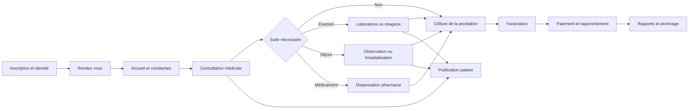

Le chemin réel est conditionnel. Un rendez-vous n'est pas obligatoire pour une urgence ou une consultation sans réservation. Une prestation n'est facturable qu'après enregistrement de sa réalisation ou de la dispensation correspondante.

<a id="section-8"></a>

## 8 Workflows détaillés

### WF-001 — Inscrire un patient

**Finalité.** Inscription enregistrée; statut et numéro patient défini par la décision de baseline associées.

**Acteur principal :** ACT-005 (inscription par le patient) ou ACT-001 (inscription à l’accueil).

Les autres acteurs concernés et leurs responsabilités figurent dans le tableau ci-dessous ; leur présence ne vaut pas attribution de permission.

| Acteur | Responsabilité dans le parcours |
| --- | --- |
| ACT-001 | Personnel administratif: Inscription et rendez-vous; facturation/paiement en conflit avec matrice. |
| ACT-005 | Patient: Inscription, réservation, consultation personnelle et demande de copie. |
| ACT-012 | Système CMRB: Application web, contrôles et enregistrement. |

**Déclencheur.** Demande d’inscription au centre ou en ligne.

**Préconditions.** Le patient ou l’accueil engage une inscription. Le formulaire, les champs obligatoires, la détection des doublons et les modalités d’inscription publique restent défini par la baseline (Q-011, Q-025).

**Scénario principal.**

1. Le patient fournit les renseignements via le portail ou à l’accueil.
2. L’accueil ou le patient renseigne le formulaire du canal retenu.
3. Le système applique les validations dont la liste est régi par la décision associée.
4. Le système enregistre l’inscription et son rattachement au dossier administratif.

**Variantes et erreurs.**

Inscription au centre et inscription en ligne sont deux canaux du même besoin; validation humaine de l’inscription en ligne définie par la baseline.

Une identité incomplète est rejetée; un homonyme ou doublon déclenche une revue humaine sans fusion automatique; après échec, la saisie est reprise sans créer de doublon.

Décision de cadrage technique : toute mutation est atomique, idempotente lorsqu'une clé de requête existe et protégée par contrôle de version. Une opération refusée n'a aucun effet métier; les doublons sont signalés et aucune fusion ou correction automatique n'est autorisée.

**Règles et autorisations.**

Les exigences liées, règles transverses et décisions Q citées sont normatives pour ce workflow.

**SEC-001** — ACT-001 ou ACT-005 peut initier l’inscription. Le contrôle d’identité, la validation et l’exposition publique restent Q-011/Q-025.

La [matrice par action](ROLE_PERMISSION_MATRIX.md) est normative. Le serveur contrôle rôle, action et ressource selon Q-025/Q-031; tout conflit ou droit absent produit un refus tracé. Une dérogation exige un accès d'urgence médical motivé ou une demande de changement approuvée.

**Données.**

L = lecture, C = création, M = modification, X = opération spéciale définie par la matrice et la décision applicable. Les mutations constituent la baseline fonctionnelle; le schéma physique en sera dérivé.

| Entité | Concept | Opération de baseline | Condition |
| --- | --- | --- | --- |
| ENT-004 | Patient | C | Sous réserve des droits et cardinalités; voir dictionnaire |
| ENT-005 | Dossier administratif | C | Sous réserve des droits et cardinalités; voir dictionnaire |

**Notifications et audit.**

Aucune notification nouvelle explicitement requise pour ce parcours. Les notifications éventuelles sont régis par les décisions associées.

La baseline Q-012/Q-026 impose un audit immuable et minimisé. Ce parcours manipule Patient, Dossier administratif.

DECISION_DE_CADRAGE : tracer l’acteur, l’action, la référence de ressource, la date et le résultat, sans recopier les données médicales, secrets ni moyens de paiement. Pour une mutation, étudier la preuve de changement séparément des métadonnées courantes. Événements audités : demande de inscrire un patient, succès, refus et erreur. Consultation sensible et durée de conservation arbitré par la baseline Q-026 / Q-012.

**Résultat.** Inscription enregistrée; statut et numéro patient défini par la décision de baseline associées. En cas de refus, aucune réussite métier n’est annoncée. Les états persistés définis par la baseline sont régis par les décisions associées; ces termes ne constituent pas une énumération de base de données.

**Diagramme.**

Lecture : rectangles = actions ; losanges = décisions ; formes arrondies = début ou résultat du parcours ; couloirs = responsabilités. Les résultats ne sont pas des statuts de base de données. Les contrôles et l’ordre retenu pour la baselines restent soumis aux règles et autorisations de cette fiche ; une décision métier manquante n’est jamais une branche d’exécution.

Les conditions de conformité renvoient aux préconditions et aux décisions de baseline de cette fiche. Elles ne définissent aucune validation de saisie ou permission supplémentaire.

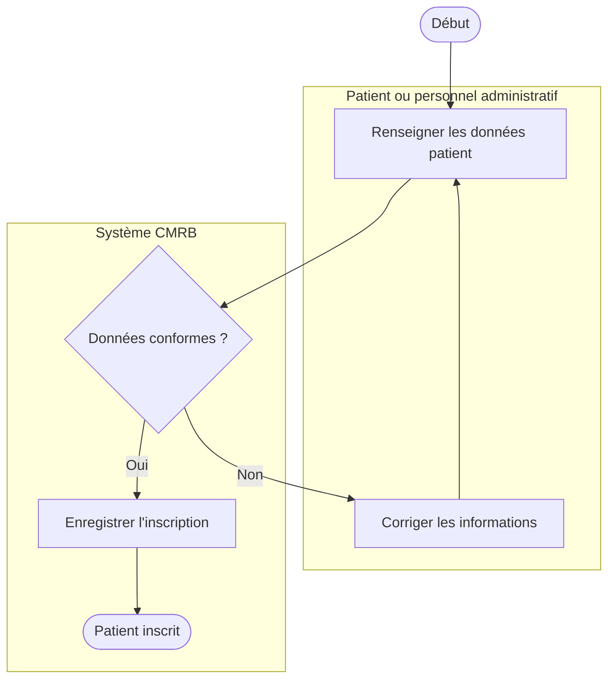

**Décisions applicables.**

- **Q-011:** La création exige nom, prénoms, date de naissance, sexe administratif, au moins un téléphone ou e-mail et le canal de contact. Adresse, pièce d'identité et contact d'urgence sont facultatifs sauf exigence opérationnelle. Le système attribue un identifiant interne immuable, signale les doublons sur identité normalisée, naissance et contact, et interdit toute fusion automatique.
- **Q-025:** Chaque personne possède un compte nominatif et des rôles cumulables approuvés par un administrateur désigné par la direction. Le premier lien patient exige date de naissance, code à usage unique sur contact vérifié et validation manuelle en cas d'écart. MFA est obligatoire pour comptes internes sensibles; inactivité 15 minutes, durée maximale 12 heures, révocation immédiate. Un accès d'urgence médical exige motif et alerte au directeur médical.
- **Q-026:** Cibles V1 : p95 ≤ 2 s pour les actions courantes et ≤ 10 s pour les rapports; disponibilité mensuelle 99,5 % hors maintenance annoncée limitée à 4 h/mois; RPO 15 min et RTO 4 h; sauvegardes chiffrées quotidiennes 35 jours et mensuelles 12 mois; 200 utilisateurs simultanés, 100 000 patients et 20 % de croissance annuelle; navigateurs majeurs sur leurs deux dernières versions; SLA P1 prise en charge 30 min et contournement 4 h.
- **Q-012:** Aucune suppression physique automatique n'est autorisée. Les dossiers cliniques sont conservés 25 ans après le dernier épisode; les dossiers de mineurs au moins jusqu'au 28e anniversaire et jamais moins de 25 ans après le dernier épisode. Les pièces financières sont conservées 10 ans, les données RH 10 ans après départ, les journaux de sécurité 12 mois et les traces d'accès clinique 10 ans. Un gel juridique suspend toute échéance. À terme, anonymisation irréversible après autorisation du responsable désigné.
- **Q-033:** La production et les sauvegardes sont hébergées dans une zone approuvée contractuellement, avec préférence Côte d'Ivoire; tout transfert hors territoire exige l'analyse et les formalités applicables. La reprise V1 utilise des modèles CSV contrôlés, rapprochement des totaux et procès-verbal. La bascule suit répétition, gel, sauvegarde, migration, contrôle, décision go/no-go et retour arrière.

**Recette.** TEST-001.


### WF-002 — Consulter et rechercher un dossier administratif

**Finalité.** Dossier administratif consulté sans modification.

**Acteur principal :** ACT-001 ou ACT-002, selon droit de lecture administrative.

Les autres acteurs concernés et leurs responsabilités figurent dans le tableau ci-dessous ; leur présence ne vaut pas attribution de permission.

| Acteur | Responsabilité dans le parcours |
| --- | --- |
| ACT-001 | Personnel administratif: Inscription et rendez-vous; facturation/paiement en conflit avec matrice. |
| ACT-002 | Médecin: Consultation et dossier clinique; orientation médicale. |
| ACT-012 | Système CMRB: Application web, contrôles et enregistrement. |

**Déclencheur.** Besoin d’identifier le patient à prendre en charge.

**Préconditions.** La recherche porte sur un dossier administratif ; les critères disponibles et le périmètre de consultation de l’intervenant doivent être validés.

**Scénario principal.**

1. L’utilisateur recherche le patient selon des critères arrêté pour la baseline.
2. Le système contrôle le périmètre de consultation attribué au rôle.
3. L’utilisateur sélectionne le dossier concerné.
4. Le système présente les informations administratives séparées des données médicales.

**Variantes et erreurs.**

Recherche par identité ou identifiant : critères définis par la baseline; absence de dossier conduit au processus d’inscription sans création automatique.

Homonymes : distinguer les dossiers avant sélection; dossier absent : signaler absence; accès non habilité : ne pas exposer le dossier.

Décision de cadrage technique : toute mutation est atomique, idempotente lorsqu'une clé de requête existe et protégée par contrôle de version. Une opération refusée n'a aucun effet métier; les doublons sont signalés et aucune fusion ou correction automatique n'est autorisée.

**Règles et autorisations.**

BR-001

**SEC-002** — ACT-001 et ACT-002 consultent le dossier administratif; les lectures des autres profils issues de la matrice définitive restent P.

La [matrice par action](ROLE_PERMISSION_MATRIX.md) est normative. Le serveur contrôle rôle, action et ressource selon Q-025/Q-031; tout conflit ou droit absent produit un refus tracé. Une dérogation exige un accès d'urgence médical motivé ou une demande de changement approuvée.

**Données.**

L = lecture, C = création, M = modification, X = opération spéciale définie par la matrice et la décision applicable. Les mutations constituent la baseline fonctionnelle; le schéma physique en sera dérivé.

| Entité | Concept | Opération de baseline | Condition |
| --- | --- | --- | --- |
| ENT-004 | Patient | L | Sous réserve des droits et cardinalités; voir dictionnaire |
| ENT-005 | Dossier administratif | L | Sous réserve des droits et cardinalités; voir dictionnaire |

**Notifications et audit.**

Aucune notification nouvelle explicitement requise pour ce parcours. Les notifications éventuelles sont régis par les décisions associées.

La baseline Q-012/Q-026 impose un audit immuable et minimisé. Ce parcours manipule Patient, Dossier administratif.

DECISION_DE_CADRAGE : tracer l’acteur, l’action, la référence de ressource, la date et le résultat, sans recopier les données médicales, secrets ni moyens de paiement. Pour une mutation, étudier la preuve de changement séparément des métadonnées courantes. Événements audités : demande de consulter et rechercher un dossier administratif, succès, refus et erreur. Consultation sensible et durée de conservation arbitré par la baseline Q-026 / Q-012.

**Résultat.** Dossier administratif consulté sans modification. En cas de refus, aucune réussite métier n’est annoncée. Les états persistés définis par la baseline sont régis par les décisions associées; ces termes ne constituent pas une énumération de base de données.

**Diagramme.**

Lecture : rectangles = actions ; losanges = décisions ; formes arrondies = début ou résultat du parcours ; couloirs = responsabilités. Les résultats ne sont pas des statuts de base de données. Les contrôles et l’ordre retenu pour la baselines restent soumis aux règles et autorisations de cette fiche ; une décision métier manquante n’est jamais une branche d’exécution.

Les conditions de conformité renvoient aux préconditions et aux décisions de baseline de cette fiche. Elles ne définissent aucune validation de saisie ou permission supplémentaire.

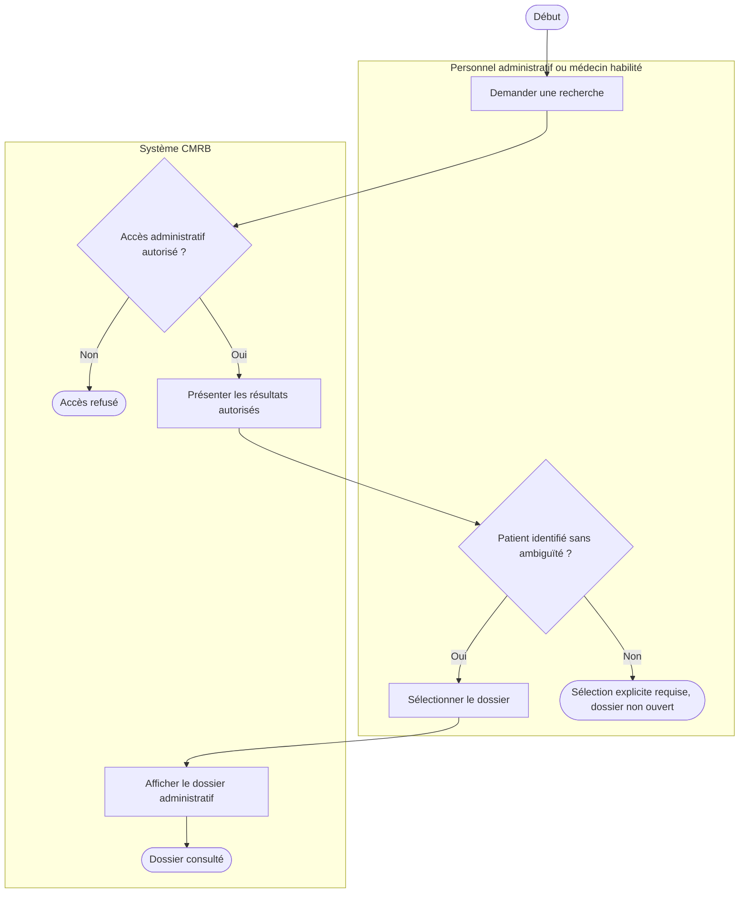

**Décisions applicables.**

- **Q-025:** Chaque personne possède un compte nominatif et des rôles cumulables approuvés par un administrateur désigné par la direction. Le premier lien patient exige date de naissance, code à usage unique sur contact vérifié et validation manuelle en cas d'écart. MFA est obligatoire pour comptes internes sensibles; inactivité 15 minutes, durée maximale 12 heures, révocation immédiate. Un accès d'urgence médical exige motif et alerte au directeur médical.
- **Q-026:** Cibles V1 : p95 ≤ 2 s pour les actions courantes et ≤ 10 s pour les rapports; disponibilité mensuelle 99,5 % hors maintenance annoncée limitée à 4 h/mois; RPO 15 min et RTO 4 h; sauvegardes chiffrées quotidiennes 35 jours et mensuelles 12 mois; 200 utilisateurs simultanés, 100 000 patients et 20 % de croissance annuelle; navigateurs majeurs sur leurs deux dernières versions; SLA P1 prise en charge 30 min et contournement 4 h.
- **Q-012:** Aucune suppression physique automatique n'est autorisée. Les dossiers cliniques sont conservés 25 ans après le dernier épisode; les dossiers de mineurs au moins jusqu'au 28e anniversaire et jamais moins de 25 ans après le dernier épisode. Les pièces financières sont conservées 10 ans, les données RH 10 ans après départ, les journaux de sécurité 12 mois et les traces d'accès clinique 10 ans. Un gel juridique suspend toute échéance. À terme, anonymisation irréversible après autorisation du responsable désigné.
- **Q-011:** La création exige nom, prénoms, date de naissance, sexe administratif, au moins un téléphone ou e-mail et le canal de contact. Adresse, pièce d'identité et contact d'urgence sont facultatifs sauf exigence opérationnelle. Le système attribue un identifiant interne immuable, signale les doublons sur identité normalisée, naissance et contact, et interdit toute fusion automatique.
- **Q-024:** L'accueil peut créer une facture brouillon à partir des prestations enregistrées, encaisser une part patient par mode autorisé et imprimer un reçu. Il ne modifie ni tarifs ni couverture, ne valide pas les bordereaux organisme, ne rembourse pas et n'annule pas une facture émise. La comptabilité émet, rapproche, crée les avoirs et traite remboursements et rejets.
- **Q-033:** La production et les sauvegardes sont hébergées dans une zone approuvée contractuellement, avec préférence Côte d'Ivoire; tout transfert hors territoire exige l'analyse et les formalités applicables. La reprise V1 utilise des modèles CSV contrôlés, rapprochement des totaux et procès-verbal. La bascule suit répétition, gel, sauvegarde, migration, contrôle, décision go/no-go et retour arrière.

**Recette.** TEST-002.


### WF-003 — Modifier un dossier administratif

**Finalité.** Dossier administratif modifié; traçabilité de correction défini par la baseline.

**Acteur principal :** ACT-001.

Les autres acteurs concernés et leurs responsabilités figurent dans le tableau ci-dessous ; leur présence ne vaut pas attribution de permission.

| Acteur | Responsabilité dans le parcours |
| --- | --- |
| ACT-001 | Personnel administratif: Inscription et rendez-vous; facturation/paiement en conflit avec matrice. |
| ACT-012 | Système CMRB: Application web, contrôles et enregistrement. |

**Déclencheur.** Correction d’une donnée administrative.

**Préconditions.** Le patient et le dossier administratif existent. Les champs modifiables et les droits de correction de l’accueil doivent être arrêtés.

**Scénario principal.**

1. L’utilisateur ouvre le dossier identifié.
2. Le système vérifie l’habilitation de modification.
3. L’utilisateur corrige les champs autorisés.
4. Le système valide les champs et conserve la correction selon une contrôle de version optimiste avec rejet de la seconde écriture obsolète.

**Variantes et erreurs.**

Une correction clinique relève du dossier médical et non de ce processus.

Modification simultanée : politique de conflit arrêté pour la baseline; identité devenue ambiguë : ne pas fusionner silencieusement; validation invalide : correction attendue.

Décision de cadrage technique : toute mutation est atomique, idempotente lorsqu'une clé de requête existe et protégée par contrôle de version. Une opération refusée n'a aucun effet métier; les doublons sont signalés et aucune fusion ou correction automatique n'est autorisée.

**Règles et autorisations.**

BR-001

**SEC-003** — ACT-001 modifie le dossier administratif. Cette permission n’autorise pas la correction d’une note médicale.

La [matrice par action](ROLE_PERMISSION_MATRIX.md) est normative. Le serveur contrôle rôle, action et ressource selon Q-025/Q-031; tout conflit ou droit absent produit un refus tracé. Une dérogation exige un accès d'urgence médical motivé ou une demande de changement approuvée.

**Données.**

L = lecture, C = création, M = modification, X = opération spéciale définie par la matrice et la décision applicable. Les mutations constituent la baseline fonctionnelle; le schéma physique en sera dérivé.

| Entité | Concept | Opération de baseline | Condition |
| --- | --- | --- | --- |
| ENT-004 | Patient | M | Sous réserve des droits et cardinalités; voir dictionnaire |
| ENT-005 | Dossier administratif | M | Sous réserve des droits et cardinalités; voir dictionnaire |

**Notifications et audit.**

Aucune notification nouvelle explicitement requise pour ce parcours. Les notifications éventuelles sont régis par les décisions associées.

La baseline Q-012/Q-026 impose un audit immuable et minimisé. Ce parcours manipule Patient, Dossier administratif.

DECISION_DE_CADRAGE : tracer l’acteur, l’action, la référence de ressource, la date et le résultat, sans recopier les données médicales, secrets ni moyens de paiement. Pour une mutation, étudier la preuve de changement séparément des métadonnées courantes. Événements audités : demande de modifier un dossier administratif, succès, refus et erreur. Consultation sensible et durée de conservation arbitré par la baseline Q-026 / Q-012.

**Résultat.** Dossier administratif modifié; traçabilité de correction défini par la baseline. En cas de refus, aucune réussite métier n’est annoncée. Les états persistés définis par la baseline sont régis par les décisions associées; ces termes ne constituent pas une énumération de base de données.

**Diagramme.**

Lecture : rectangles = actions ; losanges = décisions ; formes arrondies = début ou résultat du parcours ; couloirs = responsabilités. Les résultats ne sont pas des statuts de base de données. Les contrôles et l’ordre retenu pour la baselines restent soumis aux règles et autorisations de cette fiche ; une décision métier manquante n’est jamais une branche d’exécution.

Les conditions de conformité renvoient aux préconditions et aux décisions de baseline de cette fiche. Elles ne définissent aucune validation de saisie ou permission supplémentaire.

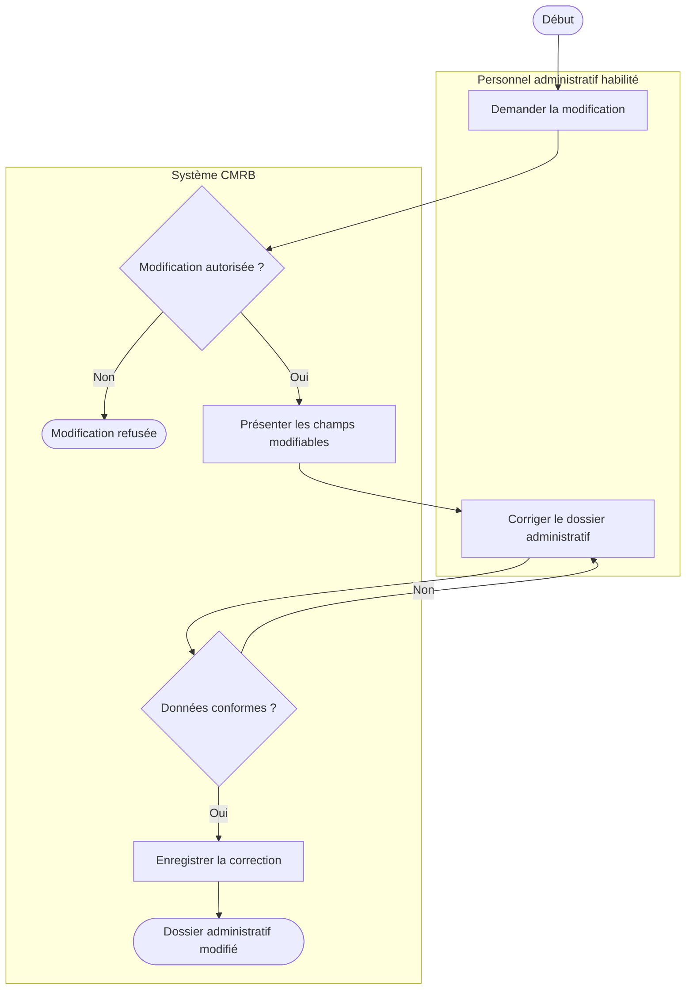

**Décisions applicables.**

- **Q-025:** Chaque personne possède un compte nominatif et des rôles cumulables approuvés par un administrateur désigné par la direction. Le premier lien patient exige date de naissance, code à usage unique sur contact vérifié et validation manuelle en cas d'écart. MFA est obligatoire pour comptes internes sensibles; inactivité 15 minutes, durée maximale 12 heures, révocation immédiate. Un accès d'urgence médical exige motif et alerte au directeur médical.
- **Q-026:** Cibles V1 : p95 ≤ 2 s pour les actions courantes et ≤ 10 s pour les rapports; disponibilité mensuelle 99,5 % hors maintenance annoncée limitée à 4 h/mois; RPO 15 min et RTO 4 h; sauvegardes chiffrées quotidiennes 35 jours et mensuelles 12 mois; 200 utilisateurs simultanés, 100 000 patients et 20 % de croissance annuelle; navigateurs majeurs sur leurs deux dernières versions; SLA P1 prise en charge 30 min et contournement 4 h.
- **Q-012:** Aucune suppression physique automatique n'est autorisée. Les dossiers cliniques sont conservés 25 ans après le dernier épisode; les dossiers de mineurs au moins jusqu'au 28e anniversaire et jamais moins de 25 ans après le dernier épisode. Les pièces financières sont conservées 10 ans, les données RH 10 ans après départ, les journaux de sécurité 12 mois et les traces d'accès clinique 10 ans. Un gel juridique suspend toute échéance. À terme, anonymisation irréversible après autorisation du responsable désigné.
- **Q-011:** La création exige nom, prénoms, date de naissance, sexe administratif, au moins un téléphone ou e-mail et le canal de contact. Adresse, pièce d'identité et contact d'urgence sont facultatifs sauf exigence opérationnelle. Le système attribue un identifiant interne immuable, signale les doublons sur identité normalisée, naissance et contact, et interdit toute fusion automatique.
- **Q-028:** Les pièces jointes V1 acceptent PDF, JPEG et PNG, 10 Mo maximum par fichier. Le système vérifie extension, type MIME, signature, taille et antivirus, calcule SHA-256, chiffre le stockage et interdit l'exécution. Les versions sont immuables; validation, publication, remplacement par nouvelle version et téléchargement sont autorisés selon rôle et ressource.
- **Q-033:** La production et les sauvegardes sont hébergées dans une zone approuvée contractuellement, avec préférence Côte d'Ivoire; tout transfert hors territoire exige l'analyse et les formalités applicables. La reprise V1 utilise des modèles CSV contrôlés, rapprochement des totaux et procès-verbal. La bascule suit répétition, gel, sauvegarde, migration, contrôle, décision go/no-go et retour arrière.

**Recette.** TEST-003.


### WF-004 — Traiter une demande de suppression ou archivage patient

**Finalité.** Demande non exécutée tant que la politique est absente.

**Acteur principal :** ACT-001.

Les autres acteurs concernés et leurs responsabilités figurent dans le tableau ci-dessous ; leur présence ne vaut pas attribution de permission.

| Acteur | Responsabilité dans le parcours |
| --- | --- |
| ACT-001 | Personnel administratif: Inscription et rendez-vous; facturation/paiement en conflit avec matrice. |
| ACT-012 | Système CMRB: Application web, contrôles et enregistrement. |

**Déclencheur.** Demande de suppression d’un dossier.

**Préconditions.** Une demande concerne un patient identifié. En l’absence de politique approuvée, aucune suppression physique n’est autorisée (BR-003).

**Scénario principal.**

1. L’utilisateur identifie le dossier et la demande.
2. Le système ou le responsable consulte la politique de conservation applicable.
3. En l’absence d’arbitrage le traitement destructif reste bloqué.
4. Après décision métier future un parcours d’archivage ou autre traitement devra être spécifié séparément.

**Variantes et erreurs.**

Archivage, anonymisation et suppression logique sont des options ouvertes, pas des transitions approuvées.

Dossier lié à des prestations ou factures : comportement référentiel non décidé; demande sans politique applicable : aucun effacement physique.

Décision de cadrage technique : toute mutation est atomique, idempotente lorsqu'une clé de requête existe et protégée par contrôle de version. Une opération refusée n'a aucun effet métier; les doublons sont signalés et aucune fusion ou correction automatique n'est autorisée.

**Règles et autorisations.**

BR-003

**SEC-004** — Aucun acteur ne peut effacer physiquement le dossier; archivage et anonymisation suivent Q-012.

La [matrice par action](ROLE_PERMISSION_MATRIX.md) est normative. Le serveur contrôle rôle, action et ressource selon Q-025/Q-031; tout conflit ou droit absent produit un refus tracé. Une dérogation exige un accès d'urgence médical motivé ou une demande de changement approuvée.

**Données.**

L = lecture, C = création, M = modification, X = opération spéciale définie par la matrice et la décision applicable. Les mutations constituent la baseline fonctionnelle; le schéma physique en sera dérivé.

| Entité | Concept | Opération de baseline | Condition |
| --- | --- | --- | --- |
| ENT-004 | Patient | L | Sous réserve des droits et cardinalités; voir dictionnaire |
| ENT-005 | Dossier administratif | X | Sous réserve des droits et cardinalités; voir dictionnaire |
| ENT-006 | Dossier médical | X | Sous réserve des droits et cardinalités; voir dictionnaire |

**Notifications et audit.**

Aucune notification nouvelle explicitement requise pour ce parcours. Les notifications éventuelles sont régis par les décisions associées.

La baseline Q-012/Q-026 impose un audit immuable et minimisé. Ce parcours manipule Patient, Dossier administratif, Dossier médical.

DECISION_DE_CADRAGE : tracer l’acteur, l’action, la référence de ressource, la date et le résultat, sans recopier les données médicales, secrets ni moyens de paiement. Pour une mutation, étudier la preuve de changement séparément des métadonnées courantes. Événements audités : demande de traiter une demande de suppression ou archivage patient, succès, refus et erreur. Consultation sensible et durée de conservation arbitré par la baseline Q-026 / Q-012.

**Résultat.** Demande non exécutée tant que la politique est absente. En cas de refus, aucune réussite métier n’est annoncée. Les états persistés définis par la baseline sont régis par les décisions associées; ces termes ne constituent pas une énumération de base de données.

**Diagramme.**

Lecture : rectangles = actions ; losanges = décisions ; formes arrondies = début ou résultat du parcours ; couloirs = responsabilités. Les résultats ne sont pas des statuts de base de données. Les contrôles et l’ordre retenu pour la baselines restent soumis aux règles et autorisations de cette fiche ; une décision métier manquante n’est jamais une branche d’exécution.

Décision de baseline : le diagramme représente uniquement la non-suppression confirmée par BR-003. L’archivage, l’anonymisation et une éventuelle destruction future ne sont pas modélisés comme opérations déjà autorisées (Q-012).

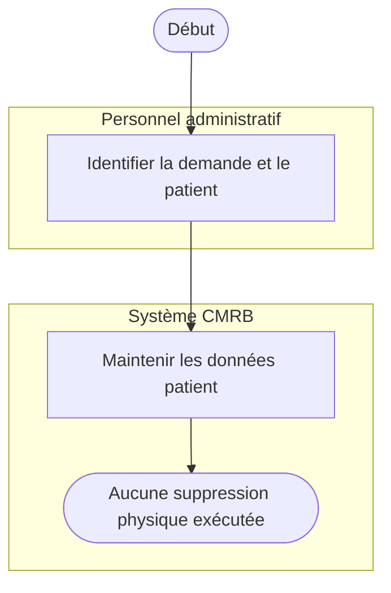

**Décisions applicables.**

- **Q-025:** Chaque personne possède un compte nominatif et des rôles cumulables approuvés par un administrateur désigné par la direction. Le premier lien patient exige date de naissance, code à usage unique sur contact vérifié et validation manuelle en cas d'écart. MFA est obligatoire pour comptes internes sensibles; inactivité 15 minutes, durée maximale 12 heures, révocation immédiate. Un accès d'urgence médical exige motif et alerte au directeur médical.
- **Q-026:** Cibles V1 : p95 ≤ 2 s pour les actions courantes et ≤ 10 s pour les rapports; disponibilité mensuelle 99,5 % hors maintenance annoncée limitée à 4 h/mois; RPO 15 min et RTO 4 h; sauvegardes chiffrées quotidiennes 35 jours et mensuelles 12 mois; 200 utilisateurs simultanés, 100 000 patients et 20 % de croissance annuelle; navigateurs majeurs sur leurs deux dernières versions; SLA P1 prise en charge 30 min et contournement 4 h.
- **Q-012:** Aucune suppression physique automatique n'est autorisée. Les dossiers cliniques sont conservés 25 ans après le dernier épisode; les dossiers de mineurs au moins jusqu'au 28e anniversaire et jamais moins de 25 ans après le dernier épisode. Les pièces financières sont conservées 10 ans, les données RH 10 ans après départ, les journaux de sécurité 12 mois et les traces d'accès clinique 10 ans. Un gel juridique suspend toute échéance. À terme, anonymisation irréversible après autorisation du responsable désigné.
- **Q-033:** La production et les sauvegardes sont hébergées dans une zone approuvée contractuellement, avec préférence Côte d'Ivoire; tout transfert hors territoire exige l'analyse et les formalités applicables. La reprise V1 utilise des modèles CSV contrôlés, rapprochement des totaux et procès-verbal. La bascule suit répétition, gel, sauvegarde, migration, contrôle, décision go/no-go et retour arrière.

**Recette.** TEST-004.


### WF-005 — Planifier un rendez-vous

**Finalité.** Rendez-vous planifié; statut exact arrêté par la baseline.

**Acteur principal :** ACT-005 ou ACT-001.

Les autres acteurs concernés et leurs responsabilités figurent dans le tableau ci-dessous ; leur présence ne vaut pas attribution de permission.

| Acteur | Responsabilité dans le parcours |
| --- | --- |
| ACT-001 | Personnel administratif: Inscription et rendez-vous; facturation/paiement en conflit avec matrice. |
| ACT-005 | Patient: Inscription, réservation, consultation personnelle et demande de copie. |
| ACT-012 | Système CMRB: Application web, contrôles et enregistrement. |

**Déclencheur.** Demande de rendez-vous par patient ou accueil.

**Préconditions.** Le patient et le besoin de rendez-vous sont identifiés. Les créneaux, ressources, durées et règles de disponibilité restent défini par la baseline (Q-015).

**Scénario principal.**

1. Le patient ou l’accueil demande un rendez-vous.
2. Le système présente les disponibilités selon agenda défini par la baseline.
3. Le demandeur choisit un créneau.
4. Le système vérifie la disponibilité et enregistre la réservation selon les règles arrêté pour la baseline.

**Variantes et erreurs.**

Canal portail ou accueil; confirmation immédiate ou ultérieure non décidée.

Deux demandes simultanées : réservation transactionnelle, une seule réussit; créneau indisponible : autre proposition; patient absent : inscription si nécessaire.

Décision de cadrage technique : toute mutation est atomique, idempotente lorsqu'une clé de requête existe et protégée par contrôle de version. Une opération refusée n'a aucun effet métier; les doublons sont signalés et aucune fusion ou correction automatique n'est autorisée.

**Règles et autorisations.**

Les exigences liées, règles transverses et décisions Q citées sont normatives pour ce workflow.

**SEC-005** — ACT-001 et ACT-005 réservent. Le périmètre propre patient et le droit sur l’agenda restent défini par la baseline.

La [matrice par action](ROLE_PERMISSION_MATRIX.md) est normative. Le serveur contrôle rôle, action et ressource selon Q-025/Q-031; tout conflit ou droit absent produit un refus tracé. Une dérogation exige un accès d'urgence médical motivé ou une demande de changement approuvée.

**Données.**

L = lecture, C = création, M = modification, X = opération spéciale définie par la matrice et la décision applicable. Les mutations constituent la baseline fonctionnelle; le schéma physique en sera dérivé.

| Entité | Concept | Opération de baseline | Condition |
| --- | --- | --- | --- |
| ENT-004 | Patient | L | Sous réserve des droits et cardinalités; voir dictionnaire |
| ENT-007 | Rendez-vous | C | Sous réserve des droits et cardinalités; voir dictionnaire |

**Notifications et audit.**

Aucune notification nouvelle explicitement requise pour ce parcours. Les notifications éventuelles sont régis par les décisions associées.

La baseline Q-012/Q-026 impose un audit immuable et minimisé. Ce parcours manipule Patient, Rendez-vous.

DECISION_DE_CADRAGE : tracer l’acteur, l’action, la référence de ressource, la date et le résultat, sans recopier les données médicales, secrets ni moyens de paiement. Pour une mutation, étudier la preuve de changement séparément des métadonnées courantes. Événements audités : demande de planifier un rendez-vous, succès, refus et erreur. Consultation sensible et durée de conservation arbitré par la baseline Q-026 / Q-012.

**Résultat.** Rendez-vous planifié; statut exact arrêté par la baseline. En cas de refus, aucune réussite métier n’est annoncée. Les états persistés définis par la baseline sont régis par les décisions associées; ces termes ne constituent pas une énumération de base de données.

**Diagramme.**

Lecture : rectangles = actions ; losanges = décisions ; formes arrondies = début ou résultat du parcours ; couloirs = responsabilités. Les résultats ne sont pas des statuts de base de données. Les contrôles et l’ordre retenu pour la baselines restent soumis aux règles et autorisations de cette fiche ; une décision métier manquante n’est jamais une branche d’exécution.

Les conditions de conformité renvoient aux préconditions et aux décisions de baseline de cette fiche. Elles ne définissent aucune validation de saisie ou permission supplémentaire.

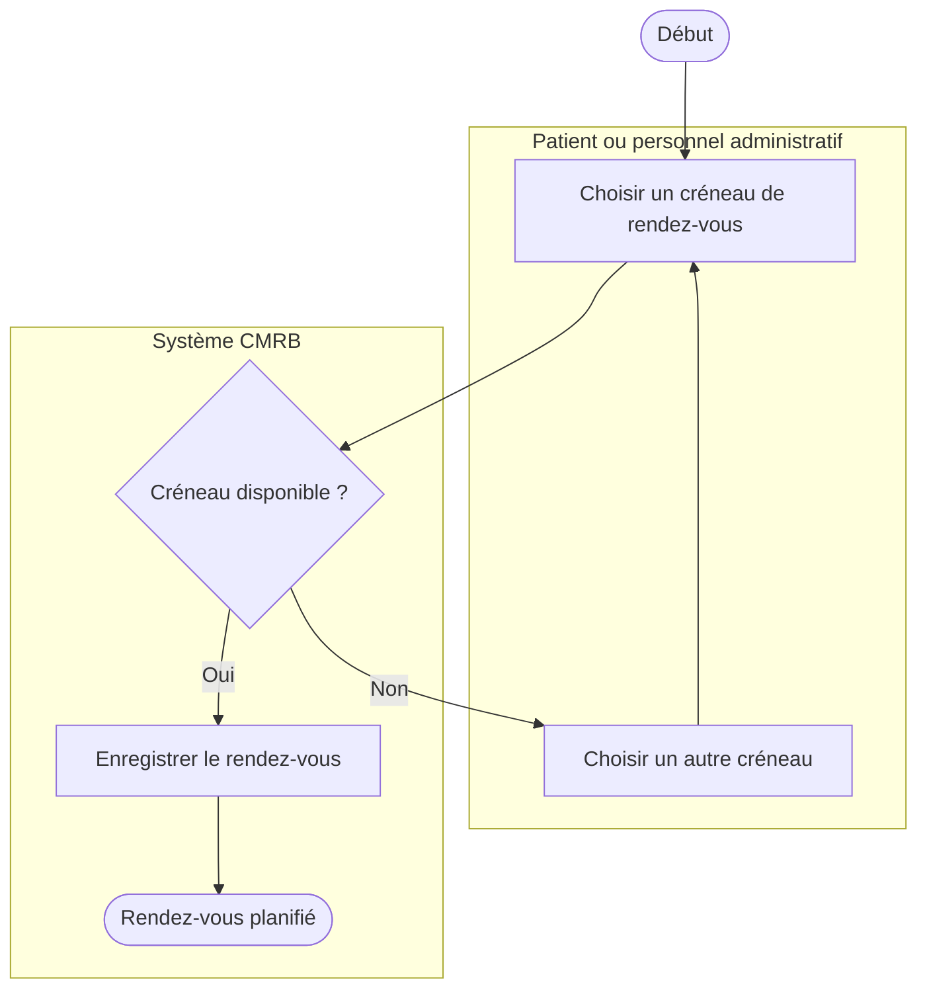

**Décisions applicables.**

- **Q-015:** L'agenda est géré par praticien et ressource obligatoire éventuelle. La durée provient du type de rendez-vous et reste paramétrable. Les états sont DEMANDE, À_CONFIRMER, CONFIRMÉ, ARRIVÉ, EN_COURS, TERMINÉ, ANNULÉ_PATIENT, ANNULÉ_CMRB, ABSENT et REPORTÉ. Les absences, congés, conflits et surbooking exceptionnel sont tracés.
- **Q-025:** Chaque personne possède un compte nominatif et des rôles cumulables approuvés par un administrateur désigné par la direction. Le premier lien patient exige date de naissance, code à usage unique sur contact vérifié et validation manuelle en cas d'écart. MFA est obligatoire pour comptes internes sensibles; inactivité 15 minutes, durée maximale 12 heures, révocation immédiate. Un accès d'urgence médical exige motif et alerte au directeur médical.
- **Q-026:** Cibles V1 : p95 ≤ 2 s pour les actions courantes et ≤ 10 s pour les rapports; disponibilité mensuelle 99,5 % hors maintenance annoncée limitée à 4 h/mois; RPO 15 min et RTO 4 h; sauvegardes chiffrées quotidiennes 35 jours et mensuelles 12 mois; 200 utilisateurs simultanés, 100 000 patients et 20 % de croissance annuelle; navigateurs majeurs sur leurs deux dernières versions; SLA P1 prise en charge 30 min et contournement 4 h.
- **Q-012:** Aucune suppression physique automatique n'est autorisée. Les dossiers cliniques sont conservés 25 ans après le dernier épisode; les dossiers de mineurs au moins jusqu'au 28e anniversaire et jamais moins de 25 ans après le dernier épisode. Les pièces financières sont conservées 10 ans, les données RH 10 ans après départ, les journaux de sécurité 12 mois et les traces d'accès clinique 10 ans. Un gel juridique suspend toute échéance. À terme, anonymisation irréversible après autorisation du responsable désigné.
- **Q-013:** L'annulation autonome du patient est permise jusqu'à 24 heures incluses avant le début prévu. À moins de 24 heures, l'accueil traite la demande et consigne le motif. Le report annule l'ancien créneau et crée un nouveau rendez-vous lié. La réservation est transactionnelle et interdit le double-booking, sauf dérogation nominative tracée par un responsable.
- **Q-033:** La production et les sauvegardes sont hébergées dans une zone approuvée contractuellement, avec préférence Côte d'Ivoire; tout transfert hors territoire exige l'analyse et les formalités applicables. La reprise V1 utilise des modèles CSV contrôlés, rapprochement des totaux et procès-verbal. La bascule suit répétition, gel, sauvegarde, migration, contrôle, décision go/no-go et retour arrière.

**Recette.** TEST-005.


### WF-006 — Confirmer un rendez-vous

**Finalité.** Confirmation enregistrée; transition partielle documentée.

**Acteur principal :** ACT-001.

Les autres acteurs concernés et leurs responsabilités figurent dans le tableau ci-dessous ; leur présence ne vaut pas attribution de permission.

| Acteur | Responsabilité dans le parcours |
| --- | --- |
| ACT-001 | Personnel administratif: Inscription et rendez-vous; facturation/paiement en conflit avec matrice. |
| ACT-012 | Système CMRB: Application web, contrôles et enregistrement. |

**Déclencheur.** Rendez-vous arrêté pour la baseline.

**Préconditions.** Un rendez-vous existe. Les états admettant une confirmation et les droits de l’accueil doivent être arrêtés (Q-015).

**Scénario principal.**

1. L’accueil retrouve le rendez-vous.
2. Le système vérifie qu’une confirmation est autorisée dans son état courant.
3. L’accueil enregistre la confirmation.
4. Le système rend la confirmation consultable.

**Variantes et erreurs.**

Le patient confirme depuis un lien à usage unique ou l'accueil confirme après authentification; une confirmation produit une notification distincte des rappels.

Un rendez-vous annulé ou introuvable est refusé sans mutation; une confirmation répétée est idempotente.

Décision de cadrage technique : toute mutation est atomique, idempotente lorsqu'une clé de requête existe et protégée par contrôle de version. Une opération refusée n'a aucun effet métier; les doublons sont signalés et aucune fusion ou correction automatique n'est autorisée.

**Règles et autorisations.**

Les exigences liées, règles transverses et décisions Q citées sont normatives pour ce workflow.

**SEC-006** — ACT-001 est cité pour confirmer. Confirmation par ACT-005 non établie.

La [matrice par action](ROLE_PERMISSION_MATRIX.md) est normative. Le serveur contrôle rôle, action et ressource selon Q-025/Q-031; tout conflit ou droit absent produit un refus tracé. Une dérogation exige un accès d'urgence médical motivé ou une demande de changement approuvée.

**Données.**

L = lecture, C = création, M = modification, X = opération spéciale définie par la matrice et la décision applicable. Les mutations constituent la baseline fonctionnelle; le schéma physique en sera dérivé.

| Entité | Concept | Opération de baseline | Condition |
| --- | --- | --- | --- |
| ENT-007 | Rendez-vous | M | Sous réserve des droits et cardinalités; voir dictionnaire |

**Notifications et audit.**

Aucune notification nouvelle explicitement requise pour ce parcours. Les notifications éventuelles sont régis par les décisions associées.

La baseline Q-012/Q-026 impose un audit immuable et minimisé. Ce parcours manipule Rendez-vous.

DECISION_DE_CADRAGE : tracer l’acteur, l’action, la référence de ressource, la date et le résultat, sans recopier les données médicales, secrets ni moyens de paiement. Pour une mutation, étudier la preuve de changement séparément des métadonnées courantes. Événements audités : demande de confirmer un rendez-vous, succès, refus et erreur. Consultation sensible et durée de conservation arbitré par la baseline Q-026 / Q-012.

**Résultat.** Confirmation enregistrée; transition partielle documentée. En cas de refus, aucune réussite métier n’est annoncée. Les états persistés définis par la baseline sont régis par les décisions associées; ces termes ne constituent pas une énumération de base de données.

**Diagramme.**

Lecture : rectangles = actions ; losanges = décisions ; formes arrondies = début ou résultat du parcours ; couloirs = responsabilités. Les résultats ne sont pas des statuts de base de données. Les contrôles et l’ordre retenu pour la baselines restent soumis aux règles et autorisations de cette fiche ; une décision métier manquante n’est jamais une branche d’exécution.

Les conditions de conformité renvoient aux préconditions et aux décisions de baseline de cette fiche. Elles ne définissent aucune validation de saisie ou permission supplémentaire.

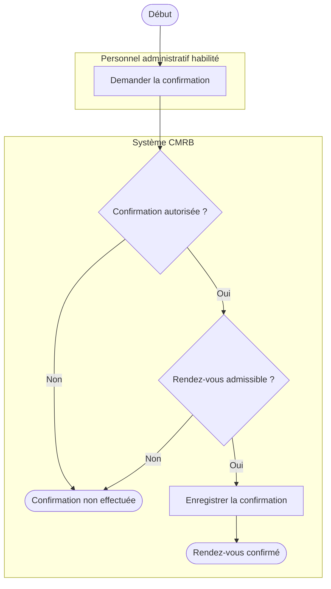

**Décisions applicables.**

- **Q-015:** L'agenda est géré par praticien et ressource obligatoire éventuelle. La durée provient du type de rendez-vous et reste paramétrable. Les états sont DEMANDE, À_CONFIRMER, CONFIRMÉ, ARRIVÉ, EN_COURS, TERMINÉ, ANNULÉ_PATIENT, ANNULÉ_CMRB, ABSENT et REPORTÉ. Les absences, congés, conflits et surbooking exceptionnel sont tracés.
- **Q-025:** Chaque personne possède un compte nominatif et des rôles cumulables approuvés par un administrateur désigné par la direction. Le premier lien patient exige date de naissance, code à usage unique sur contact vérifié et validation manuelle en cas d'écart. MFA est obligatoire pour comptes internes sensibles; inactivité 15 minutes, durée maximale 12 heures, révocation immédiate. Un accès d'urgence médical exige motif et alerte au directeur médical.
- **Q-026:** Cibles V1 : p95 ≤ 2 s pour les actions courantes et ≤ 10 s pour les rapports; disponibilité mensuelle 99,5 % hors maintenance annoncée limitée à 4 h/mois; RPO 15 min et RTO 4 h; sauvegardes chiffrées quotidiennes 35 jours et mensuelles 12 mois; 200 utilisateurs simultanés, 100 000 patients et 20 % de croissance annuelle; navigateurs majeurs sur leurs deux dernières versions; SLA P1 prise en charge 30 min et contournement 4 h.
- **Q-012:** Aucune suppression physique automatique n'est autorisée. Les dossiers cliniques sont conservés 25 ans après le dernier épisode; les dossiers de mineurs au moins jusqu'au 28e anniversaire et jamais moins de 25 ans après le dernier épisode. Les pièces financières sont conservées 10 ans, les données RH 10 ans après départ, les journaux de sécurité 12 mois et les traces d'accès clinique 10 ans. Un gel juridique suspend toute échéance. À terme, anonymisation irréversible après autorisation du responsable désigné.
- **Q-014:** Deux rappels sont planifiés à 48 heures puis 24 heures avant le rendez-vous, par canal vérifié choisi entre SMS, e-mail et WhatsApp. En cas d'échec, deux nouvelles tentatives sont effectuées puis un repli SMS, ou e-mail si aucun mobile n'est vérifié. Aucun contenu clinique n'est envoyé et les rappels cessent après annulation ou arrivée.
- **Q-033:** La production et les sauvegardes sont hébergées dans une zone approuvée contractuellement, avec préférence Côte d'Ivoire; tout transfert hors territoire exige l'analyse et les formalités applicables. La reprise V1 utilise des modèles CSV contrôlés, rapprochement des totaux et procès-verbal. La bascule suit répétition, gel, sauvegarde, migration, contrôle, décision go/no-go et retour arrière.

**Recette.** TEST-006.


### WF-007 — Rappeler un rendez-vous

**Finalité.** Rappel transmis ou échec identifié; livraison effective non assimilée à acceptation technique.

**Acteur principal :** ACT-012 pour le rappel ; ACT-001 si déclenchement manuel retenu. ACT-005 choisit préalablement le canal.

Les autres acteurs concernés et leurs responsabilités figurent dans le tableau ci-dessous ; leur présence ne vaut pas attribution de permission.

| Acteur | Responsabilité dans le parcours |
| --- | --- |
| ACT-001 | Personnel administratif: Inscription et rendez-vous; facturation/paiement en conflit avec matrice. |
| ACT-005 | Patient: Inscription, réservation, consultation personnelle et demande de copie. |
| ACT-012 | Système CMRB: Application web, contrôles et enregistrement. |
| ACT-014 | Service de notification: Transport des notifications si externalisé. |

**Déclencheur.** Échéance de rappel à fixer.

**Préconditions.** Un rendez-vous est concerné par un rappel. Le canal vérifié choisi par le patient est connu; les rappels sont déclenchés à 48 h puis 24 h selon Q-014.

**Scénario principal.**

1. Le système identifie les rendez-vous concernés selon calendrier arrêté pour la baseline.
2. Le système retrouve le canal choisi par le patient.
3. Le système prépare le rappel avec contenu arrêté pour la baseline.
4. Le service de notification transmet si une dépendance externe est retenue.
5. Le système rend le résultat d’envoi disponible selon journalisation défini par la baseline.

**Variantes et erreurs.**

Choix SMS, e-mail ou WhatsApp issu du commentaire; repli manuel ou autre canal non décidé.

En cas d'échec, deux réessais puis le canal de repli Q-014 sont utilisés et l'accueil est alerté; une annulation stoppe tout envoi non parti et marque obsolète tout envoi en cours.

Décision de cadrage technique : toute mutation est atomique, idempotente lorsqu'une clé de requête existe et protégée par contrôle de version. Une opération refusée n'a aucun effet métier; les doublons sont signalés et aucune fusion ou correction automatique n'est autorisée.

**Règles et autorisations.**

BR-010

**SEC-007** — ACT-005 choisit son canal; ACT-001 participe au rappel; rôle du déclencheur automatique arrêté pour la baseline.

La [matrice par action](ROLE_PERMISSION_MATRIX.md) est normative. Le serveur contrôle rôle, action et ressource selon Q-025/Q-031; tout conflit ou droit absent produit un refus tracé. Une dérogation exige un accès d'urgence médical motivé ou une demande de changement approuvée.

**Données.**

L = lecture, C = création, M = modification, X = opération spéciale définie par la matrice et la décision applicable. Les mutations constituent la baseline fonctionnelle; le schéma physique en sera dérivé.

| Entité | Concept | Opération de baseline | Condition |
| --- | --- | --- | --- |
| ENT-007 | Rendez-vous | L | Sous réserve des droits et cardinalités; voir dictionnaire |
| ENT-026 | Notification | C | Sous réserve des droits et cardinalités; voir dictionnaire |
| ENT-027 | Préférence de canal | L | Sous réserve des droits et cardinalités; voir dictionnaire |

**Notifications et audit.**

Rappel selon canal choisi; contenu, calendrier et réessai Q-014.

La baseline Q-012/Q-026 impose un audit immuable et minimisé. Ce parcours manipule Rendez-vous, Notification, Préférence de canal.

DECISION_DE_CADRAGE : tracer l’acteur, l’action, la référence de ressource, la date et le résultat, sans recopier les données médicales, secrets ni moyens de paiement. Pour une mutation, étudier la preuve de changement séparément des métadonnées courantes. Événements audités : demande de rappeler un rendez-vous, succès, refus et erreur. Consultation sensible et durée de conservation arbitré par la baseline Q-026 / Q-012.

**Résultat.** Rappel transmis ou échec identifié; livraison effective non assimilée à acceptation technique. En cas de refus, aucune réussite métier n’est annoncée. Les états persistés définis par la baseline sont régis par les décisions associées; ces termes ne constituent pas une énumération de base de données.

**Diagramme.**

Lecture : rectangles = actions ; losanges = décisions ; formes arrondies = début ou résultat du parcours ; couloirs = responsabilités. Les résultats ne sont pas des statuts de base de données. Les contrôles et l’ordre retenu pour la baselines restent soumis aux règles et autorisations de cette fiche ; une décision métier manquante n’est jamais une branche d’exécution.

Le choix du canal est une préparation du rappel, pas une nouvelle saisie imposée à chaque envoi. Le déclenchement manuel ou automatique et le transport externe restent arrêté pour la baseline (Q-014, Q-027). Acceptation de transmission ne signifie pas réception par le patient.

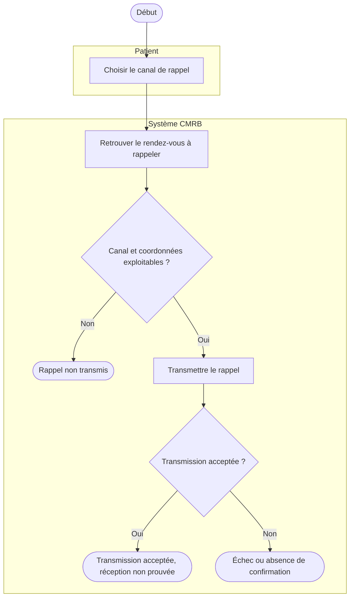

**Décisions applicables.**

- **Q-014:** Deux rappels sont planifiés à 48 heures puis 24 heures avant le rendez-vous, par canal vérifié choisi entre SMS, e-mail et WhatsApp. En cas d'échec, deux nouvelles tentatives sont effectuées puis un repli SMS, ou e-mail si aucun mobile n'est vérifié. Aucun contenu clinique n'est envoyé et les rappels cessent après annulation ou arrivée.
- **Q-025:** Chaque personne possède un compte nominatif et des rôles cumulables approuvés par un administrateur désigné par la direction. Le premier lien patient exige date de naissance, code à usage unique sur contact vérifié et validation manuelle en cas d'écart. MFA est obligatoire pour comptes internes sensibles; inactivité 15 minutes, durée maximale 12 heures, révocation immédiate. Un accès d'urgence médical exige motif et alerte au directeur médical.
- **Q-026:** Cibles V1 : p95 ≤ 2 s pour les actions courantes et ≤ 10 s pour les rapports; disponibilité mensuelle 99,5 % hors maintenance annoncée limitée à 4 h/mois; RPO 15 min et RTO 4 h; sauvegardes chiffrées quotidiennes 35 jours et mensuelles 12 mois; 200 utilisateurs simultanés, 100 000 patients et 20 % de croissance annuelle; navigateurs majeurs sur leurs deux dernières versions; SLA P1 prise en charge 30 min et contournement 4 h.
- **Q-012:** Aucune suppression physique automatique n'est autorisée. Les dossiers cliniques sont conservés 25 ans après le dernier épisode; les dossiers de mineurs au moins jusqu'au 28e anniversaire et jamais moins de 25 ans après le dernier épisode. Les pièces financières sont conservées 10 ans, les données RH 10 ans après départ, les journaux de sécurité 12 mois et les traces d'accès clinique 10 ans. Un gel juridique suspend toute échéance. À terme, anonymisation irréversible après autorisation du responsable désigné.
- **Q-027:** Les modules métier cœur sont réunis dans CMRB. Les services externes nécessaires restent autorisés derrière des adaptateurs : FNE, SMS/e-mail/WhatsApp, mobile money, hébergement, antivirus et identité. Leur indisponibilité ne doit pas corrompre une transaction; les échanges sont mis en attente, réessayés et rapprochés.
- **Q-033:** La production et les sauvegardes sont hébergées dans une zone approuvée contractuellement, avec préférence Côte d'Ivoire; tout transfert hors territoire exige l'analyse et les formalités applicables. La reprise V1 utilise des modèles CSV contrôlés, rapprochement des totaux et procès-verbal. La bascule suit répétition, gel, sauvegarde, migration, contrôle, décision go/no-go et retour arrière.

**Recette.** TEST-007.


### WF-008 — Annuler ou reprendre un rendez-vous

**Finalité.** Annulation enregistrée si autorisée; nouvelle réservation indépendante tant que lien non décidé.

**Acteur principal :** ACT-005 ; participation ACT-001 selon droit d’annulation arrêté pour la baseline.

Les autres acteurs concernés et leurs responsabilités figurent dans le tableau ci-dessous ; leur présence ne vaut pas attribution de permission.

| Acteur | Responsabilité dans le parcours |
| --- | --- |
| ACT-001 | Personnel administratif: Inscription et rendez-vous; facturation/paiement en conflit avec matrice. |
| ACT-005 | Patient: Inscription, réservation, consultation personnelle et demande de copie. |
| ACT-012 | Système CMRB: Application web, contrôles et enregistrement. |

**Déclencheur.** Demande d’annulation ou nouveau rendez-vous.

**Préconditions.** Un rendez-vous existe. Le délai « minimum 24 d’avance », son unité, sa borne et les droits d’annulation doivent être arbitrés avant application (Q-013, Q-015).

**Scénario principal.**

1. Le demandeur identifie le rendez-vous.
2. Le système compare le délai restant au seuil 24 dont unité et borne restent arrêté pour la baseline.
3. Si admissible le système enregistre l’annulation.
4. Le patient peut demander un nouveau rendez-vous par le processus de planification.

**Variantes et erreurs.**

Moins de 24 heures : exception ou refus arbitré par la baseline; relation entre ancien et nouveau rendez-vous définie par la baseline.

Rendez-vous déjà annulé, fuseau inconnu ou deux annulations : traitement idempotent et tracé; aucun report automatique supposé.

Décision de cadrage technique : toute mutation est atomique, idempotente lorsqu'une clé de requête existe et protégée par contrôle de version. Une opération refusée n'a aucun effet métier; les doublons sont signalés et aucune fusion ou correction automatique n'est autorisée.

**Règles et autorisations.**

BR-004

**SEC-008** — ACT-005 peut annuler selon commentaire 171; droit accueil et dérogation tardive non fixés.

La [matrice par action](ROLE_PERMISSION_MATRIX.md) est normative. Le serveur contrôle rôle, action et ressource selon Q-025/Q-031; tout conflit ou droit absent produit un refus tracé. Une dérogation exige un accès d'urgence médical motivé ou une demande de changement approuvée.

**Données.**

L = lecture, C = création, M = modification, X = opération spéciale définie par la matrice et la décision applicable. Les mutations constituent la baseline fonctionnelle; le schéma physique en sera dérivé.

| Entité | Concept | Opération de baseline | Condition |
| --- | --- | --- | --- |
| ENT-007 | Rendez-vous | M | Sous réserve des droits et cardinalités; voir dictionnaire |

**Notifications et audit.**

Aucune notification nouvelle explicitement requise pour ce parcours. Les notifications éventuelles sont régis par les décisions associées.

La baseline Q-012/Q-026 impose un audit immuable et minimisé. Ce parcours manipule Rendez-vous.

DECISION_DE_CADRAGE : tracer l’acteur, l’action, la référence de ressource, la date et le résultat, sans recopier les données médicales, secrets ni moyens de paiement. Pour une mutation, étudier la preuve de changement séparément des métadonnées courantes. Événements audités : demande de annuler ou reprendre un rendez-vous, succès, refus et erreur. Consultation sensible et durée de conservation arbitré par la baseline Q-026 / Q-012.

**Résultat.** Annulation enregistrée si autorisée; nouvelle réservation indépendante tant que lien non décidé. En cas de refus, aucune réussite métier n’est annoncée. Les états persistés définis par la baseline sont régis par les décisions associées; ces termes ne constituent pas une énumération de base de données.

**Diagramme.**

Lecture : rectangles = actions ; losanges = décisions ; formes arrondies = début ou résultat du parcours ; couloirs = responsabilités. Les résultats ne sont pas des statuts de base de données. Les contrôles et l’ordre retenu pour la baselines restent soumis aux règles et autorisations de cette fiche ; une décision métier manquante n’est jamais une branche d’exécution.

Décision de baseline : la condition temporelle dépend de Q-013 ; le diagramme ne fixe ni l’unité « heures » ni la borne. « Non » signifie non admissible selon la future règle, pas absence d’arbitrage.

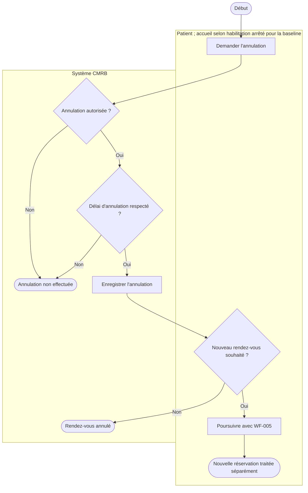

**Décisions applicables.**

- **Q-013:** L'annulation autonome du patient est permise jusqu'à 24 heures incluses avant le début prévu. À moins de 24 heures, l'accueil traite la demande et consigne le motif. Le report annule l'ancien créneau et crée un nouveau rendez-vous lié. La réservation est transactionnelle et interdit le double-booking, sauf dérogation nominative tracée par un responsable.
- **Q-015:** L'agenda est géré par praticien et ressource obligatoire éventuelle. La durée provient du type de rendez-vous et reste paramétrable. Les états sont DEMANDE, À_CONFIRMER, CONFIRMÉ, ARRIVÉ, EN_COURS, TERMINÉ, ANNULÉ_PATIENT, ANNULÉ_CMRB, ABSENT et REPORTÉ. Les absences, congés, conflits et surbooking exceptionnel sont tracés.
- **Q-025:** Chaque personne possède un compte nominatif et des rôles cumulables approuvés par un administrateur désigné par la direction. Le premier lien patient exige date de naissance, code à usage unique sur contact vérifié et validation manuelle en cas d'écart. MFA est obligatoire pour comptes internes sensibles; inactivité 15 minutes, durée maximale 12 heures, révocation immédiate. Un accès d'urgence médical exige motif et alerte au directeur médical.
- **Q-026:** Cibles V1 : p95 ≤ 2 s pour les actions courantes et ≤ 10 s pour les rapports; disponibilité mensuelle 99,5 % hors maintenance annoncée limitée à 4 h/mois; RPO 15 min et RTO 4 h; sauvegardes chiffrées quotidiennes 35 jours et mensuelles 12 mois; 200 utilisateurs simultanés, 100 000 patients et 20 % de croissance annuelle; navigateurs majeurs sur leurs deux dernières versions; SLA P1 prise en charge 30 min et contournement 4 h.
- **Q-012:** Aucune suppression physique automatique n'est autorisée. Les dossiers cliniques sont conservés 25 ans après le dernier épisode; les dossiers de mineurs au moins jusqu'au 28e anniversaire et jamais moins de 25 ans après le dernier épisode. Les pièces financières sont conservées 10 ans, les données RH 10 ans après départ, les journaux de sécurité 12 mois et les traces d'accès clinique 10 ans. Un gel juridique suspend toute échéance. À terme, anonymisation irréversible après autorisation du responsable désigné.
- **Q-033:** La production et les sauvegardes sont hébergées dans une zone approuvée contractuellement, avec préférence Côte d'Ivoire; tout transfert hors territoire exige l'analyse et les formalités applicables. La reprise V1 utilise des modèles CSV contrôlés, rapprochement des totaux et procès-verbal. La bascule suit répétition, gel, sauvegarde, migration, contrôle, décision go/no-go et retour arrière.

**Recette.** TEST-008.


### WF-009 — Relever les constantes avant consultation

**Finalité.** Constantes associées au contexte clinique, sous réserve de résolution du conflit.

**Acteur principal :** ACT-003, sous réserve de Q-002.

Les autres acteurs concernés et leurs responsabilités figurent dans le tableau ci-dessous ; leur présence ne vaut pas attribution de permission.

| Acteur | Responsabilité dans le parcours |
| --- | --- |
| ACT-003 | Personnel paramédical / infirmier: Constantes avant médecin; médicaments à clarifier. |
| ACT-002 | Médecin: Consultation et dossier clinique; orientation médicale. |
| ACT-012 | Système CMRB: Application web, contrôles et enregistrement. |

**Déclencheur.** Arrivée du patient pour consultation.

**Préconditions.** Le patient est identifié avant consultation. L’autorisation paramédicale de saisir les constantes est en conflit avec la restriction d’écriture médicale (Q-002).

**Scénario principal.**

1. Le paramédical identifie le patient.
2. Le paramédical relève tension, température et glycémie selon le SRS.
3. La saisie n’est détaillable qu’après arbitrage des droits sur les constantes.
4. Le système rend la consultation en attente visible au médecin.

**Variantes et erreurs.**

Le paramédical n'administre qu'un médicament prescrit et trace l'administration; en urgence, le médecin peut commencer l'épisode et les constantes sont complétées dès que possible.

Valeur ou unité invalide : règles arrêté pour la baseline; mauvaise identité : interrompre rattachement; conflit de droits : branche bloquée.

Décision de cadrage technique : toute mutation est atomique, idempotente lorsqu'une clé de requête existe et protégée par contrôle de version. Une opération refusée n'a aucun effet métier; les doublons sont signalés et aucune fusion ou correction automatique n'est autorisée.

**Règles et autorisations.**

BR-002

**SEC-009** — ACT-003 saisit les constantes selon annotation, en conflit avec EF-SEC-002 et AC-05. Aucun droit sur diagnostic déduit.

La [matrice par action](ROLE_PERMISSION_MATRIX.md) est normative. Le serveur contrôle rôle, action et ressource selon Q-025/Q-031; tout conflit ou droit absent produit un refus tracé. Une dérogation exige un accès d'urgence médical motivé ou une demande de changement approuvée.

**Données.**

L = lecture, C = création, M = modification, X = opération spéciale définie par la matrice et la décision applicable. Les mutations constituent la baseline fonctionnelle; le schéma physique en sera dérivé.

| Entité | Concept | Opération de baseline | Condition |
| --- | --- | --- | --- |
| ENT-004 | Patient | L | Sous réserve des droits et cardinalités; voir dictionnaire |
| ENT-006 | Dossier médical | L | Sous réserve des droits et cardinalités; voir dictionnaire |
| ENT-008 | Prestation | M | Sous réserve des droits et cardinalités; voir dictionnaire |
| ENT-015 | Constantes | C | Sous réserve des droits et cardinalités; voir dictionnaire |

**Notifications et audit.**

Aucune notification nouvelle explicitement requise pour ce parcours. Les notifications éventuelles sont régis par les décisions associées.

La baseline Q-012/Q-026 impose un audit immuable et minimisé. Ce parcours manipule Patient, Dossier médical, Prestation, Constantes.

DECISION_DE_CADRAGE : tracer l’acteur, l’action, la référence de ressource, la date et le résultat, sans recopier les données médicales, secrets ni moyens de paiement. Pour une mutation, étudier la preuve de changement séparément des métadonnées courantes. Événements audités : demande de relever les constantes avant consultation, succès, refus et erreur. Consultation sensible et durée de conservation arbitré par la baseline Q-026 / Q-012.

**Résultat.** Constantes associées au contexte clinique, sous réserve de résolution du conflit. En cas de refus, aucune réussite métier n’est annoncée. Les états persistés définis par la baseline sont régis par les décisions associées; ces termes ne constituent pas une énumération de base de données.

**Diagramme.**

Lecture : rectangles = actions ; losanges = décisions ; formes arrondies = début ou résultat du parcours ; couloirs = responsabilités. Les résultats ne sont pas des statuts de base de données. Les contrôles et l’ordre retenu pour la baselines restent soumis aux règles et autorisations de cette fiche ; une décision métier manquante n’est jamais une branche d’exécution.

Décision de baseline : ce parcours décrit l’annotation sur les constantes ; il ne tranche pas le conflit d’écriture paramédicale (Q-002). Aucune permission de diagnostic n’est déduite de la saisie des constantes.

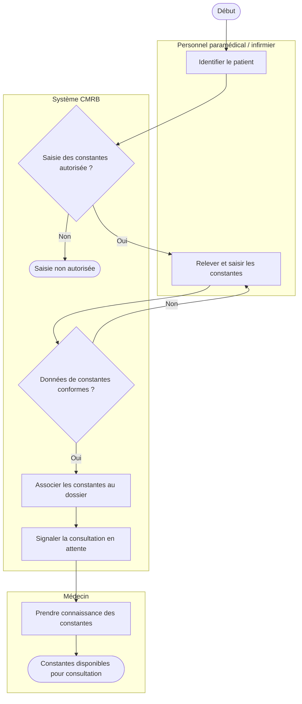

**Décisions applicables.**

- **Q-002:** Le paramédical lit les données nécessaires à l'épisode actif et saisit les constantes, allergies signalées, observations de soins et administrations de médicaments prescrits. Il ne saisit ni diagnostic, ni prescription, ni compte rendu final. Avant validation médicale il corrige sa saisie; après validation, toute correction est un addendum tracé.
- **Q-025:** Chaque personne possède un compte nominatif et des rôles cumulables approuvés par un administrateur désigné par la direction. Le premier lien patient exige date de naissance, code à usage unique sur contact vérifié et validation manuelle en cas d'écart. MFA est obligatoire pour comptes internes sensibles; inactivité 15 minutes, durée maximale 12 heures, révocation immédiate. Un accès d'urgence médical exige motif et alerte au directeur médical.
- **Q-026:** Cibles V1 : p95 ≤ 2 s pour les actions courantes et ≤ 10 s pour les rapports; disponibilité mensuelle 99,5 % hors maintenance annoncée limitée à 4 h/mois; RPO 15 min et RTO 4 h; sauvegardes chiffrées quotidiennes 35 jours et mensuelles 12 mois; 200 utilisateurs simultanés, 100 000 patients et 20 % de croissance annuelle; navigateurs majeurs sur leurs deux dernières versions; SLA P1 prise en charge 30 min et contournement 4 h.
- **Q-012:** Aucune suppression physique automatique n'est autorisée. Les dossiers cliniques sont conservés 25 ans après le dernier épisode; les dossiers de mineurs au moins jusqu'au 28e anniversaire et jamais moins de 25 ans après le dernier épisode. Les pièces financières sont conservées 10 ans, les données RH 10 ans après départ, les journaux de sécurité 12 mois et les traces d'accès clinique 10 ans. Un gel juridique suspend toute échéance. À terme, anonymisation irréversible après autorisation du responsable désigné.
- **Q-011:** La création exige nom, prénoms, date de naissance, sexe administratif, au moins un téléphone ou e-mail et le canal de contact. Adresse, pièce d'identité et contact d'urgence sont facultatifs sauf exigence opérationnelle. Le système attribue un identifiant interne immuable, signale les doublons sur identité normalisée, naissance et contact, et interdit toute fusion automatique.
- **Q-033:** La production et les sauvegardes sont hébergées dans une zone approuvée contractuellement, avec préférence Côte d'Ivoire; tout transfert hors territoire exige l'analyse et les formalités applicables. La reprise V1 utilise des modèles CSV contrôlés, rapprochement des totaux et procès-verbal. La bascule suit répétition, gel, sauvegarde, migration, contrôle, décision go/no-go et retour arrière.

**Recette.** TEST-009.


### WF-010 — Réaliser une consultation

**Finalité.** Consultation enregistrée et disponible pour facturation.

**Acteur principal :** ACT-002.

Les autres acteurs concernés et leurs responsabilités figurent dans le tableau ci-dessous ; leur présence ne vaut pas attribution de permission.

| Acteur | Responsabilité dans le parcours |
| --- | --- |
| ACT-002 | Médecin: Consultation et dossier clinique; orientation médicale. |
| ACT-003 | Personnel paramédical / infirmier: Constantes avant médecin; médicaments à clarifier. |
| ACT-012 | Système CMRB: Application web, contrôles et enregistrement. |

**Déclencheur.** Consultation en attente prise par un médecin.

**Préconditions.** Le médecin demande le dossier d’un patient identifié. L’accès est contrôlé avant présentation ; le contenu clinique et les orientations restent soumis aux décisions de baseline associées.

**Scénario principal.**

1. Le médecin identifie le patient et consulte l’historique.
2. Le médecin examine le patient et renseigne le dossier.
3. Le médecin peut joindre des documents ou rédiger une ordonnance selon contenu arrêté pour la baseline.
4. Le système enregistre la consultation comme prestation.
5. Le médecin oriente vers observation ou hospitalisation; admission, lit, transfert et sortie suivent Q-016.

**Variantes et erreurs.**

Consultation avec ou sans rendez-vous est précisé par la décision de baseline associée; orientation séjour n’est pas une admission automatique.

Document invalide ou enregistrement concurrent : reprise défini par la baseline; utilisateur non médecin : interdiction générale, hors conflit paramédical enregistré.

Décision de cadrage technique : toute mutation est atomique, idempotente lorsqu'une clé de requête existe et protégée par contrôle de version. Une opération refusée n'a aucun effet métier; les doublons sont signalés et aucune fusion ou correction automatique n'est autorisée.

**Règles et autorisations.**

BR-002

**SEC-010** — ACT-002 renseigne le dossier médical. L’ajout des constantes par ACT-003 exige Q-002; ajout de pièces jointes soumis au même périmètre.

La [matrice par action](ROLE_PERMISSION_MATRIX.md) est normative. Le serveur contrôle rôle, action et ressource selon Q-025/Q-031; tout conflit ou droit absent produit un refus tracé. Une dérogation exige un accès d'urgence médical motivé ou une demande de changement approuvée.

**Données.**

L = lecture, C = création, M = modification, X = opération spéciale définie par la matrice et la décision applicable. Les mutations constituent la baseline fonctionnelle; le schéma physique en sera dérivé.

| Entité | Concept | Opération de baseline | Condition |
| --- | --- | --- | --- |
| ENT-004 | Patient | L | Sous réserve des droits et cardinalités; voir dictionnaire |
| ENT-006 | Dossier médical | M | Sous réserve des droits et cardinalités; voir dictionnaire |
| ENT-008 | Prestation | C | Sous réserve des droits et cardinalités; voir dictionnaire |
| ENT-015 | Constantes | L | Sous réserve des droits et cardinalités; voir dictionnaire |
| ENT-019 | Ordonnance | C | Sous réserve des droits et cardinalités; voir dictionnaire |
| ENT-020 | Pièce jointe | C | Sous réserve des droits et cardinalités; voir dictionnaire |

**Notifications et audit.**

Aucune notification nouvelle explicitement requise pour ce parcours. Les notifications éventuelles sont régis par les décisions associées.

La baseline Q-012/Q-026 impose un audit immuable et minimisé. Ce parcours manipule Patient, Dossier médical, Prestation, Constantes, Ordonnance, Pièce jointe.

DECISION_DE_CADRAGE : tracer l’acteur, l’action, la référence de ressource, la date et le résultat, sans recopier les données médicales, secrets ni moyens de paiement. Pour une mutation, étudier la preuve de changement séparément des métadonnées courantes. Événements audités : demande de réaliser une consultation, succès, refus et erreur. Consultation sensible et durée de conservation arbitré par la baseline Q-026 / Q-012.

**Résultat.** Consultation enregistrée et disponible pour facturation. En cas de refus, aucune réussite métier n’est annoncée. Les états persistés définis par la baseline sont régis par les décisions associées; ces termes ne constituent pas une énumération de base de données.

**Diagramme.**

Lecture : rectangles = actions ; losanges = décisions ; formes arrondies = début ou résultat du parcours ; couloirs = responsabilités. Les résultats ne sont pas des statuts de base de données. Les contrôles et l’ordre retenu pour la baselines restent soumis aux règles et autorisations de cette fiche ; une décision métier manquante n’est jamais une branche d’exécution.

Les conditions de conformité renvoient aux préconditions et aux décisions de baseline de cette fiche. Elles ne définissent aucune validation de saisie ou permission supplémentaire.

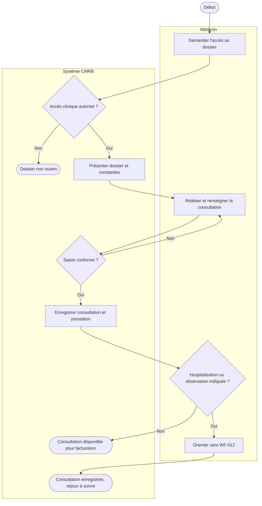

**Décisions applicables.**

- **Q-002:** Le paramédical lit les données nécessaires à l'épisode actif et saisit les constantes, allergies signalées, observations de soins et administrations de médicaments prescrits. Il ne saisit ni diagnostic, ni prescription, ni compte rendu final. Avant validation médicale il corrige sa saisie; après validation, toute correction est un addendum tracé.
- **Q-025:** Chaque personne possède un compte nominatif et des rôles cumulables approuvés par un administrateur désigné par la direction. Le premier lien patient exige date de naissance, code à usage unique sur contact vérifié et validation manuelle en cas d'écart. MFA est obligatoire pour comptes internes sensibles; inactivité 15 minutes, durée maximale 12 heures, révocation immédiate. Un accès d'urgence médical exige motif et alerte au directeur médical.
- **Q-026:** Cibles V1 : p95 ≤ 2 s pour les actions courantes et ≤ 10 s pour les rapports; disponibilité mensuelle 99,5 % hors maintenance annoncée limitée à 4 h/mois; RPO 15 min et RTO 4 h; sauvegardes chiffrées quotidiennes 35 jours et mensuelles 12 mois; 200 utilisateurs simultanés, 100 000 patients et 20 % de croissance annuelle; navigateurs majeurs sur leurs deux dernières versions; SLA P1 prise en charge 30 min et contournement 4 h.
- **Q-012:** Aucune suppression physique automatique n'est autorisée. Les dossiers cliniques sont conservés 25 ans après le dernier épisode; les dossiers de mineurs au moins jusqu'au 28e anniversaire et jamais moins de 25 ans après le dernier épisode. Les pièces financières sont conservées 10 ans, les données RH 10 ans après départ, les journaux de sécurité 12 mois et les traces d'accès clinique 10 ans. Un gel juridique suspend toute échéance. À terme, anonymisation irréversible après autorisation du responsable désigné.
- **Q-016:** Le médecin décide observation ou hospitalisation. Le séjour comprend admission, affectation chambre/lit, transferts historisés, épisodes de soins, sortie signée et clôture administrative. L'observation peut rester sans lit permanent. La facture détaille chambre par nuit, visites, soins infirmiers, pharmacie, laboratoire, imagerie et autres prestations réellement enregistrées.
- **Q-028:** Les pièces jointes V1 acceptent PDF, JPEG et PNG, 10 Mo maximum par fichier. Le système vérifie extension, type MIME, signature, taille et antivirus, calcule SHA-256, chiffre le stockage et interdit l'exécution. Les versions sont immuables; validation, publication, remplacement par nouvelle version et téléchargement sont autorisés selon rôle et ressource.
- **Q-033:** La production et les sauvegardes sont hébergées dans une zone approuvée contractuellement, avec préférence Côte d'Ivoire; tout transfert hors territoire exige l'analyse et les formalités applicables. La reprise V1 utilise des modèles CSV contrôlés, rapprochement des totaux et procès-verbal. La bascule suit répétition, gel, sauvegarde, migration, contrôle, décision go/no-go et retour arrière.

**Recette.** TEST-010.


### WF-011 — Consulter l’historique médical

**Finalité.** Historique consulté; aucune publication patient induite.

**Acteur principal :** ACT-002.

Les autres acteurs concernés et leurs responsabilités figurent dans le tableau ci-dessous ; leur présence ne vaut pas attribution de permission.

| Acteur | Responsabilité dans le parcours |
| --- | --- |
| ACT-002 | Médecin: Consultation et dossier clinique; orientation médicale. |
| ACT-012 | Système CMRB: Application web, contrôles et enregistrement. |

**Déclencheur.** Besoin clinique d’historique.

**Préconditions.** Le patient est identifié. Le médecin possède le droit de lecture médicale applicable ; l’historique est distinct de sa publication au patient.

**Scénario principal.**

1. Le médecin sélectionne le patient.
2. Le système vérifie le droit de lecture clinique.
3. Le système présente les éléments médicaux disponibles.
4. Le médecin consulte les éléments du dossier sans les modifier dans ce parcours.

**Variantes et erreurs.**

Lecture par d’autres rôles non confirmée; portail patient traité séparément.

Historique vide distinct d’erreur technique; document non autorisé non divulgué; identité ambiguë nécessite sélection sûre.

Décision de cadrage technique : toute mutation est atomique, idempotente lorsqu'une clé de requête existe et protégée par contrôle de version. Une opération refusée n'a aucun effet métier; les doublons sont signalés et aucune fusion ou correction automatique n'est autorisée.

**Règles et autorisations.**

BR-001

**SEC-011** — ACT-002 lit l’historique. Le droit de lecture médicale d’autres profils n’est pas accordé par leur seule participation aux soins.

La [matrice par action](ROLE_PERMISSION_MATRIX.md) est normative. Le serveur contrôle rôle, action et ressource selon Q-025/Q-031; tout conflit ou droit absent produit un refus tracé. Une dérogation exige un accès d'urgence médical motivé ou une demande de changement approuvée.

**Données.**

L = lecture, C = création, M = modification, X = opération spéciale définie par la matrice et la décision applicable. Les mutations constituent la baseline fonctionnelle; le schéma physique en sera dérivé.

| Entité | Concept | Opération de baseline | Condition |
| --- | --- | --- | --- |
| ENT-004 | Patient | L | Sous réserve des droits et cardinalités; voir dictionnaire |
| ENT-006 | Dossier médical | L | Sous réserve des droits et cardinalités; voir dictionnaire |
| ENT-008 | Prestation | L | Sous réserve des droits et cardinalités; voir dictionnaire |
| ENT-018 | Résultat / compte rendu | L | Sous réserve des droits et cardinalités; voir dictionnaire |
| ENT-019 | Ordonnance | L | Sous réserve des droits et cardinalités; voir dictionnaire |
| ENT-020 | Pièce jointe | L | Sous réserve des droits et cardinalités; voir dictionnaire |

**Notifications et audit.**

Aucune notification nouvelle explicitement requise pour ce parcours. Les notifications éventuelles sont régis par les décisions associées.

La baseline Q-012/Q-026 impose un audit immuable et minimisé. Ce parcours manipule Patient, Dossier médical, Prestation, Résultat / compte rendu, Ordonnance, Pièce jointe.

DECISION_DE_CADRAGE : tracer l’acteur, l’action, la référence de ressource, la date et le résultat, sans recopier les données médicales, secrets ni moyens de paiement. Pour une mutation, étudier la preuve de changement séparément des métadonnées courantes. Événements audités : demande de consulter l’historique médical, succès, refus et erreur. Consultation sensible et durée de conservation arbitré par la baseline Q-026 / Q-012.

**Résultat.** Historique consulté; aucune publication patient induite. En cas de refus, aucune réussite métier n’est annoncée. Les états persistés définis par la baseline sont régis par les décisions associées; ces termes ne constituent pas une énumération de base de données.

**Diagramme.**

Lecture : rectangles = actions ; losanges = décisions ; formes arrondies = début ou résultat du parcours ; couloirs = responsabilités. Les résultats ne sont pas des statuts de base de données. Les contrôles et l’ordre retenu pour la baselines restent soumis aux règles et autorisations de cette fiche ; une décision métier manquante n’est jamais une branche d’exécution.

Les conditions de conformité renvoient aux préconditions et aux décisions de baseline de cette fiche. Elles ne définissent aucune validation de saisie ou permission supplémentaire.

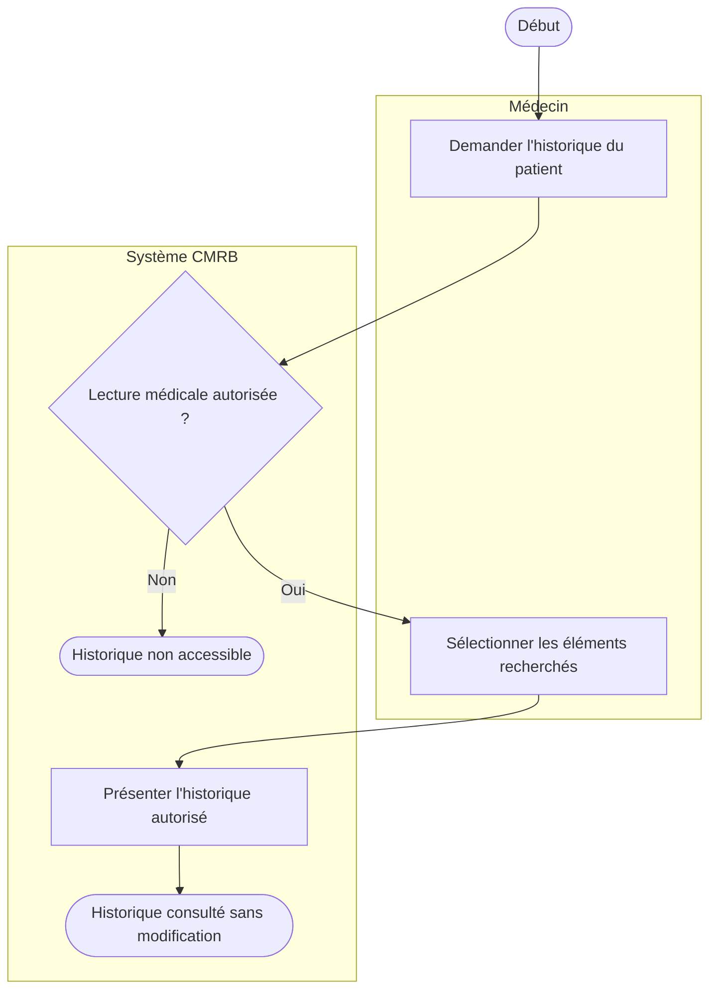

**Décisions applicables.**

- **Q-025:** Chaque personne possède un compte nominatif et des rôles cumulables approuvés par un administrateur désigné par la direction. Le premier lien patient exige date de naissance, code à usage unique sur contact vérifié et validation manuelle en cas d'écart. MFA est obligatoire pour comptes internes sensibles; inactivité 15 minutes, durée maximale 12 heures, révocation immédiate. Un accès d'urgence médical exige motif et alerte au directeur médical.
- **Q-026:** Cibles V1 : p95 ≤ 2 s pour les actions courantes et ≤ 10 s pour les rapports; disponibilité mensuelle 99,5 % hors maintenance annoncée limitée à 4 h/mois; RPO 15 min et RTO 4 h; sauvegardes chiffrées quotidiennes 35 jours et mensuelles 12 mois; 200 utilisateurs simultanés, 100 000 patients et 20 % de croissance annuelle; navigateurs majeurs sur leurs deux dernières versions; SLA P1 prise en charge 30 min et contournement 4 h.
- **Q-012:** Aucune suppression physique automatique n'est autorisée. Les dossiers cliniques sont conservés 25 ans après le dernier épisode; les dossiers de mineurs au moins jusqu'au 28e anniversaire et jamais moins de 25 ans après le dernier épisode. Les pièces financières sont conservées 10 ans, les données RH 10 ans après départ, les journaux de sécurité 12 mois et les traces d'accès clinique 10 ans. Un gel juridique suspend toute échéance. À terme, anonymisation irréversible après autorisation du responsable désigné.
- **Q-002:** Le paramédical lit les données nécessaires à l'épisode actif et saisit les constantes, allergies signalées, observations de soins et administrations de médicaments prescrits. Il ne saisit ni diagnostic, ni prescription, ni compte rendu final. Avant validation médicale il corrige sa saisie; après validation, toute correction est un addendum tracé.
- **Q-003:** Le portail expose au patient authentifié ses données d'identité, rendez-vous, factures, reçus, ordonnances signées encore visibles, résultats publiés et comptes rendus de sortie signés. Les brouillons, notes internes, données de tiers et journaux restent exclus. La visibilité commence à la publication et exige un lien compte-patient vérifié.
- **Q-028:** Les pièces jointes V1 acceptent PDF, JPEG et PNG, 10 Mo maximum par fichier. Le système vérifie extension, type MIME, signature, taille et antivirus, calcule SHA-256, chiffre le stockage et interdit l'exécution. Les versions sont immuables; validation, publication, remplacement par nouvelle version et téléchargement sont autorisés selon rôle et ressource.
- **Q-033:** La production et les sauvegardes sont hébergées dans une zone approuvée contractuellement, avec préférence Côte d'Ivoire; tout transfert hors territoire exige l'analyse et les formalités applicables. La reprise V1 utilise des modèles CSV contrôlés, rapprochement des totaux et procès-verbal. La bascule suit répétition, gel, sauvegarde, migration, contrôle, décision go/no-go et retour arrière.

**Recette.** TEST-011.


### WF-012 — Suivre hospitalisation ou observation

**Finalité.** Séjour ouvert, lit affecté si hospitalisation, transferts historisés, prestations rattachées et sortie signée selon Q-016.

**Acteur principal :** ACT-002 pour l’orientation ; répartition des autres actes arrêté pour la baseline.

Les autres acteurs concernés et leurs responsabilités figurent dans le tableau ci-dessous ; leur présence ne vaut pas attribution de permission.

| Acteur | Responsabilité dans le parcours |
| --- | --- |
| ACT-002 | Médecin: Consultation et dossier clinique; orientation médicale. |
| ACT-003 | Personnel paramédical / infirmier: Constantes avant médecin; médicaments à clarifier. |
| ACT-001 | Personnel administratif: Inscription et rendez-vous; facturation/paiement en conflit avec matrice. |
| ACT-012 | Système CMRB: Application web, contrôles et enregistrement. |

**Déclencheur.** Orientation médicale vers un séjour.

**Préconditions.** Une hospitalisation ou observation est indiquée par le médecin; admission, chambre/lit, transferts historisés et sortie signée suivent Q-016.

**Scénario principal.**

1. Le médecin indique hospitalisation ou observation.
2. Les modalités d’admission et d’affectation de chambre restent arrêté pour la baseline.
3. Les intervenants consignent les prestations du séjour selon leurs droits.
4. La sortie est décidée par un acteur arrêté pour la baseline.
5. Les éléments du séjour alimentent sa facturation.

**Variantes et erreurs.**

Chambre individuelle ou double citée; transfert, lit, durée d’observation et passage en hospitalisation définis par la baseline.

Chambre indisponible, sortie avec acte manquant ou séjour concomitant : décisions métier absentes; aucun automatisme inventé.

Décision de cadrage technique : toute mutation est atomique, idempotente lorsqu'une clé de requête existe et protégée par contrôle de version. Une opération refusée n'a aucun effet métier; les doublons sont signalés et aucune fusion ou correction automatique n'est autorisée.

**Règles et autorisations.**

Les exigences liées, règles transverses et décisions Q citées sont normatives pour ce workflow.

**SEC-012** — ACT-002 oriente vers le séjour. Autorité d’admission/sortie et saisie de soins par ACT-003 non détaillées.

La [matrice par action](ROLE_PERMISSION_MATRIX.md) est normative. Le serveur contrôle rôle, action et ressource selon Q-025/Q-031; tout conflit ou droit absent produit un refus tracé. Une dérogation exige un accès d'urgence médical motivé ou une demande de changement approuvée.

**Données.**

L = lecture, C = création, M = modification, X = opération spéciale définie par la matrice et la décision applicable. Les mutations constituent la baseline fonctionnelle; le schéma physique en sera dérivé.

| Entité | Concept | Opération de baseline | Condition |
| --- | --- | --- | --- |
| ENT-004 | Patient | L | Sous réserve des droits et cardinalités; voir dictionnaire |
| ENT-008 | Prestation | C | Sous réserve des droits et cardinalités; voir dictionnaire |
| ENT-016 | Séjour / observation | C/M | Sous réserve des droits et cardinalités; voir dictionnaire |
| ENT-017 | Chambre | L | Sous réserve des droits et cardinalités; voir dictionnaire |

**Notifications et audit.**

Aucune notification nouvelle explicitement requise pour ce parcours. Les notifications éventuelles sont régis par les décisions associées.

La baseline Q-012/Q-026 impose un audit immuable et minimisé. Ce parcours manipule Patient, Prestation, Séjour / observation, Chambre.

DECISION_DE_CADRAGE : tracer l’acteur, l’action, la référence de ressource, la date et le résultat, sans recopier les données médicales, secrets ni moyens de paiement. Pour une mutation, étudier la preuve de changement séparément des métadonnées courantes. Événements audités : demande de suivre hospitalisation ou observation, succès, refus et erreur. Consultation sensible et durée de conservation arbitré par la baseline Q-026 / Q-012.

**Résultat.** Séjour ouvert, lit affecté si hospitalisation, transferts historisés, prestations rattachées et sortie signée selon Q-016. En cas de refus, aucune réussite métier n’est annoncée. Les états persistés définis par la baseline sont régis par les décisions associées; ces termes ne constituent pas une énumération de base de données.

**Diagramme.**

Lecture : rectangles = actions ; losanges = décisions ; formes arrondies = début ou résultat du parcours ; couloirs = responsabilités. Les résultats ne sont pas des statuts de base de données. Les contrôles et l’ordre retenu pour la baselines restent soumis aux règles et autorisations de cette fiche ; une décision métier manquante n’est jamais une branche d’exécution.

Décision de baseline : vue partielle des liens entre orientation, séjour et prestations. Les étapes d’admission, de sortie et leurs responsables ne sont pas inventés. Cette vue ne permet pas encore d’implémenter la gestion complète du séjour (Q-016).

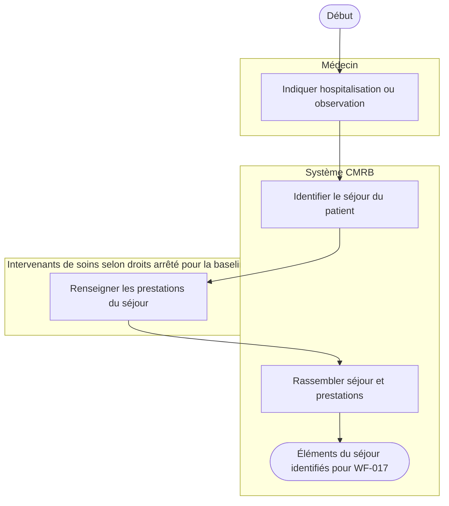

**Décisions applicables.**

- **Q-016:** Le médecin décide observation ou hospitalisation. Le séjour comprend admission, affectation chambre/lit, transferts historisés, épisodes de soins, sortie signée et clôture administrative. L'observation peut rester sans lit permanent. La facture détaille chambre par nuit, visites, soins infirmiers, pharmacie, laboratoire, imagerie et autres prestations réellement enregistrées.
- **Q-025:** Chaque personne possède un compte nominatif et des rôles cumulables approuvés par un administrateur désigné par la direction. Le premier lien patient exige date de naissance, code à usage unique sur contact vérifié et validation manuelle en cas d'écart. MFA est obligatoire pour comptes internes sensibles; inactivité 15 minutes, durée maximale 12 heures, révocation immédiate. Un accès d'urgence médical exige motif et alerte au directeur médical.
- **Q-026:** Cibles V1 : p95 ≤ 2 s pour les actions courantes et ≤ 10 s pour les rapports; disponibilité mensuelle 99,5 % hors maintenance annoncée limitée à 4 h/mois; RPO 15 min et RTO 4 h; sauvegardes chiffrées quotidiennes 35 jours et mensuelles 12 mois; 200 utilisateurs simultanés, 100 000 patients et 20 % de croissance annuelle; navigateurs majeurs sur leurs deux dernières versions; SLA P1 prise en charge 30 min et contournement 4 h.
- **Q-012:** Aucune suppression physique automatique n'est autorisée. Les dossiers cliniques sont conservés 25 ans après le dernier épisode; les dossiers de mineurs au moins jusqu'au 28e anniversaire et jamais moins de 25 ans après le dernier épisode. Les pièces financières sont conservées 10 ans, les données RH 10 ans après départ, les journaux de sécurité 12 mois et les traces d'accès clinique 10 ans. Un gel juridique suspend toute échéance. À terme, anonymisation irréversible après autorisation du responsable désigné.
- **Q-002:** Le paramédical lit les données nécessaires à l'épisode actif et saisit les constantes, allergies signalées, observations de soins et administrations de médicaments prescrits. Il ne saisit ni diagnostic, ni prescription, ni compte rendu final. Avant validation médicale il corrige sa saisie; après validation, toute correction est un addendum tracé.
- **Q-033:** La production et les sauvegardes sont hébergées dans une zone approuvée contractuellement, avec préférence Côte d'Ivoire; tout transfert hors territoire exige l'analyse et les formalités applicables. La reprise V1 utilise des modèles CSV contrôlés, rapprochement des totaux et procès-verbal. La bascule suit répétition, gel, sauvegarde, migration, contrôle, décision go/no-go et retour arrière.

**Recette.** TEST-012.


### WF-013 — Enregistrer prestation et résultat de laboratoire

**Finalité.** Prestation enregistrée; résultat non automatiquement publié au portail.

**Acteur principal :** ACT-010 pour la saisie ; réalisation par le service et validation/publication selon Q-017.

Les autres acteurs concernés et leurs responsabilités figurent dans le tableau ci-dessous ; leur présence ne vaut pas attribution de permission.

| Acteur | Responsabilité dans le parcours |
| --- | --- |
| ACT-010 | Assistante: Saisie de résultats de laboratoire. |
| ACT-002 | Médecin: Consultation et dossier clinique; orientation médicale. |
| ACT-012 | Système CMRB: Application web, contrôles et enregistrement. |

**Déclencheur.** Prestation de laboratoire à enregistrer.

**Préconditions.** Le patient, la prestation de laboratoire et le résultat à saisir sont identifiés. Les validations de contenu et le circuit de publication restent défini par la baseline (Q-017).

**Scénario principal.**

1. L’utilisateur habilité rattache la prestation au patient.
2. Le technicien enregistre réalisation et prélèvement; le résultat suit les états brouillon, validé puis publié selon Q-017.
3. L’assistante peut saisir les résultats selon l’annotation.
4. Le système conserve la prestation et le résultat sans déduire une validation médicale.
5. Le circuit de validation et de publication reste hors de cette vue, arbitré par la baseline.

**Variantes et erreurs.**

Résultat textuel ou document arrêté pour la baseline; intégration automate non confirmée.

Résultat rattaché au mauvais patient, correction après diffusion, pièce jointe invalide : règles défini par la baseline avant publication.

Décision de cadrage technique : toute mutation est atomique, idempotente lorsqu'une clé de requête existe et protégée par contrôle de version. Une opération refusée n'a aucun effet métier; les doublons sont signalés et aucune fusion ou correction automatique n'est autorisée.

**Règles et autorisations.**

Les exigences liées, règles transverses et décisions Q citées sont normatives pour ce workflow.

**SEC-013** — ACT-010 est mentionné pour saisie du résultat; ni validation ni publication ne lui sont implicitement attribuées.

La [matrice par action](ROLE_PERMISSION_MATRIX.md) est normative. Le serveur contrôle rôle, action et ressource selon Q-025/Q-031; tout conflit ou droit absent produit un refus tracé. Une dérogation exige un accès d'urgence médical motivé ou une demande de changement approuvée.

**Données.**

L = lecture, C = création, M = modification, X = opération spéciale définie par la matrice et la décision applicable. Les mutations constituent la baseline fonctionnelle; le schéma physique en sera dérivé.

| Entité | Concept | Opération de baseline | Condition |
| --- | --- | --- | --- |
| ENT-004 | Patient | L | Sous réserve des droits et cardinalités; voir dictionnaire |
| ENT-008 | Prestation | C | Sous réserve des droits et cardinalités; voir dictionnaire |
| ENT-018 | Résultat / compte rendu | C/M | Sous réserve des droits et cardinalités; voir dictionnaire |
| ENT-020 | Pièce jointe | C | Sous réserve des droits et cardinalités; voir dictionnaire |

**Notifications et audit.**

Aucune notification nouvelle explicitement requise pour ce parcours. Les notifications éventuelles sont régis par les décisions associées.

La baseline Q-012/Q-026 impose un audit immuable et minimisé. Ce parcours manipule Patient, Prestation, Résultat / compte rendu, Pièce jointe.

DECISION_DE_CADRAGE : tracer l’acteur, l’action, la référence de ressource, la date et le résultat, sans recopier les données médicales, secrets ni moyens de paiement. Pour une mutation, étudier la preuve de changement séparément des métadonnées courantes. Événements audités : demande de enregistrer prestation et résultat de laboratoire, succès, refus et erreur. Consultation sensible et durée de conservation arbitré par la baseline Q-026 / Q-012.

**Résultat.** Prestation enregistrée; résultat non automatiquement publié au portail. En cas de refus, aucune réussite métier n’est annoncée. Les états persistés définis par la baseline sont régis par les décisions associées; ces termes ne constituent pas une énumération de base de données.

**Diagramme.**

Lecture : rectangles = actions ; losanges = décisions ; formes arrondies = début ou résultat du parcours ; couloirs = responsabilités. Les résultats ne sont pas des statuts de base de données. Les contrôles et l’ordre retenu pour la baselines restent soumis aux règles et autorisations de cette fiche ; une décision métier manquante n’est jamais une branche d’exécution.

Décision de baseline : la saisie par l’assistante n’implique aucun droit de validation ou publication. Le diagramme s’arrête à l’enregistrement ; le circuit de réalisation et de diffusion reste ouvert (Q-017).

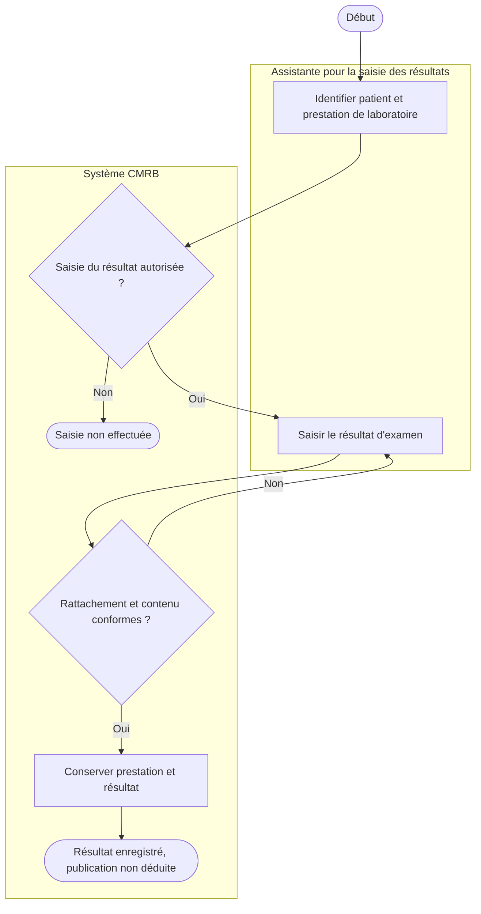

**Décisions applicables.**

- **Q-017:** Le technicien ou l'assistante habilitée saisit un brouillon de résultat; le responsable du service ou médecin habilité le valide; le médecin prescripteur ou le valideur autorisé le publie. Après validation, aucune modification destructive : une correction crée une nouvelle version et un addendum motivé. Seule la version publiée est visible au patient.
- **Q-025:** Chaque personne possède un compte nominatif et des rôles cumulables approuvés par un administrateur désigné par la direction. Le premier lien patient exige date de naissance, code à usage unique sur contact vérifié et validation manuelle en cas d'écart. MFA est obligatoire pour comptes internes sensibles; inactivité 15 minutes, durée maximale 12 heures, révocation immédiate. Un accès d'urgence médical exige motif et alerte au directeur médical.
- **Q-026:** Cibles V1 : p95 ≤ 2 s pour les actions courantes et ≤ 10 s pour les rapports; disponibilité mensuelle 99,5 % hors maintenance annoncée limitée à 4 h/mois; RPO 15 min et RTO 4 h; sauvegardes chiffrées quotidiennes 35 jours et mensuelles 12 mois; 200 utilisateurs simultanés, 100 000 patients et 20 % de croissance annuelle; navigateurs majeurs sur leurs deux dernières versions; SLA P1 prise en charge 30 min et contournement 4 h.
- **Q-012:** Aucune suppression physique automatique n'est autorisée. Les dossiers cliniques sont conservés 25 ans après le dernier épisode; les dossiers de mineurs au moins jusqu'au 28e anniversaire et jamais moins de 25 ans après le dernier épisode. Les pièces financières sont conservées 10 ans, les données RH 10 ans après départ, les journaux de sécurité 12 mois et les traces d'accès clinique 10 ans. Un gel juridique suspend toute échéance. À terme, anonymisation irréversible après autorisation du responsable désigné.
- **Q-028:** Les pièces jointes V1 acceptent PDF, JPEG et PNG, 10 Mo maximum par fichier. Le système vérifie extension, type MIME, signature, taille et antivirus, calcule SHA-256, chiffre le stockage et interdit l'exécution. Les versions sont immuables; validation, publication, remplacement par nouvelle version et téléchargement sont autorisés selon rôle et ressource.
- **Q-027:** Les modules métier cœur sont réunis dans CMRB. Les services externes nécessaires restent autorisés derrière des adaptateurs : FNE, SMS/e-mail/WhatsApp, mobile money, hébergement, antivirus et identité. Leur indisponibilité ne doit pas corrompre une transaction; les échanges sont mis en attente, réessayés et rapprochés.
- **Q-033:** La production et les sauvegardes sont hébergées dans une zone approuvée contractuellement, avec préférence Côte d'Ivoire; tout transfert hors territoire exige l'analyse et les formalités applicables. La reprise V1 utilise des modèles CSV contrôlés, rapprochement des totaux et procès-verbal. La bascule suit répétition, gel, sauvegarde, migration, contrôle, décision go/no-go et retour arrière.

**Recette.** TEST-013.


### WF-014 — Enregistrer imagerie et compte rendu

**Finalité.** Prestation d’imagerie enregistrée; diffusion conditionnée aux décisions.

**Acteur principal :** Intervenant d’imagerie à habiliter ; participation ACT-002 arrêté pour la baseline, sans création d’un rôle autonome.

Les autres acteurs concernés et leurs responsabilités figurent dans le tableau ci-dessous ; leur présence ne vaut pas attribution de permission.

| Acteur | Responsabilité dans le parcours |
| --- | --- |
| ACT-002 | Médecin: Consultation et dossier clinique; orientation médicale. |
| ACT-012 | Système CMRB: Application web, contrôles et enregistrement. |

**Déclencheur.** Échographie ou autre imagerie réalisée.

**Préconditions.** Le patient et la prestation d’imagerie sont identifiés. Le rôle de saisie, le contenu et le circuit de diffusion du compte rendu restent arrêté pour la baseline (Q-017).

**Scénario principal.**

1. L’utilisateur à habiliter identifie patient et prestation.
2. Le système enregistre le type d’imagerie.
3. Le compte rendu et les éventuelles pièces jointes sont renseignés selon contenu défini par la baseline.
4. Le système conserve la prestation et le compte rendu sans diffusion implicite.
5. La validation et la visibilité restent défini par la baseline séparément.

**Variantes et erreurs.**

Échographie est un exemple d’imagerie; stockage d’images DICOM non exigé.

Compte rendu absent, document volumineux ou correction : politique non précisée; aucun résultat réputé validé par simple saisie.

Décision de cadrage technique : toute mutation est atomique, idempotente lorsqu'une clé de requête existe et protégée par contrôle de version. Une opération refusée n'a aucun effet métier; les doublons sont signalés et aucune fusion ou correction automatique n'est autorisée.

**Règles et autorisations.**

Les exigences liées, règles transverses et décisions Q citées sont normatives pour ce workflow.

**SEC-014** — Aucun profil de validation/publication du compte rendu n’est arrêté; présence ACT-002 est une participation arrêté pour la baseline.

La [matrice par action](ROLE_PERMISSION_MATRIX.md) est normative. Le serveur contrôle rôle, action et ressource selon Q-025/Q-031; tout conflit ou droit absent produit un refus tracé. Une dérogation exige un accès d'urgence médical motivé ou une demande de changement approuvée.

**Données.**

L = lecture, C = création, M = modification, X = opération spéciale définie par la matrice et la décision applicable. Les mutations constituent la baseline fonctionnelle; le schéma physique en sera dérivé.

| Entité | Concept | Opération de baseline | Condition |
| --- | --- | --- | --- |
| ENT-004 | Patient | L | Sous réserve des droits et cardinalités; voir dictionnaire |
| ENT-008 | Prestation | C | Sous réserve des droits et cardinalités; voir dictionnaire |
| ENT-018 | Résultat / compte rendu | C/M | Sous réserve des droits et cardinalités; voir dictionnaire |
| ENT-020 | Pièce jointe | C | Sous réserve des droits et cardinalités; voir dictionnaire |

**Notifications et audit.**

Aucune notification nouvelle explicitement requise pour ce parcours. Les notifications éventuelles sont régis par les décisions associées.

La baseline Q-012/Q-026 impose un audit immuable et minimisé. Ce parcours manipule Patient, Prestation, Résultat / compte rendu, Pièce jointe.

DECISION_DE_CADRAGE : tracer l’acteur, l’action, la référence de ressource, la date et le résultat, sans recopier les données médicales, secrets ni moyens de paiement. Pour une mutation, étudier la preuve de changement séparément des métadonnées courantes. Événements audités : demande de enregistrer imagerie et compte rendu, succès, refus et erreur. Consultation sensible et durée de conservation arbitré par la baseline Q-026 / Q-012.

**Résultat.** Prestation d’imagerie enregistrée; diffusion conditionnée aux décisions. En cas de refus, aucune réussite métier n’est annoncée. Les états persistés définis par la baseline sont régis par les décisions associées; ces termes ne constituent pas une énumération de base de données.

**Diagramme.**

Lecture : rectangles = actions ; losanges = décisions ; formes arrondies = début ou résultat du parcours ; couloirs = responsabilités. Les résultats ne sont pas des statuts de base de données. Les contrôles et l’ordre retenu pour la baselines restent soumis aux règles et autorisations de cette fiche ; une décision métier manquante n’est jamais une branche d’exécution.

Décision de baseline : rôle de saisie et circuit de validation/publication arrêtés par la baseline. L’enregistrement ne vaut pas validation médicale ni publication au portail (Q-017).

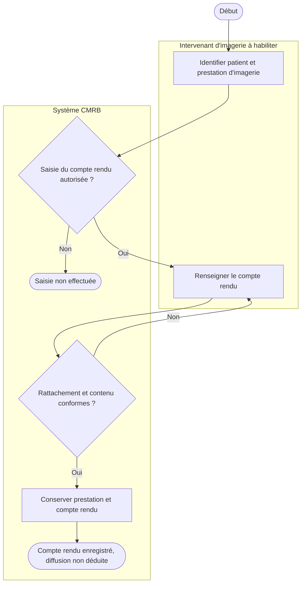

**Décisions applicables.**

- **Q-017:** Le technicien ou l'assistante habilitée saisit un brouillon de résultat; le responsable du service ou médecin habilité le valide; le médecin prescripteur ou le valideur autorisé le publie. Après validation, aucune modification destructive : une correction crée une nouvelle version et un addendum motivé. Seule la version publiée est visible au patient.
- **Q-025:** Chaque personne possède un compte nominatif et des rôles cumulables approuvés par un administrateur désigné par la direction. Le premier lien patient exige date de naissance, code à usage unique sur contact vérifié et validation manuelle en cas d'écart. MFA est obligatoire pour comptes internes sensibles; inactivité 15 minutes, durée maximale 12 heures, révocation immédiate. Un accès d'urgence médical exige motif et alerte au directeur médical.
- **Q-026:** Cibles V1 : p95 ≤ 2 s pour les actions courantes et ≤ 10 s pour les rapports; disponibilité mensuelle 99,5 % hors maintenance annoncée limitée à 4 h/mois; RPO 15 min et RTO 4 h; sauvegardes chiffrées quotidiennes 35 jours et mensuelles 12 mois; 200 utilisateurs simultanés, 100 000 patients et 20 % de croissance annuelle; navigateurs majeurs sur leurs deux dernières versions; SLA P1 prise en charge 30 min et contournement 4 h.
- **Q-012:** Aucune suppression physique automatique n'est autorisée. Les dossiers cliniques sont conservés 25 ans après le dernier épisode; les dossiers de mineurs au moins jusqu'au 28e anniversaire et jamais moins de 25 ans après le dernier épisode. Les pièces financières sont conservées 10 ans, les données RH 10 ans après départ, les journaux de sécurité 12 mois et les traces d'accès clinique 10 ans. Un gel juridique suspend toute échéance. À terme, anonymisation irréversible après autorisation du responsable désigné.
- **Q-028:** Les pièces jointes V1 acceptent PDF, JPEG et PNG, 10 Mo maximum par fichier. Le système vérifie extension, type MIME, signature, taille et antivirus, calcule SHA-256, chiffre le stockage et interdit l'exécution. Les versions sont immuables; validation, publication, remplacement par nouvelle version et téléchargement sont autorisés selon rôle et ressource.
- **Q-033:** La production et les sauvegardes sont hébergées dans une zone approuvée contractuellement, avec préférence Côte d'Ivoire; tout transfert hors territoire exige l'analyse et les formalités applicables. La reprise V1 utilise des modèles CSV contrôlés, rapprochement des totaux et procès-verbal. La bascule suit répétition, gel, sauvegarde, migration, contrôle, décision go/no-go et retour arrière.

**Recette.** TEST-014.


### WF-015 — Relier pharmacie, stock et prestation

**Finalité.** Dispensation confirmée, mouvement de stock et ligne facturable créés atomiquement selon Q-018.

**Acteur principal :** ACT-008, avec lecture de la prescription active et confirmation de dispensation selon Q-018.

Les autres acteurs concernés et leurs responsabilités figurent dans le tableau ci-dessous ; leur présence ne vaut pas attribution de permission.

| Acteur | Responsabilité dans le parcours |
| --- | --- |
| ACT-008 | Gestionnaire de stock / pharmacie: Produits, mouvements, seuils et implication pharmacie. |
| ACT-002 | Médecin: Consultation et dossier clinique; orientation médicale. |
| ACT-012 | Système CMRB: Application web, contrôles et enregistrement. |

**Déclencheur.** Prestation pharmacie, notamment pendant un séjour.

**Préconditions.** Le produit, le patient et la prestation de pharmacie sont identifiés. L’autorité de dispensation et son lien exact avec stock et facture sont régis par les décisions associées.

**Scénario principal.**

1. L’intervenant identifie patient, produit et prestation.
2. La pharmacie renseigne ce qui a été délivré selon périmètre arrêté pour la baseline.
3. La confirmation de dispensation crée atomiquement le mouvement de stock et la ligne facturable selon Q-018.
4. Les éléments facturables sont transmis à la facturation.

**Variantes et erreurs.**

Dispensation ambulatoire ou hospitalière : seules implications du séjour explicitées; retour non décrit.

Stock insuffisant, double remise, annulation ou rupture entre stock et facture : traitement arbitré par la baseline.

Décision de cadrage technique : toute mutation est atomique, idempotente lorsqu'une clé de requête existe et protégée par contrôle de version. Une opération refusée n'a aucun effet métier; les doublons sont signalés et aucune fusion ou correction automatique n'est autorisée.

**Règles et autorisations.**

Les exigences liées, règles transverses et décisions Q citées sont normatives pour ce workflow.

**SEC-015** — ACT-008 intervient en pharmacie/stock; lecture limitée à l'identité et à la prescription active; aucune émission de facture.

La [matrice par action](ROLE_PERMISSION_MATRIX.md) est normative. Le serveur contrôle rôle, action et ressource selon Q-025/Q-031; tout conflit ou droit absent produit un refus tracé. Une dérogation exige un accès d'urgence médical motivé ou une demande de changement approuvée.

**Données.**

L = lecture, C = création, M = modification, X = opération spéciale définie par la matrice et la décision applicable. Les mutations constituent la baseline fonctionnelle; le schéma physique en sera dérivé.

| Entité | Concept | Opération de baseline | Condition |
| --- | --- | --- | --- |
| ENT-004 | Patient | L | Sous réserve des droits et cardinalités; voir dictionnaire |
| ENT-008 | Prestation | C | Sous réserve des droits et cardinalités; voir dictionnaire |
| ENT-012 | Produit de stock | L | Sous réserve des droits et cardinalités; voir dictionnaire |
| ENT-013 | Mouvement de stock | C | Sous réserve des droits et cardinalités; voir dictionnaire |
| ENT-022 | Ligne de facture | X | Sous réserve des droits et cardinalités; voir dictionnaire |

**Notifications et audit.**

Aucune notification nouvelle explicitement requise pour ce parcours. Les notifications éventuelles sont régis par les décisions associées.

La baseline Q-012/Q-026 impose un audit immuable et minimisé. Ce parcours manipule Patient, Prestation, Produit de stock, Mouvement de stock, Ligne de facture.

DECISION_DE_CADRAGE : tracer l’acteur, l’action, la référence de ressource, la date et le résultat, sans recopier les données médicales, secrets ni moyens de paiement. Pour une mutation, étudier la preuve de changement séparément des métadonnées courantes. Événements audités : demande de relier pharmacie, stock et prestation, succès, refus et erreur. Consultation sensible et durée de conservation arbitré par la baseline Q-026 / Q-012.

**Résultat.** Dispensation confirmée, mouvement de stock et ligne facturable créés atomiquement selon Q-018. En cas de refus, aucune réussite métier n’est annoncée. Les états persistés définis par la baseline sont régis par les décisions associées; ces termes ne constituent pas une énumération de base de données.

**Diagramme.**

Lecture : rectangles = actions ; losanges = décisions ; formes arrondies = début ou résultat du parcours ; couloirs = responsabilités. Les résultats ne sont pas des statuts de base de données. Les contrôles et l’ordre retenu pour la baselines restent soumis aux règles et autorisations de cette fiche ; une décision métier manquante n’est jamais une branche d’exécution.

Décision de baseline : le rapprochement avec un mouvement de stock et une ligne de facture reste défini par la baseline (Q-018). Aucun débit automatique du stock n’est déduit de la simple saisie.

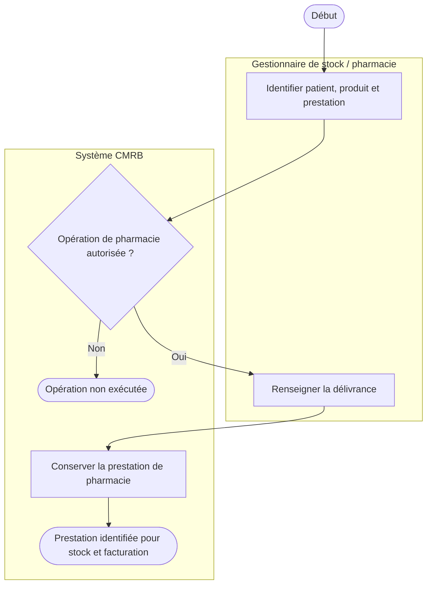

**Décisions applicables.**

- **Q-025:** Chaque personne possède un compte nominatif et des rôles cumulables approuvés par un administrateur désigné par la direction. Le premier lien patient exige date de naissance, code à usage unique sur contact vérifié et validation manuelle en cas d'écart. MFA est obligatoire pour comptes internes sensibles; inactivité 15 minutes, durée maximale 12 heures, révocation immédiate. Un accès d'urgence médical exige motif et alerte au directeur médical.
- **Q-026:** Cibles V1 : p95 ≤ 2 s pour les actions courantes et ≤ 10 s pour les rapports; disponibilité mensuelle 99,5 % hors maintenance annoncée limitée à 4 h/mois; RPO 15 min et RTO 4 h; sauvegardes chiffrées quotidiennes 35 jours et mensuelles 12 mois; 200 utilisateurs simultanés, 100 000 patients et 20 % de croissance annuelle; navigateurs majeurs sur leurs deux dernières versions; SLA P1 prise en charge 30 min et contournement 4 h.
- **Q-012:** Aucune suppression physique automatique n'est autorisée. Les dossiers cliniques sont conservés 25 ans après le dernier épisode; les dossiers de mineurs au moins jusqu'au 28e anniversaire et jamais moins de 25 ans après le dernier épisode. Les pièces financières sont conservées 10 ans, les données RH 10 ans après départ, les journaux de sécurité 12 mois et les traces d'accès clinique 10 ans. Un gel juridique suspend toute échéance. À terme, anonymisation irréversible après autorisation du responsable désigné.
- **Q-018:** Le stock est décrémenté et la ligne devient facturable lors de la confirmation de dispensation. Une réservation ne décrémente pas le stock. Un retour admissible crée un mouvement inverse et un avoir; un médicament délivré non réintégrable reste sorti. Toute annulation après dispensation passe par une opération de contrepassation, jamais par suppression.
- **Q-023:** Le stock gère produits, catégories, unités, fournisseurs, réceptions, sorties, retours, ajustements et inventaires. Lot et péremption sont obligatoires pour les médicaments et facultatifs pour la bureautique. La sortie applique FEFO, les seuils sont définis par produit et emplacement, et la valorisation V1 utilise le coût moyen pondéré.
- **Q-033:** La production et les sauvegardes sont hébergées dans une zone approuvée contractuellement, avec préférence Côte d'Ivoire; tout transfert hors territoire exige l'analyse et les formalités applicables. La reprise V1 utilise des modèles CSV contrôlés, rapprochement des totaux et procès-verbal. La bascule suit répétition, gel, sauvegarde, migration, contrôle, décision go/no-go et retour arrière.

**Recette.** TEST-015.


### WF-016 — Émettre une facture individuelle

**Finalité.** Facture individuelle émise selon Q-009, Q-020, Q-024 et Q-035.

**Acteur principal :** ACT-004 ; rôle ACT-001 en conflit.

Les autres acteurs concernés et leurs responsabilités figurent dans le tableau ci-dessous ; leur présence ne vaut pas attribution de permission.

| Acteur | Responsabilité dans le parcours |
| --- | --- |
| ACT-004 | Service comptable: Facturation, paiements et rapports financiers. |
| ACT-001 | Personnel administratif: Inscription et rendez-vous; facturation/paiement en conflit avec matrice. |
| ACT-012 | Système CMRB: Application web, contrôles et enregistrement. |

**Déclencheur.** Prestations ambulatoires à facturer.

**Préconditions.** Le patient, les prestations et le payeur sont identifiés. Tarifs, taxes, numérotation et règles d’émission doivent être définis ; le droit de facturer de l’accueil reste en conflit.

**Scénario principal.**

1. Le service de facturation recherche le patient et les prestations.
2. L’utilisateur vérifie le type de payeur.
3. Les lignes et montants sont établis selon tarification arrêté pour la baseline.
4. La facture individuelle est émise par le rôle habilité.
5. Le suivi du règlement devient possible.

**Variantes et erreurs.**

Séjour traité dans sa facture dédiée; émission par accueil mentionnée mais matrice contradictoire.

Prestation déjà facturée, tarif absent, facture annulée : règles Q-009, Q-020, Q-024 et Q-035; aucun montant déduit d’un tarif inexistant.

Décision de cadrage technique : toute mutation est atomique, idempotente lorsqu'une clé de requête existe et protégée par contrôle de version. Une opération refusée n'a aucun effet métier; les doublons sont signalés et aucune fusion ou correction automatique n'est autorisée.

**Règles et autorisations.**

BR-012, BR-013

**SEC-016** — ACT-004 émet la facture; attribution à ACT-001 en conflit entre UC-07 et matrice.

La [matrice par action](ROLE_PERMISSION_MATRIX.md) est normative. Le serveur contrôle rôle, action et ressource selon Q-025/Q-031; tout conflit ou droit absent produit un refus tracé. Une dérogation exige un accès d'urgence médical motivé ou une demande de changement approuvée.

**Données.**

L = lecture, C = création, M = modification, X = opération spéciale définie par la matrice et la décision applicable. Les mutations constituent la baseline fonctionnelle; le schéma physique en sera dérivé.

| Entité | Concept | Opération de baseline | Condition |
| --- | --- | --- | --- |
| ENT-004 | Patient | L | Sous réserve des droits et cardinalités; voir dictionnaire |
| ENT-008 | Prestation | L | Sous réserve des droits et cardinalités; voir dictionnaire |
| ENT-009 | Facture | C | Sous réserve des droits et cardinalités; voir dictionnaire |
| ENT-022 | Ligne de facture | C | Sous réserve des droits et cardinalités; voir dictionnaire |

**Notifications et audit.**

Aucune notification nouvelle explicitement requise pour ce parcours. Les notifications éventuelles sont régis par les décisions associées.

La baseline Q-012/Q-026 impose un audit immuable et minimisé. Ce parcours manipule Patient, Prestation, Facture, Ligne de facture.

DECISION_DE_CADRAGE : tracer l’acteur, l’action, la référence de ressource, la date et le résultat, sans recopier les données médicales, secrets ni moyens de paiement. Pour une mutation, étudier la preuve de changement séparément des métadonnées courantes. Événements audités : demande de émettre une facture individuelle, succès, refus et erreur. Consultation sensible et durée de conservation arbitré par la baseline Q-026 / Q-012.

**Résultat.** Facture individuelle émise selon Q-009, Q-020, Q-024 et Q-035. En cas de refus, aucune réussite métier n’est annoncée. Les états persistés définis par la baseline sont régis par les décisions associées; ces termes ne constituent pas une énumération de base de données.

**Diagramme.**

Lecture : rectangles = actions ; losanges = décisions ; formes arrondies = début ou résultat du parcours ; couloirs = responsabilités. Les résultats ne sont pas des statuts de base de données. Les contrôles et l’ordre retenu pour la baselines restent soumis aux règles et autorisations de cette fiche ; une décision métier manquante n’est jamais une branche d’exécution.

Les conditions de conformité renvoient aux préconditions et aux décisions de baseline de cette fiche. Elles ne définissent aucune validation de saisie ou permission supplémentaire.

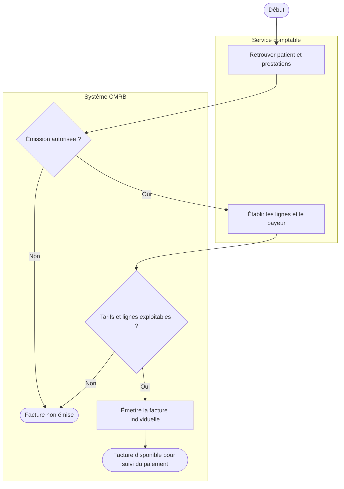

**Décisions applicables.**

- **Q-025:** Chaque personne possède un compte nominatif et des rôles cumulables approuvés par un administrateur désigné par la direction. Le premier lien patient exige date de naissance, code à usage unique sur contact vérifié et validation manuelle en cas d'écart. MFA est obligatoire pour comptes internes sensibles; inactivité 15 minutes, durée maximale 12 heures, révocation immédiate. Un accès d'urgence médical exige motif et alerte au directeur médical.
- **Q-026:** Cibles V1 : p95 ≤ 2 s pour les actions courantes et ≤ 10 s pour les rapports; disponibilité mensuelle 99,5 % hors maintenance annoncée limitée à 4 h/mois; RPO 15 min et RTO 4 h; sauvegardes chiffrées quotidiennes 35 jours et mensuelles 12 mois; 200 utilisateurs simultanés, 100 000 patients et 20 % de croissance annuelle; navigateurs majeurs sur leurs deux dernières versions; SLA P1 prise en charge 30 min et contournement 4 h.
- **Q-012:** Aucune suppression physique automatique n'est autorisée. Les dossiers cliniques sont conservés 25 ans après le dernier épisode; les dossiers de mineurs au moins jusqu'au 28e anniversaire et jamais moins de 25 ans après le dernier épisode. Les pièces financières sont conservées 10 ans, les données RH 10 ans après départ, les journaux de sécurité 12 mois et les traces d'accès clinique 10 ans. Un gel juridique suspend toute échéance. À terme, anonymisation irréversible après autorisation du responsable désigné.
- **Q-024:** L'accueil peut créer une facture brouillon à partir des prestations enregistrées, encaisser une part patient par mode autorisé et imprimer un reçu. Il ne modifie ni tarifs ni couverture, ne valide pas les bordereaux organisme, ne rembourse pas et n'annule pas une facture émise. La comptabilité émet, rapproche, crée les avoirs et traite remboursements et rejets.
- **Q-020:** Une facture est PAYÉE lorsque les paiements confirmés et avoirs imputés couvrent toutes les parts dues. Un trop-perçu crée un crédit ou un remboursement tracé. L'archivage rend la facture non modifiable mais consultable. Un remboursement ou avoir postérieur conserve l'original, crée une écriture inverse et recalcule le solde.
- **Q-009:** La couverture est calculée par ligne éligible : montant couvert = minimum(base éligible après remises × taux, plafond restant), puis exclusions. Les montants sont arrondis au franc CFA le plus proche, méthode demi-supérieure. Le patient supporte le reste. Une seule couverture principale est gérée en V1; les cumuls relèvent d'un changement ultérieur.
- **Q-035:** Les tarifs sont versionnés avec date d'effet et devise XOF sans décimales. Les taxes et exonérations sont des codes configurables. Une facture émise est immuable; correction par avoir puis nouvelle facture. La séquence interne et le numéro officiel FNE sont distincts, uniques et conservés. Remises, annulations et remboursements exigent motif, habilitation et piste d'audit.
- **Q-033:** La production et les sauvegardes sont hébergées dans une zone approuvée contractuellement, avec préférence Côte d'Ivoire; tout transfert hors territoire exige l'analyse et les formalités applicables. La reprise V1 utilise des modèles CSV contrôlés, rapprochement des totaux et procès-verbal. La bascule suit répétition, gel, sauvegarde, migration, contrôle, décision go/no-go et retour arrière.

**Recette.** TEST-016.


### WF-017 — Établir la facture du séjour

**Finalité.** Facture du séjour calculée en XOF depuis les nuits et prestations réellement enregistrées, avec tarifs versionnés selon Q-016/Q-035.

**Acteur principal :** ACT-004 ; rôle ACT-001 arrêté pour la baseline.

Les autres acteurs concernés et leurs responsabilités figurent dans le tableau ci-dessous ; leur présence ne vaut pas attribution de permission.

| Acteur | Responsabilité dans le parcours |
| --- | --- |
| ACT-004 | Service comptable: Facturation, paiements et rapports financiers. |
| ACT-001 | Personnel administratif: Inscription et rendez-vous; facturation/paiement en conflit avec matrice. |
| ACT-012 | Système CMRB: Application web, contrôles et enregistrement. |

**Déclencheur.** Facturation d’une hospitalisation.

**Préconditions.** Le séjour et ses prestations sont identifiés. Rubriques, durées, tarifs et modalités d’émission doivent être définis avant calcul de la facture.

**Scénario principal.**

1. La facturation retrouve le séjour du patient.
2. Les rubriques chambre, visites, soins, médicaments et examens sont réunies.
3. Les quantités, durées et tarifs sont calculés selon règles arrêté pour la baseline.
4. La facture est établie avec les rubriques retenues.

**Variantes et erreurs.**

Observation et chambre double : calcul non précisé; facturation intermédiaire non confirmée.

Durée incomplète, prestation tardive, médicament déjà facturé ou tarif manquant : résolution métier requise.

Décision de cadrage technique : toute mutation est atomique, idempotente lorsqu'une clé de requête existe et protégée par contrôle de version. Une opération refusée n'a aucun effet métier; les doublons sont signalés et aucune fusion ou correction automatique n'est autorisée.

**Règles et autorisations.**

BR-012

**SEC-017** — Facturation de séjour par ACT-004; saisie accueil et corrections après paiement arbitré par la baseline.

La [matrice par action](ROLE_PERMISSION_MATRIX.md) est normative. Le serveur contrôle rôle, action et ressource selon Q-025/Q-031; tout conflit ou droit absent produit un refus tracé. Une dérogation exige un accès d'urgence médical motivé ou une demande de changement approuvée.

**Données.**

L = lecture, C = création, M = modification, X = opération spéciale définie par la matrice et la décision applicable. Les mutations constituent la baseline fonctionnelle; le schéma physique en sera dérivé.

| Entité | Concept | Opération de baseline | Condition |
| --- | --- | --- | --- |
| ENT-004 | Patient | L | Sous réserve des droits et cardinalités; voir dictionnaire |
| ENT-009 | Facture | C | Sous réserve des droits et cardinalités; voir dictionnaire |
| ENT-016 | Séjour / observation | L | Sous réserve des droits et cardinalités; voir dictionnaire |
| ENT-017 | Chambre | L | Sous réserve des droits et cardinalités; voir dictionnaire |
| ENT-022 | Ligne de facture | C | Sous réserve des droits et cardinalités; voir dictionnaire |

**Notifications et audit.**

Aucune notification nouvelle explicitement requise pour ce parcours. Les notifications éventuelles sont régis par les décisions associées.

La baseline Q-012/Q-026 impose un audit immuable et minimisé. Ce parcours manipule Patient, Facture, Séjour / observation, Chambre, Ligne de facture.

DECISION_DE_CADRAGE : tracer l’acteur, l’action, la référence de ressource, la date et le résultat, sans recopier les données médicales, secrets ni moyens de paiement. Pour une mutation, étudier la preuve de changement séparément des métadonnées courantes. Événements audités : demande de établir la facture du séjour, succès, refus et erreur. Consultation sensible et durée de conservation arbitré par la baseline Q-026 / Q-012.

**Résultat.** Facture du séjour calculée en XOF depuis les nuits et prestations réellement enregistrées, avec tarifs versionnés selon Q-016/Q-035. En cas de refus, aucune réussite métier n’est annoncée. Les états persistés définis par la baseline sont régis par les décisions associées; ces termes ne constituent pas une énumération de base de données.

**Diagramme.**

Lecture : rectangles = actions ; losanges = décisions ; formes arrondies = début ou résultat du parcours ; couloirs = responsabilités. Les résultats ne sont pas des statuts de base de données. Les contrôles et l’ordre retenu pour la baselines restent soumis aux règles et autorisations de cette fiche ; une décision métier manquante n’est jamais une branche d’exécution.

Les conditions de conformité renvoient aux préconditions et aux décisions de baseline de cette fiche. Elles ne définissent aucune validation de saisie ou permission supplémentaire.

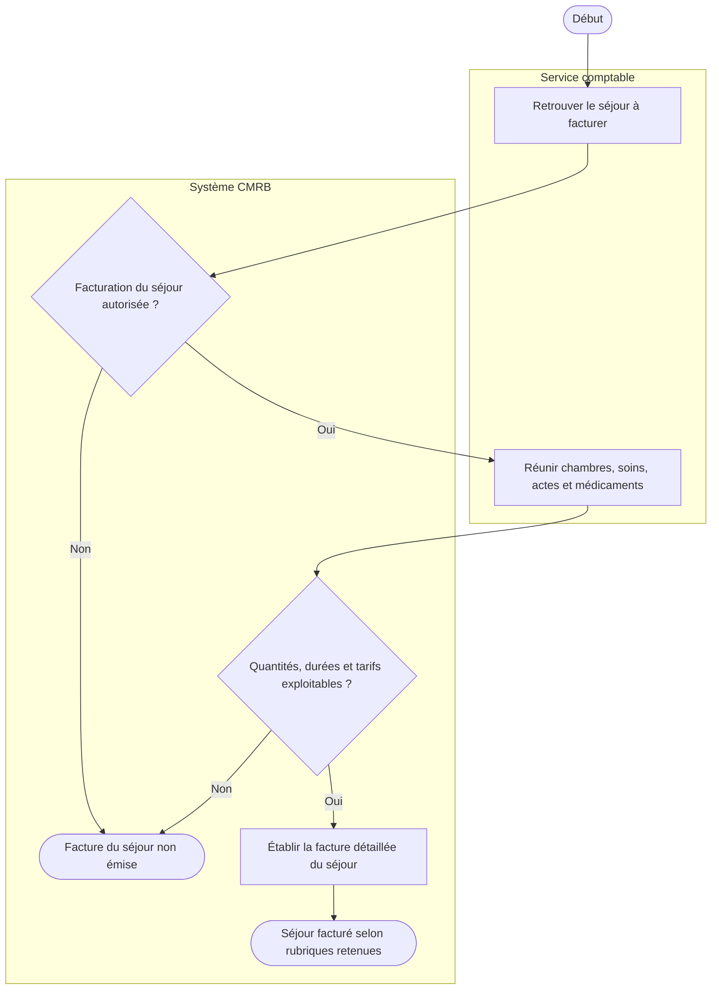

**Décisions applicables.**

- **Q-025:** Chaque personne possède un compte nominatif et des rôles cumulables approuvés par un administrateur désigné par la direction. Le premier lien patient exige date de naissance, code à usage unique sur contact vérifié et validation manuelle en cas d'écart. MFA est obligatoire pour comptes internes sensibles; inactivité 15 minutes, durée maximale 12 heures, révocation immédiate. Un accès d'urgence médical exige motif et alerte au directeur médical.
- **Q-026:** Cibles V1 : p95 ≤ 2 s pour les actions courantes et ≤ 10 s pour les rapports; disponibilité mensuelle 99,5 % hors maintenance annoncée limitée à 4 h/mois; RPO 15 min et RTO 4 h; sauvegardes chiffrées quotidiennes 35 jours et mensuelles 12 mois; 200 utilisateurs simultanés, 100 000 patients et 20 % de croissance annuelle; navigateurs majeurs sur leurs deux dernières versions; SLA P1 prise en charge 30 min et contournement 4 h.
- **Q-012:** Aucune suppression physique automatique n'est autorisée. Les dossiers cliniques sont conservés 25 ans après le dernier épisode; les dossiers de mineurs au moins jusqu'au 28e anniversaire et jamais moins de 25 ans après le dernier épisode. Les pièces financières sont conservées 10 ans, les données RH 10 ans après départ, les journaux de sécurité 12 mois et les traces d'accès clinique 10 ans. Un gel juridique suspend toute échéance. À terme, anonymisation irréversible après autorisation du responsable désigné.
- **Q-016:** Le médecin décide observation ou hospitalisation. Le séjour comprend admission, affectation chambre/lit, transferts historisés, épisodes de soins, sortie signée et clôture administrative. L'observation peut rester sans lit permanent. La facture détaille chambre par nuit, visites, soins infirmiers, pharmacie, laboratoire, imagerie et autres prestations réellement enregistrées.
- **Q-009:** La couverture est calculée par ligne éligible : montant couvert = minimum(base éligible après remises × taux, plafond restant), puis exclusions. Les montants sont arrondis au franc CFA le plus proche, méthode demi-supérieure. Le patient supporte le reste. Une seule couverture principale est gérée en V1; les cumuls relèvent d'un changement ultérieur.
- **Q-020:** Une facture est PAYÉE lorsque les paiements confirmés et avoirs imputés couvrent toutes les parts dues. Un trop-perçu crée un crédit ou un remboursement tracé. L'archivage rend la facture non modifiable mais consultable. Un remboursement ou avoir postérieur conserve l'original, crée une écriture inverse et recalcule le solde.
- **Q-024:** L'accueil peut créer une facture brouillon à partir des prestations enregistrées, encaisser une part patient par mode autorisé et imprimer un reçu. Il ne modifie ni tarifs ni couverture, ne valide pas les bordereaux organisme, ne rembourse pas et n'annule pas une facture émise. La comptabilité émet, rapproche, crée les avoirs et traite remboursements et rejets.
- **Q-035:** Les tarifs sont versionnés avec date d'effet et devise XOF sans décimales. Les taxes et exonérations sont des codes configurables. Une facture émise est immuable; correction par avoir puis nouvelle facture. La séquence interne et le numéro officiel FNE sont distincts, uniques et conservés. Remises, annulations et remboursements exigent motif, habilitation et piste d'audit.
- **Q-033:** La production et les sauvegardes sont hébergées dans une zone approuvée contractuellement, avec préférence Côte d'Ivoire; tout transfert hors territoire exige l'analyse et les formalités applicables. La reprise V1 utilise des modèles CSV contrôlés, rapprochement des totaux et procès-verbal. La bascule suit répétition, gel, sauvegarde, migration, contrôle, décision go/no-go et retour arrière.

**Recette.** TEST-017.


### WF-018 — Facturer assurance ou mutuelle

**Finalité.** Facture organisme et parts à recouvrer identifiées.

**Acteur principal :** ACT-004.

Les autres acteurs concernés et leurs responsabilités figurent dans le tableau ci-dessous ; leur présence ne vaut pas attribution de permission.

| Acteur | Responsabilité dans le parcours |
| --- | --- |
| ACT-004 | Service comptable: Facturation, paiements et rapports financiers. |
| ACT-006 | Assureur / mutuelle: Destinataire financier et débiteur tiers. |
| ACT-012 | Système CMRB: Application web, contrôles et enregistrement. |

**Déclencheur.** Constitution d’une facture organisme payeur.

**Préconditions.** L’organisme payeur et les prestations couvertes sont identifiés. Le sens des « 10 patients », la base du pourcentage et la ventilation doivent être arbitrés.

**Scénario principal.**

1. La comptabilité identifie l’organisme et les prestations couvertes.
2. La prise en charge en pourcentage est appliquée selon base défini par la baseline.
3. Les patients sont regroupés par organisme et période, par lots de dix au maximum selon Q-007.
4. La facture conserve le détail justifiant les montants.
5. Le paiement différé est suivi.

**Variantes et erreurs.**

Assurance et mutuelle utilisent la catégorie d'organisme Q-008; un lot de un à dix patients est admis selon Q-007.

Couverture inconnue, pourcentage incohérent ou prestations de plusieurs organismes : pas de regroupement automatique supposé.

Décision de cadrage technique : toute mutation est atomique, idempotente lorsqu'une clé de requête existe et protégée par contrôle de version. Une opération refusée n'a aucun effet métier; les doublons sont signalés et aucune fusion ou correction automatique n'est autorisée.

**Règles et autorisations.**

BR-007, BR-008

**SEC-018** — ACT-004 facture l’organisme ACT-006. ACT-006 n’a pas d’accès applicatif direct confirmé.

La [matrice par action](ROLE_PERMISSION_MATRIX.md) est normative. Le serveur contrôle rôle, action et ressource selon Q-025/Q-031; tout conflit ou droit absent produit un refus tracé. Une dérogation exige un accès d'urgence médical motivé ou une demande de changement approuvée.

**Données.**

L = lecture, C = création, M = modification, X = opération spéciale définie par la matrice et la décision applicable. Les mutations constituent la baseline fonctionnelle; le schéma physique en sera dérivé.

| Entité | Concept | Opération de baseline | Condition |
| --- | --- | --- | --- |
| ENT-004 | Patient | L | Sous réserve des droits et cardinalités; voir dictionnaire |
| ENT-008 | Prestation | L | Sous réserve des droits et cardinalités; voir dictionnaire |
| ENT-009 | Facture | C | Sous réserve des droits et cardinalités; voir dictionnaire |
| ENT-011 | Organisme payeur | L | Sous réserve des droits et cardinalités; voir dictionnaire |
| ENT-022 | Ligne de facture | C | Sous réserve des droits et cardinalités; voir dictionnaire |
| ENT-023 | Prise en charge | X | Sous réserve des droits et cardinalités; voir dictionnaire |

**Notifications et audit.**

Aucune notification nouvelle explicitement requise pour ce parcours. Les notifications éventuelles sont régis par les décisions associées.

La baseline Q-012/Q-026 impose un audit immuable et minimisé. Ce parcours manipule Patient, Prestation, Facture, Organisme payeur, Ligne de facture, Prise en charge.

DECISION_DE_CADRAGE : tracer l’acteur, l’action, la référence de ressource, la date et le résultat, sans recopier les données médicales, secrets ni moyens de paiement. Pour une mutation, étudier la preuve de changement séparément des métadonnées courantes. Événements audités : demande de facturer assurance ou mutuelle, succès, refus et erreur. Consultation sensible et durée de conservation arbitré par la baseline Q-026 / Q-012.

**Résultat.** Facture organisme et parts à recouvrer identifiées. En cas de refus, aucune réussite métier n’est annoncée. Les états persistés définis par la baseline sont régis par les décisions associées; ces termes ne constituent pas une énumération de base de données.

**Diagramme.**

Lecture : rectangles = actions ; losanges = décisions ; formes arrondies = début ou résultat du parcours ; couloirs = responsabilités. Les résultats ne sont pas des statuts de base de données. Les contrôles et l’ordre retenu pour la baselines restent soumis aux règles et autorisations de cette fiche ; une décision métier manquante n’est jamais une branche d’exécution.

Décision de baseline : la condition de groupement ne fixe ni plafond ni lot exact de 10 patients. La base de couverture, le détail et la transmission à l’organisme sont précisés par les décisions de baseline associées (Q-007, Q-009).

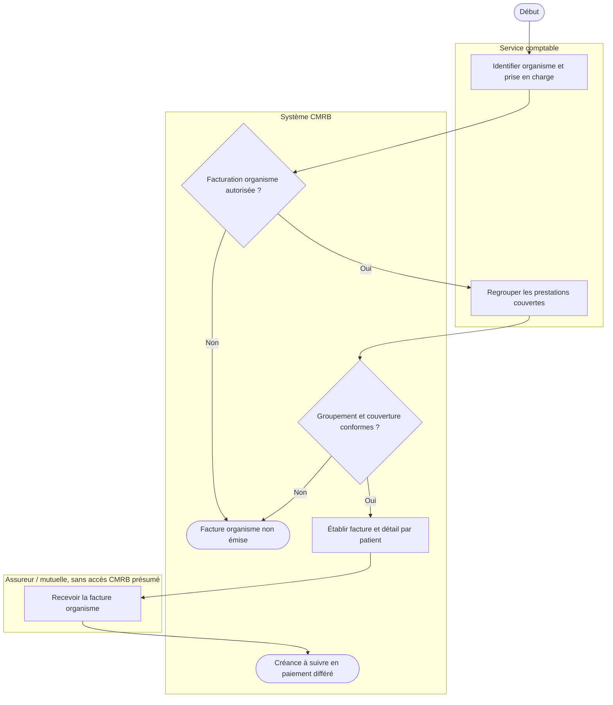

**Décisions applicables.**

- **Q-025:** Chaque personne possède un compte nominatif et des rôles cumulables approuvés par un administrateur désigné par la direction. Le premier lien patient exige date de naissance, code à usage unique sur contact vérifié et validation manuelle en cas d'écart. MFA est obligatoire pour comptes internes sensibles; inactivité 15 minutes, durée maximale 12 heures, révocation immédiate. Un accès d'urgence médical exige motif et alerte au directeur médical.
- **Q-026:** Cibles V1 : p95 ≤ 2 s pour les actions courantes et ≤ 10 s pour les rapports; disponibilité mensuelle 99,5 % hors maintenance annoncée limitée à 4 h/mois; RPO 15 min et RTO 4 h; sauvegardes chiffrées quotidiennes 35 jours et mensuelles 12 mois; 200 utilisateurs simultanés, 100 000 patients et 20 % de croissance annuelle; navigateurs majeurs sur leurs deux dernières versions; SLA P1 prise en charge 30 min et contournement 4 h.
- **Q-012:** Aucune suppression physique automatique n'est autorisée. Les dossiers cliniques sont conservés 25 ans après le dernier épisode; les dossiers de mineurs au moins jusqu'au 28e anniversaire et jamais moins de 25 ans après le dernier épisode. Les pièces financières sont conservées 10 ans, les données RH 10 ans après départ, les journaux de sécurité 12 mois et les traces d'accès clinique 10 ans. Un gel juridique suspend toute échéance. À terme, anonymisation irréversible après autorisation du responsable désigné.
- **Q-007:** Une facture destinée à un organisme regroupe au maximum dix patients pour un même organisme et une même période de facturation. Un lot incomplet est autorisé. Chaque patient, prestation et montant reste identifiable par une ligne distincte.
- **Q-009:** La couverture est calculée par ligne éligible : montant couvert = minimum(base éligible après remises × taux, plafond restant), puis exclusions. Les montants sont arrondis au franc CFA le plus proche, méthode demi-supérieure. Le patient supporte le reste. Une seule couverture principale est gérée en V1; les cumuls relèvent d'un changement ultérieur.
- **Q-008:** Assurance et mutuelle partagent l'entité Organisme payeur, avec une catégorie obligatoire ASSURANCE, MUTUELLE ou AUTRE. L'identité, les conventions et les comptes sont communs; les rapports et règles de couverture restent séparables par catégorie.
- **Q-029:** Chaque règlement est imputé explicitement à une ou plusieurs factures et, si nécessaire, à leurs lignes. Une zone d'attente comptable temporaire est permise mais doit être apurée. L'enregistrement exige payeur, montant, devise XOF, date, mode, référence unique et clé d'idempotence. La ventilation ne détruit jamais l'écriture d'origine.
- **Q-035:** Les tarifs sont versionnés avec date d'effet et devise XOF sans décimales. Les taxes et exonérations sont des codes configurables. Une facture émise est immuable; correction par avoir puis nouvelle facture. La séquence interne et le numéro officiel FNE sont distincts, uniques et conservés. Remises, annulations et remboursements exigent motif, habilitation et piste d'audit.
- **Q-033:** La production et les sauvegardes sont hébergées dans une zone approuvée contractuellement, avec préférence Côte d'Ivoire; tout transfert hors territoire exige l'analyse et les formalités applicables. La reprise V1 utilise des modèles CSV contrôlés, rapprochement des totaux et procès-verbal. La bascule suit répétition, gel, sauvegarde, migration, contrôle, décision go/no-go et retour arrière.

**Recette.** TEST-018.


### WF-019 — Enregistrer et consulter un paiement

**Finalité.** Paiement enregistré; règlement effectif distingué de simple initiation.

**Acteur principal :** ACT-004 ; rôle ACT-001 en conflit.

Les autres acteurs concernés et leurs responsabilités figurent dans le tableau ci-dessous ; leur présence ne vaut pas attribution de permission.

| Acteur | Responsabilité dans le parcours |
| --- | --- |
| ACT-004 | Service comptable: Facturation, paiements et rapports financiers. |
| ACT-001 | Personnel administratif: Inscription et rendez-vous; facturation/paiement en conflit avec matrice. |
| ACT-006 | Assureur / mutuelle: Destinataire financier et débiteur tiers. |
| ACT-005 | Patient: Inscription, réservation, consultation personnelle et demande de copie. |
| ACT-012 | Système CMRB: Application web, contrôles et enregistrement. |
| ACT-015 | Service de paiement: Transaction en ligne si intégration retenue. |

**Déclencheur.** Règlement patient ou organisme reçu.

**Préconditions.** La dette et le règlement à enregistrer sont identifiés. La preuve admissible, l’affectation et le traitement du paiement partiel doivent être arrêtés.

**Scénario principal.**

1. L’utilisateur retrouve la dette concernée.
2. Le mode et la preuve de règlement sont identifiés.
3. Le système enregistre le montant et l’affectation selon règles arrêté pour la baseline.
4. L’historique des paiements est consultable par l’acteur habilité.

**Variantes et erreurs.**

Espèces, chèque, virement, carte, Mobile Money et en ligne cités; remboursement et partiel relèvent des décisions ouvertes.

Une clé d'idempotence bloque le doublon; preuve et référence sont exigées, le trop-perçu devient crédit/remboursement tracé, et aucun retour navigateur ne confirme seul un paiement.

Décision de cadrage technique : toute mutation est atomique, idempotente lorsqu'une clé de requête existe et protégée par contrôle de version. Une opération refusée n'a aucun effet métier; les doublons sont signalés et aucune fusion ou correction automatique n'est autorisée.

**Règles et autorisations.**

BR-014

**SEC-019** — ACT-004 enregistre les paiements; ACT-001 apparaît dans UC-08 mais pas dans la matrice. Payer ne signifie pas pouvoir modifier l’historique.

La [matrice par action](ROLE_PERMISSION_MATRIX.md) est normative. Le serveur contrôle rôle, action et ressource selon Q-025/Q-031; tout conflit ou droit absent produit un refus tracé. Une dérogation exige un accès d'urgence médical motivé ou une demande de changement approuvée.

**Données.**

L = lecture, C = création, M = modification, X = opération spéciale définie par la matrice et la décision applicable. Les mutations constituent la baseline fonctionnelle; le schéma physique en sera dérivé.

| Entité | Concept | Opération de baseline | Condition |
| --- | --- | --- | --- |
| ENT-009 | Facture | L | Sous réserve des droits et cardinalités; voir dictionnaire |
| ENT-010 | Paiement | C | Sous réserve des droits et cardinalités; voir dictionnaire |
| ENT-011 | Organisme payeur | L | Sous réserve des droits et cardinalités; voir dictionnaire |
| ENT-028 | Affectation de paiement | C | Sous réserve des droits et cardinalités; voir dictionnaire |

**Notifications et audit.**

Aucune notification nouvelle explicitement requise pour ce parcours. Les notifications éventuelles sont régis par les décisions associées.

La baseline Q-012/Q-026 impose un audit immuable et minimisé. Ce parcours manipule Facture, Paiement, Organisme payeur, Affectation de paiement.

DECISION_DE_CADRAGE : tracer l’acteur, l’action, la référence de ressource, la date et le résultat, sans recopier les données médicales, secrets ni moyens de paiement. Pour une mutation, étudier la preuve de changement séparément des métadonnées courantes. Événements audités : demande de enregistrer et consulter un paiement, succès, refus et erreur. Consultation sensible et durée de conservation arbitré par la baseline Q-026 / Q-012.

**Résultat.** Paiement enregistré; règlement effectif distingué de simple initiation. En cas de refus, aucune réussite métier n’est annoncée. Les états persistés définis par la baseline sont régis par les décisions associées; ces termes ne constituent pas une énumération de base de données.

**Diagramme.**

Lecture : rectangles = actions ; losanges = décisions ; formes arrondies = début ou résultat du parcours ; couloirs = responsabilités. Les résultats ne sont pas des statuts de base de données. Les contrôles et l’ordre retenu pour la baselines restent soumis aux règles et autorisations de cette fiche ; une décision métier manquante n’est jamais une branche d’exécution.

Les conditions de conformité renvoient aux préconditions et aux décisions de baseline de cette fiche. Elles ne définissent aucune validation de saisie ou permission supplémentaire.

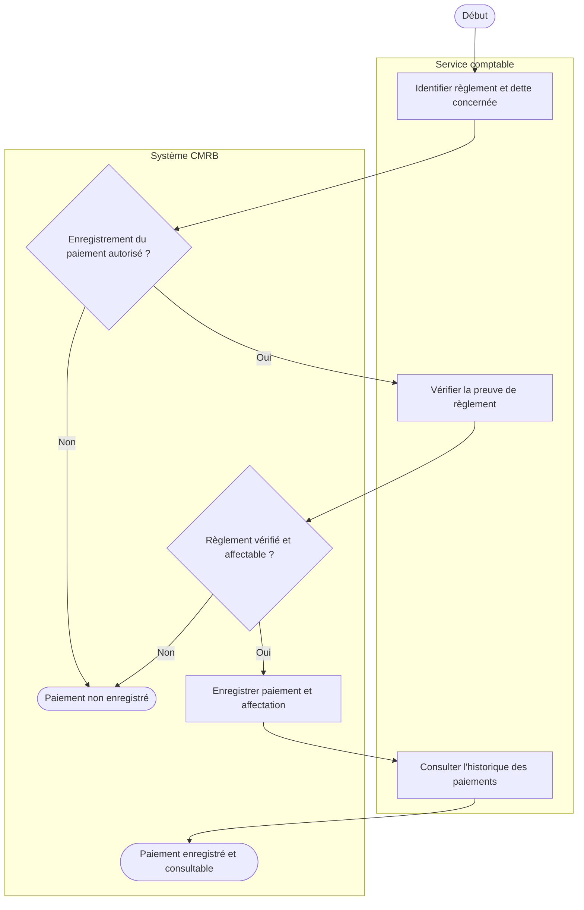

**Décisions applicables.**

- **Q-025:** Chaque personne possède un compte nominatif et des rôles cumulables approuvés par un administrateur désigné par la direction. Le premier lien patient exige date de naissance, code à usage unique sur contact vérifié et validation manuelle en cas d'écart. MFA est obligatoire pour comptes internes sensibles; inactivité 15 minutes, durée maximale 12 heures, révocation immédiate. Un accès d'urgence médical exige motif et alerte au directeur médical.
- **Q-026:** Cibles V1 : p95 ≤ 2 s pour les actions courantes et ≤ 10 s pour les rapports; disponibilité mensuelle 99,5 % hors maintenance annoncée limitée à 4 h/mois; RPO 15 min et RTO 4 h; sauvegardes chiffrées quotidiennes 35 jours et mensuelles 12 mois; 200 utilisateurs simultanés, 100 000 patients et 20 % de croissance annuelle; navigateurs majeurs sur leurs deux dernières versions; SLA P1 prise en charge 30 min et contournement 4 h.
- **Q-012:** Aucune suppression physique automatique n'est autorisée. Les dossiers cliniques sont conservés 25 ans après le dernier épisode; les dossiers de mineurs au moins jusqu'au 28e anniversaire et jamais moins de 25 ans après le dernier épisode. Les pièces financières sont conservées 10 ans, les données RH 10 ans après départ, les journaux de sécurité 12 mois et les traces d'accès clinique 10 ans. Un gel juridique suspend toute échéance. À terme, anonymisation irréversible après autorisation du responsable désigné.
- **Q-019:** La V1 accepte espèces, virement bancaire et mobile money enregistrés manuellement. Chaque paiement porte montant, date, payeur, mode, référence et justificatif éventuel. Les statuts sont EN_ATTENTE, CONFIRMÉ, REJETÉ, ANNULÉ et REMBOURSÉ. Cartes, PayPal, Stripe et confirmation automatique sont hors V1.
- **Q-024:** L'accueil peut créer une facture brouillon à partir des prestations enregistrées, encaisser une part patient par mode autorisé et imprimer un reçu. Il ne modifie ni tarifs ni couverture, ne valide pas les bordereaux organisme, ne rembourse pas et n'annule pas une facture émise. La comptabilité émet, rapproche, crée les avoirs et traite remboursements et rejets.
- **Q-029:** Chaque règlement est imputé explicitement à une ou plusieurs factures et, si nécessaire, à leurs lignes. Une zone d'attente comptable temporaire est permise mais doit être apurée. L'enregistrement exige payeur, montant, devise XOF, date, mode, référence unique et clé d'idempotence. La ventilation ne détruit jamais l'écriture d'origine.
- **Q-033:** La production et les sauvegardes sont hébergées dans une zone approuvée contractuellement, avec préférence Côte d'Ivoire; tout transfert hors territoire exige l'analyse et les formalités applicables. La reprise V1 utilise des modèles CSV contrôlés, rapprochement des totaux et procès-verbal. La bascule suit répétition, gel, sauvegarde, migration, contrôle, décision go/no-go et retour arrière.

**Recette.** TEST-019.


### WF-020 — Suivre paiement différé, écarts et rejets

**Finalité.** Encours et écart identifiés; résolution régie par Q-009, Q-019 et Q-029.

**Acteur principal :** ACT-004.

Les autres acteurs concernés et leurs responsabilités figurent dans le tableau ci-dessous ; leur présence ne vaut pas attribution de permission.

| Acteur | Responsabilité dans le parcours |
| --- | --- |
| ACT-004 | Service comptable: Facturation, paiements et rapports financiers. |
| ACT-006 | Assureur / mutuelle: Destinataire financier et débiteur tiers. |
| ACT-012 | Système CMRB: Application web, contrôles et enregistrement. |

**Déclencheur.** Échéance ou règlement d’un organisme à rapprocher.

**Préconditions.** Des factures et des paiements de l’organisme sont disponibles pour comparaison. Les règles de ventilation et de traitement des écarts restent défini par la baseline.

**Scénario principal.**

1. La comptabilité retrouve les factures de l’organisme.
2. Le paiement reçu est comparé aux montants attendus.
3. Les écarts, rejets ou paiements incomplets sont identifiés.
4. Le traitement de l’écart attend les règles métier de rapprochement.

**Variantes et erreurs.**

Le paiement différé est suivi manuellement; la V1 exclut relance automatique, remise de dette et échéancier automatisé.

Organisme conteste une ligne ou verse un total non ventilé : décision de ventilation nécessaire; aucun solde effacé silencieusement.

Décision de cadrage technique : toute mutation est atomique, idempotente lorsqu'une clé de requête existe et protégée par contrôle de version. Une opération refusée n'a aucun effet métier; les doublons sont signalés et aucune fusion ou correction automatique n'est autorisée.

**Règles et autorisations.**

BR-008

**SEC-020** — ACT-004 suit les écarts avec ACT-006; aucune remise de dette ni annulation de créance autorisée implicitement.

La [matrice par action](ROLE_PERMISSION_MATRIX.md) est normative. Le serveur contrôle rôle, action et ressource selon Q-025/Q-031; tout conflit ou droit absent produit un refus tracé. Une dérogation exige un accès d'urgence médical motivé ou une demande de changement approuvée.

**Données.**

L = lecture, C = création, M = modification, X = opération spéciale définie par la matrice et la décision applicable. Les mutations constituent la baseline fonctionnelle; le schéma physique en sera dérivé.

| Entité | Concept | Opération de baseline | Condition |
| --- | --- | --- | --- |
| ENT-009 | Facture | L | Sous réserve des droits et cardinalités; voir dictionnaire |
| ENT-010 | Paiement | L | Sous réserve des droits et cardinalités; voir dictionnaire |
| ENT-011 | Organisme payeur | L | Sous réserve des droits et cardinalités; voir dictionnaire |
| ENT-023 | Prise en charge | L | Sous réserve des droits et cardinalités; voir dictionnaire |
| ENT-028 | Affectation de paiement | X | Sous réserve des droits et cardinalités; voir dictionnaire |

**Notifications et audit.**

Aucune notification nouvelle explicitement requise pour ce parcours. Les notifications éventuelles sont régis par les décisions associées.

La baseline Q-012/Q-026 impose un audit immuable et minimisé. Ce parcours manipule Facture, Paiement, Organisme payeur, Prise en charge, Affectation de paiement.

DECISION_DE_CADRAGE : tracer l’acteur, l’action, la référence de ressource, la date et le résultat, sans recopier les données médicales, secrets ni moyens de paiement. Pour une mutation, étudier la preuve de changement séparément des métadonnées courantes. Événements audités : demande de suivre paiement différé, écarts et rejets, succès, refus et erreur. Consultation sensible et durée de conservation arbitré par la baseline Q-026 / Q-012.

**Résultat.** Encours et écart identifiés; résolution régie par Q-009, Q-019 et Q-029. En cas de refus, aucune réussite métier n’est annoncée. Les états persistés définis par la baseline sont régis par les décisions associées; ces termes ne constituent pas une énumération de base de données.

**Diagramme.**

Lecture : rectangles = actions ; losanges = décisions ; formes arrondies = début ou résultat du parcours ; couloirs = responsabilités. Les résultats ne sont pas des statuts de base de données. Les contrôles et l’ordre retenu pour la baselines restent soumis aux règles et autorisations de cette fiche ; une décision métier manquante n’est jamais une branche d’exécution.

Décision de baseline : le parcours identifie les écarts ; il ne les résout pas automatiquement et n’efface aucun solde. La suite nécessite les règles de ventilation, rejet et recouvrement (Q-019, Q-029).

```mermaid
flowchart TD
  start(["Début"])
  subgraph U["Service comptable"]
    a["Demander les encours de l'organisme"]
    d["Comparer montants reçus et attendus"]
    e{"Écart ou rejet constaté ?"}
    z(["Écart identifié, traitement arbitré par la baseline"])
    x(["Aucun écart constaté"])
  end
  subgraph S["Système CMRB"]
    b{"Consultation financière autorisée ?"}
    r(["Encours non accessibles"])
    c["Présenter factures et paiements"]
  end
  start --> a
  a --> b
  b -->|Oui| c
  b -->|Non| r
  c --> d
  d --> e
  e -->|Oui| z
  e -->|Non| x
```

**Décisions applicables.**

- **Q-025:** Chaque personne possède un compte nominatif et des rôles cumulables approuvés par un administrateur désigné par la direction. Le premier lien patient exige date de naissance, code à usage unique sur contact vérifié et validation manuelle en cas d'écart. MFA est obligatoire pour comptes internes sensibles; inactivité 15 minutes, durée maximale 12 heures, révocation immédiate. Un accès d'urgence médical exige motif et alerte au directeur médical.
- **Q-026:** Cibles V1 : p95 ≤ 2 s pour les actions courantes et ≤ 10 s pour les rapports; disponibilité mensuelle 99,5 % hors maintenance annoncée limitée à 4 h/mois; RPO 15 min et RTO 4 h; sauvegardes chiffrées quotidiennes 35 jours et mensuelles 12 mois; 200 utilisateurs simultanés, 100 000 patients et 20 % de croissance annuelle; navigateurs majeurs sur leurs deux dernières versions; SLA P1 prise en charge 30 min et contournement 4 h.
- **Q-012:** Aucune suppression physique automatique n'est autorisée. Les dossiers cliniques sont conservés 25 ans après le dernier épisode; les dossiers de mineurs au moins jusqu'au 28e anniversaire et jamais moins de 25 ans après le dernier épisode. Les pièces financières sont conservées 10 ans, les données RH 10 ans après départ, les journaux de sécurité 12 mois et les traces d'accès clinique 10 ans. Un gel juridique suspend toute échéance. À terme, anonymisation irréversible après autorisation du responsable désigné.
- **Q-019:** La V1 accepte espèces, virement bancaire et mobile money enregistrés manuellement. Chaque paiement porte montant, date, payeur, mode, référence et justificatif éventuel. Les statuts sont EN_ATTENTE, CONFIRMÉ, REJETÉ, ANNULÉ et REMBOURSÉ. Cartes, PayPal, Stripe et confirmation automatique sont hors V1.
- **Q-029:** Chaque règlement est imputé explicitement à une ou plusieurs factures et, si nécessaire, à leurs lignes. Une zone d'attente comptable temporaire est permise mais doit être apurée. L'enregistrement exige payeur, montant, devise XOF, date, mode, référence unique et clé d'idempotence. La ventilation ne détruit jamais l'écriture d'origine.
- **Q-009:** La couverture est calculée par ligne éligible : montant couvert = minimum(base éligible après remises × taux, plafond restant), puis exclusions. Les montants sont arrondis au franc CFA le plus proche, méthode demi-supérieure. Le patient supporte le reste. Une seule couverture principale est gérée en V1; les cumuls relèvent d'un changement ultérieur.
- **Q-033:** La production et les sauvegardes sont hébergées dans une zone approuvée contractuellement, avec préférence Côte d'Ivoire; tout transfert hors territoire exige l'analyse et les formalités applicables. La reprise V1 utilise des modèles CSV contrôlés, rapprochement des totaux et procès-verbal. La bascule suit répétition, gel, sauvegarde, migration, contrôle, décision go/no-go et retour arrière.

**Recette.** TEST-020.


### WF-021 — Archiver une facture payée

**Finalité.** Facture archivée si condition de paiement satisfaite.

**Acteur principal :** ACT-004 ou ACT-012 selon déclenchement automatique après paiement complet.

Les autres acteurs concernés et leurs responsabilités figurent dans le tableau ci-dessous ; leur présence ne vaut pas attribution de permission.

| Acteur | Responsabilité dans le parcours |
| --- | --- |
| ACT-004 | Service comptable: Facturation, paiements et rapports financiers. |
| ACT-012 | Système CMRB: Application web, contrôles et enregistrement. |

**Déclencheur.** Facture considérée comme payée.

**Préconditions.** Une facture existe avec ses paiements; elle devient payée puis archivée automatiquement lorsque toutes les parts sont couvertes selon Q-020.

**Scénario principal.**

1. Le système détermine le paiement complet selon définition arrêté pour la baseline.
2. La facture payée devient automatiquement archivable.
3. L’archivage mentionné par le SRS est appliqué selon déclenchement automatique après paiement complet.
4. Les droits de consultation et correction après archivage restent défini par la baseline.

**Variantes et erreurs.**

L'archivage exige la couverture de toutes les parts dues; un paiement partiel ou d'un seul payeur laisse la facture ouverte.

Remboursement ou rejet après archivage : transition définie par la baseline; aucune suppression de facture déduite de l’archivage.

Décision de cadrage technique : toute mutation est atomique, idempotente lorsqu'une clé de requête existe et protégée par contrôle de version. Une opération refusée n'a aucun effet métier; les doublons sont signalés et aucune fusion ou correction automatique n'est autorisée.

**Règles et autorisations.**

BR-009

**SEC-021** — Déclencheur comptable ou système arrêté par la baseline. Archivage ne donne aucun droit de destruction ni réouverture.

La [matrice par action](ROLE_PERMISSION_MATRIX.md) est normative. Le serveur contrôle rôle, action et ressource selon Q-025/Q-031; tout conflit ou droit absent produit un refus tracé. Une dérogation exige un accès d'urgence médical motivé ou une demande de changement approuvée.

**Données.**

L = lecture, C = création, M = modification, X = opération spéciale définie par la matrice et la décision applicable. Les mutations constituent la baseline fonctionnelle; le schéma physique en sera dérivé.

| Entité | Concept | Opération de baseline | Condition |
| --- | --- | --- | --- |
| ENT-009 | Facture | M | Sous réserve des droits et cardinalités; voir dictionnaire |
| ENT-010 | Paiement | L | Sous réserve des droits et cardinalités; voir dictionnaire |
| ENT-028 | Affectation de paiement | L | Sous réserve des droits et cardinalités; voir dictionnaire |

**Notifications et audit.**

Aucune notification nouvelle explicitement requise pour ce parcours. Les notifications éventuelles sont régis par les décisions associées.

La baseline Q-012/Q-026 impose un audit immuable et minimisé. Ce parcours manipule Facture, Paiement, Affectation de paiement.

DECISION_DE_CADRAGE : tracer l’acteur, l’action, la référence de ressource, la date et le résultat, sans recopier les données médicales, secrets ni moyens de paiement. Pour une mutation, étudier la preuve de changement séparément des métadonnées courantes. Événements audités : demande de archiver une facture payée, succès, refus et erreur. Consultation sensible et durée de conservation arbitré par la baseline Q-026 / Q-012.

**Résultat.** Facture archivée si condition de paiement satisfaite. En cas de refus, aucune réussite métier n’est annoncée. Les états persistés définis par la baseline sont régis par les décisions associées; ces termes ne constituent pas une énumération de base de données.

**Diagramme.**

Lecture : rectangles = actions ; losanges = décisions ; formes arrondies = début ou résultat du parcours ; couloirs = responsabilités. Les résultats ne sont pas des statuts de base de données. Les contrôles et l’ordre retenu pour la baselines restent soumis aux règles et autorisations de cette fiche ; une décision métier manquante n’est jamais une branche d’exécution.

Les conditions de conformité renvoient aux préconditions et aux décisions de baseline de cette fiche. Elles ne définissent aucune validation de saisie ou permission supplémentaire.

```mermaid
flowchart TD
  start(["Début"])
  subgraph U["Service comptable ou système selon déclencheur arrêté pour la baseline"]
    a["Identifier la facture à archiver"]
  end
  subgraph S["Système CMRB"]
    b{"Archivage autorisé ?"}
    r(["Facture non archivée"])
    c{"Condition de paiement satisfaite ?"}
    d["Archiver la facture sans la supprimer"]
    z(["Facture archivée"])
  end
  start --> a
  a --> b
  b -->|Oui| c
  b -->|Non| r
  c -->|Oui| d
  c -->|Non| r
  d --> z
```

**Décisions applicables.**

- **Q-020:** Une facture est PAYÉE lorsque les paiements confirmés et avoirs imputés couvrent toutes les parts dues. Un trop-perçu crée un crédit ou un remboursement tracé. L'archivage rend la facture non modifiable mais consultable. Un remboursement ou avoir postérieur conserve l'original, crée une écriture inverse et recalcule le solde.
- **Q-025:** Chaque personne possède un compte nominatif et des rôles cumulables approuvés par un administrateur désigné par la direction. Le premier lien patient exige date de naissance, code à usage unique sur contact vérifié et validation manuelle en cas d'écart. MFA est obligatoire pour comptes internes sensibles; inactivité 15 minutes, durée maximale 12 heures, révocation immédiate. Un accès d'urgence médical exige motif et alerte au directeur médical.
- **Q-026:** Cibles V1 : p95 ≤ 2 s pour les actions courantes et ≤ 10 s pour les rapports; disponibilité mensuelle 99,5 % hors maintenance annoncée limitée à 4 h/mois; RPO 15 min et RTO 4 h; sauvegardes chiffrées quotidiennes 35 jours et mensuelles 12 mois; 200 utilisateurs simultanés, 100 000 patients et 20 % de croissance annuelle; navigateurs majeurs sur leurs deux dernières versions; SLA P1 prise en charge 30 min et contournement 4 h.
- **Q-012:** Aucune suppression physique automatique n'est autorisée. Les dossiers cliniques sont conservés 25 ans après le dernier épisode; les dossiers de mineurs au moins jusqu'au 28e anniversaire et jamais moins de 25 ans après le dernier épisode. Les pièces financières sont conservées 10 ans, les données RH 10 ans après départ, les journaux de sécurité 12 mois et les traces d'accès clinique 10 ans. Un gel juridique suspend toute échéance. À terme, anonymisation irréversible après autorisation du responsable désigné.
- **Q-029:** Chaque règlement est imputé explicitement à une ou plusieurs factures et, si nécessaire, à leurs lignes. Une zone d'attente comptable temporaire est permise mais doit être apurée. L'enregistrement exige payeur, montant, devise XOF, date, mode, référence unique et clé d'idempotence. La ventilation ne détruit jamais l'écriture d'origine.
- **Q-035:** Les tarifs sont versionnés avec date d'effet et devise XOF sans décimales. Les taxes et exonérations sont des codes configurables. Une facture émise est immuable; correction par avoir puis nouvelle facture. La séquence interne et le numéro officiel FNE sont distincts, uniques et conservés. Remises, annulations et remboursements exigent motif, habilitation et piste d'audit.
- **Q-033:** La production et les sauvegardes sont hébergées dans une zone approuvée contractuellement, avec préférence Côte d'Ivoire; tout transfert hors territoire exige l'analyse et les formalités applicables. La reprise V1 utilise des modèles CSV contrôlés, rapprochement des totaux et procès-verbal. La bascule suit répétition, gel, sauvegarde, migration, contrôle, décision go/no-go et retour arrière.

**Recette.** TEST-021.


### WF-022 — Accéder à la plateforme FNE

**Finalité.** Plateforme externe ouverte, sans preuve automatique d’émission fiscale.

**Acteur principal :** ACT-004.

Les autres acteurs concernés et leurs responsabilités figurent dans le tableau ci-dessous ; leur présence ne vaut pas attribution de permission.

| Acteur | Responsabilité dans le parcours |
| --- | --- |
| ACT-004 | Service comptable: Facturation, paiements et rapports financiers. |
| ACT-013 | Plateforme FNE: Destination du bouton FNE. |
| ACT-012 | Système CMRB: Application web, contrôles et enregistrement. |

**Déclencheur.** Utilisateur active le bouton FNE.

**Préconditions.** Le lien de la plateforme FNE doit être fourni. L’accès CMRB au bouton ne présume ni session externe ni droit fiscal sur la plateforme.

**Scénario principal.**

1. L’utilisateur habilité ouvre la fonction de facturation.
2. Le système propose le bouton vers la plateforme FNE.
3. L’utilisateur suit le lien externe dont l’adresse est fourni par la configuration de déploiement.
4. Les opérations fiscales réalisées sur cette plateforme ne sont pas connues automatiquement de CMRB.

**Variantes et erreurs.**

Une API ou un préremplissage serait un choix supplémentaire arrêté pour la baseline, non déduit du bouton.

Lien indisponible ou session externe expirée : reprise externe; ne pas marquer la facture fiscale créée sur simple clic.

Décision de cadrage technique : toute mutation est atomique, idempotente lorsqu'une clé de requête existe et protégée par contrôle de version. Une opération refusée n'a aucun effet métier; les doublons sont signalés et aucune fusion ou correction automatique n'est autorisée.

**Règles et autorisations.**

Les exigences liées, règles transverses et décisions Q citées sont normatives pour ce workflow.

**SEC-022** — ACT-004 accède au bouton; une identité CMRB ne fournit pas de session ni droit sur ACT-013.

La [matrice par action](ROLE_PERMISSION_MATRIX.md) est normative. Le serveur contrôle rôle, action et ressource selon Q-025/Q-031; tout conflit ou droit absent produit un refus tracé. Une dérogation exige un accès d'urgence médical motivé ou une demande de changement approuvée.

**Données.**

L = lecture, C = création, M = modification, X = opération spéciale définie par la matrice et la décision applicable. Les mutations constituent la baseline fonctionnelle; le schéma physique en sera dérivé.

| Entité | Concept | Opération de baseline | Condition |
| --- | --- | --- | --- |
| ENT-009 | Facture | L | Sous réserve des droits et cardinalités; voir dictionnaire |

**Notifications et audit.**

Aucune notification nouvelle explicitement requise pour ce parcours. Les notifications éventuelles sont régis par les décisions associées.

La baseline Q-012/Q-026 impose un audit immuable et minimisé. Ce parcours manipule Facture.

DECISION_DE_CADRAGE : tracer l’acteur, l’action, la référence de ressource, la date et le résultat, sans recopier les données médicales, secrets ni moyens de paiement. Pour une mutation, étudier la preuve de changement séparément des métadonnées courantes. Événements audités : demande de accéder à la plateforme fne, succès, refus et erreur. Consultation sensible et durée de conservation arbitré par la baseline Q-026 / Q-012.

**Résultat.** Plateforme externe ouverte, sans preuve automatique d’émission fiscale. En cas de refus, aucune réussite métier n’est annoncée. Les états persistés définis par la baseline sont régis par les décisions associées; ces termes ne constituent pas une énumération de base de données.

**Diagramme.**

Lecture : rectangles = actions ; losanges = décisions ; formes arrondies = début ou résultat du parcours ; couloirs = responsabilités. Les résultats ne sont pas des statuts de base de données. Les contrôles et l’ordre retenu pour la baselines restent soumis aux règles et autorisations de cette fiche ; une décision métier manquante n’est jamais une branche d’exécution.

La branche d’accessibilité représente le résultat observé par l’utilisateur dans sa navigation externe, pas un contrôle ou retour automatique de la plateforme vers CMRB. Aucune émission fiscale n’est attestée.

```mermaid
flowchart TD
  start(["Début"])
  subgraph U["Service comptable"]
    a["Demander l'accès au bouton FNE"]
    d["Suivre le lien externe"]
  end
  subgraph S["Système CMRB"]
    b{"Accès à la fonction autorisé ?"}
    r(["Lien non retenu pour la baseline"])
    c["Présenter le lien vers la plateforme FNE"]
  end
  subgraph X["Navigation externe, hors contrôle CMRB"]
    e{"Plateforme accessible ?"}
    z(["Page externe ouverte, émission non attestée"])
    x(["Plateforme externe inaccessible"])
  end
  start --> a
  a --> b
  b -->|Oui| c
  b -->|Non| r
  c --> d
  d --> e
  e -->|Oui| z
  e -->|Non| x
```

**Décisions applicables.**

- **Q-025:** Chaque personne possède un compte nominatif et des rôles cumulables approuvés par un administrateur désigné par la direction. Le premier lien patient exige date de naissance, code à usage unique sur contact vérifié et validation manuelle en cas d'écart. MFA est obligatoire pour comptes internes sensibles; inactivité 15 minutes, durée maximale 12 heures, révocation immédiate. Un accès d'urgence médical exige motif et alerte au directeur médical.
- **Q-026:** Cibles V1 : p95 ≤ 2 s pour les actions courantes et ≤ 10 s pour les rapports; disponibilité mensuelle 99,5 % hors maintenance annoncée limitée à 4 h/mois; RPO 15 min et RTO 4 h; sauvegardes chiffrées quotidiennes 35 jours et mensuelles 12 mois; 200 utilisateurs simultanés, 100 000 patients et 20 % de croissance annuelle; navigateurs majeurs sur leurs deux dernières versions; SLA P1 prise en charge 30 min et contournement 4 h.
- **Q-012:** Aucune suppression physique automatique n'est autorisée. Les dossiers cliniques sont conservés 25 ans après le dernier épisode; les dossiers de mineurs au moins jusqu'au 28e anniversaire et jamais moins de 25 ans après le dernier épisode. Les pièces financières sont conservées 10 ans, les données RH 10 ans après départ, les journaux de sécurité 12 mois et les traces d'accès clinique 10 ans. Un gel juridique suspend toute échéance. À terme, anonymisation irréversible après autorisation du responsable désigné.
- **Q-010:** La V1 ouvre la plateforme FNE de la DGI dans un nouvel onglet et conserve dans CMRB le numéro FNE, le QR ou justificatif et l'état de rapprochement saisis par un utilisateur habilité. Aucune donnée n'est transmise automatiquement. L'API FNE est un lot ultérieur soumis au guide DGI et à l'agrément applicable.
- **Q-027:** Les modules métier cœur sont réunis dans CMRB. Les services externes nécessaires restent autorisés derrière des adaptateurs : FNE, SMS/e-mail/WhatsApp, mobile money, hébergement, antivirus et identité. Leur indisponibilité ne doit pas corrompre une transaction; les échanges sont mis en attente, réessayés et rapprochés.
- **Q-033:** La production et les sauvegardes sont hébergées dans une zone approuvée contractuellement, avec préférence Côte d'Ivoire; tout transfert hors territoire exige l'analyse et les formalités applicables. La reprise V1 utilise des modèles CSV contrôlés, rapprochement des totaux et procès-verbal. La bascule suit répétition, gel, sauvegarde, migration, contrôle, décision go/no-go et retour arrière.

**Recette.** TEST-022.


### WF-023 — Consulter son dossier dans le portail

**Finalité.** Contenu consulté dans les limites décidées.

**Acteur principal :** ACT-005.

Les autres acteurs concernés et leurs responsabilités figurent dans le tableau ci-dessous ; leur présence ne vaut pas attribution de permission.

| Acteur | Responsabilité dans le parcours |
| --- | --- |
| ACT-005 | Patient: Inscription, réservation, consultation personnelle et demande de copie. |
| ACT-012 | Système CMRB: Application web, contrôles et enregistrement. |

**Déclencheur.** Patient ouvre son espace personnel.

**Préconditions.** Le compte doit être relié au patient concerné. Le périmètre visible dans le portail reste en conflit avec certaines exclusions du SRS (Q-003).

**Scénario principal.**

1. Le patient accède à son espace via une identité à vérifier selon méthode future.
2. Le système établit le lien entre compte et patient.
3. Le système sélectionne les données dont la visibilité aura été arbitrée.
4. Le patient consulte le contenu autorisé; remise de copie traitée séparément.

**Variantes et erreurs.**

Mineur, représentant ou compte partagé définis par la baseline; aucun accès à un autre dossier supposé.

Lien identité absent, tentative d’accès à un autre patient, URL de pièce jointe directe : contrôles serveur retenu pour la baselines; conflit de périmètre bloque la spécification finale.

Décision de cadrage technique : toute mutation est atomique, idempotente lorsqu'une clé de requête existe et protégée par contrôle de version. Une opération refusée n'a aucun effet métier; les doublons sont signalés et aucune fusion ou correction automatique n'est autorisée.

**Règles et autorisations.**

BR-006

**SEC-023** — ACT-005 : propre dossier seulement après liaison d’identité et arbitrage du périmètre; lecture ne permet pas de modifier le médical.

La [matrice par action](ROLE_PERMISSION_MATRIX.md) est normative. Le serveur contrôle rôle, action et ressource selon Q-025/Q-031; tout conflit ou droit absent produit un refus tracé. Une dérogation exige un accès d'urgence médical motivé ou une demande de changement approuvée.

**Données.**

L = lecture, C = création, M = modification, X = opération spéciale définie par la matrice et la décision applicable. Les mutations constituent la baseline fonctionnelle; le schéma physique en sera dérivé.

| Entité | Concept | Opération de baseline | Condition |
| --- | --- | --- | --- |
| ENT-004 | Patient | L | Sous réserve des droits et cardinalités; voir dictionnaire |
| ENT-005 | Dossier administratif | L | Sous réserve des droits et cardinalités; voir dictionnaire |
| ENT-006 | Dossier médical | L | Sous réserve des droits et cardinalités; voir dictionnaire |
| ENT-018 | Résultat / compte rendu | L | Sous réserve des droits et cardinalités; voir dictionnaire |
| ENT-019 | Ordonnance | L | Sous réserve des droits et cardinalités; voir dictionnaire |
| ENT-020 | Pièce jointe | L | Sous réserve des droits et cardinalités; voir dictionnaire |

**Notifications et audit.**

Aucune notification nouvelle explicitement requise pour ce parcours. Les notifications éventuelles sont régis par les décisions associées.

La baseline Q-012/Q-026 impose un audit immuable et minimisé. Ce parcours manipule Patient, Dossier administratif, Dossier médical, Résultat / compte rendu, Ordonnance, Pièce jointe.

DECISION_DE_CADRAGE : tracer l’acteur, l’action, la référence de ressource, la date et le résultat, sans recopier les données médicales, secrets ni moyens de paiement. Pour une mutation, étudier la preuve de changement séparément des métadonnées courantes. Événements audités : demande de consulter son dossier dans le portail, succès, refus et erreur. Consultation sensible et durée de conservation arbitré par la baseline Q-026 / Q-012.

**Résultat.** Contenu consulté dans les limites décidées. En cas de refus, aucune réussite métier n’est annoncée. Les états persistés définis par la baseline sont régis par les décisions associées; ces termes ne constituent pas une énumération de base de données.

**Diagramme.**

Lecture : rectangles = actions ; losanges = décisions ; formes arrondies = début ou résultat du parcours ; couloirs = responsabilités. Les résultats ne sont pas des statuts de base de données. Les contrôles et l’ordre retenu pour la baselines restent soumis aux règles et autorisations de cette fiche ; une décision métier manquante n’est jamais une branche d’exécution.

Décision de baseline : le diagramme ne choisit pas les catégories de données visibles tant que Q-003 reste ouvert. Une lecture autorisée n’est pas une autorisation de téléchargement.

```mermaid
flowchart TD
  start(["Début"])
  subgraph U["Patient"]
    a["Demander son dossier"]
    z(["Dossier consulté, sans remise de copie implicite"])
  end
  subgraph S["Système CMRB"]
    b{"Identité liée au patient concerné ?"}
    r(["Accès au dossier refusé"])
    c["Sélectionner les données du périmètre autorisé"]
    d["Présenter les données accessibles"]
  end
  start --> a
  a --> b
  b -->|Oui| c
  b -->|Non| r
  c --> d
  d --> z
```

**Décisions applicables.**

- **Q-003:** Le portail expose au patient authentifié ses données d'identité, rendez-vous, factures, reçus, ordonnances signées encore visibles, résultats publiés et comptes rendus de sortie signés. Les brouillons, notes internes, données de tiers et journaux restent exclus. La visibilité commence à la publication et exige un lien compte-patient vérifié.
- **Q-025:** Chaque personne possède un compte nominatif et des rôles cumulables approuvés par un administrateur désigné par la direction. Le premier lien patient exige date de naissance, code à usage unique sur contact vérifié et validation manuelle en cas d'écart. MFA est obligatoire pour comptes internes sensibles; inactivité 15 minutes, durée maximale 12 heures, révocation immédiate. Un accès d'urgence médical exige motif et alerte au directeur médical.
- **Q-026:** Cibles V1 : p95 ≤ 2 s pour les actions courantes et ≤ 10 s pour les rapports; disponibilité mensuelle 99,5 % hors maintenance annoncée limitée à 4 h/mois; RPO 15 min et RTO 4 h; sauvegardes chiffrées quotidiennes 35 jours et mensuelles 12 mois; 200 utilisateurs simultanés, 100 000 patients et 20 % de croissance annuelle; navigateurs majeurs sur leurs deux dernières versions; SLA P1 prise en charge 30 min et contournement 4 h.
- **Q-012:** Aucune suppression physique automatique n'est autorisée. Les dossiers cliniques sont conservés 25 ans après le dernier épisode; les dossiers de mineurs au moins jusqu'au 28e anniversaire et jamais moins de 25 ans après le dernier épisode. Les pièces financières sont conservées 10 ans, les données RH 10 ans après départ, les journaux de sécurité 12 mois et les traces d'accès clinique 10 ans. Un gel juridique suspend toute échéance. À terme, anonymisation irréversible après autorisation du responsable désigné.
- **Q-005:** Le médecin auteur ou le directeur médical délégué décide des copies cliniques; le responsable administratif décide des pièces administratives ou financières. La demande indique identité, périmètre et motif. La remise se fait en PDF protégé à lien unique valable 72 heures ou sous enveloppe scellée, avec preuve de remise.
- **Q-006:** Le système contrôle la délivrance côté serveur, les URL temporaires, l'authentification, le filigrane et le journal de téléchargement. Il n'affirme pas empêcher une photographie ou une capture d'écran; cette limite est affichée et couverte par les règles d'usage.
- **Q-033:** La production et les sauvegardes sont hébergées dans une zone approuvée contractuellement, avec préférence Côte d'Ivoire; tout transfert hors territoire exige l'analyse et les formalités applicables. La reprise V1 utilise des modèles CSV contrôlés, rapprochement des totaux et procès-verbal. La bascule suit répétition, gel, sauvegarde, migration, contrôle, décision go/no-go et retour arrière.

**Recette.** TEST-023.


### WF-024 — Limiter l’accès patient à une ordonnance

**Finalité.** Accès accordé ou expiré; ordonnance clinique non supprimée par cette règle.

**Acteur principal :** ACT-005.

Les autres acteurs concernés et leurs responsabilités figurent dans le tableau ci-dessous ; leur présence ne vaut pas attribution de permission.

| Acteur | Responsabilité dans le parcours |
| --- | --- |
| ACT-005 | Patient: Inscription, réservation, consultation personnelle et demande de copie. |
| ACT-012 | Système CMRB: Application web, contrôles et enregistrement. |

**Déclencheur.** Patient demande une ordonnance.

**Préconditions.** L’ordonnance est rattachée au patient. L’origine, le fuseau et l’inclusion de la borne des 15 jours doivent être décidés avant application de la fenêtre (Q-004).

**Scénario principal.**

1. Le système contrôle l’identité et l’appartenance du document.
2. Le système détermine l’origine temporelle selon décision attendue.
3. Le système compare la demande à la fenêtre de 15 jours.
4. Dans la fenêtre le contenu est présenté; après expiration l’accès patient n’est plus accordé.

**Variantes et erreurs.**

Renouvellement, document corrigé et accès du médecin non couverts par cette fenêtre patient.

Une origine non autorisée est refusée; le calcul utilise Africa/Abidjan; une URL expirée ou réutilisée est refusée côté serveur et tracée.

Décision de cadrage technique : toute mutation est atomique, idempotente lorsqu'une clé de requête existe et protégée par contrôle de version. Une opération refusée n'a aucun effet métier; les doublons sont signalés et aucune fusion ou correction automatique n'est autorisée.

**Règles et autorisations.**

BR-005

**SEC-024** — ACT-005 : propre ordonnance et condition temporelle; accès médecin non limité par cette mention patient.

La [matrice par action](ROLE_PERMISSION_MATRIX.md) est normative. Le serveur contrôle rôle, action et ressource selon Q-025/Q-031; tout conflit ou droit absent produit un refus tracé. Une dérogation exige un accès d'urgence médical motivé ou une demande de changement approuvée.

**Données.**

L = lecture, C = création, M = modification, X = opération spéciale définie par la matrice et la décision applicable. Les mutations constituent la baseline fonctionnelle; le schéma physique en sera dérivé.

| Entité | Concept | Opération de baseline | Condition |
| --- | --- | --- | --- |
| ENT-004 | Patient | L | Sous réserve des droits et cardinalités; voir dictionnaire |
| ENT-019 | Ordonnance | L | Sous réserve des droits et cardinalités; voir dictionnaire |

**Notifications et audit.**

Aucune notification nouvelle explicitement requise pour ce parcours. Les notifications éventuelles sont régis par les décisions associées.

La baseline Q-012/Q-026 impose un audit immuable et minimisé. Ce parcours manipule Patient, Ordonnance.

DECISION_DE_CADRAGE : tracer l’acteur, l’action, la référence de ressource, la date et le résultat, sans recopier les données médicales, secrets ni moyens de paiement. Pour une mutation, étudier la preuve de changement séparément des métadonnées courantes. Événements audités : demande de limiter l’accès patient à une ordonnance, succès, refus et erreur. Consultation sensible et durée de conservation arbitré par la baseline Q-026 / Q-012.

**Résultat.** Accès accordé ou expiré; ordonnance clinique non supprimée par cette règle. En cas de refus, aucune réussite métier n’est annoncée. Les états persistés définis par la baseline sont régis par les décisions associées; ces termes ne constituent pas une énumération de base de données.

**Diagramme.**

Lecture : rectangles = actions ; losanges = décisions ; formes arrondies = début ou résultat du parcours ; couloirs = responsabilités. Les résultats ne sont pas des statuts de base de données. Les contrôles et l’ordre retenu pour la baselines restent soumis aux règles et autorisations de cette fiche ; une décision métier manquante n’est jamais une branche d’exécution.

Décision de baseline : origine, borne et exceptions de la fenêtre restent ouvertes (Q-004). La branche expirée retire la visibilité patient, pas la conservation de l’ordonnance clinique.

```mermaid
flowchart TD
  start(["Début"])
  subgraph U["Patient"]
    a["Demander son ordonnance"]
  end
  subgraph S["Système CMRB"]
    b{"Identité et appartenance autorisées ?"}
    r(["Accès refusé, aucun contenu présenté"])
    c["Comparer la demande à la fenêtre de 15 jours"]
    d{"Demande dans la fenêtre ?"}
    e["Présenter l'ordonnance"]
    z(["Ordonnance consultable"])
    x(["Accès expiré, ordonnance conservée"])
  end
  start --> a
  a --> b
  b -->|Oui| c
  b -->|Non| r
  c --> d
  d -->|Oui| e
  d -->|Non| x
  e --> z
```

**Décisions applicables.**

- **Q-004:** La fenêtre d'une ordonnance court de sa publication signée jusqu'à l'instant exclu publication + 15 jours calendaires, selon le fuseau Africa/Abidjan. L'expiration masque le document dans le portail sans supprimer le dossier clinique ni empêcher une demande formelle de copie.
- **Q-025:** Chaque personne possède un compte nominatif et des rôles cumulables approuvés par un administrateur désigné par la direction. Le premier lien patient exige date de naissance, code à usage unique sur contact vérifié et validation manuelle en cas d'écart. MFA est obligatoire pour comptes internes sensibles; inactivité 15 minutes, durée maximale 12 heures, révocation immédiate. Un accès d'urgence médical exige motif et alerte au directeur médical.
- **Q-026:** Cibles V1 : p95 ≤ 2 s pour les actions courantes et ≤ 10 s pour les rapports; disponibilité mensuelle 99,5 % hors maintenance annoncée limitée à 4 h/mois; RPO 15 min et RTO 4 h; sauvegardes chiffrées quotidiennes 35 jours et mensuelles 12 mois; 200 utilisateurs simultanés, 100 000 patients et 20 % de croissance annuelle; navigateurs majeurs sur leurs deux dernières versions; SLA P1 prise en charge 30 min et contournement 4 h.
- **Q-012:** Aucune suppression physique automatique n'est autorisée. Les dossiers cliniques sont conservés 25 ans après le dernier épisode; les dossiers de mineurs au moins jusqu'au 28e anniversaire et jamais moins de 25 ans après le dernier épisode. Les pièces financières sont conservées 10 ans, les données RH 10 ans après départ, les journaux de sécurité 12 mois et les traces d'accès clinique 10 ans. Un gel juridique suspend toute échéance. À terme, anonymisation irréversible après autorisation du responsable désigné.
- **Q-003:** Le portail expose au patient authentifié ses données d'identité, rendez-vous, factures, reçus, ordonnances signées encore visibles, résultats publiés et comptes rendus de sortie signés. Les brouillons, notes internes, données de tiers et journaux restent exclus. La visibilité commence à la publication et exige un lien compte-patient vérifié.
- **Q-033:** La production et les sauvegardes sont hébergées dans une zone approuvée contractuellement, avec préférence Côte d'Ivoire; tout transfert hors territoire exige l'analyse et les formalités applicables. La reprise V1 utilise des modèles CSV contrôlés, rapprochement des totaux et procès-verbal. La bascule suit répétition, gel, sauvegarde, migration, contrôle, décision go/no-go et retour arrière.

**Recette.** TEST-024.


### WF-025 — Demander une copie du dossier et traiter la décision

**Finalité.** Décision enregistrée par l'approbateur Q-005; copie remise uniquement au patient vérifié après acceptation.

**Acteur principal :** ACT-005 ; approbateur défini par Q-005.

Les autres acteurs concernés et leurs responsabilités figurent dans le tableau ci-dessous ; leur présence ne vaut pas attribution de permission.

| Acteur | Responsabilité dans le parcours |
| --- | --- |
| ACT-005 | Patient: Inscription, réservation, consultation personnelle et demande de copie. |
| ACT-012 | Système CMRB: Application web, contrôles et enregistrement. |

**Déclencheur.** Patient demande à obtenir son dossier.

**Préconditions.** Le patient demande une copie de son dossier. Le décideur, son habilitation, le contenu et le canal de remise doivent être définis (Q-005).

**Scénario principal.**

1. Le patient formule sa demande de copie.
2. Le système ou le service destinataire identifie le dossier et le périmètre demandé.
3. Un décideur non identifié par le SRS examine la demande.
4. Si acceptée une copie peut être remise selon canal arrêté pour la baseline; sinon aucune remise n’est déclenchée.

**Variantes et erreurs.**

Refus, demande de complément, délai et recours non décrits; ne pas inventer de rôle approbateur.

Demande d’un tiers, double demande, copie après expiration d’ordonnance : arbitrages nécessaires.

Décision de cadrage technique : toute mutation est atomique, idempotente lorsqu'une clé de requête existe et protégée par contrôle de version. Une opération refusée n'a aucun effet métier; les doublons sont signalés et aucune fusion ou correction automatique n'est autorisée.

**Règles et autorisations.**

BR-006

**SEC-025** — ACT-005 demande; approbateur défini par Q-005 : médecin auteur ou directeur médical délégué pour le clinique, responsable administratif pour l'administratif ou financier.

La [matrice par action](ROLE_PERMISSION_MATRIX.md) est normative. Le serveur contrôle rôle, action et ressource selon Q-025/Q-031; tout conflit ou droit absent produit un refus tracé. Une dérogation exige un accès d'urgence médical motivé ou une demande de changement approuvée.

**Données.**

L = lecture, C = création, M = modification, X = opération spéciale définie par la matrice et la décision applicable. Les mutations constituent la baseline fonctionnelle; le schéma physique en sera dérivé.

| Entité | Concept | Opération de baseline | Condition |
| --- | --- | --- | --- |
| ENT-004 | Patient | L | Sous réserve des droits et cardinalités; voir dictionnaire |
| ENT-021 | Demande de copie | C | Sous réserve des droits et cardinalités; voir dictionnaire |
| ENT-024 | Décision de copie | C | Sous réserve des droits et cardinalités; voir dictionnaire |
| ENT-020 | Pièce jointe | L | Sous réserve des droits et cardinalités; voir dictionnaire |

**Notifications et audit.**

Aucune notification nouvelle explicitement requise pour ce parcours. Les notifications éventuelles sont régis par les décisions associées.

La baseline Q-012/Q-026 impose un audit immuable et minimisé. Ce parcours manipule Patient, Demande de copie, Décision de copie, Pièce jointe.

DECISION_DE_CADRAGE : tracer l’acteur, l’action, la référence de ressource, la date et le résultat, sans recopier les données médicales, secrets ni moyens de paiement. Pour une mutation, étudier la preuve de changement séparément des métadonnées courantes. Événements audités : demande de demander une copie du dossier et traiter la décision, succès, refus et erreur. Consultation sensible et durée de conservation arbitré par la baseline Q-026 / Q-012.

**Résultat.** Décision enregistrée par l'approbateur Q-005; copie remise uniquement au patient vérifié après acceptation. En cas de refus, aucune réussite métier n’est annoncée. Les états persistés définis par la baseline sont régis par les décisions associées; ces termes ne constituent pas une énumération de base de données.

**Diagramme.**

Lecture : rectangles = actions ; losanges = décisions ; formes arrondies = début ou résultat du parcours ; couloirs = responsabilités. Les résultats ne sont pas des statuts de base de données. Les contrôles et l’ordre retenu pour la baselines restent soumis aux règles et autorisations de cette fiche ; une décision métier manquante n’est jamais une branche d’exécution.

Décision de baseline : l'approbateur est déterminé par la nature de la copie conformément à Q-005. La branche « Non » signifie absence d’acceptation permettant la remise ; elle ne crée pas un statut persistant « Rejeté » ni un délai de décision.

```mermaid
flowchart TD
  start(["Début"])
  subgraph U["Patient"]
    a["Demander une copie du dossier"]
    z(["Copie remise selon canal arrêté pour la baseline"])
  end
  subgraph S["Système CMRB"]
    b["Identifier dossier et périmètre demandé"]
    e["Permettre la remise de la copie acceptée"]
    x(["Aucune copie remise"])
  end
  subgraph D["Approbateur habilité selon Q-005"]
    c["Examiner la demande de copie"]
    d{"Demande acceptée ?"}
  end
  start --> a
  a --> b
  b --> c
  c --> d
  d -->|Oui| e
  d -->|Non| x
  e --> z
```

**Décisions applicables.**

- **Q-005:** Le médecin auteur ou le directeur médical délégué décide des copies cliniques; le responsable administratif décide des pièces administratives ou financières. La demande indique identité, périmètre et motif. La remise se fait en PDF protégé à lien unique valable 72 heures ou sous enveloppe scellée, avec preuve de remise.
- **Q-025:** Chaque personne possède un compte nominatif et des rôles cumulables approuvés par un administrateur désigné par la direction. Le premier lien patient exige date de naissance, code à usage unique sur contact vérifié et validation manuelle en cas d'écart. MFA est obligatoire pour comptes internes sensibles; inactivité 15 minutes, durée maximale 12 heures, révocation immédiate. Un accès d'urgence médical exige motif et alerte au directeur médical.
- **Q-026:** Cibles V1 : p95 ≤ 2 s pour les actions courantes et ≤ 10 s pour les rapports; disponibilité mensuelle 99,5 % hors maintenance annoncée limitée à 4 h/mois; RPO 15 min et RTO 4 h; sauvegardes chiffrées quotidiennes 35 jours et mensuelles 12 mois; 200 utilisateurs simultanés, 100 000 patients et 20 % de croissance annuelle; navigateurs majeurs sur leurs deux dernières versions; SLA P1 prise en charge 30 min et contournement 4 h.
- **Q-012:** Aucune suppression physique automatique n'est autorisée. Les dossiers cliniques sont conservés 25 ans après le dernier épisode; les dossiers de mineurs au moins jusqu'au 28e anniversaire et jamais moins de 25 ans après le dernier épisode. Les pièces financières sont conservées 10 ans, les données RH 10 ans après départ, les journaux de sécurité 12 mois et les traces d'accès clinique 10 ans. Un gel juridique suspend toute échéance. À terme, anonymisation irréversible après autorisation du responsable désigné.
- **Q-006:** Le système contrôle la délivrance côté serveur, les URL temporaires, l'authentification, le filigrane et le journal de téléchargement. Il n'affirme pas empêcher une photographie ou une capture d'écran; cette limite est affichée et couverte par les règles d'usage.
- **Q-028:** Les pièces jointes V1 acceptent PDF, JPEG et PNG, 10 Mo maximum par fichier. Le système vérifie extension, type MIME, signature, taille et antivirus, calcule SHA-256, chiffre le stockage et interdit l'exécution. Les versions sont immuables; validation, publication, remplacement par nouvelle version et téléchargement sont autorisés selon rôle et ressource.
- **Q-033:** La production et les sauvegardes sont hébergées dans une zone approuvée contractuellement, avec préférence Côte d'Ivoire; tout transfert hors territoire exige l'analyse et les formalités applicables. La reprise V1 utilise des modèles CSV contrôlés, rapprochement des totaux et procès-verbal. La bascule suit répétition, gel, sauvegarde, migration, contrôle, décision go/no-go et retour arrière.

**Recette.** TEST-025.


### WF-026 — Produire les rapports financiers

**Finalité.** Rapport disponible avec périmètre et base de calcul explicites.

**Acteur principal :** ACT-004 ou ACT-009 selon accès au rapport.

Les autres acteurs concernés et leurs responsabilités figurent dans le tableau ci-dessous ; leur présence ne vaut pas attribution de permission.

| Acteur | Responsabilité dans le parcours |
| --- | --- |
| ACT-004 | Service comptable: Facturation, paiements et rapports financiers. |
| ACT-009 | Direction: Consultation de rapports et arbitrage projet. |
| ACT-012 | Système CMRB: Application web, contrôles et enregistrement. |

**Déclencheur.** Rapport demandé pour une période.

**Préconditions.** La période, les filtres et les sources financières sont identifiés. Les formules des indicateurs et les droits d’accès doivent être validés (Q-021).

**Scénario principal.**

1. L’utilisateur choisit période et filtre organisme ou particulier.
2. Le système contrôle le périmètre autorisé et l’exploitabilité de la période et des données ; contrôles retenu pour la baselines arrêté pour la baseline.
3. Le système agrège chiffre d’affaires, dépenses ou consommation.
4. L’utilisateur consulte le rapport; export PDF ou CSV selon la matrice de permissions.

**Variantes et erreurs.**

Périodes jour, semaine, mois, année ou personnalisée; planification automatique non déduite de la périodicité.

Aucune donnée distincte de source indisponible; filtre contradictoire ou dates invalides : validation défini par la baseline; données médicales non nécessaires à exclure par recommandation.

Décision de cadrage technique : toute mutation est atomique, idempotente lorsqu'une clé de requête existe et protégée par contrôle de version. Une opération refusée n'a aucun effet métier; les doublons sont signalés et aucune fusion ou correction automatique n'est autorisée.

**Règles et autorisations.**

BR-018

**SEC-026** — ACT-004 et ACT-009 sont cités pour rapports; export, détail patient et périmètres précis restent à attribuer.

La [matrice par action](ROLE_PERMISSION_MATRIX.md) est normative. Le serveur contrôle rôle, action et ressource selon Q-025/Q-031; tout conflit ou droit absent produit un refus tracé. Une dérogation exige un accès d'urgence médical motivé ou une demande de changement approuvée.

**Données.**

L = lecture, C = création, M = modification, X = opération spéciale définie par la matrice et la décision applicable. Les mutations constituent la baseline fonctionnelle; le schéma physique en sera dérivé.

| Entité | Concept | Opération de baseline | Condition |
| --- | --- | --- | --- |
| ENT-008 | Prestation | L | Sous réserve des droits et cardinalités; voir dictionnaire |
| ENT-009 | Facture | L | Sous réserve des droits et cardinalités; voir dictionnaire |
| ENT-010 | Paiement | L | Sous réserve des droits et cardinalités; voir dictionnaire |
| ENT-011 | Organisme payeur | L | Sous réserve des droits et cardinalités; voir dictionnaire |
| ENT-029 | Dépense | L | Sous réserve des droits et cardinalités; voir dictionnaire |

**Notifications et audit.**

Aucune notification nouvelle explicitement requise pour ce parcours. Les notifications éventuelles sont régis par les décisions associées.

La baseline Q-012/Q-026 impose un audit immuable et minimisé. Ce parcours manipule Prestation, Facture, Paiement, Organisme payeur, Dépense.

DECISION_DE_CADRAGE : tracer l’acteur, l’action, la référence de ressource, la date et le résultat, sans recopier les données médicales, secrets ni moyens de paiement. Pour une mutation, étudier la preuve de changement séparément des métadonnées courantes. Événements audités : demande de produire les rapports financiers, succès, refus et erreur. Consultation sensible et durée de conservation arbitré par la baseline Q-026 / Q-012.

**Résultat.** Rapport disponible avec périmètre et base de calcul explicites. En cas de refus, aucune réussite métier n’est annoncée. Les états persistés définis par la baseline sont régis par les décisions associées; ces termes ne constituent pas une énumération de base de données.

**Diagramme.**

Lecture : rectangles = actions ; losanges = décisions ; formes arrondies = début ou résultat du parcours ; couloirs = responsabilités. Les résultats ne sont pas des statuts de base de données. Les contrôles et l’ordre retenu pour la baselines restent soumis aux règles et autorisations de cette fiche ; une décision métier manquante n’est jamais une branche d’exécution.

Décision de baseline : les formules constituent un préalable de conception (Q-021), pas une question posée au logiciel après calcul. Source indisponible et absence de données ne doivent pas être confondues.

```mermaid
flowchart TD
  start(["Début"])
  subgraph U["Service comptable ou direction selon droits arrêté pour la baseline"]
    a["Choisir période et filtre"]
    z(["Rapport financier consultable"])
  end
  subgraph S["Système CMRB"]
    b{"Rapport et périmètre autorisés ?"}
    r(["Rapport non produit"])
    c{"Période et données exploitables ?"}
    d["Calculer les indicateurs du rapport"]
    e["Présenter le rapport et ses filtres"]
  end
  start --> a
  a --> b
  b -->|Oui| c
  b -->|Non| r
  c -->|Oui| d
  c -->|Non| r
  d --> e
  e --> z
```

**Décisions applicables.**

- **Q-021:** Les rapports distinguent comptabilité d'engagement par date de prestation/facture et trésorerie par date de paiement. La période mensuelle est retenu pour la baselinee par défaut, avec plage libre. Les filtres couvrent payeur, catégorie, service, prestation, praticien et statut. Les exports autorisés sont PDF et CSV; les dépenses suivent leur date de comptabilisation.
- **Q-025:** Chaque personne possède un compte nominatif et des rôles cumulables approuvés par un administrateur désigné par la direction. Le premier lien patient exige date de naissance, code à usage unique sur contact vérifié et validation manuelle en cas d'écart. MFA est obligatoire pour comptes internes sensibles; inactivité 15 minutes, durée maximale 12 heures, révocation immédiate. Un accès d'urgence médical exige motif et alerte au directeur médical.
- **Q-026:** Cibles V1 : p95 ≤ 2 s pour les actions courantes et ≤ 10 s pour les rapports; disponibilité mensuelle 99,5 % hors maintenance annoncée limitée à 4 h/mois; RPO 15 min et RTO 4 h; sauvegardes chiffrées quotidiennes 35 jours et mensuelles 12 mois; 200 utilisateurs simultanés, 100 000 patients et 20 % de croissance annuelle; navigateurs majeurs sur leurs deux dernières versions; SLA P1 prise en charge 30 min et contournement 4 h.
- **Q-012:** Aucune suppression physique automatique n'est autorisée. Les dossiers cliniques sont conservés 25 ans après le dernier épisode; les dossiers de mineurs au moins jusqu'au 28e anniversaire et jamais moins de 25 ans après le dernier épisode. Les pièces financières sont conservées 10 ans, les données RH 10 ans après départ, les journaux de sécurité 12 mois et les traces d'accès clinique 10 ans. Un gel juridique suspend toute échéance. À terme, anonymisation irréversible après autorisation du responsable désigné.
- **Q-008:** Assurance et mutuelle partagent l'entité Organisme payeur, avec une catégorie obligatoire ASSURANCE, MUTUELLE ou AUTRE. L'identité, les conventions et les comptes sont communs; les rapports et règles de couverture restent séparables par catégorie.
- **Q-033:** La production et les sauvegardes sont hébergées dans une zone approuvée contractuellement, avec préférence Côte d'Ivoire; tout transfert hors territoire exige l'analyse et les formalités applicables. La reprise V1 utilise des modèles CSV contrôlés, rapprochement des totaux et procès-verbal. La bascule suit répétition, gel, sauvegarde, migration, contrôle, décision go/no-go et retour arrière.

**Recette.** TEST-026.


### WF-027 — Gérer les informations du personnel

**Finalité.** Fiche personnel exploitable selon champs validés.

**Acteur principal :** ACT-007.

Les autres acteurs concernés et leurs responsabilités figurent dans le tableau ci-dessous ; leur présence ne vaut pas attribution de permission.

| Acteur | Responsabilité dans le parcours |
| --- | --- |
| ACT-007 | Responsable RH / paie: Personnel, préparation de la paie et bulletins selon Q-022; aucun calcul social ou fiscal automatique sans paramétrage approuvé. |
| ACT-012 | Système CMRB: Application web, contrôles et enregistrement. |

**Déclencheur.** Création ou mise à jour d’une fiche employé.

**Préconditions.** L’employé est identifié. Les champs RH, les obligations de saisie et le périmètre du responsable RH sont précisés par les décisions de baseline associées (Q-022).

**Scénario principal.**

1. Le responsable RH identifie l’employé.
2. Il renseigne les informations RH retenues par le futur dictionnaire validé.
3. Le système vérifie les validations décidées.
4. La fiche devient utilisable pour la paie.

**Variantes et erreurs.**

Gestion de contrats, présence et absences citée comme détail défini par la baseline; aucune gestion complète de recrutement ajoutée.

Doublon employé, données contractuelles absentes ou accès salarial non habilité : traitement défini par la baseline.

Décision de cadrage technique : toute mutation est atomique, idempotente lorsqu'une clé de requête existe et protégée par contrôle de version. Une opération refusée n'a aucun effet métier; les doublons sont signalés et aucune fusion ou correction automatique n'est autorisée.

**Règles et autorisations.**

Les exigences liées, règles transverses et décisions Q citées sont normatives pour ce workflow.

**SEC-027** — ACT-007 gère le personnel; droit aux salaires ne s’étend pas aux autres données patient.

La [matrice par action](ROLE_PERMISSION_MATRIX.md) est normative. Le serveur contrôle rôle, action et ressource selon Q-025/Q-031; tout conflit ou droit absent produit un refus tracé. Une dérogation exige un accès d'urgence médical motivé ou une demande de changement approuvée.

**Données.**

L = lecture, C = création, M = modification, X = opération spéciale définie par la matrice et la décision applicable. Les mutations constituent la baseline fonctionnelle; le schéma physique en sera dérivé.

| Entité | Concept | Opération de baseline | Condition |
| --- | --- | --- | --- |
| ENT-003 | Employé | C/M | Sous réserve des droits et cardinalités; voir dictionnaire |

**Notifications et audit.**

Aucune notification nouvelle explicitement requise pour ce parcours. Les notifications éventuelles sont régis par les décisions associées.

La baseline Q-012/Q-026 impose un audit immuable et minimisé. Ce parcours manipule Employé.

DECISION_DE_CADRAGE : tracer l’acteur, l’action, la référence de ressource, la date et le résultat, sans recopier les données médicales, secrets ni moyens de paiement. Pour une mutation, étudier la preuve de changement séparément des métadonnées courantes. Événements audités : demande de gérer les informations du personnel, succès, refus et erreur. Consultation sensible et durée de conservation arbitré par la baseline Q-026 / Q-012.

**Résultat.** Fiche personnel exploitable selon champs validés. En cas de refus, aucune réussite métier n’est annoncée. Les états persistés définis par la baseline sont régis par les décisions associées; ces termes ne constituent pas une énumération de base de données.

**Diagramme.**

Lecture : rectangles = actions ; losanges = décisions ; formes arrondies = début ou résultat du parcours ; couloirs = responsabilités. Les résultats ne sont pas des statuts de base de données. Les contrôles et l’ordre retenu pour la baselines restent soumis aux règles et autorisations de cette fiche ; une décision métier manquante n’est jamais une branche d’exécution.

Les conditions de conformité renvoient aux préconditions et aux décisions de baseline de cette fiche. Elles ne définissent aucune validation de saisie ou permission supplémentaire.

```mermaid
flowchart TD
  start(["Début"])
  subgraph U["Responsable RH / paie"]
    a["Identifier l'employé"]
    c["Renseigner les informations du personnel"]
  end
  subgraph S["Système CMRB"]
    b{"Modification RH autorisée ?"}
    r(["Fiche personnel non modifiée"])
    d{"Informations conformes ?"}
    e["Conserver la fiche de l'employé"]
    z(["Fiche personnel disponible pour la paie"])
  end
  start --> a
  a --> b
  b -->|Oui| c
  b -->|Non| r
  c --> d
  d -->|Non| c
  d -->|Oui| e
  e --> z
```

**Décisions applicables.**

- **Q-022:** La V1 RH couvre registre du personnel, contrat, période, montants de base, primes, retenues, brut, net et bulletin. Elle ne calcule pas automatiquement des règles sociales ou fiscales non fournies. Le RH prépare, la comptabilité contrôle, la direction approuve; le bulletin est verrouillé puis l'employé est notifié à la date de paiement enregistrée.
- **Q-025:** Chaque personne possède un compte nominatif et des rôles cumulables approuvés par un administrateur désigné par la direction. Le premier lien patient exige date de naissance, code à usage unique sur contact vérifié et validation manuelle en cas d'écart. MFA est obligatoire pour comptes internes sensibles; inactivité 15 minutes, durée maximale 12 heures, révocation immédiate. Un accès d'urgence médical exige motif et alerte au directeur médical.
- **Q-026:** Cibles V1 : p95 ≤ 2 s pour les actions courantes et ≤ 10 s pour les rapports; disponibilité mensuelle 99,5 % hors maintenance annoncée limitée à 4 h/mois; RPO 15 min et RTO 4 h; sauvegardes chiffrées quotidiennes 35 jours et mensuelles 12 mois; 200 utilisateurs simultanés, 100 000 patients et 20 % de croissance annuelle; navigateurs majeurs sur leurs deux dernières versions; SLA P1 prise en charge 30 min et contournement 4 h.
- **Q-012:** Aucune suppression physique automatique n'est autorisée. Les dossiers cliniques sont conservés 25 ans après le dernier épisode; les dossiers de mineurs au moins jusqu'au 28e anniversaire et jamais moins de 25 ans après le dernier épisode. Les pièces financières sont conservées 10 ans, les données RH 10 ans après départ, les journaux de sécurité 12 mois et les traces d'accès clinique 10 ans. Un gel juridique suspend toute échéance. À terme, anonymisation irréversible après autorisation du responsable désigné.
- **Q-034:** Le plan de référence dure 24 semaines : cadrage 2, conception 4, construction 10, intégration/QA 4, recette-déploiement 2 et hypercare 2. Chaque jalon possède critères d'entrée/sortie; le client répond sous 5 jours ouvrés. Un retard de dépendance client décale le jalon sans modifier silencieusement le périmètre.
- **Q-033:** La production et les sauvegardes sont hébergées dans une zone approuvée contractuellement, avec préférence Côte d'Ivoire; tout transfert hors territoire exige l'analyse et les formalités applicables. La reprise V1 utilise des modèles CSV contrôlés, rapprochement des totaux et procès-verbal. La bascule suit répétition, gel, sauvegarde, migration, contrôle, décision go/no-go et retour arrière.

**Recette.** TEST-027.


### WF-028 — Produire la paie et notifier l’employé

**Finalité.** Bulletin produit et notification de paie selon calendrier retenu.

**Acteur principal :** ACT-007.

Les autres acteurs concernés et leurs responsabilités figurent dans le tableau ci-dessous ; leur présence ne vaut pas attribution de permission.

| Acteur | Responsabilité dans le parcours |
| --- | --- |
| ACT-007 | Responsable RH / paie: Personnel, préparation de la paie et bulletins selon Q-022; aucun calcul social ou fiscal automatique sans paramétrage approuvé. |
| ACT-011 | Employé: Destinataire notification le jour de paie. |
| ACT-012 | Système CMRB: Application web, contrôles et enregistrement. |
| ACT-014 | Service de notification: Transport des notifications si externalisé. |

**Déclencheur.** Période de paie à traiter.

**Préconditions.** Les éléments de paie de l’employé sont identifiés. Les formules, le calendrier de paie et le canal de notification doivent être validés ; le bulletin ne prouve pas le versement.

**Scénario principal.**

1. Le responsable RH rassemble les éléments de paie.
2. Le système contrôle l’accès et les éléments de paie selon les validations défini par la baseline.
3. Le calcul individuel et la masse salariale suivent une formule attendue de CMRB.
4. Un bulletin est généré par salarié.
5. Le jour de paie l’employé reçoit une notification selon canal défini par la baseline.

**Variantes et erreurs.**

Validation avant paie et bulletin rectificatif définis par la baseline; génération bulletin ne prouve pas virement effectif.

Calcul absent, employé sans coordonnée, bulletin incorrect ou notification dupliquée : procédures arrêté pour la baseline.

Décision de cadrage technique : toute mutation est atomique, idempotente lorsqu'une clé de requête existe et protégée par contrôle de version. Une opération refusée n'a aucun effet métier; les doublons sont signalés et aucune fusion ou correction automatique n'est autorisée.

**Règles et autorisations.**

BR-011

**SEC-028** — ACT-007 produit le bulletin, ACT-011 reçoit notification; aucun compte libre-service ni droit de validation de paie déduit.

La [matrice par action](ROLE_PERMISSION_MATRIX.md) est normative. Le serveur contrôle rôle, action et ressource selon Q-025/Q-031; tout conflit ou droit absent produit un refus tracé. Une dérogation exige un accès d'urgence médical motivé ou une demande de changement approuvée.

**Données.**

L = lecture, C = création, M = modification, X = opération spéciale définie par la matrice et la décision applicable. Les mutations constituent la baseline fonctionnelle; le schéma physique en sera dérivé.

| Entité | Concept | Opération de baseline | Condition |
| --- | --- | --- | --- |
| ENT-003 | Employé | L | Sous réserve des droits et cardinalités; voir dictionnaire |
| ENT-014 | Bulletin de paie | C | Sous réserve des droits et cardinalités; voir dictionnaire |
| ENT-026 | Notification | C | Sous réserve des droits et cardinalités; voir dictionnaire |

**Notifications et audit.**

Notification employé le jour de paie; contenu et canal Q-022.

La baseline Q-012/Q-026 impose un audit immuable et minimisé. Ce parcours manipule Employé, Bulletin de paie, Notification.

DECISION_DE_CADRAGE : tracer l’acteur, l’action, la référence de ressource, la date et le résultat, sans recopier les données médicales, secrets ni moyens de paiement. Pour une mutation, étudier la preuve de changement séparément des métadonnées courantes. Événements audités : demande de produire la paie et notifier l’employé, succès, refus et erreur. Consultation sensible et durée de conservation arbitré par la baseline Q-026 / Q-012.

**Résultat.** Bulletin produit et notification de paie selon calendrier retenu. En cas de refus, aucune réussite métier n’est annoncée. Les états persistés définis par la baseline sont régis par les décisions associées; ces termes ne constituent pas une énumération de base de données.

**Diagramme.**

Lecture : rectangles = actions ; losanges = décisions ; formes arrondies = début ou résultat du parcours ; couloirs = responsabilités. Les résultats ne sont pas des statuts de base de données. Les contrôles et l’ordre retenu pour la baselines restent soumis aux règles et autorisations de cette fiche ; une décision métier manquante n’est jamais une branche d’exécution.

Le destinataire est l’employé concerné (ACT-011) ; le transport peut être externalisé (ACT-014), sans fournisseur imposé. Une transmission acceptée n’atteste ni lecture du message ni versement du salaire. Q-014 et Q-022 restent ouverts.

```mermaid
flowchart TD
  start(["Début"])
  subgraph U["Responsable RH / paie"]
    a["Rassembler les éléments de paie"]
  end
  subgraph S["Système CMRB"]
    b{"Production de paie autorisée ?"}
    r(["Bulletin non produit"])
    c{"Éléments de paie exploitables ?"}
    d["Calculer la paie selon formules retenues"]
    e["Générer le bulletin de paie"]
    f["Transmettre la notification le jour de paie"]
    g{"Transmission acceptée ?"}
    z(["Bulletin produit, notification transmise"])
    x(["Bulletin produit, notification non confirmée"])
  end
  start --> a
  a --> b
  b -->|Oui| c
  b -->|Non| r
  c -->|Oui| d
  c -->|Non| r
  d --> e
  e --> f
  f --> g
  g -->|Oui| z
  g -->|Non| x
```

**Décisions applicables.**

- **Q-025:** Chaque personne possède un compte nominatif et des rôles cumulables approuvés par un administrateur désigné par la direction. Le premier lien patient exige date de naissance, code à usage unique sur contact vérifié et validation manuelle en cas d'écart. MFA est obligatoire pour comptes internes sensibles; inactivité 15 minutes, durée maximale 12 heures, révocation immédiate. Un accès d'urgence médical exige motif et alerte au directeur médical.
- **Q-022:** La V1 RH couvre registre du personnel, contrat, période, montants de base, primes, retenues, brut, net et bulletin. Elle ne calcule pas automatiquement des règles sociales ou fiscales non fournies. Le RH prépare, la comptabilité contrôle, la direction approuve; le bulletin est verrouillé puis l'employé est notifié à la date de paiement enregistrée.
- **Q-026:** Cibles V1 : p95 ≤ 2 s pour les actions courantes et ≤ 10 s pour les rapports; disponibilité mensuelle 99,5 % hors maintenance annoncée limitée à 4 h/mois; RPO 15 min et RTO 4 h; sauvegardes chiffrées quotidiennes 35 jours et mensuelles 12 mois; 200 utilisateurs simultanés, 100 000 patients et 20 % de croissance annuelle; navigateurs majeurs sur leurs deux dernières versions; SLA P1 prise en charge 30 min et contournement 4 h.
- **Q-012:** Aucune suppression physique automatique n'est autorisée. Les dossiers cliniques sont conservés 25 ans après le dernier épisode; les dossiers de mineurs au moins jusqu'au 28e anniversaire et jamais moins de 25 ans après le dernier épisode. Les pièces financières sont conservées 10 ans, les données RH 10 ans après départ, les journaux de sécurité 12 mois et les traces d'accès clinique 10 ans. Un gel juridique suspend toute échéance. À terme, anonymisation irréversible après autorisation du responsable désigné.
- **Q-014:** Deux rappels sont planifiés à 48 heures puis 24 heures avant le rendez-vous, par canal vérifié choisi entre SMS, e-mail et WhatsApp. En cas d'échec, deux nouvelles tentatives sont effectuées puis un repli SMS, ou e-mail si aucun mobile n'est vérifié. Aucun contenu clinique n'est envoyé et les rappels cessent après annulation ou arrivée.
- **Q-034:** Le plan de référence dure 24 semaines : cadrage 2, conception 4, construction 10, intégration/QA 4, recette-déploiement 2 et hypercare 2. Chaque jalon possède critères d'entrée/sortie; le client répond sous 5 jours ouvrés. Un retard de dépendance client décale le jalon sans modifier silencieusement le périmètre.
- **Q-033:** La production et les sauvegardes sont hébergées dans une zone approuvée contractuellement, avec préférence Côte d'Ivoire; tout transfert hors territoire exige l'analyse et les formalités applicables. La reprise V1 utilise des modèles CSV contrôlés, rapprochement des totaux et procès-verbal. La bascule suit répétition, gel, sauvegarde, migration, contrôle, décision go/no-go et retour arrière.

**Recette.** TEST-028.


### WF-029 — Gérer les produits de stock

**Finalité.** Produit référencé.

**Acteur principal :** ACT-008.

Les autres acteurs concernés et leurs responsabilités figurent dans le tableau ci-dessous ; leur présence ne vaut pas attribution de permission.

| Acteur | Responsabilité dans le parcours |
| --- | --- |
| ACT-008 | Gestionnaire de stock / pharmacie: Produits, mouvements, seuils et implication pharmacie. |
| ACT-012 | Système CMRB: Application web, contrôles et enregistrement. |

**Déclencheur.** Produit pharmacie ou bureautique à référencer.

**Préconditions.** Le produit est identifié comme article de pharmacie ou de bureautique. Caractéristiques, unités et règles de doublon sont précisés par les décisions de baseline associées (Q-023).

**Scénario principal.**

1. Le gestionnaire identifie le produit.
2. Il renseigne sa catégorie pharmacie ou bureautique.
3. Les caractéristiques et unités sont fixées selon dictionnaire arrêté pour la baseline.
4. Le produit devient utilisable dans les mouvements.

**Variantes et erreurs.**

Médicament et article de bureau partagent un besoin de stock sans imposer mêmes caractéristiques.

Doublon de désignation ou changement d’unité après mouvements : intégrité défini par la baseline.

Décision de cadrage technique : toute mutation est atomique, idempotente lorsqu'une clé de requête existe et protégée par contrôle de version. Une opération refusée n'a aucun effet métier; les doublons sont signalés et aucune fusion ou correction automatique n'est autorisée.

**Règles et autorisations.**

Les exigences liées, règles transverses et décisions Q citées sont normatives pour ce workflow.

**SEC-029** — ACT-008 gère les produits. Les droits d’achat avancé restent indéfinis.

La [matrice par action](ROLE_PERMISSION_MATRIX.md) est normative. Le serveur contrôle rôle, action et ressource selon Q-025/Q-031; tout conflit ou droit absent produit un refus tracé. Une dérogation exige un accès d'urgence médical motivé ou une demande de changement approuvée.

**Données.**

L = lecture, C = création, M = modification, X = opération spéciale définie par la matrice et la décision applicable. Les mutations constituent la baseline fonctionnelle; le schéma physique en sera dérivé.

| Entité | Concept | Opération de baseline | Condition |
| --- | --- | --- | --- |
| ENT-012 | Produit de stock | C/M | Sous réserve des droits et cardinalités; voir dictionnaire |

**Notifications et audit.**

Aucune notification nouvelle explicitement requise pour ce parcours. Les notifications éventuelles sont régis par les décisions associées.

La baseline Q-012/Q-026 impose un audit immuable et minimisé. Ce parcours manipule Produit de stock.

DECISION_DE_CADRAGE : tracer l’acteur, l’action, la référence de ressource, la date et le résultat, sans recopier les données médicales, secrets ni moyens de paiement. Pour une mutation, étudier la preuve de changement séparément des métadonnées courantes. Événements audités : demande de gérer les produits de stock, succès, refus et erreur. Consultation sensible et durée de conservation arbitré par la baseline Q-026 / Q-012.

**Résultat.** Produit référencé. En cas de refus, aucune réussite métier n’est annoncée. Les états persistés définis par la baseline sont régis par les décisions associées; ces termes ne constituent pas une énumération de base de données.

**Diagramme.**

Lecture : rectangles = actions ; losanges = décisions ; formes arrondies = début ou résultat du parcours ; couloirs = responsabilités. Les résultats ne sont pas des statuts de base de données. Les contrôles et l’ordre retenu pour la baselines restent soumis aux règles et autorisations de cette fiche ; une décision métier manquante n’est jamais une branche d’exécution.

Les conditions de conformité renvoient aux préconditions et aux décisions de baseline de cette fiche. Elles ne définissent aucune validation de saisie ou permission supplémentaire.

```mermaid
flowchart TD
  start(["Début"])
  subgraph U["Gestionnaire de stock / pharmacie"]
    a["Identifier le produit"]
    c["Renseigner catégorie et caractéristiques"]
  end
  subgraph S["Système CMRB"]
    b{"Gestion du produit autorisée ?"}
    r(["Produit non enregistré"])
    d{"Données produit conformes ?"}
    e["Conserver la référence produit"]
    z(["Produit référencé"])
  end
  start --> a
  a --> b
  b -->|Oui| c
  b -->|Non| r
  c --> d
  d -->|Non| c
  d -->|Oui| e
  e --> z
```

**Décisions applicables.**

- **Q-023:** Le stock gère produits, catégories, unités, fournisseurs, réceptions, sorties, retours, ajustements et inventaires. Lot et péremption sont obligatoires pour les médicaments et facultatifs pour la bureautique. La sortie applique FEFO, les seuils sont définis par produit et emplacement, et la valorisation V1 utilise le coût moyen pondéré.
- **Q-025:** Chaque personne possède un compte nominatif et des rôles cumulables approuvés par un administrateur désigné par la direction. Le premier lien patient exige date de naissance, code à usage unique sur contact vérifié et validation manuelle en cas d'écart. MFA est obligatoire pour comptes internes sensibles; inactivité 15 minutes, durée maximale 12 heures, révocation immédiate. Un accès d'urgence médical exige motif et alerte au directeur médical.
- **Q-026:** Cibles V1 : p95 ≤ 2 s pour les actions courantes et ≤ 10 s pour les rapports; disponibilité mensuelle 99,5 % hors maintenance annoncée limitée à 4 h/mois; RPO 15 min et RTO 4 h; sauvegardes chiffrées quotidiennes 35 jours et mensuelles 12 mois; 200 utilisateurs simultanés, 100 000 patients et 20 % de croissance annuelle; navigateurs majeurs sur leurs deux dernières versions; SLA P1 prise en charge 30 min et contournement 4 h.
- **Q-012:** Aucune suppression physique automatique n'est autorisée. Les dossiers cliniques sont conservés 25 ans après le dernier épisode; les dossiers de mineurs au moins jusqu'au 28e anniversaire et jamais moins de 25 ans après le dernier épisode. Les pièces financières sont conservées 10 ans, les données RH 10 ans après départ, les journaux de sécurité 12 mois et les traces d'accès clinique 10 ans. Un gel juridique suspend toute échéance. À terme, anonymisation irréversible après autorisation du responsable désigné.
- **Q-033:** La production et les sauvegardes sont hébergées dans une zone approuvée contractuellement, avec préférence Côte d'Ivoire; tout transfert hors territoire exige l'analyse et les formalités applicables. La reprise V1 utilise des modèles CSV contrôlés, rapprochement des totaux et procès-verbal. La bascule suit répétition, gel, sauvegarde, migration, contrôle, décision go/no-go et retour arrière.

**Recette.** TEST-029.


### WF-030 — Enregistrer entrée, sortie et consulter stock

**Finalité.** Mouvement enregistré et stock cohérent selon règle future.

**Acteur principal :** ACT-008.

Les autres acteurs concernés et leurs responsabilités figurent dans le tableau ci-dessous ; leur présence ne vaut pas attribution de permission.

| Acteur | Responsabilité dans le parcours |
| --- | --- |
| ACT-008 | Gestionnaire de stock / pharmacie: Produits, mouvements, seuils et implication pharmacie. |
| ACT-012 | Système CMRB: Application web, contrôles et enregistrement. |

**Déclencheur.** Approvisionnement, sortie ou consultation de disponibilité.

**Préconditions.** Le produit existe. L’unité, les validations de quantité et la politique de stock négatif ou concurrent sont arbitrés par la baseline (Q-023).

**Scénario principal.**

1. Le gestionnaire sélectionne le produit.
2. Il renseigne sens et quantité du mouvement selon unité défini par la baseline.
3. Le système applique le mouvement suivant les règles d’intégrité arrêté pour la baseline.
4. Le stock courant est consultable pour le produit.

**Variantes et erreurs.**

Achats avancés évoqués sans circuit approuvé; inventaire et correction non détaillés.

Quantité invalide, mouvement doublé, sorties concurrentes ou solde négatif : politique de rejet atomique, idempotence et verrouillage optimiste avant implementation.

Décision de cadrage technique : toute mutation est atomique, idempotente lorsqu'une clé de requête existe et protégée par contrôle de version. Une opération refusée n'a aucun effet métier; les doublons sont signalés et aucune fusion ou correction automatique n'est autorisée.

**Règles et autorisations.**

Les exigences liées, règles transverses et décisions Q citées sont normatives pour ce workflow.

**SEC-030** — ACT-008 saisit mouvements et consulte stock; correction d’inventaire et retour non autorisés implicitement.

La [matrice par action](ROLE_PERMISSION_MATRIX.md) est normative. Le serveur contrôle rôle, action et ressource selon Q-025/Q-031; tout conflit ou droit absent produit un refus tracé. Une dérogation exige un accès d'urgence médical motivé ou une demande de changement approuvée.

**Données.**

L = lecture, C = création, M = modification, X = opération spéciale définie par la matrice et la décision applicable. Les mutations constituent la baseline fonctionnelle; le schéma physique en sera dérivé.

| Entité | Concept | Opération de baseline | Condition |
| --- | --- | --- | --- |
| ENT-012 | Produit de stock | M | Sous réserve des droits et cardinalités; voir dictionnaire |
| ENT-013 | Mouvement de stock | C | Sous réserve des droits et cardinalités; voir dictionnaire |

**Notifications et audit.**

Aucune notification nouvelle explicitement requise pour ce parcours. Les notifications éventuelles sont régis par les décisions associées.

La baseline Q-012/Q-026 impose un audit immuable et minimisé. Ce parcours manipule Produit de stock, Mouvement de stock.

DECISION_DE_CADRAGE : tracer l’acteur, l’action, la référence de ressource, la date et le résultat, sans recopier les données médicales, secrets ni moyens de paiement. Pour une mutation, étudier la preuve de changement séparément des métadonnées courantes. Événements audités : demande de enregistrer entrée, sortie et consulter stock, succès, refus et erreur. Consultation sensible et durée de conservation arbitré par la baseline Q-026 / Q-012.

**Résultat.** Mouvement enregistré et stock cohérent selon règle future. En cas de refus, aucune réussite métier n’est annoncée. Les états persistés définis par la baseline sont régis par les décisions associées; ces termes ne constituent pas une énumération de base de données.

**Diagramme.**

Lecture : rectangles = actions ; losanges = décisions ; formes arrondies = début ou résultat du parcours ; couloirs = responsabilités. Les résultats ne sont pas des statuts de base de données. Les contrôles et l’ordre retenu pour la baselines restent soumis aux règles et autorisations de cette fiche ; une décision métier manquante n’est jamais une branche d’exécution.

Les conditions de conformité renvoient aux préconditions et aux décisions de baseline de cette fiche. Elles ne définissent aucune validation de saisie ou permission supplémentaire.

```mermaid
flowchart TD
  start(["Début"])
  subgraph U["Gestionnaire de stock / pharmacie"]
    a["Sélectionner le produit"]
    c["Renseigner sens et quantité"]
    f["Consulter le stock du produit"]
  end
  subgraph S["Système CMRB"]
    b{"Mouvement de stock autorisé ?"}
    r(["Mouvement non appliqué"])
    d{"Mouvement conforme aux règles de stock ?"}
    e["Enregistrer le mouvement et actualiser le stock"]
    z(["Mouvement enregistré, stock consultable"])
  end
  start --> a
  a --> b
  b -->|Oui| c
  b -->|Non| r
  c --> d
  d -->|Oui| e
  d -->|Non| r
  e --> f
  f --> z
```

**Décisions applicables.**

- **Q-023:** Le stock gère produits, catégories, unités, fournisseurs, réceptions, sorties, retours, ajustements et inventaires. Lot et péremption sont obligatoires pour les médicaments et facultatifs pour la bureautique. La sortie applique FEFO, les seuils sont définis par produit et emplacement, et la valorisation V1 utilise le coût moyen pondéré.
- **Q-025:** Chaque personne possède un compte nominatif et des rôles cumulables approuvés par un administrateur désigné par la direction. Le premier lien patient exige date de naissance, code à usage unique sur contact vérifié et validation manuelle en cas d'écart. MFA est obligatoire pour comptes internes sensibles; inactivité 15 minutes, durée maximale 12 heures, révocation immédiate. Un accès d'urgence médical exige motif et alerte au directeur médical.
- **Q-026:** Cibles V1 : p95 ≤ 2 s pour les actions courantes et ≤ 10 s pour les rapports; disponibilité mensuelle 99,5 % hors maintenance annoncée limitée à 4 h/mois; RPO 15 min et RTO 4 h; sauvegardes chiffrées quotidiennes 35 jours et mensuelles 12 mois; 200 utilisateurs simultanés, 100 000 patients et 20 % de croissance annuelle; navigateurs majeurs sur leurs deux dernières versions; SLA P1 prise en charge 30 min et contournement 4 h.
- **Q-012:** Aucune suppression physique automatique n'est autorisée. Les dossiers cliniques sont conservés 25 ans après le dernier épisode; les dossiers de mineurs au moins jusqu'au 28e anniversaire et jamais moins de 25 ans après le dernier épisode. Les pièces financières sont conservées 10 ans, les données RH 10 ans après départ, les journaux de sécurité 12 mois et les traces d'accès clinique 10 ans. Un gel juridique suspend toute échéance. À terme, anonymisation irréversible après autorisation du responsable désigné.
- **Q-018:** Le stock est décrémenté et la ligne devient facturable lors de la confirmation de dispensation. Une réservation ne décrémente pas le stock. Un retour admissible crée un mouvement inverse et un avoir; un médicament délivré non réintégrable reste sorti. Toute annulation après dispensation passe par une opération de contrepassation, jamais par suppression.
- **Q-033:** La production et les sauvegardes sont hébergées dans une zone approuvée contractuellement, avec préférence Côte d'Ivoire; tout transfert hors territoire exige l'analyse et les formalités applicables. La reprise V1 utilise des modèles CSV contrôlés, rapprochement des totaux et procès-verbal. La bascule suit répétition, gel, sauvegarde, migration, contrôle, décision go/no-go et retour arrière.

**Recette.** TEST-030.


### WF-031 — Renseigner les seuils de sécurité

**Finalité.** Seuil enregistré; mécanisme d’alerte reste ouvert.

**Acteur principal :** ACT-008.

Les autres acteurs concernés et leurs responsabilités figurent dans le tableau ci-dessous ; leur présence ne vaut pas attribution de permission.

| Acteur | Responsabilité dans le parcours |
| --- | --- |
| ACT-008 | Gestionnaire de stock / pharmacie: Produits, mouvements, seuils et implication pharmacie. |
| ACT-012 | Système CMRB: Application web, contrôles et enregistrement. |

**Déclencheur.** Définition ou modification d’un seuil produit.

**Préconditions.** Le produit existe. L’unité, la portée et la validation du seuil sont régis par les décisions associées ; aucun envoi automatique d’alerte n’est présumé.

**Scénario principal.**

1. Le gestionnaire sélectionne le produit.
2. Il renseigne le seuil de sécurité demandé.
3. Le système valide un seuil non négatif dans l'unité du produit et pour chaque emplacement.
4. La comparaison au stock permet d’étudier une alerte, définie par la baseline dans le SRS.

**Variantes et erreurs.**

Le seuil est défini par produit et emplacement; une alerte est émise lorsque le disponible est inférieur ou égal au seuil, sans commande automatique.

Seuil négatif, unité incohérente ou destinataire absent : règle attendue.

Décision de cadrage technique : toute mutation est atomique, idempotente lorsqu'une clé de requête existe et protégée par contrôle de version. Une opération refusée n'a aucun effet métier; les doublons sont signalés et aucune fusion ou correction automatique n'est autorisée.

**Règles et autorisations.**

BR-017

**SEC-031** — ACT-008 renseigne seuil; destinataire d’alerte et droit de changer une règle globale non fixés.

La [matrice par action](ROLE_PERMISSION_MATRIX.md) est normative. Le serveur contrôle rôle, action et ressource selon Q-025/Q-031; tout conflit ou droit absent produit un refus tracé. Une dérogation exige un accès d'urgence médical motivé ou une demande de changement approuvée.

**Données.**

L = lecture, C = création, M = modification, X = opération spéciale définie par la matrice et la décision applicable. Les mutations constituent la baseline fonctionnelle; le schéma physique en sera dérivé.

| Entité | Concept | Opération de baseline | Condition |
| --- | --- | --- | --- |
| ENT-012 | Produit de stock | M | Sous réserve des droits et cardinalités; voir dictionnaire |
| ENT-013 | Mouvement de stock | L | Sous réserve des droits et cardinalités; voir dictionnaire |

**Notifications et audit.**

Aucune notification nouvelle explicitement requise pour ce parcours. Les notifications éventuelles sont régis par les décisions associées.

La baseline Q-012/Q-026 impose un audit immuable et minimisé. Ce parcours manipule Produit de stock, Mouvement de stock.

DECISION_DE_CADRAGE : tracer l’acteur, l’action, la référence de ressource, la date et le résultat, sans recopier les données médicales, secrets ni moyens de paiement. Pour une mutation, étudier la preuve de changement séparément des métadonnées courantes. Événements audités : demande de renseigner les seuils de sécurité, succès, refus et erreur. Consultation sensible et durée de conservation arbitré par la baseline Q-026 / Q-012.

**Résultat.** Seuil enregistré; mécanisme d’alerte reste ouvert. En cas de refus, aucune réussite métier n’est annoncée. Les états persistés définis par la baseline sont régis par les décisions associées; ces termes ne constituent pas une énumération de base de données.

**Diagramme.**

Lecture : rectangles = actions ; losanges = décisions ; formes arrondies = début ou résultat du parcours ; couloirs = responsabilités. Les résultats ne sont pas des statuts de base de données. Les contrôles et l’ordre retenu pour la baselines restent soumis aux règles et autorisations de cette fiche ; une décision métier manquante n’est jamais une branche d’exécution.

Le parcours s’arrête à l’enregistrement du seuil. Alerte, destinataire et automatisation ne sont pas approuvés par ce diagramme (Q-023).

```mermaid
flowchart TD
  start(["Début"])
  subgraph U["Gestionnaire de stock / pharmacie"]
    a["Sélectionner le produit"]
    c["Renseigner le seuil de sécurité"]
  end
  subgraph S["Système CMRB"]
    b{"Modification du seuil autorisée ?"}
    r(["Seuil non modifié"])
    d{"Seuil conforme à l'unité et à la portée ?"}
    e["Enregistrer le seuil"]
    z(["Seuil enregistré, sans alerte automatique présumée"])
  end
  start --> a
  a --> b
  b -->|Oui| c
  b -->|Non| r
  c --> d
  d -->|Non| c
  d -->|Oui| e
  e --> z
```

**Décisions applicables.**

- **Q-025:** Chaque personne possède un compte nominatif et des rôles cumulables approuvés par un administrateur désigné par la direction. Le premier lien patient exige date de naissance, code à usage unique sur contact vérifié et validation manuelle en cas d'écart. MFA est obligatoire pour comptes internes sensibles; inactivité 15 minutes, durée maximale 12 heures, révocation immédiate. Un accès d'urgence médical exige motif et alerte au directeur médical.
- **Q-026:** Cibles V1 : p95 ≤ 2 s pour les actions courantes et ≤ 10 s pour les rapports; disponibilité mensuelle 99,5 % hors maintenance annoncée limitée à 4 h/mois; RPO 15 min et RTO 4 h; sauvegardes chiffrées quotidiennes 35 jours et mensuelles 12 mois; 200 utilisateurs simultanés, 100 000 patients et 20 % de croissance annuelle; navigateurs majeurs sur leurs deux dernières versions; SLA P1 prise en charge 30 min et contournement 4 h.
- **Q-012:** Aucune suppression physique automatique n'est autorisée. Les dossiers cliniques sont conservés 25 ans après le dernier épisode; les dossiers de mineurs au moins jusqu'au 28e anniversaire et jamais moins de 25 ans après le dernier épisode. Les pièces financières sont conservées 10 ans, les données RH 10 ans après départ, les journaux de sécurité 12 mois et les traces d'accès clinique 10 ans. Un gel juridique suspend toute échéance. À terme, anonymisation irréversible après autorisation du responsable désigné.
- **Q-023:** Le stock gère produits, catégories, unités, fournisseurs, réceptions, sorties, retours, ajustements et inventaires. Lot et péremption sont obligatoires pour les médicaments et facultatifs pour la bureautique. La sortie applique FEFO, les seuils sont définis par produit et emplacement, et la valorisation V1 utilise le coût moyen pondéré.
- **Q-033:** La production et les sauvegardes sont hébergées dans une zone approuvée contractuellement, avec préférence Côte d'Ivoire; tout transfert hors territoire exige l'analyse et les formalités applicables. La reprise V1 utilise des modèles CSV contrôlés, rapprochement des totaux et procès-verbal. La bascule suit répétition, gel, sauvegarde, migration, contrôle, décision go/no-go et retour arrière.

**Recette.** TEST-031.


### WF-032 — Établir le contexte d’accès utilisateur

**Finalité.** Contexte d’accès établi; authentification détaillée classée DECISION_DE_CADRAGE.

**Acteur principal :** Utilisateur demandant une fonction protégée ; catégories humaines énumérées ci-dessous, sans nouveau rôle générique.

Les autres acteurs concernés et leurs responsabilités figurent dans le tableau ci-dessous ; leur présence ne vaut pas attribution de permission.

| Acteur | Responsabilité dans le parcours |
| --- | --- |
| ACT-012 | Système CMRB: Application web, contrôles et enregistrement. |
| ACT-001 | Personnel administratif: Inscription et rendez-vous; facturation/paiement en conflit avec matrice. |
| ACT-002 | Médecin: Consultation et dossier clinique; orientation médicale. |
| ACT-003 | Personnel paramédical / infirmier: Constantes avant médecin; médicaments à clarifier. |
| ACT-004 | Service comptable: Facturation, paiements et rapports financiers. |
| ACT-005 | Patient: Inscription, réservation, consultation personnelle et demande de copie. |
| ACT-007 | Responsable RH / paie: Personnel, préparation de la paie et bulletins selon Q-022; aucun calcul social ou fiscal automatique sans paramétrage approuvé. |
| ACT-008 | Gestionnaire de stock / pharmacie: Produits, mouvements, seuils et implication pharmacie. |

**Déclencheur.** Accès à une fonction protégée.

**Préconditions.** L’utilisateur demande une fonction protégée. Le mécanisme de preuve d’identité et le lien compte-patient sont choisis par les décisions de baseline associées ; l’inscription publique est un parcours distinct.

**Scénario principal.**

1. L'utilisateur interne utilise identifiant, mot de passe et MFA selon son niveau; le patient utilise date de naissance, code à usage unique sur contact vérifié et revue manuelle en cas d'écart, selon Q-025.
2. Le système détermine le compte et ses droits.
3. Le système vérifie l’accès à l’action et à la ressource.
4. La fonction protégée est rendue accessible seulement dans le contexte autorisé.

**Variantes et erreurs.**

Inscription publique, comptes internes et patients peuvent nécessiter des mécanismes différents; aucun fournisseur imposé.

Preuve invalide, session expirée, ressource d’un autre patient : contrôles d'identité, de session et d'autorisation objet; récupération de compte définie par la décision de baseline associée.

Décision de cadrage technique : toute mutation est atomique, idempotente lorsqu'une clé de requête existe et protégée par contrôle de version. Une opération refusée n'a aucun effet métier; les doublons sont signalés et aucune fusion ou correction automatique n'est autorisée.

**Règles et autorisations.**

BR-016

**SEC-032** — Tous les rôles protégés requièrent le contexte d'identité Q-025; l'inscription publique reste distincte et ne confère aucun droit avant vérification.

La [matrice par action](ROLE_PERMISSION_MATRIX.md) est normative. Le serveur contrôle rôle, action et ressource selon Q-025/Q-031; tout conflit ou droit absent produit un refus tracé. Une dérogation exige un accès d'urgence médical motivé ou une demande de changement approuvée.

**Données.**

L = lecture, C = création, M = modification, X = opération spéciale définie par la matrice et la décision applicable. Les mutations constituent la baseline fonctionnelle; le schéma physique en sera dérivé.

| Entité | Concept | Opération de baseline | Condition |
| --- | --- | --- | --- |
| ENT-001 | Utilisateur | L | Sous réserve des droits et cardinalités; voir dictionnaire |
| ENT-002 | Rôle | L | Sous réserve des droits et cardinalités; voir dictionnaire |
| ENT-004 | Patient | L | Sous réserve des droits et cardinalités; voir dictionnaire |

**Notifications et audit.**

Aucune notification nouvelle explicitement requise pour ce parcours. Les notifications éventuelles sont régis par les décisions associées.

La baseline Q-012/Q-026 impose un audit immuable et minimisé. Ce parcours manipule Utilisateur, Rôle, Patient.

DECISION_DE_CADRAGE : tracer l’acteur, l’action, la référence de ressource, la date et le résultat, sans recopier les données médicales, secrets ni moyens de paiement. Pour une mutation, étudier la preuve de changement séparément des métadonnées courantes. Événements audités : demande de établir le contexte d’accès utilisateur, succès, refus et erreur. Consultation sensible et durée de conservation arbitré par la baseline Q-026 / Q-012.

**Résultat.** Contexte d’accès établi; authentification détaillée classée DECISION_DE_CADRAGE. En cas de refus, aucune réussite métier n’est annoncée. Les états persistés définis par la baseline sont régis par les décisions associées; ces termes ne constituent pas une énumération de base de données.

**Diagramme.**

Lecture : rectangles = actions ; losanges = décisions ; formes arrondies = début ou résultat du parcours ; couloirs = responsabilités. Les résultats ne sont pas des statuts de base de données. Les contrôles et l’ordre retenu pour la baselines restent soumis aux règles et autorisations de cette fiche ; une décision métier manquante n’est jamais une branche d’exécution.

DECISION_DE_CADRAGE : vérifier l’identité avant de déterminer les droits et de présenter la ressource. Le mécanisme de connexion, les sessions et la récupération de compte ne sont pas spécifiés (Q-025).

```mermaid
flowchart TD
  start(["Début"])
  subgraph U["Utilisateur d'une fonction protégée"]
    a["Présenter une preuve d'identité"]
    z(["Fonction protégée accessible"])
  end
  subgraph S["Système CMRB"]
    b{"Identité vérifiée ?"}
    r(["Accès non accordé"])
    c["Déterminer le compte et ses droits"]
    d{"Action et ressource autorisées ?"}
    e["Ouvrir la fonction dans ce contexte"]
  end
  start --> a
  a --> b
  b -->|Oui| c
  b -->|Non| r
  c --> d
  d -->|Oui| e
  d -->|Non| r
  e --> z
```

**Décisions applicables.**

- **Q-025:** Chaque personne possède un compte nominatif et des rôles cumulables approuvés par un administrateur désigné par la direction. Le premier lien patient exige date de naissance, code à usage unique sur contact vérifié et validation manuelle en cas d'écart. MFA est obligatoire pour comptes internes sensibles; inactivité 15 minutes, durée maximale 12 heures, révocation immédiate. Un accès d'urgence médical exige motif et alerte au directeur médical.
- **Q-026:** Cibles V1 : p95 ≤ 2 s pour les actions courantes et ≤ 10 s pour les rapports; disponibilité mensuelle 99,5 % hors maintenance annoncée limitée à 4 h/mois; RPO 15 min et RTO 4 h; sauvegardes chiffrées quotidiennes 35 jours et mensuelles 12 mois; 200 utilisateurs simultanés, 100 000 patients et 20 % de croissance annuelle; navigateurs majeurs sur leurs deux dernières versions; SLA P1 prise en charge 30 min et contournement 4 h.
- **Q-012:** Aucune suppression physique automatique n'est autorisée. Les dossiers cliniques sont conservés 25 ans après le dernier épisode; les dossiers de mineurs au moins jusqu'au 28e anniversaire et jamais moins de 25 ans après le dernier épisode. Les pièces financières sont conservées 10 ans, les données RH 10 ans après départ, les journaux de sécurité 12 mois et les traces d'accès clinique 10 ans. Un gel juridique suspend toute échéance. À terme, anonymisation irréversible après autorisation du responsable désigné.
- **Q-033:** La production et les sauvegardes sont hébergées dans une zone approuvée contractuellement, avec préférence Côte d'Ivoire; tout transfert hors territoire exige l'analyse et les formalités applicables. La reprise V1 utilise des modèles CSV contrôlés, rapprochement des totaux et procès-verbal. La bascule suit répétition, gel, sauvegarde, migration, contrôle, décision go/no-go et retour arrière.

**Recette.** TEST-032.


### WF-033 — Définir et attribuer les habilitations

**Finalité.** Habilitations définies uniquement après arbitrage métier.

**Acteur principal :** Administrateur des habilitations délégué par la direction ; ACT-012 applique les droits, sans se les attribuer.

Les autres acteurs concernés et leurs responsabilités figurent dans le tableau ci-dessous ; leur présence ne vaut pas attribution de permission.

| Acteur | Responsabilité dans le parcours |
| --- | --- |
| ACT-012 | Système CMRB: Application web, contrôles et enregistrement. |

**Déclencheur.** Besoin de définir ou modifier des droits.

**Préconditions.** La matrice définitive est appliquée par l'administrateur des habilitations délégué par la direction; les rôles sont cumulables après approbation et prennent effet immédiatement avec révocation des sessions concernées.

**Scénario principal.**

1. L'administrateur des habilitations délégué par la direction consulte la matrice décidée.
2. Les permissions sont réparties par module et action.
3. Les rôles sont associés aux utilisateurs selon cardinalité arrêté pour la baseline.
4. Le système applique les droits aux prochaines opérations selon prise d'effet immédiate et révocation des sessions concernées.

**Variantes et erreurs.**

Retrait d’accès et cumul de rôles nécessitent décisions; aucun superadministrateur omnipotent supposé.

L'auto-attribution est interdite; un refus explicite prévaut; tout retrait révoque immédiatement les sessions; un rôle inconnu est refusé et journalisé.

Décision de cadrage technique : toute mutation est atomique, idempotente lorsqu'une clé de requête existe et protégée par contrôle de version. Une opération refusée n'a aucun effet métier; les doublons sont signalés et aucune fusion ou correction automatique n'est autorisée.

**Règles et autorisations.**

BR-002, BR-016

**SEC-033** — L'administrateur des habilitations est délégué par la direction. L'auto-attribution et le contournement des refus sont interdits; aucun rôle n'accorde un accès clinique implicite.

La [matrice par action](ROLE_PERMISSION_MATRIX.md) est normative. Le serveur contrôle rôle, action et ressource selon Q-025/Q-031; tout conflit ou droit absent produit un refus tracé. Une dérogation exige un accès d'urgence médical motivé ou une demande de changement approuvée.

**Données.**

L = lecture, C = création, M = modification, X = opération spéciale définie par la matrice et la décision applicable. Les mutations constituent la baseline fonctionnelle; le schéma physique en sera dérivé.

| Entité | Concept | Opération de baseline | Condition |
| --- | --- | --- | --- |
| ENT-001 | Utilisateur | M | Sous réserve des droits et cardinalités; voir dictionnaire |
| ENT-002 | Rôle | C/M | Sous réserve des droits et cardinalités; voir dictionnaire |
| ENT-025 | Autorisation par action | C/M | Sous réserve des droits et cardinalités; voir dictionnaire |

**Notifications et audit.**

Aucune notification nouvelle explicitement requise pour ce parcours. Les notifications éventuelles sont régis par les décisions associées.

La baseline Q-012/Q-026 impose un audit immuable et minimisé. Ce parcours manipule Utilisateur, Rôle, Autorisation par action.

DECISION_DE_CADRAGE : tracer l’acteur, l’action, la référence de ressource, la date et le résultat, sans recopier les données médicales, secrets ni moyens de paiement. Pour une mutation, étudier la preuve de changement séparément des métadonnées courantes. Événements audités : demande de définir et attribuer les habilitations, succès, refus et erreur. Consultation sensible et durée de conservation arbitré par la baseline Q-026 / Q-012.

**Résultat.** Habilitations définies uniquement après arbitrage métier. En cas de refus, aucune réussite métier n’est annoncée. Les états persistés définis par la baseline sont régis par les décisions associées; ces termes ne constituent pas une énumération de base de données.

**Diagramme.**

Lecture : rectangles = actions ; losanges = décisions ; formes arrondies = début ou résultat du parcours ; couloirs = responsabilités. Les résultats ne sont pas des statuts de base de données. Les contrôles et l’ordre retenu pour la baselines restent soumis aux règles et autorisations de cette fiche ; une décision métier manquante n’est jamais une branche d’exécution.

Décision de baseline : aucun rôle de superadministrateur ni auto-attribution n’est créé. La matrice et le responsable doivent être décidés avant mise en œuvre (Q-025, Q-031).

```mermaid
flowchart TD
  start(["Début"])
  subgraph U["Administrateur des habilitations délégué par la direction"]
    a["Demander l'attribution de rôles"]
    c["Sélectionner les rôles selon la matrice"]
  end
  subgraph S["Système CMRB"]
    b{"Attribution autorisée pour cet utilisateur ?"}
    r(["Habilitations inchangées"])
    d{"Attribution conforme à la matrice ?"}
    e["Appliquer les habilitations"]
    z(["Habilitations attribuées selon politique retenue"])
  end
  start --> a
  a --> b
  b -->|Oui| c
  b -->|Non| r
  c --> d
  d -->|Oui| e
  d -->|Non| r
  e --> z
```

**Décisions applicables.**

- **Q-025:** Chaque personne possède un compte nominatif et des rôles cumulables approuvés par un administrateur désigné par la direction. Le premier lien patient exige date de naissance, code à usage unique sur contact vérifié et validation manuelle en cas d'écart. MFA est obligatoire pour comptes internes sensibles; inactivité 15 minutes, durée maximale 12 heures, révocation immédiate. Un accès d'urgence médical exige motif et alerte au directeur médical.
- **Q-026:** Cibles V1 : p95 ≤ 2 s pour les actions courantes et ≤ 10 s pour les rapports; disponibilité mensuelle 99,5 % hors maintenance annoncée limitée à 4 h/mois; RPO 15 min et RTO 4 h; sauvegardes chiffrées quotidiennes 35 jours et mensuelles 12 mois; 200 utilisateurs simultanés, 100 000 patients et 20 % de croissance annuelle; navigateurs majeurs sur leurs deux dernières versions; SLA P1 prise en charge 30 min et contournement 4 h.
- **Q-012:** Aucune suppression physique automatique n'est autorisée. Les dossiers cliniques sont conservés 25 ans après le dernier épisode; les dossiers de mineurs au moins jusqu'au 28e anniversaire et jamais moins de 25 ans après le dernier épisode. Les pièces financières sont conservées 10 ans, les données RH 10 ans après départ, les journaux de sécurité 12 mois et les traces d'accès clinique 10 ans. Un gel juridique suspend toute échéance. À terme, anonymisation irréversible après autorisation du responsable désigné.
- **Q-031:** Les permissions sont décomposées par action créer, lire, modifier, valider, publier, annuler, rembourser, exporter et administrer, puis contrôlées côté serveur sur l'action et la ressource. Le droit au module n'accorde aucun droit implicite sur toutes ses données.
- **Q-002:** Le paramédical lit les données nécessaires à l'épisode actif et saisit les constantes, allergies signalées, observations de soins et administrations de médicaments prescrits. Il ne saisit ni diagnostic, ni prescription, ni compte rendu final. Avant validation médicale il corrige sa saisie; après validation, toute correction est un addendum tracé.
- **Q-024:** L'accueil peut créer une facture brouillon à partir des prestations enregistrées, encaisser une part patient par mode autorisé et imprimer un reçu. Il ne modifie ni tarifs ni couverture, ne valide pas les bordereaux organisme, ne rembourse pas et n'annule pas une facture émise. La comptabilité émet, rapproche, crée les avoirs et traite remboursements et rejets.
- **Q-033:** La production et les sauvegardes sont hébergées dans une zone approuvée contractuellement, avec préférence Côte d'Ivoire; tout transfert hors territoire exige l'analyse et les formalités applicables. La reprise V1 utilise des modèles CSV contrôlés, rapprochement des totaux et procès-verbal. La bascule suit répétition, gel, sauvegarde, migration, contrôle, décision go/no-go et retour arrière.

**Recette.** TEST-033.


<a id="section-9"></a>

## 9 Règles métier consolidées

Les règles ci-dessous sont actives pour la V1. Les formulations sources restent dans le catalogue des exigences; les ajouts sont des `DECISION_DE_CADRAGE` reliées au registre Q-001 à Q-035.

### BR-001 — Séparer données administratives et cliniques

Les dossiers administratif et médical utilisent des permissions et des données distinctes; aucun droit administratif n'accorde un accès clinique.

Source : EF-PAT-005 EF-DM-003. Statut : CLOSED_FOR_BASELINE. Workflows : WF-002, WF-003, WF-011.

### BR-002 — Encadrer l'écriture clinique

Les médecins rédigent diagnostic, prescription et conclusion. Les paramédicaux saisissent constantes, observations de soins et administrations prescrites selon Q-002.

Source : EF-DM-002 EF-SEC-002 ADD-001 ADD-015. Statut : CLOSED_FOR_BASELINE. Workflows : WF-009, WF-010, WF-033.

### BR-003 — Interdire la suppression destructive

Aucun dossier clinique n'est supprimé physiquement; archivage, gel et anonymisation suivent Q-012.

Source : EF-PAT-006 ADD-012. Statut : CLOSED_FOR_BASELINE. Workflows : WF-004.

### BR-004 — Appliquer le délai d'annulation

L'annulation autonome est permise jusqu'à 24 heures incluses avant le rendez-vous; ensuite l'accueil intervient et motive l'opération.

Source : ADD-005. Statut : CLOSED_FOR_BASELINE. Workflows : WF-008.

### BR-005 — Limiter la visibilité d'une ordonnance

Une ordonnance publiée est visible pendant 15 jours calendaires selon Q-004 sans suppression de la preuve clinique.

Source : ADD-002. Statut : CLOSED_FOR_BASELINE. Workflows : WF-024.

### BR-006 — Remettre une copie après décision habilitée

La copie est délivrée après contrôle d'identité et décision selon Q-005, par lien temporaire ou remise scellée.

Source : ADD-003. Statut : CLOSED_FOR_BASELINE. Workflows : WF-023, WF-025.

### BR-007 — Limiter le groupement organisme

Une facture organisme regroupe au maximum dix patients d'un même organisme et d'une même période, avec détail par patient.

Source : ADD-004. Statut : CLOSED_FOR_BASELINE. Workflows : WF-018.

### BR-008 — Calculer la couverture par ligne

La quote-part suit la formule, les plafonds, exclusions et arrondis définis dans Q-009.

Source : ADD-010. Statut : CLOSED_FOR_BASELINE. Workflows : WF-018, WF-020.

### BR-009 — Archiver une facture soldée

Une facture soldée est verrouillée et archivée; les corrections passent par avoir, remboursement ou nouvelle facture.

Source : ADD-009. Statut : CLOSED_FOR_BASELINE. Workflows : WF-021.

### BR-010 — Respecter le canal de rappel

Le patient choisit un canal vérifié; le calendrier, les tentatives et le repli suivent Q-014.

Source : ADD-006. Statut : CLOSED_FOR_BASELINE. Workflows : WF-007.

### BR-011 — Notifier la paie approuvée

L'employé est notifié à la date de paiement d'un bulletin approuvé et verrouillé.

Source : ADD-007. Statut : CLOSED_FOR_BASELINE. Workflows : WF-028.

### BR-012 — Facturer individuellement l'ambulatoire

Chaque patient ambulatoire reçoit une facture individuelle; le groupement concerne les bordereaux organisme.

Source : EF-FAC-001. Statut : CLOSED_FOR_BASELINE. Workflows : WF-016, WF-017.

### BR-013 — Conserver les catégories de prestations

Consultation, hospitalisation, imagerie, laboratoire et pharmacie utilisent un socle commun de prestation et des détails spécialisés.

Source : EF-SRV-TRA-001. Statut : CLOSED_FOR_BASELINE. Workflows : WF-016.

### BR-014 — Conserver l'historique des paiements

Toute opération de paiement, rejet, imputation, remboursement et contrepassation reste consultable et non destructive.

Source : EF-PAI-003. Statut : CLOSED_FOR_BASELINE. Workflows : WF-019.

### BR-015 — Appliquer la politique de conservation

Les durées, gels et anonymisations sont celles de Q-012 et restent configurables sans autoriser une destruction silencieuse.

Source : ADD-012. Statut : CLOSED_FOR_BASELINE. Workflows : Transverse.

### BR-016 — Contrôler chaque action et ressource

Les droits sont décomposés par action et vérifiés côté serveur selon Q-031.

Source : EF-SEC-001 ENF-003. Statut : CLOSED_FOR_BASELINE. Workflows : WF-032, WF-033.

### BR-017 — Alerter sur les seuils de stock

Chaque produit et emplacement possède un seuil; l'alerte ne modifie jamais automatiquement le stock.

Source : ADD-017. Statut : CLOSED_FOR_BASELINE. Workflows : WF-031.

### BR-018 — Distinguer engagement et trésorerie

Les rapports appliquent les dates, filtres et formats définis par Q-021.

Source : ADD-011. Statut : CLOSED_FOR_BASELINE. Workflows : WF-026.


<a id="section-10"></a>

## 10 Dossier patient et dossier médical

Le dossier administratif contient identité, coordonnées, contacts et informations nécessaires à la prise en charge et à la facturation. Le dossier médical contient épisodes, motif, antécédents pertinents, allergies, constantes, observations, diagnostics, prescriptions, actes, résultats, documents et comptes rendus. Les permissions sont séparées même lorsque les objets partagent un identifiant patient.

Le paramédical peut saisir les constantes, allergies signalées, observations de soins et administrations prescrites sur l'épisode actif. Le médecin reste responsable du diagnostic, de la prescription, de la conclusion et de la validation clinique. Après validation, toute correction crée un addendum signé.

La conservation suit Q-012 : aucune suppression physique automatique, gel possible, anonymisation irréversible seulement après échéance et autorisation. Les durées constituent un cadrage contractuel à soumettre à la revue juridique locale avant production.

<a id="section-11"></a>

## 11 Prestations et séjours

Une prestation possède un patient, un type, un exécutant, une date, un statut, des détails spécialisés et des éléments facturables. Le séjour distingue observation et hospitalisation, conserve les affectations chambre ou lit et facture seulement les éléments réellement enregistrés. Les résultats passent par brouillon, validation, publication et addendum.

<a id="section-12"></a>

## 12 Facturation paiements stock RH et rapports

La devise de la V1 est le franc CFA XOF sans décimales. Les tarifs, taxes, exonérations et conventions sont versionnés par date d'effet. Une facture émise est immuable. Le patient reçoit une facture ambulatoire individuelle; un bordereau organisme peut regrouper au maximum dix patients d'un même organisme et d'une même période, avec détail conservé.

La V1 accepte espèces, virement et mobile money saisis manuellement avec référence. Le stock est décrémenté à la dispensation confirmée, applique FEFO pour les médicaments et utilise le coût moyen pondéré. La paie V1 enregistre des montants approuvés et produit le bulletin; elle ne déduit pas de règles sociales ou fiscales absentes. Les rapports distinguent engagement et trésorerie et s'exportent en PDF ou CSV.

<a id="section-13"></a>

## 13 Portail patient et copies

Le patient accède uniquement à ses ressources vérifiées et publiées : identité, rendez-vous, factures, reçus, ordonnances encore visibles, résultats et comptes rendus signés. Les brouillons, notes internes et données de tiers sont exclus. Une copie clinique exige la décision du médecin auteur ou du directeur médical délégué; la remise numérique utilise un lien unique de 72 heures et reste journalisée.

<a id="section-14"></a>

## 14 Modèle de données

« Prise en charge » (ENT-023) désigne la couverture financière par un organisme payeur, pas l’épisode de soins. La mesure de constantes se rattache à une prestation clinique (ENT-015-A04). Le patient dont le dossier est demandé et l’utilisateur demandeur sont deux références distinctes de la demande de copie ; cette distinction ne donne aucun droit de représentation par un tiers.

« Résultat / compte rendu », « Séjour / observation » et « Décision de copie » sont les noms canoniques du dictionnaire. Les expressions résultat de laboratoire et compte rendu d’imagerie précisent le contexte du même concept, sans créer deux entités supplémentaires.

| Entité | Concept | Statut | Source | Processus |
| --- | --- | --- | --- | --- |
| ENT-001 | Utilisateur | SRS_REQUIREMENT | §6.1; EF-SEC-001 | WF-032, WF-033 |
| ENT-002 | Rôle | SRS_REQUIREMENT | §6.1; EF-SEC-003 | WF-032, WF-033 |
| ENT-003 | Employé | SRS_REQUIREMENT | §6.1; EF-RH-001 | WF-027, WF-028 |
| ENT-004 | Patient | SRS_REQUIREMENT | §6.1; EF-PAT-007 | WF-001, WF-002, WF-003, WF-004, WF-005, WF-009, WF-010, WF-011, WF-012, WF-013, WF-014, WF-015, WF-016, WF-017, WF-018, WF-023, WF-024, WF-025, WF-032 |
| ENT-005 | Dossier administratif | SRS_REQUIREMENT | §1.3; §6.1; EF-PAT-005 | WF-001, WF-002, WF-003, WF-004, WF-023 |
| ENT-006 | Dossier médical | SRS_REQUIREMENT | §1.3; §6.1; EF-DM-004 | WF-004, WF-009, WF-010, WF-011, WF-023 |
| ENT-007 | Rendez-vous | SRS_REQUIREMENT | §6.1; EF-RDV-001 | WF-005, WF-006, WF-007, WF-008 |
| ENT-008 | Prestation | SRS_REQUIREMENT | §6.1; EF-SRV-TRA-001 | WF-009, WF-010, WF-011, WF-012, WF-013, WF-014, WF-015, WF-016, WF-018, WF-026 |
| ENT-009 | Facture | SRS_REQUIREMENT | §6.1; EF-FAC-001 | WF-016, WF-017, WF-018, WF-019, WF-020, WF-021, WF-022, WF-026 |
| ENT-010 | Paiement | SRS_REQUIREMENT | §6.1; EF-PAI-003 | WF-019, WF-020, WF-021, WF-026 |
| ENT-011 | Organisme payeur | SRS_REQUIREMENT | §6.1; EF-FAC-006 | WF-018, WF-019, WF-020, WF-026 |
| ENT-012 | Produit de stock | SRS_REQUIREMENT | §6.1; EF-STK-001 | WF-015, WF-029, WF-030, WF-031 |
| ENT-013 | Mouvement de stock | SRS_REQUIREMENT | §6.1; EF-STK-003 | WF-015, WF-030, WF-031 |
| ENT-014 | Bulletin de paie | SRS_REQUIREMENT | §6.1; EF-RH-003 | WF-028 |
| ENT-015 | Constantes | SRS_REQUIREMENT | ADD-001; EF-DM-004 | WF-009, WF-010 |
| ENT-016 | Séjour / observation | SRS_REQUIREMENT | EF-SRV-CONS-003; ADD-008 | WF-012, WF-017 |
| ENT-017 | Chambre | SRS_REQUIREMENT | ADD-008 | WF-012, WF-017 |
| ENT-018 | Résultat / compte rendu | SRS_REQUIREMENT | EF-SRV-LAB-002 EF-SRV-IMG-002 ADD-013 | WF-011, WF-013, WF-014, WF-023 |
| ENT-019 | Ordonnance | SRS_REQUIREMENT | ADD-002; EF-DM-004 | WF-010, WF-011, WF-023, WF-024 |
| ENT-020 | Pièce jointe | SRS_REQUIREMENT | ADD-020 | WF-010, WF-011, WF-013, WF-014, WF-023, WF-025 |
| ENT-021 | Demande de copie | SRS_REQUIREMENT | ADD-003 | WF-025 |
| ENT-022 | Ligne de facture | DECISION_DE_CADRAGE | §6.2; ADD-004 ADD-008 | WF-015, WF-016, WF-017, WF-018 |
| ENT-023 | Prise en charge | CLOSED_FOR_BASELINE | ADD-010; §7.5 | WF-018, WF-020 |
| ENT-024 | Décision de copie | DECISION_DE_CADRAGE | ADD-003 | WF-025 |
| ENT-025 | Autorisation par action | DECISION_DE_CADRAGE | EF-SEC-003 | WF-033 |
| ENT-026 | Notification | DECISION_DE_CADRAGE | ADD-006 ADD-007 | WF-007, WF-028 |
| ENT-027 | Préférence de canal | SRS_REQUIREMENT | ADD-006 | WF-007 |
| ENT-028 | Affectation de paiement | DECISION_DE_CADRAGE | §6.2; EF-PAI-005 | WF-019, WF-020, WF-021 |
| ENT-029 | Dépense | CLOSED_FOR_BASELINE | EF-REP-002 | WF-026 |

### Frontières conceptuelles

Le patient est une personne, le dossier administratif regroupe son identification et le dossier médical porte les éléments cliniques. Une consultation est une prestation; séjour, résultat et ordonnance sont des concepts associés, sans imposer héritage ni table par sous-type.

Une facture groupe des éléments facturables; le détail multi-patient interdit de supposer un patient unique pour toute facture. Un paiement est distinct de la dette et de son éventuelle ventilation. Organisme payeur et catégorie assurance/mutuelle restent séparés dans l’analyse tant que Q-008 est ouverte.

Les données de stock sont reliées aux prestations pharmacie sans déclencheur de mouvement imposé. Bulletin et notification de paie ne prouvent pas un virement. Une demande de copie n’attribue pas une autorité de décision. Une date d’expiration d’accès n’est pas une date de destruction du document.

### Relations et cardinalités

| Relation | Cardinalité connue | Point restant ouvert |
| --- | --- | --- |
| Patient → rendez-vous | 0..n rendez-vous par patient, §6.2 | Inverse, identité de réservation et inscription préalable défini par la décision de baseline associée |
| Patient → prestation | 0..n prestations par patient, §6.2 | Unicité de bénéficiaire et prestation groupée à vérifier |
| Patient → dossiers | Rattachement administratif et médical explicites | 0/1/plusieurs dossiers historiques arrêté par la baseline |
| Facture → payeur et éléments | Un payeur et un ou plusieurs éléments selon §6.2, modèle arrêté pour la baseline | Catégorie du payeur, multi-patients et lignes Q-007 Q-029 |
| Paiement → dette | Rattachement annoncé, cible non décidée | Facture, prestation ou autre; ventilation n:m retenu pour la baselinee |
| Produit → mouvements | 0..n mouvements par produit, §6.2 | Mouvement mono-produit ou document multi-lignes défini par la baseline |
| Utilisateur → rôles | Un ou plusieurs rôles, choix ouvert §6.2 | Cumul, héritage et conflits définis par la baseline |
| Employé → bulletins / utilisateur | Liens possibles §6.2 | Compte facultatif; au plus un bulletin validé par employé et mois civil |
| Séjour → chambre / prestations | Relations justifiées par facturation | Transferts, simultanéité, lits et périodes défini par la baseline |
| Dossier → documents / copie | Relations justifiées par commentaires 172/176 | Version, visibilité, décision et multiplicité arrêté pour la baseline |

### Concepts non matérialisés

Catalogue des rapports, filtres, rôles et règles n’implique pas une table pour chacun. Le modèle logique doit matérialiser fournisseur, commande, lit, agenda, session, tâche de notification et journal d'audit lorsqu'ils portent une règle de baseline; le schéma physique conserve les cardinalités et intégrités définies ici.


### Vue métier sans cardinalités inventées

Traits simples : rattachements étudiés, pas clés étrangères approuvées. Les choix physiques et cardinalités absentes sont dans le modèle de domaine.

```mermaid
flowchart LR
  P["ENT-004 Patient"] --- A["ENT-005 Dossier administratif"]
  P --- M["ENT-006 Dossier médical"]
  P --- R["ENT-007 Rendez-vous"]
  P --- S["ENT-008 Prestation"]
  M --- C["ENT-015 Constantes"]
  M --- O["ENT-019 Ordonnance"]
  M --- D["ENT-020 Pièce jointe"]
  S --- E["ENT-018 Résultat / compte rendu"]
  S --- H["ENT-016 Séjour / observation"]
  H --- CH["ENT-017 Chambre"]
  P --- DC["ENT-021 Demande de copie"]
  DC --- DE["ENT-024 Décision de copie"]
```

### ERD financier de baseline — DECISION_DE_CADRAGE

Ce dessin propose une représentation du détail multi-patient et des affectations. Toutes les cardinalités inverses, clés et affectations restent arrêté pour la baseline Q-007, Q-009 et Q-029. Les identifiants ne déterminent aucun type SQL. Les autres concepts restent dans le dictionnaire : leur absence de cette vue ciblée n’est pas une exclusion.

```mermaid
erDiagram
  PATIENT ||--o{ PRESTATION : "beneficie hypothese"
  FACTURE ||--|{ LIGNE : "détail de baseline"
  PRESTATION ||--o{ LIGNE : "rattachement a valider"
  PAIEMENT ||--o{ AFFECTATION : "ventilation de baseline"
  FACTURE ||--o{ AFFECTATION : "dette cible"
  PATIENT {
    identifier id PK "ENT-004 proposition"
  }
  PRESTATION {
    identifier id PK "ENT-008 proposition"
    identifier patient_ref FK "a valider"
  }
  FACTURE {
    identifier id PK "ENT-009 proposition"
  }
  LIGNE {
    identifier id PK "ENT-022 proposition"
    identifier facture_ref FK "de baseline"
    identifier prestation_ref FK "de baseline"
  }
  PAIEMENT {
    identifier id PK "ENT-010 proposition"
  }
  AFFECTATION {
    identifier id PK "ENT-028 proposition"
    identifier paiement_ref FK "de baseline"
    identifier facture_ref FK "de baseline"
  }
```

Aucune relation paiement-facture exclusive n’est approuvée. Les règles interdisant la double facturation, les avoirs et le paiement partiel doivent être définies avant de convertir ce modèle en contraintes de base de données.


Le dictionnaire détaillé `CMRB_DATA_DICTIONARY_FOR_VALIDATION.md` contient les 29 concepts et 76 attributs. Les noms physiques peuvent être affinés pendant la conception technique, mais les relations, contraintes métier, classifications et décisions Q ne peuvent pas changer sans demande formelle.

<a id="section-15"></a>

## 15 Sécurité confidentialité et audit

Les données de santé sont traitées comme sensibles. La solution applique chiffrement en transit et au repos, comptes nominatifs, MFA pour rôles sensibles, sessions limitées, contrôle serveur par ressource, journalisation des lectures cliniques et des opérations financières, antivirus des documents, sauvegardes chiffrées et séparation des environnements.

Le premier lien portail exige une date de naissance, un code à usage unique envoyé sur un contact vérifié et une revue manuelle en cas d'écart. L'accès d'urgence est limité au médecin, motivé et signalé. Aucun secret, mot de passe, document médical ou moyen de paiement n'est écrit dans les journaux techniques.

<a id="section-16"></a>

## 16 Exigences non fonctionnelles

Ces cibles sont des `DECISION_DE_CADRAGE` clôturées par Q-026. Elles servent au dimensionnement et à la recette; les horaires exacts de support et pénalités restent des variables commerciales du contrat, pas des choix de conception.

### Protocole NFR-001 — Performance

| Élément | Contenu |
| --- | --- |
| Source | §5.2 et Q-026 |
| Cible V1 | 200 utilisateurs simultanés; p95 ≤ 2 s pour lecture/saisie courante et p95 ≤ 10 s pour rapports de 12 mois; taux d'erreur < 1 %. |
| Protocole | Test de charge reproductible sur inscription, consultation, facture et rapport. |
| Preuve | Résultat horodaté, environnement, données fictives, paramètres et écarts |
| Statut | CLOSED_FOR_BASELINE |

### Protocole NFR-002 — Disponibilité

| Élément | Contenu |
| --- | --- |
| Source | §5.2 et Q-026 |
| Cible V1 | 99,5 % par mois, hors maintenance annoncée 48 h avant et plafonnée à 4 h par mois. |
| Protocole | Calcul des minutes de service et simulation d'indisponibilité. |
| Preuve | Résultat horodaté, environnement, données fictives, paramètres et écarts |
| Statut | CLOSED_FOR_BASELINE |

### Protocole NFR-003 — Authentification

| Élément | Contenu |
| --- | --- |
| Source | §5.2 et Q-026 |
| Cible V1 | MFA pour comptes internes sensibles; session inactive 15 min, durée maximale 12 h; verrouillage progressif après 5 échecs; récupération avec preuve renforcée. |
| Protocole | Accès valide/invalide, expiration, révocation et récupération. |
| Preuve | Résultat horodaté, environnement, données fictives, paramètres et écarts |
| Statut | CLOSED_FOR_BASELINE |

### Protocole NFR-004 — Chiffrement

| Élément | Contenu |
| --- | --- |
| Source | §5.2 et Q-026 |
| Cible V1 | TLS 1.2 minimum en transit, chiffrement AES-256 ou équivalent au repos, secrets hors code, rotation annuelle des clés et après incident. |
| Protocole | Inspection des configurations, certificats, stockage et rotation. |
| Preuve | Résultat horodaté, environnement, données fictives, paramètres et écarts |
| Statut | CLOSED_FOR_BASELINE |

### Protocole NFR-005 — Audit

| Élément | Contenu |
| --- | --- |
| Source | §5.2 et Q-026 |
| Cible V1 | Tracer authentification, lecture clinique, mutation, validation, publication, export, habilitation et finance; horodatage UTC, acteur réel, ressource, résultat; intégrité et accès restreint. |
| Protocole | Générer chaque événement et vérifier attribution, intégrité et minimisation. |
| Preuve | Résultat horodaté, environnement, données fictives, paramètres et écarts |
| Statut | CLOSED_FOR_BASELINE |

### Protocole NFR-006 — Sauvegarde et reprise

| Élément | Contenu |
| --- | --- |
| Source | §5.2 et Q-026 |
| Cible V1 | RPO 15 min, RTO 4 h; sauvegarde chiffrée quotidienne 35 jours et mensuelle 12 mois; test de restauration trimestriel. |
| Protocole | Restaurer base et documents, mesurer perte et durée, vérifier les liens. |
| Preuve | Résultat horodaté, environnement, données fictives, paramètres et écarts |
| Statut | CLOSED_FOR_BASELINE |

### Protocole NFR-007 — Journaux techniques

| Élément | Contenu |
| --- | --- |
| Source | §5.2 et Q-026 |
| Cible V1 | Corrélation par identifiant, aucune donnée clinique ou secret en clair; rétention 12 mois, accès exploitation restreint; traces d'accès clinique 10 ans. |
| Protocole | Provoquer refus/erreur et contrôler diagnostic, contenu, accès et expiration. |
| Preuve | Résultat horodaté, environnement, données fictives, paramètres et écarts |
| Statut | CLOSED_FOR_BASELINE |

### Protocole NFR-008 — Dimensionnement

| Élément | Contenu |
| --- | --- |
| Source | §5.2 et Q-026 |
| Cible V1 | 100 000 patients, 1 million de documents, 200 sessions simultanées et 20 % de croissance annuelle sans rupture des cibles NFR-001. |
| Protocole | Charge croissante, concurrence sur rendez-vous, stock et paiements. |
| Preuve | Résultat horodaté, environnement, données fictives, paramètres et écarts |
| Statut | CLOSED_FOR_BASELINE |

### Protocole NFR-009 — Compatibilité

| Élément | Contenu |
| --- | --- |
| Source | §5.2 et Q-026 |
| Cible V1 | Deux dernières versions stables de Chrome, Edge, Firefox et Safari; interface responsive à partir de 360 px; impression A4 et Letter pour documents métiers. |
| Protocole | Parcours représentatifs et contrôle visuel sur la matrice cible. |
| Preuve | Résultat horodaté, environnement, données fictives, paramètres et écarts |
| Statut | CLOSED_FOR_BASELINE |

### Protocole NFR-010 — Maintenabilité

| Élément | Contenu |
| --- | --- |
| Source | §5.2 et Q-026 |
| Cible V1 | Code revu, tests automatisés, migrations versionnées, environnements séparés, CI/CD, rollback documenté, dépendances inventoriées et correctifs critiques sous 72 h. |
| Protocole | Reproduire installation, migration, déploiement et retour arrière. |
| Preuve | Résultat horodaté, environnement, données fictives, paramètres et écarts |
| Statut | CLOSED_FOR_BASELINE |

### Protocole NFR-011 — Support

| Élément | Contenu |
| --- | --- |
| Source | §5.2 et Q-026 |
| Cible V1 | P1 prise en charge 30 min, contournement 4 h, résolution cible 1 jour ouvré; P2 4 h/3 jours; P3 1 jour/10 jours, pendant les horaires contractuels sauf P1. |
| Protocole | Simuler un incident par criticité et mesurer les délais. |
| Preuve | Résultat horodaté, environnement, données fictives, paramètres et écarts |
| Statut | CLOSED_FOR_BASELINE |


<a id="section-17"></a>

## 17 Intégrations externes

Le cœur métier reste dans CMRB. Des adaptateurs isolent FNE, SMS, e-mail, WhatsApp, mobile money, hébergement, identité et antivirus. Une panne externe place l'échange en attente, applique des réessais bornés et permet un rapprochement humain. La V1 n'envoie aucune facture automatiquement à la DGI : elle ouvre la plateforme officielle et conserve la preuve FNE saisie.

<a id="section-18"></a>

## 18 Migration et mise en production

La reprise utilise des modèles CSV versionnés, données fictives en répétition, contrôle des formats, rapport d'erreurs, totaux de rapprochement et procès-verbal. La bascule comprend gel des sources, sauvegarde, chargement, contrôles, décision go ou no-go, ouverture progressive et retour arrière documenté. La production et les sauvegardes sont placées dans la zone d'hébergement approuvée au contrat; un transfert hors Côte d'Ivoire exige l'analyse et les formalités applicables.

Le calendrier de référence est de 24 semaines : 2 cadrage, 4 conception, 10 construction, 4 intégration et QA, 2 recette et déploiement, 2 hypercare. Les dates calendaires dépendent de la date de signature et des dépendances client.

<a id="section-19"></a>

## 19 Recette et critères d'acceptation

L'acceptation exige l'exécution des 33 scénarios fonctionnels, des tests négatifs de permissions, des tests de concurrence sur rendez-vous, stock et paiements, des tests de sécurité documentaire et des 11 protocoles non fonctionnels. Une anomalie bloquante P1 empêche l'acceptation; les anomalies mineures disposent d'un plan daté accepté.

Ces scénarios constituent les spécifications de recette. Ils seront exécutés sur l'application; l'absence actuelle d'application n'affecte pas leur statut de baseline.

### TEST-001 — Inscrire un patient

| Champ | Valeur |
| --- | --- |
| Workflow | WF-001 |
| Exigences | EF-PAT-001 EF-PAT-004 EF-PAT-007 EF-PORT-001 |
| Préparation | Règles et habilitations arbitrées; jeu fictif sans données patient réelles |
| Scénario positif | Demande d’inscription au centre ou en ligne; suivre les étapes 7 de la fiche |
| Résultat attendu | Inscription enregistrée; statut ACTIF et identifiant patient interne immuable |
| Scénarios négatifs | Identité incomplète : rejet avec erreurs de validation localisées; homonyme ou doublon : aucun rapprochement automatique autorisé par le SRS; échec de saisie : reprise sans duplication après correction. |
| Frontières / cas sensibles | Données manquantes, référence absente et permission incorrecte; comportements définis par la baseline arrêté pour la baseline. |
| Oracle de recette | Décisions clôturées Q-011, Q-025, résultat attendu de la fiche et absence d'effet de bord interdit |
| Statut | READY_FOR_IMPLEMENTATION; exécution requise en recette |

### TEST-002 — Consulter et rechercher un dossier administratif

| Champ | Valeur |
| --- | --- |
| Workflow | WF-002 |
| Exigences | EF-PAT-003 EF-PAT-005 |
| Préparation | Règles et habilitations arbitrées; jeu fictif sans données patient réelles |
| Scénario positif | Besoin d’identifier le patient à prendre en charge; suivre les étapes 7 de la fiche |
| Résultat attendu | Dossier administratif consulté sans modification |
| Scénarios négatifs | Homonymes : distinguer les dossiers avant sélection; dossier absent : signaler absence; accès non habilité : ne pas exposer le dossier. |
| Frontières / cas sensibles | Données manquantes, référence absente et permission incorrecte; comportements définis par la baseline arrêté pour la baseline. |
| Oracle de recette | Décisions clôturées Q-011, Q-024, Q-025, résultat attendu de la fiche et absence d'effet de bord interdit |
| Statut | READY_FOR_IMPLEMENTATION; exécution requise en recette |

### TEST-003 — Modifier un dossier administratif

| Champ | Valeur |
| --- | --- |
| Workflow | WF-003 |
| Exigences | EF-PAT-002 EF-PAT-005 EF-PAT-007 |
| Préparation | Règles et habilitations arbitrées; jeu fictif sans données patient réelles |
| Scénario positif | Correction d’une donnée administrative; suivre les étapes 7 de la fiche |
| Résultat attendu | Dossier administratif modifié; traçabilité de correction défini par la baseline |
| Scénarios négatifs | Modification simultanée : conflit détecté par version et nouvelle lecture exigée; identité devenue ambiguë : ne pas fusionner silencieusement; validation invalide : correction attendue. |
| Frontières / cas sensibles | Données manquantes, référence absente et permission incorrecte; comportements définis par la baseline arrêté pour la baseline. |
| Oracle de recette | Décisions clôturées Q-011, Q-025, Q-028, résultat attendu de la fiche et absence d'effet de bord interdit |
| Statut | READY_FOR_IMPLEMENTATION; exécution requise en recette |

### TEST-004 — Traiter une demande de suppression ou archivage patient

| Champ | Valeur |
| --- | --- |
| Workflow | WF-004 |
| Exigences | EF-PAT-006 |
| Préparation | Règles et habilitations arbitrées; jeu fictif sans données patient réelles |
| Scénario positif | Demande de suppression d’un dossier; suivre les étapes 7 de la fiche |
| Résultat attendu | Demande non exécutée tant que la politique est absente |
| Scénarios négatifs | Dossier lié à des prestations ou factures : comportement référentiel défini par la décision Q associée; demande sans politique applicable : aucun effacement physique. |
| Frontières / cas sensibles | Demander la suppression d’un patient lié à une facture : aucun effacement physique; archivage/anonymisation seulement selon Q-012. |
| Oracle de recette | Décisions clôturées Q-012, Q-025, résultat attendu de la fiche et absence d'effet de bord interdit |
| Statut | READY_FOR_IMPLEMENTATION; exécution requise en recette |

### TEST-005 — Planifier un rendez-vous

| Champ | Valeur |
| --- | --- |
| Workflow | WF-005 |
| Exigences | EF-RDV-001 EF-RDV-004 EF-RDV-006 EF-PORT-002 |
| Préparation | Règles et habilitations arbitrées; jeu fictif sans données patient réelles |
| Scénario positif | Demande de rendez-vous par patient ou accueil; suivre les étapes 7 de la fiche |
| Résultat attendu | Rendez-vous planifié; statut DEMANDE ou À_CONFIRMER selon le canal |
| Scénarios négatifs | Deux demandes simultanées : contrôle transactionnel empêchant le double-booking; créneau indisponible : autre proposition; patient absent : inscription si nécessaire. |
| Frontières / cas sensibles | Données manquantes, référence absente et permission incorrecte; comportements définis par la baseline arrêté pour la baseline. |
| Oracle de recette | Décisions clôturées Q-013, Q-015, Q-025, résultat attendu de la fiche et absence d'effet de bord interdit |
| Statut | READY_FOR_IMPLEMENTATION; exécution requise en recette |

### TEST-006 — Confirmer un rendez-vous

| Champ | Valeur |
| --- | --- |
| Workflow | WF-006 |
| Exigences | EF-RDV-002 EF-RDV-006 |
| Préparation | Règles et habilitations arbitrées; jeu fictif sans données patient réelles |
| Scénario positif | Rendez-vous arrêté pour la baseline; suivre les étapes 7 de la fiche |
| Résultat attendu | Confirmation enregistrée; transition partielle documentée |
| Scénarios négatifs | Rendez-vous annulé ou introuvable : transition déterminée par la décision Q associée; double confirmation : opération idempotente sans notification dupliquée. |
| Frontières / cas sensibles | Données manquantes, référence absente et permission incorrecte; comportements définis par la baseline arrêté pour la baseline. |
| Oracle de recette | Décisions clôturées Q-014, Q-015, résultat attendu de la fiche et absence d'effet de bord interdit |
| Statut | READY_FOR_IMPLEMENTATION; exécution requise en recette |

### TEST-007 — Rappeler un rendez-vous

| Champ | Valeur |
| --- | --- |
| Workflow | WF-007 |
| Exigences | EF-RDV-003 EF-RDV-005 ADD-006 |
| Préparation | Règles et habilitations arbitrées; jeu fictif sans données patient réelles |
| Scénario positif | Échéance de rappel à fixer; suivre les étapes 7 de la fiche |
| Résultat attendu | Rappel transmis ou échec identifié; livraison effective non assimilée à acceptation technique |
| Scénarios négatifs | Coordonnée absente, rejet ou service indisponible : deux réessais puis repli et alerte accueil; annulation pendant envoi : annulation prioritaire et envoi stoppé ou marqué obsolète. |
| Frontières / cas sensibles | Simuler panne prestataire puis reprise, adresse manquante et rendez-vous annulé entre sélection et envoi; politique de réessai arrêté pour la baseline. |
| Oracle de recette | Décisions clôturées Q-014, Q-026, Q-027, résultat attendu de la fiche et absence d'effet de bord interdit |
| Statut | READY_FOR_IMPLEMENTATION; exécution requise en recette |

### TEST-008 — Annuler ou reprendre un rendez-vous

| Champ | Valeur |
| --- | --- |
| Workflow | WF-008 |
| Exigences | EF-RDV-007 ADD-005 |
| Préparation | Règles et habilitations arbitrées; jeu fictif sans données patient réelles |
| Scénario positif | Demande d’annulation ou nouveau rendez-vous; suivre les étapes 7 de la fiche |
| Résultat attendu | Annulation enregistrée si autorisée; nouvelle réservation indépendante tant que lien défini par la décision Q associée |
| Scénarios négatifs | Rendez-vous déjà annulé, fuseau inconnu ou deux annulations : résultat idempotent et tracé; aucun report automatique supposé. |
| Frontières / cas sensibles | Si l’unité heure est confirmée : tester 24 h moins une seconde, exactement 24 h et 24 h plus une seconde. Unité et borne inclusive appliquée selon Q-013 Q-013. |
| Oracle de recette | Décisions clôturées Q-013, Q-015, résultat attendu de la fiche et absence d'effet de bord interdit |
| Statut | READY_FOR_IMPLEMENTATION; exécution requise en recette |

### TEST-009 — Relever les constantes avant consultation

| Champ | Valeur |
| --- | --- |
| Workflow | WF-009 |
| Exigences | ADD-001 ADD-015 EF-DM-004 EF-SEC-002 |
| Préparation | Règles et habilitations arbitrées; jeu fictif sans données patient réelles |
| Scénario positif | Arrivée du patient pour consultation; suivre les étapes 7 de la fiche |
| Résultat attendu | Constantes associées au contexte clinique, sous réserve de résolution du conflit |
| Scénarios négatifs | Valeur ou unité invalide : règles arrêté pour la baseline; mauvaise identité : interrompre rattachement; conflit de droits : branche bloquée. |
| Frontières / cas sensibles | Tenter saisie de constante puis diagnostic avec profil paramédical : résultats attendus différenciés à faire approuver Q-002, conflit AC-05 visible. |
| Oracle de recette | Décisions clôturées Q-002, Q-011, résultat attendu de la fiche et absence d'effet de bord interdit |
| Statut | READY_FOR_IMPLEMENTATION; exécution requise en recette |

### TEST-010 — Réaliser une consultation

| Champ | Valeur |
| --- | --- |
| Workflow | WF-010 |
| Exigences | EF-SRV-CONS-001 EF-SRV-CONS-002 EF-SRV-CONS-003 EF-DM-002 EF-DM-004 ADD-020 ADD-021 |
| Préparation | Règles et habilitations arbitrées; jeu fictif sans données patient réelles |
| Scénario positif | Consultation en attente prise par un médecin; suivre les étapes 7 de la fiche |
| Résultat attendu | Consultation enregistrée et disponible pour facturation |
| Scénarios négatifs | Document invalide ou enregistrement concurrent : reprise sans duplication après correction; utilisateur non médecin : interdiction générale, hors conflit paramédical enregistré. |
| Frontières / cas sensibles | Données manquantes, référence absente et permission incorrecte; comportements définis par la baseline arrêté pour la baseline. |
| Oracle de recette | Décisions clôturées Q-002, Q-016, Q-028, résultat attendu de la fiche et absence d'effet de bord interdit |
| Statut | READY_FOR_IMPLEMENTATION; exécution requise en recette |

### TEST-011 — Consulter l’historique médical

| Champ | Valeur |
| --- | --- |
| Workflow | WF-011 |
| Exigences | EF-DM-001 EF-DM-003 |
| Préparation | Règles et habilitations arbitrées; jeu fictif sans données patient réelles |
| Scénario positif | Besoin clinique d’historique; suivre les étapes 7 de la fiche |
| Résultat attendu | Historique consulté; aucune publication patient induite |
| Scénarios négatifs | Historique vide distinct d’erreur technique; document non autorisé non divulgué; identité ambiguë nécessite sélection sûre. |
| Frontières / cas sensibles | Données manquantes, référence absente et permission incorrecte; comportements définis par la baseline arrêté pour la baseline. |
| Oracle de recette | Décisions clôturées Q-002, Q-003, Q-025, Q-028, résultat attendu de la fiche et absence d'effet de bord interdit |
| Statut | READY_FOR_IMPLEMENTATION; exécution requise en recette |

### TEST-012 — Suivre hospitalisation ou observation

| Champ | Valeur |
| --- | --- |
| Workflow | WF-012 |
| Exigences | EF-SRV-HOSP-001 EF-SRV-HOSP-002 EF-SRV-CONS-003 ADD-008 |
| Préparation | Règles et habilitations arbitrées; jeu fictif sans données patient réelles |
| Scénario positif | Orientation médicale vers un séjour; suivre les étapes 7 de la fiche |
| Résultat attendu | Séjour ouvert, lit affecté si hospitalisation, transferts historisés, prestations rattachées et sortie signée selon Q-016 |
| Scénarios négatifs | Chambre indisponible, sortie avec acte manquant ou séjour concomitant : décisions métier absentes; aucun automatisme inventé. |
| Frontières / cas sensibles | Séjour en chambre double, changement de chambre et passage observation-hospitalisation : aucune tarification ou transition silencieusement déduite. |
| Oracle de recette | Décisions clôturées Q-016, Q-002, résultat attendu de la fiche et absence d'effet de bord interdit |
| Statut | READY_FOR_IMPLEMENTATION; exécution requise en recette |

### TEST-013 — Enregistrer prestation et résultat de laboratoire

| Champ | Valeur |
| --- | --- |
| Workflow | WF-013 |
| Exigences | EF-SRV-LAB-001 EF-SRV-LAB-002 ADD-013 |
| Préparation | Règles et habilitations arbitrées; jeu fictif sans données patient réelles |
| Scénario positif | Prestation de laboratoire à enregistrer; suivre les étapes 7 de la fiche |
| Résultat attendu | Prestation enregistrée; résultat non automatiquement publié au portail |
| Scénarios négatifs | Résultat rattaché au mauvais patient, correction après diffusion, pièce jointe invalide : règles défini par la baseline avant publication. |
| Frontières / cas sensibles | Données manquantes, référence absente et permission incorrecte; comportements définis par la baseline arrêté pour la baseline. |
| Oracle de recette | Décisions clôturées Q-017, Q-028, Q-027, résultat attendu de la fiche et absence d'effet de bord interdit |
| Statut | READY_FOR_IMPLEMENTATION; exécution requise en recette |

### TEST-014 — Enregistrer imagerie et compte rendu

| Champ | Valeur |
| --- | --- |
| Workflow | WF-014 |
| Exigences | EF-SRV-IMG-001 EF-SRV-IMG-002 |
| Préparation | Règles et habilitations arbitrées; jeu fictif sans données patient réelles |
| Scénario positif | Échographie ou autre imagerie réalisée; suivre les étapes 7 de la fiche |
| Résultat attendu | Prestation d’imagerie enregistrée; diffusion conditionnée aux décisions |
| Scénarios négatifs | Compte rendu absent, document volumineux ou correction : politique non précisée; aucun résultat réputé validé par simple saisie. |
| Frontières / cas sensibles | Données manquantes, référence absente et permission incorrecte; comportements définis par la baseline arrêté pour la baseline. |
| Oracle de recette | Décisions clôturées Q-017, Q-028, résultat attendu de la fiche et absence d'effet de bord interdit |
| Statut | READY_FOR_IMPLEMENTATION; exécution requise en recette |

### TEST-015 — Relier pharmacie, stock et prestation

| Champ | Valeur |
| --- | --- |
| Workflow | WF-015 |
| Exigences | EF-SRV-PHA-001 EF-SRV-PHA-002 EF-SRV-TRA-003 |
| Préparation | Règles et habilitations arbitrées; jeu fictif sans données patient réelles |
| Scénario positif | Prestation pharmacie, notamment pendant un séjour; suivre les étapes 7 de la fiche |
| Résultat attendu | Dispensation confirmée, mouvement de stock et ligne facturable créés atomiquement selon Q-018 |
| Scénarios négatifs | Stock insuffisant, double remise, annulation ou rupture entre stock et facture : traitement arbitré par la baseline. |
| Frontières / cas sensibles | Données manquantes, référence absente et permission incorrecte; comportements définis par la baseline arrêté pour la baseline. |
| Oracle de recette | Décisions clôturées Q-018, Q-023, résultat attendu de la fiche et absence d'effet de bord interdit |
| Statut | READY_FOR_IMPLEMENTATION; exécution requise en recette |

### TEST-016 — Émettre une facture individuelle

| Champ | Valeur |
| --- | --- |
| Workflow | WF-016 |
| Exigences | EF-FAC-001 EF-FAC-006 EF-SRV-TRA-001 EF-SRV-TRA-003 ADD-019 |
| Préparation | Règles et habilitations arbitrées; jeu fictif sans données patient réelles |
| Scénario positif | Prestations ambulatoires à facturer; suivre les étapes 7 de la fiche |
| Résultat attendu | Facture individuelle émise selon Q-009, Q-020, Q-024 et Q-035 |
| Scénarios négatifs | Prestation déjà facturée, tarif absent, facture annulée : règles Q-009, Q-020, Q-024 et Q-035; aucun montant déduit d’un tarif inexistant. |
| Frontières / cas sensibles | Données manquantes, référence absente et permission incorrecte; comportements définis par la baseline arrêté pour la baseline. |
| Oracle de recette | Décisions clôturées Q-024, Q-020, Q-009, Q-035, résultat attendu de la fiche et absence d'effet de bord interdit |
| Statut | READY_FOR_IMPLEMENTATION; exécution requise en recette |

### TEST-017 — Établir la facture du séjour

| Champ | Valeur |
| --- | --- |
| Workflow | WF-017 |
| Exigences | EF-FAC-001 EF-SRV-HOSP-002 ADD-008 |
| Préparation | Règles et habilitations arbitrées; jeu fictif sans données patient réelles |
| Scénario positif | Facturation d’une hospitalisation; suivre les étapes 7 de la fiche |
| Résultat attendu | Facture du séjour calculée en XOF depuis les nuits et prestations enregistrées, avec tarifs versionnés selon Q-016/Q-035 |
| Scénarios négatifs | Durée incomplète, prestation tardive, médicament déjà facturé ou tarif manquant : résolution métier requise. |
| Frontières / cas sensibles | Données manquantes, référence absente et permission incorrecte; comportements définis par la baseline arrêté pour la baseline. |
| Oracle de recette | Décisions clôturées Q-016, Q-009, Q-020, Q-024, Q-035, résultat attendu de la fiche et absence d'effet de bord interdit |
| Statut | READY_FOR_IMPLEMENTATION; exécution requise en recette |

### TEST-018 — Facturer assurance ou mutuelle

| Champ | Valeur |
| --- | --- |
| Workflow | WF-018 |
| Exigences | EF-FAC-002 EF-FAC-003 EF-FAC-006 ADD-004 ADD-010 |
| Préparation | Règles et habilitations arbitrées; jeu fictif sans données patient réelles |
| Scénario positif | Constitution d’une facture organisme payeur; suivre les étapes 7 de la fiche |
| Résultat attendu | Facture organisme et parts à recouvrer identifiées |
| Scénarios négatifs | Couverture inconnue, pourcentage incohérent ou prestations de plusieurs organismes : pas de regroupement automatique supposé. |
| Frontières / cas sensibles | Tester 9, 10 et 11 patients, deux organismes et couverture partielle; résultat du regroupement dépend de Q-007. |
| Oracle de recette | Décisions clôturées Q-007, Q-008, Q-009, Q-029, Q-035, résultat attendu de la fiche et absence d'effet de bord interdit |
| Statut | READY_FOR_IMPLEMENTATION; exécution requise en recette |

### TEST-019 — Enregistrer et consulter un paiement

| Champ | Valeur |
| --- | --- |
| Workflow | WF-019 |
| Exigences | EF-PAI-001 EF-PAI-002 EF-PAI-003 EF-PAI-004 EF-SRV-TRA-002 ADD-016 ADD-019 |
| Préparation | Règles et habilitations arbitrées; jeu fictif sans données patient réelles |
| Scénario positif | Règlement patient ou organisme reçu; suivre les étapes 7 de la fiche |
| Résultat attendu | Paiement enregistré; règlement effectif distingué de simple initiation |
| Scénarios négatifs | Le doublon ou callback répété est idempotent; preuve et référence sont obligatoires; le trop-perçu devient crédit/remboursement; le retour navigateur ne confirme jamais seul le paiement. |
| Frontières / cas sensibles | Soumettre deux fois la même preuve de paiement; simuler notification prestataire répétée ou retour navigateur sans règlement : comportement approuvé requis Q-019. |
| Oracle de recette | Décisions clôturées Q-019, Q-024, Q-029, résultat attendu de la fiche et absence d'effet de bord interdit |
| Statut | READY_FOR_IMPLEMENTATION; exécution requise en recette |

### TEST-020 — Suivre paiement différé, écarts et rejets

| Champ | Valeur |
| --- | --- |
| Workflow | WF-020 |
| Exigences | EF-PAI-005 ADD-010 |
| Préparation | Règles et habilitations arbitrées; jeu fictif sans données patient réelles |
| Scénario positif | Échéance ou règlement d’un organisme à rapprocher; suivre les étapes 7 de la fiche |
| Résultat attendu | Encours et écart identifiés; résolution régie par Q-009, Q-019 et Q-029 |
| Scénarios négatifs | Organisme conteste une ligne ou verse un total non ventilé : décision de ventilation nécessaire; aucun solde effacé silencieusement. |
| Frontières / cas sensibles | Un paiement global couvre plusieurs factures et laisse une part patient : vérifier ventilation selon exemples futurs Q-009 et Q-029. |
| Oracle de recette | Décisions clôturées Q-009, Q-019, Q-029, résultat attendu de la fiche et absence d'effet de bord interdit |
| Statut | READY_FOR_IMPLEMENTATION; exécution requise en recette |

### TEST-021 — Archiver une facture payée

| Champ | Valeur |
| --- | --- |
| Workflow | WF-021 |
| Exigences | EF-FAC-005 ADD-009 |
| Préparation | Règles et habilitations arbitrées; jeu fictif sans données patient réelles |
| Scénario positif | Facture considérée comme payée; suivre les étapes 7 de la fiche |
| Résultat attendu | Facture archivée si condition de paiement satisfaite |
| Scénarios négatifs | Remboursement ou rejet après archivage : transition définie par la baseline; aucune suppression de facture déduite de l’archivage. |
| Frontières / cas sensibles | Paiement partiel, complet toutes parts comprises puis rejet après archivage : aucune transition de réouverture inventée Q-020. |
| Oracle de recette | Décisions clôturées Q-020, Q-029, Q-035, résultat attendu de la fiche et absence d'effet de bord interdit |
| Statut | READY_FOR_IMPLEMENTATION; exécution requise en recette |

### TEST-022 — Accéder à la plateforme FNE

| Champ | Valeur |
| --- | --- |
| Workflow | WF-022 |
| Exigences | EF-FAC-004 ADD-014 |
| Préparation | Règles et habilitations arbitrées; jeu fictif sans données patient réelles |
| Scénario positif | Utilisateur active le bouton FNE; suivre les étapes 7 de la fiche |
| Résultat attendu | Plateforme externe ouverte, sans preuve automatique d’émission fiscale |
| Scénarios négatifs | Lien indisponible ou session externe expirée : reprise externe; ne pas marquer la facture fiscale créée sur simple clic. |
| Frontières / cas sensibles | Cliquer le bouton avec plateforme inaccessible : aucune facture fiscale marquée émise automatiquement. |
| Oracle de recette | Décisions clôturées Q-010, Q-027, résultat attendu de la fiche et absence d'effet de bord interdit |
| Statut | READY_FOR_IMPLEMENTATION; exécution requise en recette |

### TEST-023 — Consulter son dossier dans le portail

| Champ | Valeur |
| --- | --- |
| Workflow | WF-023 |
| Exigences | EF-PORT-003 EF-PORT-004 EF-DM-005 ADD-003 |
| Préparation | Règles et habilitations arbitrées; jeu fictif sans données patient réelles |
| Scénario positif | Patient ouvre son espace personnel; suivre les étapes 7 de la fiche |
| Résultat attendu | Contenu consulté dans les limites décidées |
| Scénarios négatifs | Lien identité absent, tentative d’accès à un autre patient, URL de pièce jointe directe : contrôles serveur retenu pour la baselines; conflit de périmètre bloque la spécification finale. |
| Frontières / cas sensibles | Substituer l’identifiant d’un autre patient et ouvrir une URL de pièce jointe sans contexte; vérifier le périmètre approuvé Q-003 et Q-025. |
| Oracle de recette | Décisions clôturées Q-003, Q-005, Q-006, Q-025, résultat attendu de la fiche et absence d'effet de bord interdit |
| Statut | READY_FOR_IMPLEMENTATION; exécution requise en recette |

### TEST-024 — Limiter l’accès patient à une ordonnance

| Champ | Valeur |
| --- | --- |
| Workflow | WF-024 |
| Exigences | ADD-002 EF-PORT-003 |
| Préparation | Règles et habilitations arbitrées; jeu fictif sans données patient réelles |
| Scénario positif | Patient demande une ordonnance; suivre les étapes 7 de la fiche |
| Résultat attendu | Accès accordé ou expiré; ordonnance clinique non supprimée par cette règle |
| Scénarios négatifs | Une origine non autorisée est refusée; le calcul utilise Africa/Abidjan; une URL expirée ou réutilisée est refusée côté serveur et tracée. |
| Frontières / cas sensibles | Tester avant, à et après la borne de 15 jours, renouvellement et URL directe conservée; pas de suppression du dossier clinique par expiration de visibilité. |
| Oracle de recette | Décisions clôturées Q-004, Q-003, Q-025, résultat attendu de la fiche et absence d'effet de bord interdit |
| Statut | READY_FOR_IMPLEMENTATION; exécution requise en recette |

### TEST-025 — Demander une copie du dossier et traiter la décision

| Champ | Valeur |
| --- | --- |
| Workflow | WF-025 |
| Exigences | ADD-003 EF-PORT-003 |
| Préparation | Règles et habilitations arbitrées; jeu fictif sans données patient réelles |
| Scénario positif | Patient demande à obtenir son dossier; suivre les étapes 7 de la fiche |
| Résultat attendu | Décision enregistrée par l'approbateur Q-005; copie remise uniquement au patient vérifié après acceptation |
| Scénarios négatifs | Demande d’un tiers, double demande, copie après expiration d’ordonnance : arbitrages nécessaires. |
| Frontières / cas sensibles | Demande acceptée, non acceptée et décideur non habilité : copie jamais remise sans acceptation; canal et identité à approuver Q-005. |
| Oracle de recette | Décisions clôturées Q-005, Q-006, Q-025, Q-028, résultat attendu de la fiche et absence d'effet de bord interdit |
| Statut | READY_FOR_IMPLEMENTATION; exécution requise en recette |

### TEST-026 — Produire les rapports financiers

| Champ | Valeur |
| --- | --- |
| Workflow | WF-026 |
| Exigences | EF-REP-001 EF-REP-002 EF-REP-003 EF-REP-004 EF-REP-005 ADD-011 |
| Préparation | Règles et habilitations arbitrées; jeu fictif sans données patient réelles |
| Scénario positif | Rapport demandé pour une période; suivre les étapes 7 de la fiche |
| Résultat attendu | Rapport disponible avec périmètre et base de calcul explicites |
| Scénarios négatifs | Aucune donnée distincte de source indisponible; filtre contradictoire ou dates invalides : validation défini par la baseline; données médicales non nécessaires à exclure par recommandation. |
| Frontières / cas sensibles | Comparer rapport émis et encaissé sur jeu contenant facture impayée, paiement différé et correction; résultat dépend des formules Q-021. |
| Oracle de recette | Décisions clôturées Q-021, Q-008, résultat attendu de la fiche et absence d'effet de bord interdit |
| Statut | READY_FOR_IMPLEMENTATION; exécution requise en recette |

### TEST-027 — Gérer les informations du personnel

| Champ | Valeur |
| --- | --- |
| Workflow | WF-027 |
| Exigences | EF-RH-001 EF-RH-004 |
| Préparation | Règles et habilitations arbitrées; jeu fictif sans données patient réelles |
| Scénario positif | Création ou mise à jour d’une fiche employé; suivre les étapes 7 de la fiche |
| Résultat attendu | Fiche personnel exploitable selon champs validés |
| Scénarios négatifs | Doublon employé, données contractuelles absentes ou accès salarial non habilité : traitement défini par la baseline. |
| Frontières / cas sensibles | Données manquantes, référence absente et permission incorrecte; comportements définis par la baseline arrêté pour la baseline. |
| Oracle de recette | Décisions clôturées Q-022, Q-025, Q-034, résultat attendu de la fiche et absence d'effet de bord interdit |
| Statut | READY_FOR_IMPLEMENTATION; exécution requise en recette |

### TEST-028 — Produire la paie et notifier l’employé

| Champ | Valeur |
| --- | --- |
| Workflow | WF-028 |
| Exigences | EF-RH-002 EF-RH-003 EF-RH-004 ADD-007 |
| Préparation | Règles et habilitations arbitrées; jeu fictif sans données patient réelles |
| Scénario positif | Période de paie à traiter; suivre les étapes 7 de la fiche |
| Résultat attendu | Bulletin produit et notification de paie selon calendrier retenu |
| Scénarios négatifs | Calcul absent, employé sans coordonnée, bulletin incorrect ou notification dupliquée : procédures arrêté pour la baseline. |
| Frontières / cas sensibles | Notification le jour de paie, bulletin corrigé et salarié sans contact : ne pas divulguer un bulletin à un autre salarié. |
| Oracle de recette | Décisions clôturées Q-022, Q-014, Q-026, Q-034, résultat attendu de la fiche et absence d'effet de bord interdit |
| Statut | READY_FOR_IMPLEMENTATION; exécution requise en recette |

### TEST-029 — Gérer les produits de stock

| Champ | Valeur |
| --- | --- |
| Workflow | WF-029 |
| Exigences | EF-STK-001 EF-STK-002 |
| Préparation | Règles et habilitations arbitrées; jeu fictif sans données patient réelles |
| Scénario positif | Produit pharmacie ou bureautique à référencer; suivre les étapes 7 de la fiche |
| Résultat attendu | Produit référencé |
| Scénarios négatifs | Doublon de désignation ou changement d’unité après mouvements : intégrité défini par la baseline. |
| Frontières / cas sensibles | Données manquantes, référence absente et permission incorrecte; comportements définis par la baseline arrêté pour la baseline. |
| Oracle de recette | Décisions clôturées Q-023, résultat attendu de la fiche et absence d'effet de bord interdit |
| Statut | READY_FOR_IMPLEMENTATION; exécution requise en recette |

### TEST-030 — Enregistrer entrée, sortie et consulter stock

| Champ | Valeur |
| --- | --- |
| Workflow | WF-030 |
| Exigences | EF-STK-003 EF-STK-004 ADD-022 |
| Préparation | Règles et habilitations arbitrées; jeu fictif sans données patient réelles |
| Scénario positif | Approvisionnement, sortie ou consultation de disponibilité; suivre les étapes 7 de la fiche |
| Résultat attendu | Mouvement enregistré et stock cohérent selon règle future |
| Scénarios négatifs | Quantité invalide ou solde négatif rejetés atomiquement; clé d'idempotence contre les doublons; verrou de ligne pour sorties concurrentes. |
| Frontières / cas sensibles | Deux sorties simultanées et reprise d’une entrée après erreur : contraintes de solde et duplication à approuver Q-023. |
| Oracle de recette | Décisions clôturées Q-023, Q-018, résultat attendu de la fiche et absence d'effet de bord interdit |
| Statut | READY_FOR_IMPLEMENTATION; exécution requise en recette |

### TEST-031 — Renseigner les seuils de sécurité

| Champ | Valeur |
| --- | --- |
| Workflow | WF-031 |
| Exigences | EF-STK-005 ADD-017 |
| Préparation | Règles et habilitations arbitrées; jeu fictif sans données patient réelles |
| Scénario positif | Définition ou modification d’un seuil produit; suivre les étapes 7 de la fiche |
| Résultat attendu | Seuil enregistré; mécanisme d’alerte reste ouvert |
| Scénarios négatifs | Seuil négatif, unité incohérente ou destinataire absent : règle attendue. |
| Frontières / cas sensibles | Stock au-dessus, égal et inférieur au seuil; ne pas considérer l’alerte automatique comme déjà approuvée. |
| Oracle de recette | Décisions clôturées Q-023, résultat attendu de la fiche et absence d'effet de bord interdit |
| Statut | READY_FOR_IMPLEMENTATION; exécution requise en recette |

### TEST-032 — Établir le contexte d’accès utilisateur

| Champ | Valeur |
| --- | --- |
| Workflow | WF-032 |
| Exigences | EF-SEC-001 ENF-002 ENF-003 |
| Préparation | Règles et habilitations arbitrées; jeu fictif sans données patient réelles |
| Scénario positif | Accès à une fonction protégée; suivre les étapes 7 de la fiche |
| Résultat attendu | Contexte d’accès établi; authentification détaillée classée DECISION_DE_CADRAGE |
| Scénarios négatifs | Preuve invalide, session expirée, ressource d’un autre patient : contrôles d'identité, de session et d'autorisation objet; récupération de compte définie par la décision de baseline associée. |
| Frontières / cas sensibles | Session expirée et compte lié au mauvais patient : aucun accès protégé selon la politique à approuver. |
| Oracle de recette | Décisions clôturées Q-025, Q-026, résultat attendu de la fiche et absence d'effet de bord interdit |
| Statut | READY_FOR_IMPLEMENTATION; exécution requise en recette |

### TEST-033 — Définir et attribuer les habilitations

| Champ | Valeur |
| --- | --- |
| Workflow | WF-033 |
| Exigences | EF-SEC-001 EF-SEC-002 EF-SEC-003 EF-SEC-004 ENF-003 |
| Préparation | Règles et habilitations arbitrées; jeu fictif sans données patient réelles |
| Scénario positif | Besoin de définir ou modifier des droits; suivre les étapes 7 de la fiche |
| Résultat attendu | Habilitations définies uniquement après arbitrage métier |
| Scénarios négatifs | Auto-attribution interdite; refus explicite prioritaire; retrait avec révocation immédiate de session; rôle inconnu refusé et journalisé. |
| Frontières / cas sensibles | Retrait d’un rôle pendant session et cumul de rôles opposés : résultats arrêté pour la baseline avant livraison de la gestion des droits. |
| Oracle de recette | Décisions clôturées Q-002, Q-024, Q-025, Q-031, résultat attendu de la fiche et absence d'effet de bord interdit |
| Statut | READY_FOR_IMPLEMENTATION; exécution requise en recette |


<a id="section-20"></a>

## 20 Synthèse des décisions clôturées

Statut : `CLOSED_FOR_BASELINE`. Date : 17 septembre 2026. Ce document est un index; le registre détaillé conserve sources, impacts et risques.

| ID | Sujet historique | Règle V1 retenue |
| --- | --- | --- |
| Q-001 | Quelle priorité accorder aux commentaires, révisions et texte contradictoire ? | Le texte courant du SRS reste la preuve source. |
| Q-002 | Quels champs les paramédicaux peuvent-ils saisir, corriger et consulter ? | Le paramédical lit les données nécessaires à l'épisode actif et saisit les constantes, allergies signalées, observations de soins et administrations de médicaments prescrits. |
| Q-003 | Quelles données et versions sont visibles, pour quels patients et à partir de quel événement ? | Le portail expose au patient authentifié ses données d'identité, rendez-vous, factures, reçus, ordonnances signées encore visibles, résultats publiés et comptes rendus de sortie signés. |
| Q-004 | Les 15 jours commencent-ils à la prescription, validation ou publication; que se passe-t-il à la limite exacte ? | La fenêtre d'une ordonnance court de sa publication signée jusqu'à l'instant exclu publication + 15 jours calendaires, selon le fuseau Africa/Abidjan. |
| Q-005 | Qui accepte/refuse, pour quels motifs, quel format et quel canal de remise ? | Le médecin auteur ou le directeur médical délégué décide des copies cliniques; le responsable administratif décide des pièces administratives ou financières. |
| Q-006 | L’objectif porte-t-il sur la fonction de téléchargement ou sur toute reproduction ? | Le système contrôle la délivrance côté serveur, les URL temporaires, l'authentification, le filigrane et le journal de téléchargement. |
| Q-007 | Est-ce exactement 10, un maximum de 10, ou un exemple; par organisme et par période ? | Une facture destinée à un organisme regroupe au maximum dix patients pour un même organisme et une même période de facturation. |
| Q-008 | Un même type d’organisme couvre-t-il assurance et mutuelle, avec ou sans catégorie distincte ? | Assurance et mutuelle partagent l'entité Organisme payeur, avec une catégorie obligatoire ASSURANCE, MUTUELLE ou AUTRE. |
| Q-009 | Sur quelle base calculer les pourcentages, arrondis, plafonds, exceptions et reste patient ? | La couverture est calculée par ligne éligible : montant couvert = minimum(base éligible après remises × taux, plafond restant), puis exclusions. |
| Q-010 | Le bouton ouvre-t-il seulement la plateforme ou transmet-il aussi des informations ? | La V1 ouvre la plateforme FNE de la DGI dans un nouvel onglet et conserve dans CMRB le numéro FNE, le QR ou justificatif et l'état de rapprochement saisis par un utilisateur habilité. |
| Q-011 | Quels champs, justificatifs, règles d’unicité et traitement des homonymes sont requis par canal ? | La création exige nom, prénoms, date de naissance, sexe administratif, au moins un téléphone ou e-mail et le canal de contact. |
| Q-012 | Quelles durées par donnée, quel déclencheur, gel, archivage et destruction autorisée ? | Aucune suppression physique automatique n'est autorisée. |
| Q-013 | Confirmez-vous l’unité heure, la limite inclusive, les acteurs, exceptions et effet d’un report ? | L'annulation autonome du patient est permise jusqu'à 24 heures incluses avant le début prévu. |
| Q-014 | Combien de rappels, à quel moment, avec quel contenu et quel repli en cas d’échec ? | Deux rappels sont planifiés à 48 heures puis 24 heures avant le rendez-vous, par canal vérifié choisi entre SMS, e-mail et WhatsApp. |
| Q-015 | Quels agendas, ressources, durées, doublons, absences et statuts sont nécessaires ? | L'agenda est géré par praticien et ressource obligatoire éventuelle. |
| Q-016 | Quelles admissions, chambres, durées, transferts, sorties et différences observation/hospitalisation ? | Le médecin décide observation ou hospitalisation. |
| Q-017 | Qui saisit, valide, corrige et publie les résultats et comptes rendus ? | Le technicien ou l'assistante habilitée saisit un brouillon de résultat; le responsable du service ou médecin habilité le valide; le médecin prescripteur ou le valideur autorisé le publie. |
| Q-018 | Quand une dispensation décrémente-t-elle le stock et devient-elle facturable; comment gérer retour ou annulation ? | Le stock est décrémenté et la ligne devient facturable lors de la confirmation de dispensation. |
| Q-019 | Quels moyens au lancement; saisie manuelle ou intégration; quelle preuve et quel traitement des rejets ? | La V1 accepte espèces, virement bancaire et mobile money enregistrés manuellement. |
| Q-020 | Payée signifie-t-il solde nul toutes parts comprises; que permet l’archivage, puis un remboursement ? | Une facture est PAYÉE lorsque les paiements confirmés et avoirs imputés couvrent toutes les parts dues. |
| Q-021 | Quelle base CA, consommation et dépenses; date de service, facture ou paiement; formats attendus ? | Les rapports distinguent comptabilité d'engagement par date de prestation/facture et trésorerie par date de paiement. |
| Q-022 | Quel lot pour RH/paie, formule, période, validations, confidentialité et date déclenchant la notification ? | La V1 RH couvre registre du personnel, contrat, période, montants de base, primes, retenues, brut, net et bulletin. |
| Q-023 | Quels achats, fournisseurs, unités, inventaires, seuils, lots, péremption et alertes sont requis ? | Le stock gère produits, catégories, unités, fournisseurs, réceptions, sorties, retours, ajustements et inventaires. |
| Q-024 | Quelles actions de facture et paiement sont autorisées à l’accueil ? | L'accueil peut créer une facture brouillon à partir des prestations enregistrées, encaisser une part patient par mode autorisé et imprimer un reçu. |
| Q-025 | Comment créer, vérifier, attribuer et retirer un accès; prouver le lien compte-patient; gérer les sessions ? | Chaque personne possède un compte nominatif et des rôles cumulables approuvés par un administrateur désigné par la direction. |
| Q-026 | Quels volumes, p95, disponibilité, RPO/RTO, rétention logs, restauration, navigateurs et SLA ? | Cibles V1 : p95 ≤ 2 s pour les actions courantes et ≤ 10 s pour les rapports; disponibilité mensuelle 99,5 % hors maintenance annoncée limitée à 4 h/mois; RPO 15 min et RTO 4 h; sauvegardes chiffrées quotidiennes 35 jours et mensuelles 12 mois; 200 utilisateurs simultanés, 100 000 patients et 20 % de croissance annuelle; navigateurs majeurs sur leurs deux dernières versions; SLA P1 prise en charge 30 min et contournement 4 h. |
| Q-027 | Aucun logiciel métier tiers, ou aucune dépendance même pour SMS et paiement ? | Les modules métier cœur sont réunis dans CMRB. |
| Q-028 | Quels fichiers, taille, version, validation de contenu et règles de téléchargement ? | Les pièces jointes V1 acceptent PDF, JPEG et PNG, 10 Mo maximum par fichier. |
| Q-029 | Quel niveau d’affectation d’un règlement et d’identification de chaque ligne ? | Chaque règlement est imputé explicitement à une ou plusieurs factures et, si nécessaire, à leurs lignes. |
| Q-030 | Valider le glossaire harmonisé sans modifier les citations sources. | Le glossaire harmonisé est adopté : Patient, Dossier administratif, Dossier médical, Épisode, Prestation, Facture, Ligne de facture, Paiement, Imputation, Organisme payeur et Document sont des concepts distincts. |
| Q-031 | Confirmer la décomposition technique des capacités pour appliquer les droits existants. | Les permissions sont décomposées par action créer, lire, modifier, valider, publier, annuler, rembourser, exporter et administrer, puis contrôlées côté serveur sur l'action et la ressource. |
| Q-032 | Souhaitez-vous ouvrir des demandes de changement distinctes pour ces capacités ? | Les fonctions non retenues en V1 deviennent des demandes de changement distinctes : API FNE, paiement en ligne automatisé, interopérabilité HL7/FHIR/DICOM, télémédecine, application mobile native, moteur complet de paie, multi-site et rapports médicaux avancés. |
| Q-033 | Quel cadre applicable, lieu d’hébergement, données à reprendre, validation et procédure de bascule ? | La production et les sauvegardes sont hébergées dans une zone approuvée contractuellement, avec préférence Côte d'Ivoire; tout transfert hors territoire exige l'analyse et les formalités applicables. |
| Q-034 | Quels lots, échéances, responsables de validation et conditions de passage en développement ? | Le plan de référence dure 24 semaines : cadrage 2, conception 4, construction 10, intégration/QA 4, recette-déploiement 2 et hypercare 2. |
| Q-035 | Quels tarifs et dates d’effet, devise, arrondis, taxes, numéros, annulations, avoirs et corrections après émission ? | Les tarifs sont versionnés avec date d'effet et devise XOF sans décimales. |


<a id="section-21"></a>

## 21 Risques résiduels non bloquants

| Risque | Mesure de réduction | Condition avant production |
| --- | --- | --- |
| Applicabilité exacte des règles locales de données de santé | Revue juridique ivoirienne et formalités ARTCI | Avis et registre des traitements |
| Paramètres fiscaux FNE susceptibles d'évoluer | Paramétrage, veille DGI, rapprochement manuel V1 | Compte FNE actif et procédure écrite |
| Tarifs et conventions réels absents | Import versionné approuvé par comptabilité | Catalogue signé avant recette financière |
| Données historiques hétérogènes | Migration sur modèles, rejets explicites et rapprochement | Échantillon et PV de reprise |
| Dépendance aux fournisseurs de notification | Adaptateur, file d'attente, repli et surveillance | Contrat fournisseur et secrets de production |

Ces risques n'empêchent pas le développement parce que leurs interfaces, contrôles et comportements de repli sont définis. Ils conditionnent la mise en production ou les données de configuration finales.

<a id="section-22"></a>

## 22 Gestion des changements

Après approbation, toute demande indique identifiant, motif, urgence, impact patient, données, sécurité, coût, délai, tests et décision. Le prestataire réalise une analyse; le comité de projet accepte, rejette ou reporte. Aucun accord oral ne modifie la baseline. Une décision acceptée met à jour exigences, règles, workflows, données, tests, dossier global, prix ou calendrier selon l'impact.

<a id="section-23"></a>

## 23 Références réglementaires et fiscales

- [Loi ivoirienne n° 2013-450 relative à la protection des données à caractère personnel](https://www.artci.ci/images/stories/pdf/autre_documents/recueil_textes_telecoms_tic_poste_partie_legislative.pdf), publiée par l'ARTCI. Les données de santé y sont classées comme données sensibles.
- [Portail officiel FNE de la Direction générale des Impôts](https://www.fne.dgi.gouv.ci/facturation.php), qui décrit la génération directe, l'interfaçage API et les terminaux agréés.
- [Procédure officielle d'interfaçage FNE](https://www.fne.dgi.gouv.ci/documents/FNE-procedureapi.pdf), qui décrit la certification, le QR code et la numérotation annuelle.

Ces références orientent la conception. Elles ne constituent pas une certification de conformité. Le contrat impose une revue juridique et fiscale locale avant production.

<a id="section-24"></a>

## 24 Déclaration d'approbation globale

En approuvant ce dossier, le client accepte le périmètre V1, les 35 décisions de baseline, les responsabilités, les exclusions, les critères de recette et la procédure de changement. Cette approbation autorise la finalisation du contrat; elle ne vaut pas encore ordre de démarrage. Le développement commence après signature du contrat et satisfaction de ses conditions de démarrage.

| Pour le CMRB | Pour le prestataire |
| --- | --- |
| Nom :  | Nom :  |
| Fonction :  | Fonction :  |
| Date :  | Date :  |
| Signature :  | Signature :  |
