<!-- DOCUMENT GÉNÉRÉ : ne pas modifier directement. Empreinte des sources : a2e037bc28a3c8b7c0b1ab2c8ef7040780f8aacda22381c8d328c4bb9551a9f3 -->

# CMRB — Workflows de la baseline fonctionnelle

## 1. Objet et approbation globale

Ce document présente les 33 workflows de la baseline issue du SRS accepté et des décisions de cadrage clôturées. Les processus constituent la référence fonctionnelle de la V1; les formulations sources restent traçables.

La validation client porte sur le dossier consolidé dans son ensemble. Toute correction demandée après approbation est instruite comme une demande de changement traçable.

## 2. Lire les diagrammes

| Forme | Signification |
| --- | --- |
| Rectangle | Action effectuée par un intervenant ou le système |
| Losange | Condition avec branches nommées |
| Flèche | Enchaînement proposé entre étapes |
| Forme arrondie | Début ou résultat métier, pas statut de base de données imposé |
| Sous-graphe | Acteur ou responsabilité regroupant les actions |

Les références Q renvoient à des décisions clôturées. Elles ne représentent plus des questions actives. Les contrôles d’accès de la matrice définitive s’appliquent côté serveur par action et ressource.

Les blocs Mermaid intégrés constituent la représentation graphique source. Ils peuvent être consultés comme texte et rendus dans un environnement Markdown compatible Mermaid ; aucune image externe n’est nécessaire.

## 3. Acteurs et responsabilités

Un rôle, un service organisationnel, un destinataire externe et un compte technique ne sont pas interchangeables. La présence dans un parcours n’accorde pas automatiquement un droit applicatif.

| ID et acteur | Nature | Responsabilité et limite principale |
| --- | --- | --- |
| ACT-001 — Personnel administratif | Rôle métier interne | Inscription et rendez-vous; facturation/paiement selon la séparation des tâches Q-024. Données administratives; aucune écriture clinique générale autorisée. |
| ACT-002 — Médecin | Rôle métier interne | Consultation et dossier clinique; orientation médicale. Dossier médical; aucune attribution de droit comptable supplémentaire. |
| ACT-003 — Personnel paramédical / infirmier | Rôle métier interne | Constantes avant médecin; médicaments selon Q-002. Constantes, observations de soins et administrations prescrites selon Q-002; diagnostic et prescription interdits. |
| ACT-004 — Service comptable | Rôle métier interne de comptabilité | Facturation, paiements et rapports financiers. Données financières; matrice ne prévoit pas accès au dossier médical. |
| ACT-005 — Patient | Acteur externe | Inscription, réservation, consultation personnelle et demande de copie. Périmètre personnel seulement; identité et représentants définis par la baseline. |
| ACT-006 — Assureur / mutuelle | Organisme externe payeur | Destinataire financier et débiteur tiers. Aucun compte ni accès direct dans la V1; échanges gérés par la comptabilité. |
| ACT-007 — Responsable RH / paie | Rôle métier interne | Personnel, préparation de la paie et bulletins selon Q-022; aucun calcul social ou fiscal automatique sans paramétrage approuvé. Données RH et salaire; aucun droit clinique justifié. |
| ACT-008 — Gestionnaire de stock / pharmacie | Profil cité; séparation éventuelle arrêté pour la baseline | Produits, mouvements, seuils et implication pharmacie. Produits, lots, mouvements et dispensation; lecture limitée à l'identité et à la prescription active selon Q-018/Q-023. |
| ACT-009 — Direction | Rôle de direction pour rapports, approbations et délégation des habilitations | Consultation de rapports et arbitrage projet. Rapports financiers; droits techniques définis par la baseline. |
| ACT-010 — Assistante | Fonction citée, pas rôle autonome validé | Saisie de résultats de laboratoire. Rattachement organisationnel et validation clinique définis par la baseline. |
| ACT-011 — Employé | Personne et destinataire | Destinataire notification le jour de paie. Aucun libre-service RH ni compte employé déduit. |
| ACT-012 — Système CMRB | Acteur système | Application web, contrôles et enregistrement. Aucune autorité métier de décision autonome présumée. |
| ACT-013 — Plateforme FNE | Système externe référencé | Destination du bouton FNE. Pas d’échange automatique de données confirmé. |
| ACT-014 — Service de notification | Interface technique externe | Transport des notifications si externalisé. Contenu minimal retenu pour la baseline; fournisseur configuré au déploiement et isolé par adaptateur. |
| ACT-015 — Service de paiement | Interface technique externe | Transaction en ligne si intégration retenue. Aucune API, marque ou responsabilité de confirmation arrêtée. |

Les autorités de copie, publication et habilitation sont définies par Q-005, Q-017 et Q-025. Consulter la [matrice des permissions](../requirements/ROLE_PERMISSION_MATRIX.md) pour les allocations définitives.

## 4. Vue du parcours patient

Vue d’orientation entre familles de processus, pas chronologie contractuelle des soins et encaissements. Un passage par les rendez-vous ou les examens n’est pas imposé à tous les patients. Les conditions d’accueil sans rendez-vous, d’urgence et l’ordre exact entre paiement et soins sont régis par les décisions associées. Les renvois indiquent les fiches détaillées, où les droits et exceptions sont précisés.

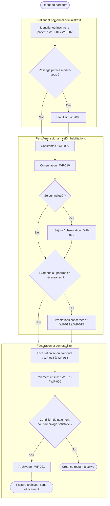

L’accès au dossier, aux ordonnances et aux copies est traité séparément dans WF-023 à WF-025 ; il n’est pas conditionné par ce dessin à une fin de parcours de facturation.

## Sommaire des domaines

- [5. Gestion des accès](#domaine-5) : WF-032, WF-033.
- [6. Patients et dossiers administratifs](#domaine-6) : WF-001, WF-002, WF-003, WF-004.
- [7. Rendez-vous](#domaine-7) : WF-005, WF-006, WF-007, WF-008.
- [8. Parcours médical et prestations](#domaine-8) : WF-009, WF-010, WF-011, WF-012, WF-013, WF-014, WF-015.
- [9. Facturation et paiements](#domaine-9) : WF-016, WF-017, WF-018, WF-019, WF-020, WF-021, WF-022.
- [10. Portail patient et copies](#domaine-10) : WF-023, WF-024, WF-025.
- [11. Produits et stocks](#domaine-11) : WF-029, WF-030, WF-031.
- [12. Personnel et paie](#domaine-12) : WF-027, WF-028.
- [13. Rapports financiers](#domaine-13) : WF-026.

<a id="domaine-5"></a>

## 5. Gestion des accès

<a id="wf-032"></a>

### WF-032 — Établir le contexte d’accès utilisateur

**Objectif :** Contexte d’accès établi; authentification détaillée classée Décision de cadrage de la baseline.

**Acteur principal :** Utilisateur demandant une fonction protégée ; catégories humaines énumérées ci-dessous, sans nouveau rôle générique.

Les autres acteurs concernés et leurs responsabilités figurent dans le tableau ci-dessous ; leur présence ne vaut pas attribution de permission.

| Acteur | Responsabilité dans le parcours |
| --- | --- |
| ACT-012 | Système CMRB: Application web, contrôles et enregistrement. |
| ACT-001 | Personnel administratif: Inscription et rendez-vous; facturation/paiement en conflit avec matrice. |
| ACT-002 | Médecin: Consultation et dossier clinique; orientation médicale. |
| ACT-003 | Personnel paramédical / infirmier: Constantes avant médecin; médicaments à clarifier. |
| ACT-004 | Service comptable: Facturation, paiements et rapports financiers. |
| ACT-005 | Patient: Inscription, réservation, consultation personnelle et demande de copie. |
| ACT-007 | Responsable RH / paie: Personnel, préparation de la paie et bulletins selon Q-022; aucun calcul social ou fiscal automatique sans paramétrage approuvé. |
| ACT-008 | Gestionnaire de stock / pharmacie: Produits, mouvements, seuils et implication pharmacie. |

**Déclencheur :** Accès à une fonction protégée.

**Préconditions principales :** L’utilisateur demande une fonction protégée. Le mécanisme de preuve d’identité et le lien compte-patient sont choisis par les décisions de baseline associées ; l’inscription publique est un parcours distinct.

**Résultat attendu :** Contexte d’accès établi; authentification détaillée classée Décision de cadrage de la baseline.

#### Diagramme du processus

Décision de cadrage de la baseline : vérifier l’identité avant de déterminer les droits et de présenter la ressource. Le mécanisme de connexion, les sessions et la récupération de compte ne sont pas spécifiés (Q-025).

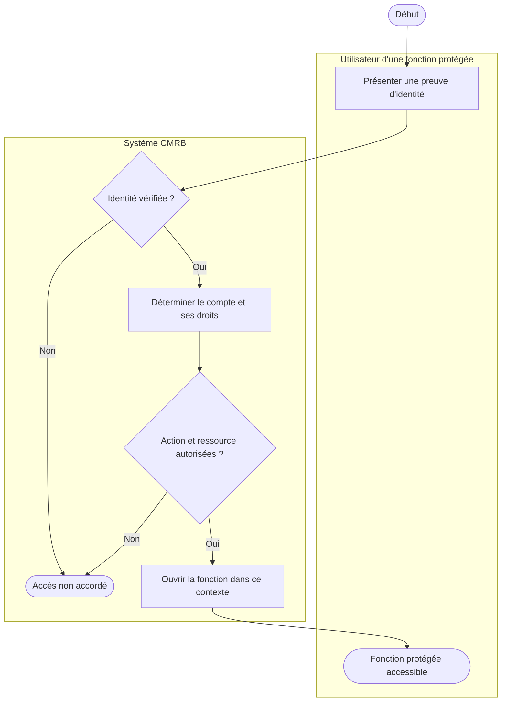

#### Règles critiques et autorisations

- **BR-016 — Contrôler chaque action et ressource :** Les droits sont décomposés par action et vérifiés côté serveur selon Q-031.

**SEC-032** — Tous les rôles protégés requièrent le contexte d'identité Q-025; l'inscription publique reste distincte et ne confère aucun droit avant vérification.

**Notifications :** aucun envoi supplémentaire explicitement requis.

#### Exceptions importantes

Inscription publique, comptes internes et patients peuvent nécessiter des mécanismes différents; aucun fournisseur imposé.

Preuve invalide, session expirée, ressource d’un autre patient : contrôles d'identité, de session et d'autorisation objet; récupération de compte définie par la décision de baseline associée.

Décision de cadrage technique : toute mutation est atomique, idempotente lorsqu'une clé de requête existe et protégée par contrôle de version. Une opération refusée n'a aucun effet métier; les doublons sont signalés et aucune fusion ou correction automatique n'est autorisée.

**Exigences SRS associées :** EF-SEC-001; ENF-002; ENF-003. Sources exactes dans le [catalogue](../requirements/REQUIREMENTS_CATALOG.md).

**Données concernées :** ENT-001 — Utilisateur; ENT-002 — Rôle; ENT-004 — Patient.

#### Décisions de baseline applicables

- [Q-025](#q-025) : Comment créer, vérifier, attribuer et retirer un accès; prouver le lien compte-patient; gérer les sessions ?
- [Q-026](#q-026) : Quels volumes, p95, disponibilité, RPO/RTO, rétention logs, restauration, navigateurs et SLA ?
- [Q-012](#q-012) : Quelles durées par donnée, quel déclencheur, gel, archivage et destruction autorisée ?
- [Q-033](#q-033) : Quel cadre applicable, lieu d’hébergement, données à reprendre, validation et procédure de bascule ?

[Fiche canonique et scénarios de recette](../workflows/WF-032.md).

<a id="wf-033"></a>

### WF-033 — Définir et attribuer les habilitations

**Objectif :** Habilitations définies uniquement après arbitrage métier.

**Acteur principal :** Administrateur des habilitations délégué par la direction ; ACT-012 applique les droits, sans se les attribuer.

Les autres acteurs concernés et leurs responsabilités figurent dans le tableau ci-dessous ; leur présence ne vaut pas attribution de permission.

| Acteur | Responsabilité dans le parcours |
| --- | --- |
| ACT-012 | Système CMRB: Application web, contrôles et enregistrement. |

**Déclencheur :** Besoin de définir ou modifier des droits.

**Préconditions principales :** La matrice définitive est appliquée par l'administrateur des habilitations délégué par la direction; les rôles sont cumulables après approbation et prennent effet immédiatement avec révocation des sessions concernées.

**Résultat attendu :** Habilitations définies uniquement après arbitrage métier.

#### Diagramme du processus

Décision de baseline : aucun rôle de superadministrateur ni auto-attribution n’est créé. La matrice et le responsable doivent être décidés avant mise en œuvre (Q-025, Q-031).

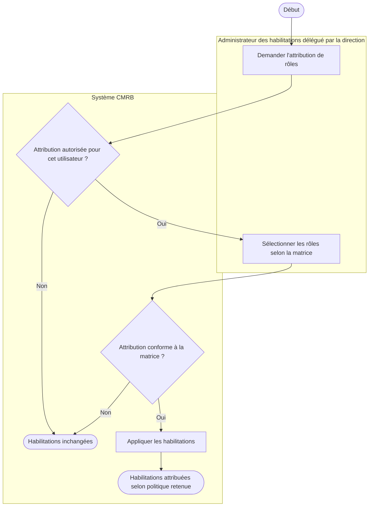

#### Règles critiques et autorisations

- **BR-002 — Encadrer l'écriture clinique :** Les médecins rédigent diagnostic, prescription et conclusion. Les paramédicaux saisissent constantes, observations de soins et administrations prescrites selon Q-002.
- **BR-016 — Contrôler chaque action et ressource :** Les droits sont décomposés par action et vérifiés côté serveur selon Q-031.

**SEC-033** — L'administrateur des habilitations est délégué par la direction. L'auto-attribution et le contournement des refus sont interdits; aucun rôle n'accorde un accès clinique implicite.

**Notifications :** aucun envoi supplémentaire explicitement requis.

#### Exceptions importantes

Retrait d’accès et cumul de rôles nécessitent décisions; aucun superadministrateur omnipotent supposé.

L'auto-attribution est interdite; un refus explicite prévaut; tout retrait révoque immédiatement les sessions; un rôle inconnu est refusé et journalisé.

Décision de cadrage technique : toute mutation est atomique, idempotente lorsqu'une clé de requête existe et protégée par contrôle de version. Une opération refusée n'a aucun effet métier; les doublons sont signalés et aucune fusion ou correction automatique n'est autorisée.

**Exigences SRS associées :** EF-SEC-001; EF-SEC-002; EF-SEC-003; EF-SEC-004; ENF-003. Sources exactes dans le [catalogue](../requirements/REQUIREMENTS_CATALOG.md).

**Données concernées :** ENT-001 — Utilisateur; ENT-002 — Rôle; ENT-025 — Autorisation par action.

#### Décisions de baseline applicables

- [Q-025](#q-025) : Comment créer, vérifier, attribuer et retirer un accès; prouver le lien compte-patient; gérer les sessions ?
- [Q-026](#q-026) : Quels volumes, p95, disponibilité, RPO/RTO, rétention logs, restauration, navigateurs et SLA ?
- [Q-012](#q-012) : Quelles durées par donnée, quel déclencheur, gel, archivage et destruction autorisée ?
- [Q-031](#q-031) : Confirmer la décomposition technique des capacités pour appliquer les droits existants.
- [Q-002](#q-002) : Quels champs les paramédicaux peuvent-ils saisir, corriger et consulter ?
- [Q-024](#q-024) : Quelles actions de facture et paiement sont autorisées à l’accueil ?
- [Q-033](#q-033) : Quel cadre applicable, lieu d’hébergement, données à reprendre, validation et procédure de bascule ?

[Fiche canonique et scénarios de recette](../workflows/WF-033.md).


<a id="domaine-6"></a>

## 6. Patients et dossiers administratifs

<a id="wf-001"></a>

### WF-001 — Inscrire un patient

**Objectif :** Inscription enregistrée; statut et numéro patient défini par la décision de baseline associées.

**Acteur principal :** ACT-005 (inscription par le patient) ou ACT-001 (inscription à l’accueil).

Les autres acteurs concernés et leurs responsabilités figurent dans le tableau ci-dessous ; leur présence ne vaut pas attribution de permission.

| Acteur | Responsabilité dans le parcours |
| --- | --- |
| ACT-001 | Personnel administratif: Inscription et rendez-vous; facturation/paiement en conflit avec matrice. |
| ACT-005 | Patient: Inscription, réservation, consultation personnelle et demande de copie. |
| ACT-012 | Système CMRB: Application web, contrôles et enregistrement. |

**Déclencheur :** Demande d’inscription au centre ou en ligne.

**Préconditions principales :** Le patient ou l’accueil engage une inscription. Le formulaire, les champs obligatoires, la détection des doublons et les modalités d’inscription publique restent défini par la baseline (Q-011, Q-025).

**Résultat attendu :** Inscription enregistrée; statut et numéro patient défini par la décision de baseline associées.

#### Diagramme du processus

Les conditions de conformité renvoient aux préconditions et aux décisions de baseline de cette fiche. Elles ne définissent aucune validation de saisie ou permission supplémentaire.

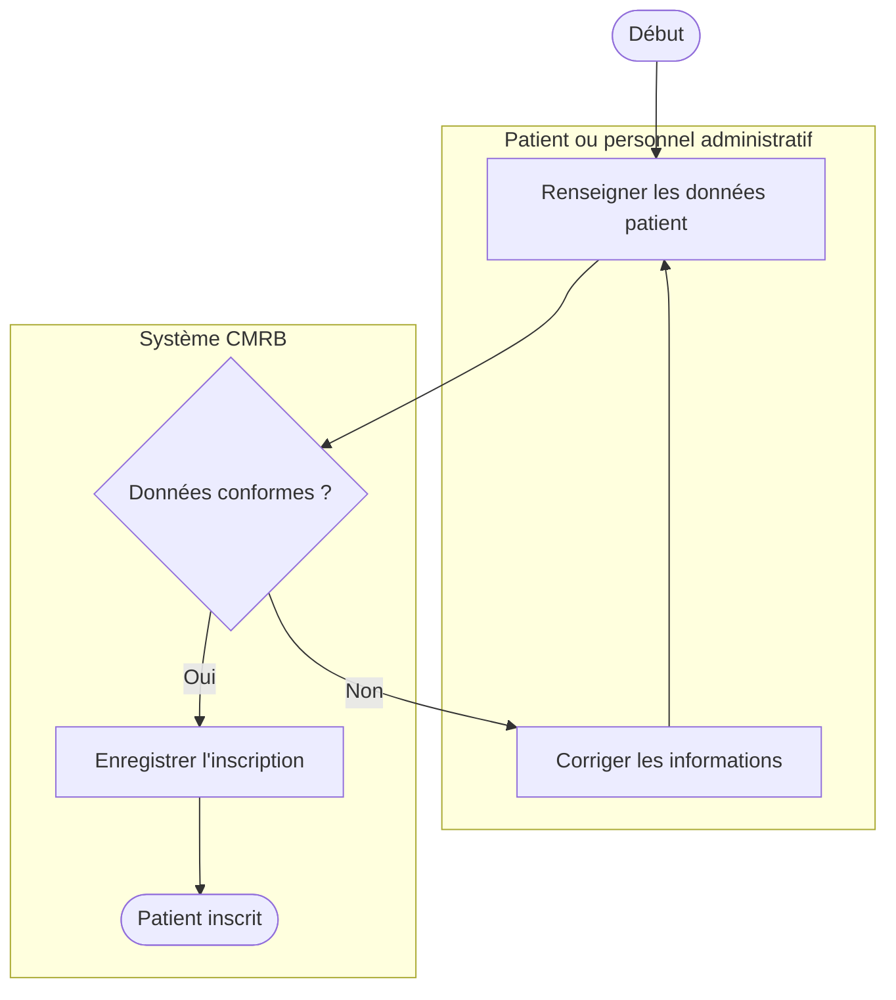

#### Règles critiques et autorisations

Les exigences liées, règles transverses et décisions Q citées sont normatives pour ce workflow.

**SEC-001** — ACT-001 ou ACT-005 peut initier l’inscription. Le contrôle d’identité, la validation et l’exposition publique restent Q-011/Q-025.

**Notifications :** aucun envoi supplémentaire explicitement requis.

#### Exceptions importantes

Inscription au centre et inscription en ligne sont deux canaux du même besoin; validation humaine de l’inscription en ligne définie par la baseline.

Une identité incomplète est rejetée; un homonyme ou doublon déclenche une revue humaine sans fusion automatique; après échec, la saisie est reprise sans créer de doublon.

Décision de cadrage technique : toute mutation est atomique, idempotente lorsqu'une clé de requête existe et protégée par contrôle de version. Une opération refusée n'a aucun effet métier; les doublons sont signalés et aucune fusion ou correction automatique n'est autorisée.

**Exigences SRS associées :** EF-PAT-001; EF-PAT-004; EF-PAT-007; EF-PORT-001. Sources exactes dans le [catalogue](../requirements/REQUIREMENTS_CATALOG.md).

**Données concernées :** ENT-004 — Patient; ENT-005 — Dossier administratif.

#### Décisions de baseline applicables

- [Q-011](#q-011) : Quels champs, justificatifs, règles d’unicité et traitement des homonymes sont requis par canal ?
- [Q-025](#q-025) : Comment créer, vérifier, attribuer et retirer un accès; prouver le lien compte-patient; gérer les sessions ?
- [Q-026](#q-026) : Quels volumes, p95, disponibilité, RPO/RTO, rétention logs, restauration, navigateurs et SLA ?
- [Q-012](#q-012) : Quelles durées par donnée, quel déclencheur, gel, archivage et destruction autorisée ?
- [Q-033](#q-033) : Quel cadre applicable, lieu d’hébergement, données à reprendre, validation et procédure de bascule ?

[Fiche canonique et scénarios de recette](../workflows/WF-001.md).

<a id="wf-002"></a>

### WF-002 — Consulter et rechercher un dossier administratif

**Objectif :** Dossier administratif consulté sans modification.

**Acteur principal :** ACT-001 ou ACT-002, selon droit de lecture administrative.

Les autres acteurs concernés et leurs responsabilités figurent dans le tableau ci-dessous ; leur présence ne vaut pas attribution de permission.

| Acteur | Responsabilité dans le parcours |
| --- | --- |
| ACT-001 | Personnel administratif: Inscription et rendez-vous; facturation/paiement en conflit avec matrice. |
| ACT-002 | Médecin: Consultation et dossier clinique; orientation médicale. |
| ACT-012 | Système CMRB: Application web, contrôles et enregistrement. |

**Déclencheur :** Besoin d’identifier le patient à prendre en charge.

**Préconditions principales :** La recherche porte sur un dossier administratif ; les critères disponibles et le périmètre de consultation de l’intervenant doivent être validés.

**Résultat attendu :** Dossier administratif consulté sans modification.

#### Diagramme du processus

Les conditions de conformité renvoient aux préconditions et aux décisions de baseline de cette fiche. Elles ne définissent aucune validation de saisie ou permission supplémentaire.

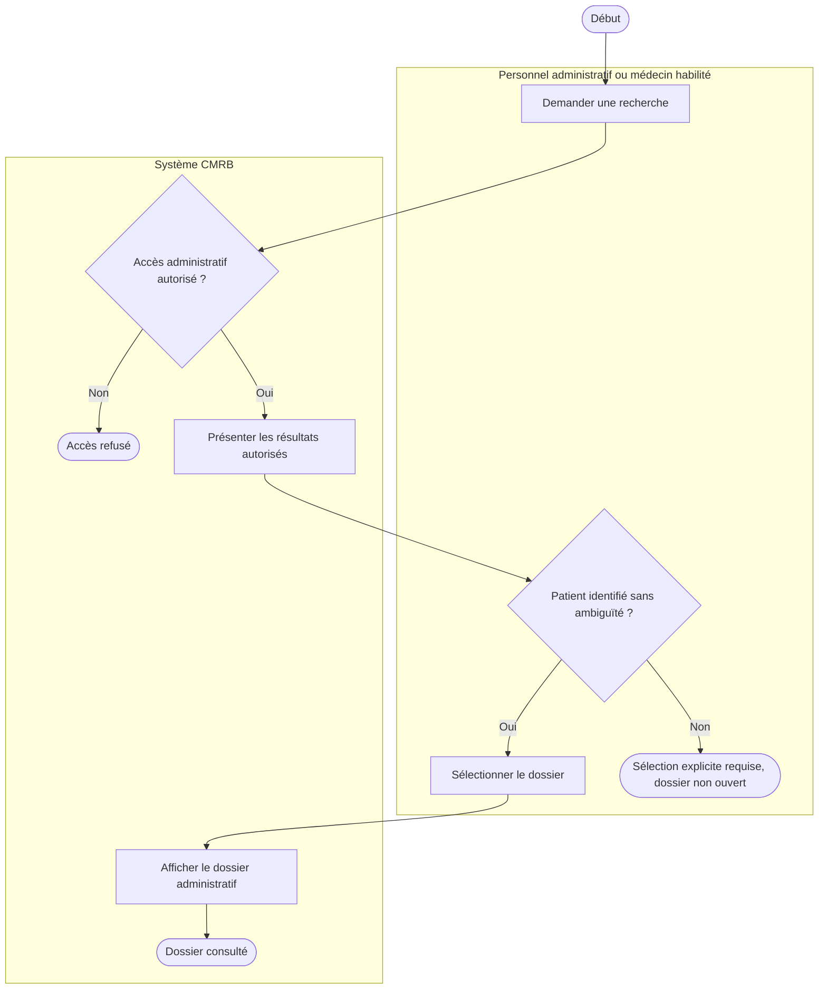

#### Règles critiques et autorisations

- **BR-001 — Séparer données administratives et cliniques :** Les dossiers administratif et médical utilisent des permissions et des données distinctes; aucun droit administratif n'accorde un accès clinique.

**SEC-002** — ACT-001 et ACT-002 consultent le dossier administratif; les lectures des autres profils issues de la matrice définitive restent P.

**Notifications :** aucun envoi supplémentaire explicitement requis.

#### Exceptions importantes

Recherche par identité ou identifiant : critères définis par la baseline; absence de dossier conduit au processus d’inscription sans création automatique.

Homonymes : distinguer les dossiers avant sélection; dossier absent : signaler absence; accès non habilité : ne pas exposer le dossier.

Décision de cadrage technique : toute mutation est atomique, idempotente lorsqu'une clé de requête existe et protégée par contrôle de version. Une opération refusée n'a aucun effet métier; les doublons sont signalés et aucune fusion ou correction automatique n'est autorisée.

**Exigences SRS associées :** EF-PAT-003; EF-PAT-005. Sources exactes dans le [catalogue](../requirements/REQUIREMENTS_CATALOG.md).

**Données concernées :** ENT-004 — Patient; ENT-005 — Dossier administratif.

#### Décisions de baseline applicables

- [Q-025](#q-025) : Comment créer, vérifier, attribuer et retirer un accès; prouver le lien compte-patient; gérer les sessions ?
- [Q-026](#q-026) : Quels volumes, p95, disponibilité, RPO/RTO, rétention logs, restauration, navigateurs et SLA ?
- [Q-012](#q-012) : Quelles durées par donnée, quel déclencheur, gel, archivage et destruction autorisée ?
- [Q-011](#q-011) : Quels champs, justificatifs, règles d’unicité et traitement des homonymes sont requis par canal ?
- [Q-024](#q-024) : Quelles actions de facture et paiement sont autorisées à l’accueil ?
- [Q-033](#q-033) : Quel cadre applicable, lieu d’hébergement, données à reprendre, validation et procédure de bascule ?

[Fiche canonique et scénarios de recette](../workflows/WF-002.md).

<a id="wf-003"></a>

### WF-003 — Modifier un dossier administratif

**Objectif :** Dossier administratif modifié; traçabilité de correction défini par la baseline.

**Acteur principal :** ACT-001.

Les autres acteurs concernés et leurs responsabilités figurent dans le tableau ci-dessous ; leur présence ne vaut pas attribution de permission.

| Acteur | Responsabilité dans le parcours |
| --- | --- |
| ACT-001 | Personnel administratif: Inscription et rendez-vous; facturation/paiement en conflit avec matrice. |
| ACT-012 | Système CMRB: Application web, contrôles et enregistrement. |

**Déclencheur :** Correction d’une donnée administrative.

**Préconditions principales :** Le patient et le dossier administratif existent. Les champs modifiables et les droits de correction de l’accueil doivent être arrêtés.

**Résultat attendu :** Dossier administratif modifié; traçabilité de correction défini par la baseline.

#### Diagramme du processus

Les conditions de conformité renvoient aux préconditions et aux décisions de baseline de cette fiche. Elles ne définissent aucune validation de saisie ou permission supplémentaire.

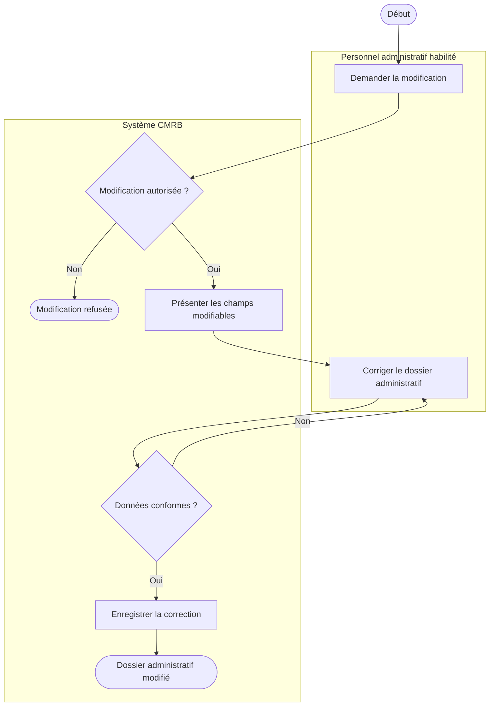

#### Règles critiques et autorisations

- **BR-001 — Séparer données administratives et cliniques :** Les dossiers administratif et médical utilisent des permissions et des données distinctes; aucun droit administratif n'accorde un accès clinique.

**SEC-003** — ACT-001 modifie le dossier administratif. Cette permission n’autorise pas la correction d’une note médicale.

**Notifications :** aucun envoi supplémentaire explicitement requis.

#### Exceptions importantes

Une correction clinique relève du dossier médical et non de ce processus.

Modification simultanée : politique de conflit arrêté pour la baseline; identité devenue ambiguë : ne pas fusionner silencieusement; validation invalide : correction attendue.

Décision de cadrage technique : toute mutation est atomique, idempotente lorsqu'une clé de requête existe et protégée par contrôle de version. Une opération refusée n'a aucun effet métier; les doublons sont signalés et aucune fusion ou correction automatique n'est autorisée.

**Exigences SRS associées :** EF-PAT-002; EF-PAT-005; EF-PAT-007. Sources exactes dans le [catalogue](../requirements/REQUIREMENTS_CATALOG.md).

**Données concernées :** ENT-004 — Patient; ENT-005 — Dossier administratif.

#### Décisions de baseline applicables

- [Q-025](#q-025) : Comment créer, vérifier, attribuer et retirer un accès; prouver le lien compte-patient; gérer les sessions ?
- [Q-026](#q-026) : Quels volumes, p95, disponibilité, RPO/RTO, rétention logs, restauration, navigateurs et SLA ?
- [Q-012](#q-012) : Quelles durées par donnée, quel déclencheur, gel, archivage et destruction autorisée ?
- [Q-011](#q-011) : Quels champs, justificatifs, règles d’unicité et traitement des homonymes sont requis par canal ?
- [Q-028](#q-028) : Quels fichiers, taille, version, validation de contenu et règles de téléchargement ?
- [Q-033](#q-033) : Quel cadre applicable, lieu d’hébergement, données à reprendre, validation et procédure de bascule ?

[Fiche canonique et scénarios de recette](../workflows/WF-003.md).

<a id="wf-004"></a>

### WF-004 — Traiter une demande de suppression ou archivage patient

**Objectif :** Demande non exécutée tant que la politique est absente.

**Acteur principal :** ACT-001.

Les autres acteurs concernés et leurs responsabilités figurent dans le tableau ci-dessous ; leur présence ne vaut pas attribution de permission.

| Acteur | Responsabilité dans le parcours |
| --- | --- |
| ACT-001 | Personnel administratif: Inscription et rendez-vous; facturation/paiement en conflit avec matrice. |
| ACT-012 | Système CMRB: Application web, contrôles et enregistrement. |

**Déclencheur :** Demande de suppression d’un dossier.

**Préconditions principales :** Une demande concerne un patient identifié. En l’absence de politique approuvée, aucune suppression physique n’est autorisée (BR-003).

**Résultat attendu :** Demande non exécutée tant que la politique est absente.

#### Diagramme du processus

Décision de baseline : le diagramme représente uniquement la non-suppression confirmée par BR-003. L’archivage, l’anonymisation et une éventuelle destruction future ne sont pas modélisés comme opérations déjà autorisées (Q-012).

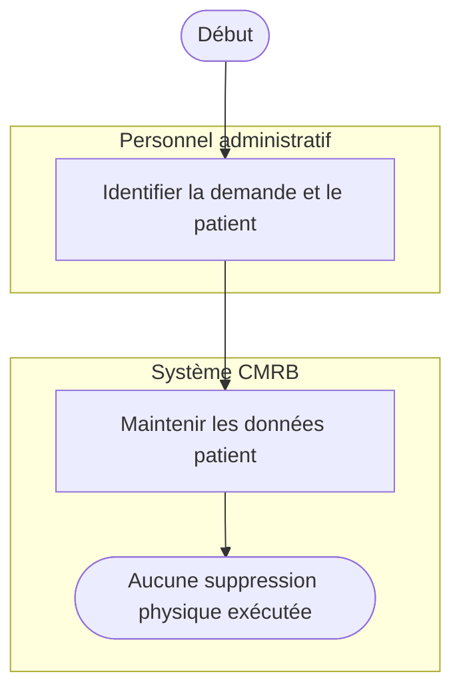

#### Règles critiques et autorisations

- **BR-003 — Interdire la suppression destructive :** Aucun dossier clinique n'est supprimé physiquement; archivage, gel et anonymisation suivent Q-012.

**SEC-004** — Aucun acteur ne peut effacer physiquement le dossier; archivage et anonymisation suivent Q-012.

**Notifications :** aucun envoi supplémentaire explicitement requis.

#### Exceptions importantes

Archivage, anonymisation et suppression logique sont des options ouvertes, pas des transitions approuvées.

Dossier lié à des prestations ou factures : comportement référentiel non décidé; demande sans politique applicable : aucun effacement physique.

Décision de cadrage technique : toute mutation est atomique, idempotente lorsqu'une clé de requête existe et protégée par contrôle de version. Une opération refusée n'a aucun effet métier; les doublons sont signalés et aucune fusion ou correction automatique n'est autorisée.

**Exigences SRS associées :** EF-PAT-006. Sources exactes dans le [catalogue](../requirements/REQUIREMENTS_CATALOG.md).

**Données concernées :** ENT-004 — Patient; ENT-005 — Dossier administratif; ENT-006 — Dossier médical.

#### Décisions de baseline applicables

- [Q-025](#q-025) : Comment créer, vérifier, attribuer et retirer un accès; prouver le lien compte-patient; gérer les sessions ?
- [Q-026](#q-026) : Quels volumes, p95, disponibilité, RPO/RTO, rétention logs, restauration, navigateurs et SLA ?
- [Q-012](#q-012) : Quelles durées par donnée, quel déclencheur, gel, archivage et destruction autorisée ?
- [Q-033](#q-033) : Quel cadre applicable, lieu d’hébergement, données à reprendre, validation et procédure de bascule ?

[Fiche canonique et scénarios de recette](../workflows/WF-004.md).


<a id="domaine-7"></a>

## 7. Rendez-vous

<a id="wf-005"></a>

### WF-005 — Planifier un rendez-vous

**Objectif :** Rendez-vous planifié; statut exact arrêté par la baseline.

**Acteur principal :** ACT-005 ou ACT-001.

Les autres acteurs concernés et leurs responsabilités figurent dans le tableau ci-dessous ; leur présence ne vaut pas attribution de permission.

| Acteur | Responsabilité dans le parcours |
| --- | --- |
| ACT-001 | Personnel administratif: Inscription et rendez-vous; facturation/paiement en conflit avec matrice. |
| ACT-005 | Patient: Inscription, réservation, consultation personnelle et demande de copie. |
| ACT-012 | Système CMRB: Application web, contrôles et enregistrement. |

**Déclencheur :** Demande de rendez-vous par patient ou accueil.

**Préconditions principales :** Le patient et le besoin de rendez-vous sont identifiés. Les créneaux, ressources, durées et règles de disponibilité restent défini par la baseline (Q-015).

**Résultat attendu :** Rendez-vous planifié; statut exact arrêté par la baseline.

#### Diagramme du processus

Les conditions de conformité renvoient aux préconditions et aux décisions de baseline de cette fiche. Elles ne définissent aucune validation de saisie ou permission supplémentaire.

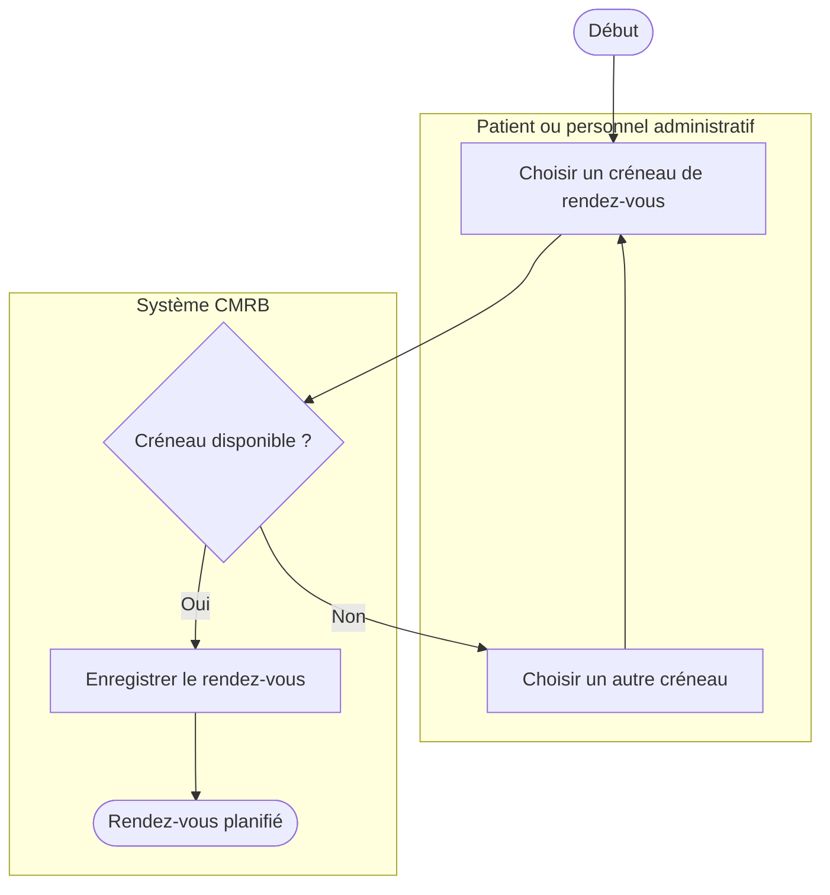

#### Règles critiques et autorisations

Les exigences liées, règles transverses et décisions Q citées sont normatives pour ce workflow.

**SEC-005** — ACT-001 et ACT-005 réservent. Le périmètre propre patient et le droit sur l’agenda restent défini par la baseline.

**Notifications :** aucun envoi supplémentaire explicitement requis.

#### Exceptions importantes

Canal portail ou accueil; confirmation immédiate ou ultérieure non décidée.

Deux demandes simultanées : réservation transactionnelle, une seule réussit; créneau indisponible : autre proposition; patient absent : inscription si nécessaire.

Décision de cadrage technique : toute mutation est atomique, idempotente lorsqu'une clé de requête existe et protégée par contrôle de version. Une opération refusée n'a aucun effet métier; les doublons sont signalés et aucune fusion ou correction automatique n'est autorisée.

**Exigences SRS associées :** EF-RDV-001; EF-RDV-004; EF-RDV-006; EF-PORT-002. Sources exactes dans le [catalogue](../requirements/REQUIREMENTS_CATALOG.md).

**Données concernées :** ENT-004 — Patient; ENT-007 — Rendez-vous.

#### Décisions de baseline applicables

- [Q-015](#q-015) : Quels agendas, ressources, durées, doublons, absences et statuts sont nécessaires ?
- [Q-025](#q-025) : Comment créer, vérifier, attribuer et retirer un accès; prouver le lien compte-patient; gérer les sessions ?
- [Q-026](#q-026) : Quels volumes, p95, disponibilité, RPO/RTO, rétention logs, restauration, navigateurs et SLA ?
- [Q-012](#q-012) : Quelles durées par donnée, quel déclencheur, gel, archivage et destruction autorisée ?
- [Q-013](#q-013) : Confirmez-vous l’unité heure, la limite inclusive, les acteurs, exceptions et effet d’un report ?
- [Q-033](#q-033) : Quel cadre applicable, lieu d’hébergement, données à reprendre, validation et procédure de bascule ?

[Fiche canonique et scénarios de recette](../workflows/WF-005.md).

<a id="wf-006"></a>

### WF-006 — Confirmer un rendez-vous

**Objectif :** Confirmation enregistrée; transition partielle documentée.

**Acteur principal :** ACT-001.

Les autres acteurs concernés et leurs responsabilités figurent dans le tableau ci-dessous ; leur présence ne vaut pas attribution de permission.

| Acteur | Responsabilité dans le parcours |
| --- | --- |
| ACT-001 | Personnel administratif: Inscription et rendez-vous; facturation/paiement en conflit avec matrice. |
| ACT-012 | Système CMRB: Application web, contrôles et enregistrement. |

**Déclencheur :** Rendez-vous arrêté pour la baseline.

**Préconditions principales :** Un rendez-vous existe. Les états admettant une confirmation et les droits de l’accueil doivent être arrêtés (Q-015).

**Résultat attendu :** Confirmation enregistrée; transition partielle documentée.

#### Diagramme du processus

Les conditions de conformité renvoient aux préconditions et aux décisions de baseline de cette fiche. Elles ne définissent aucune validation de saisie ou permission supplémentaire.

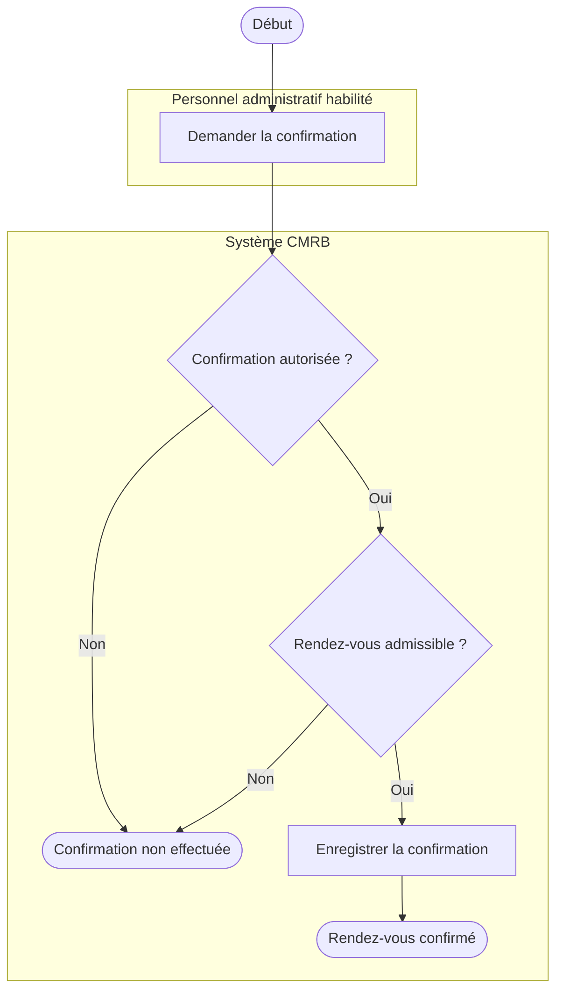

#### Règles critiques et autorisations

Les exigences liées, règles transverses et décisions Q citées sont normatives pour ce workflow.

**SEC-006** — ACT-001 est cité pour confirmer. Confirmation par ACT-005 non établie.

**Notifications :** aucun envoi supplémentaire explicitement requis.

#### Exceptions importantes

Le patient confirme depuis un lien à usage unique ou l'accueil confirme après authentification; une confirmation produit une notification distincte des rappels.

Un rendez-vous annulé ou introuvable est refusé sans mutation; une confirmation répétée est idempotente.

Décision de cadrage technique : toute mutation est atomique, idempotente lorsqu'une clé de requête existe et protégée par contrôle de version. Une opération refusée n'a aucun effet métier; les doublons sont signalés et aucune fusion ou correction automatique n'est autorisée.

#### Cycle de vie partiel

Vue partielle : seuls les états nécessaires à la formulation source sont nommés. Aucun état initial technique, rejet, réouverture ou suppression n’est ajouté.

| Origine | Cible | Sens / condition | Acteur | Action | Notification | Audit | Interdictions |
| --- | --- | --- | --- | --- | --- | --- | --- |
| Planifie | Confirme | Confirmation enregistrée; Q-015 | ACT-001 | Appliquer la transition après validation | Immédiate après succès transactionnel | Q-026 | Toutes les autres transitions sont interdites; aucune autorisation déduite |

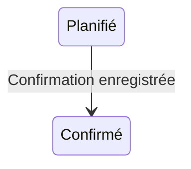

Source : EF-RDV-002. Labels conceptuels, codes techniques arrêtés par la baseline.

**Exigences SRS associées :** EF-RDV-002; EF-RDV-006. Sources exactes dans le [catalogue](../requirements/REQUIREMENTS_CATALOG.md).

**Données concernées :** ENT-007 — Rendez-vous.

#### Décisions de baseline applicables

- [Q-015](#q-015) : Quels agendas, ressources, durées, doublons, absences et statuts sont nécessaires ?
- [Q-025](#q-025) : Comment créer, vérifier, attribuer et retirer un accès; prouver le lien compte-patient; gérer les sessions ?
- [Q-026](#q-026) : Quels volumes, p95, disponibilité, RPO/RTO, rétention logs, restauration, navigateurs et SLA ?
- [Q-012](#q-012) : Quelles durées par donnée, quel déclencheur, gel, archivage et destruction autorisée ?
- [Q-014](#q-014) : Combien de rappels, à quel moment, avec quel contenu et quel repli en cas d’échec ?
- [Q-033](#q-033) : Quel cadre applicable, lieu d’hébergement, données à reprendre, validation et procédure de bascule ?

[Fiche canonique et scénarios de recette](../workflows/WF-006.md).

<a id="wf-007"></a>

### WF-007 — Rappeler un rendez-vous

**Objectif :** Rappel transmis ou échec identifié; livraison effective non assimilée à acceptation technique.

**Acteur principal :** ACT-012 pour le rappel ; ACT-001 si déclenchement manuel retenu. ACT-005 choisit préalablement le canal.

Les autres acteurs concernés et leurs responsabilités figurent dans le tableau ci-dessous ; leur présence ne vaut pas attribution de permission.

| Acteur | Responsabilité dans le parcours |
| --- | --- |
| ACT-001 | Personnel administratif: Inscription et rendez-vous; facturation/paiement en conflit avec matrice. |
| ACT-005 | Patient: Inscription, réservation, consultation personnelle et demande de copie. |
| ACT-012 | Système CMRB: Application web, contrôles et enregistrement. |
| ACT-014 | Service de notification: Transport des notifications si externalisé. |

**Déclencheur :** Échéance de rappel à fixer.

**Préconditions principales :** Un rendez-vous est concerné par un rappel. Le canal vérifié choisi par le patient est connu; les rappels sont déclenchés à 48 h puis 24 h selon Q-014.

**Résultat attendu :** Rappel transmis ou échec identifié; livraison effective non assimilée à acceptation technique.

#### Diagramme du processus

Le choix du canal est une préparation du rappel, pas une nouvelle saisie imposée à chaque envoi. Le déclenchement manuel ou automatique et le transport externe restent arrêté pour la baseline (Q-014, Q-027). Acceptation de transmission ne signifie pas réception par le patient.

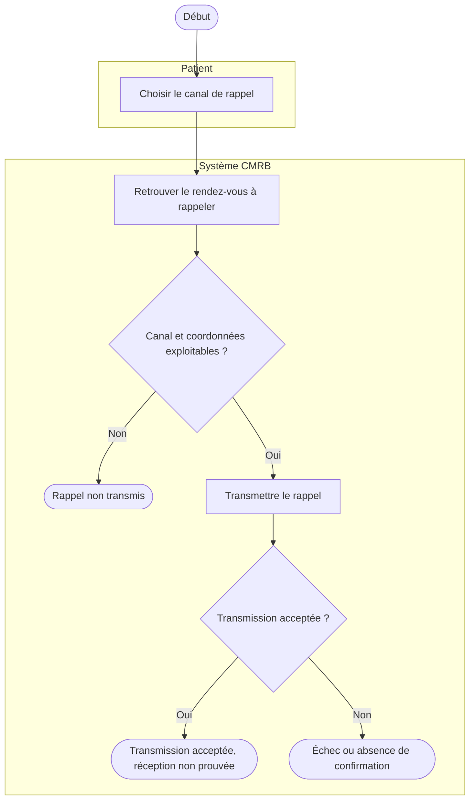

#### Règles critiques et autorisations

- **BR-010 — Respecter le canal de rappel :** Le patient choisit un canal vérifié; le calendrier, les tentatives et le repli suivent Q-014.

**SEC-007** — ACT-005 choisit son canal; ACT-001 participe au rappel; rôle du déclencheur automatique arrêté pour la baseline.

**Notifications :** Rappel selon canal choisi; contenu, calendrier et réessai Q-014.

#### Exceptions importantes

Choix SMS, e-mail ou WhatsApp issu du commentaire; repli manuel ou autre canal non décidé.

En cas d'échec, deux réessais puis le canal de repli Q-014 sont utilisés et l'accueil est alerté; une annulation stoppe tout envoi non parti et marque obsolète tout envoi en cours.

Décision de cadrage technique : toute mutation est atomique, idempotente lorsqu'une clé de requête existe et protégée par contrôle de version. Une opération refusée n'a aucun effet métier; les doublons sont signalés et aucune fusion ou correction automatique n'est autorisée.

**Exigences SRS associées :** EF-RDV-003; EF-RDV-005; ADD-006. Sources exactes dans le [catalogue](../requirements/REQUIREMENTS_CATALOG.md).

**Données concernées :** ENT-007 — Rendez-vous; ENT-026 — Notification; ENT-027 — Préférence de canal.

#### Décisions de baseline applicables

- [Q-014](#q-014) : Combien de rappels, à quel moment, avec quel contenu et quel repli en cas d’échec ?
- [Q-025](#q-025) : Comment créer, vérifier, attribuer et retirer un accès; prouver le lien compte-patient; gérer les sessions ?
- [Q-026](#q-026) : Quels volumes, p95, disponibilité, RPO/RTO, rétention logs, restauration, navigateurs et SLA ?
- [Q-012](#q-012) : Quelles durées par donnée, quel déclencheur, gel, archivage et destruction autorisée ?
- [Q-027](#q-027) : Aucun logiciel métier tiers, ou aucune dépendance même pour SMS et paiement ?
- [Q-033](#q-033) : Quel cadre applicable, lieu d’hébergement, données à reprendre, validation et procédure de bascule ?

[Fiche canonique et scénarios de recette](../workflows/WF-007.md).

<a id="wf-008"></a>

### WF-008 — Annuler ou reprendre un rendez-vous

**Objectif :** Annulation enregistrée si autorisée; nouvelle réservation indépendante tant que lien non décidé.

**Acteur principal :** ACT-005 ; participation ACT-001 selon droit d’annulation arrêté pour la baseline.

Les autres acteurs concernés et leurs responsabilités figurent dans le tableau ci-dessous ; leur présence ne vaut pas attribution de permission.

| Acteur | Responsabilité dans le parcours |
| --- | --- |
| ACT-001 | Personnel administratif: Inscription et rendez-vous; facturation/paiement en conflit avec matrice. |
| ACT-005 | Patient: Inscription, réservation, consultation personnelle et demande de copie. |
| ACT-012 | Système CMRB: Application web, contrôles et enregistrement. |

**Déclencheur :** Demande d’annulation ou nouveau rendez-vous.

**Préconditions principales :** Un rendez-vous existe. Le délai « minimum 24 d’avance », son unité, sa borne et les droits d’annulation doivent être arbitrés avant application (Q-013, Q-015).

**Résultat attendu :** Annulation enregistrée si autorisée; nouvelle réservation indépendante tant que lien non décidé.

#### Diagramme du processus

Décision de baseline : la condition temporelle dépend de Q-013 ; le diagramme ne fixe ni l’unité « heures » ni la borne. « Non » signifie non admissible selon la future règle, pas absence d’arbitrage.

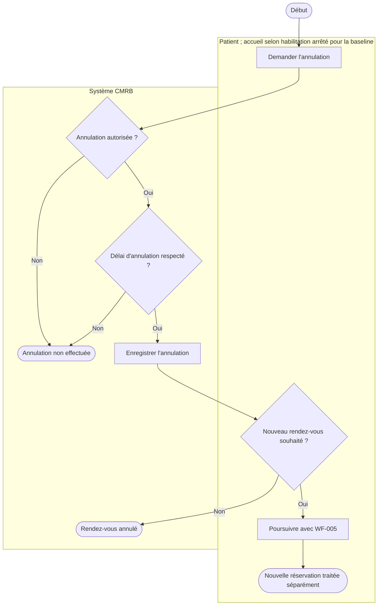

#### Règles critiques et autorisations

- **BR-004 — Appliquer le délai d'annulation :** L'annulation autonome est permise jusqu'à 24 heures incluses avant le rendez-vous; ensuite l'accueil intervient et motive l'opération.

**SEC-008** — ACT-005 peut annuler selon commentaire 171; droit accueil et dérogation tardive non fixés.

**Notifications :** aucun envoi supplémentaire explicitement requis.

#### Exceptions importantes

Moins de 24 heures : exception ou refus arbitré par la baseline; relation entre ancien et nouveau rendez-vous définie par la baseline.

Rendez-vous déjà annulé, fuseau inconnu ou deux annulations : traitement idempotent et tracé; aucun report automatique supposé.

Décision de cadrage technique : toute mutation est atomique, idempotente lorsqu'une clé de requête existe et protégée par contrôle de version. Une opération refusée n'a aucun effet métier; les doublons sont signalés et aucune fusion ou correction automatique n'est autorisée.

#### Cycle de vie partiel

Vue partielle : seuls les états nécessaires à la formulation source sont nommés. Aucun état initial technique, rejet, réouverture ou suppression n’est ajouté.

| Origine | Cible | Sens / condition | Acteur | Action | Notification | Audit | Interdictions |
| --- | --- | --- | --- | --- | --- | --- | --- |
| Planifie | Annule | Annulation admissible; Q-013 | ACT-005; ACT-001 arrêté pour la baseline | Appliquer la transition après validation | Immédiate après succès transactionnel | Q-026 | Toutes les autres transitions sont interdites; aucune autorisation déduite |

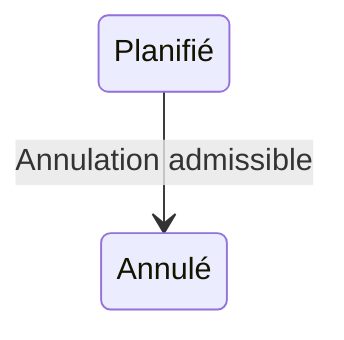

Source : ADD-005. Labels conceptuels, codes techniques arrêtés par la baseline.

**Exigences SRS associées :** EF-RDV-007; ADD-005. Sources exactes dans le [catalogue](../requirements/REQUIREMENTS_CATALOG.md).

**Données concernées :** ENT-007 — Rendez-vous.

#### Décisions de baseline applicables

- [Q-013](#q-013) : Confirmez-vous l’unité heure, la limite inclusive, les acteurs, exceptions et effet d’un report ?
- [Q-015](#q-015) : Quels agendas, ressources, durées, doublons, absences et statuts sont nécessaires ?
- [Q-025](#q-025) : Comment créer, vérifier, attribuer et retirer un accès; prouver le lien compte-patient; gérer les sessions ?
- [Q-026](#q-026) : Quels volumes, p95, disponibilité, RPO/RTO, rétention logs, restauration, navigateurs et SLA ?
- [Q-012](#q-012) : Quelles durées par donnée, quel déclencheur, gel, archivage et destruction autorisée ?
- [Q-033](#q-033) : Quel cadre applicable, lieu d’hébergement, données à reprendre, validation et procédure de bascule ?

[Fiche canonique et scénarios de recette](../workflows/WF-008.md).


<a id="domaine-8"></a>

## 8. Parcours médical et prestations

<a id="wf-009"></a>

### WF-009 — Relever les constantes avant consultation

**Objectif :** Constantes associées au contexte clinique, sous réserve de résolution du conflit.

**Acteur principal :** ACT-003, sous réserve de Q-002.

Les autres acteurs concernés et leurs responsabilités figurent dans le tableau ci-dessous ; leur présence ne vaut pas attribution de permission.

| Acteur | Responsabilité dans le parcours |
| --- | --- |
| ACT-003 | Personnel paramédical / infirmier: Constantes avant médecin; médicaments à clarifier. |
| ACT-002 | Médecin: Consultation et dossier clinique; orientation médicale. |
| ACT-012 | Système CMRB: Application web, contrôles et enregistrement. |

**Déclencheur :** Arrivée du patient pour consultation.

**Préconditions principales :** Le patient est identifié avant consultation. L’autorisation paramédicale de saisir les constantes est en conflit avec la restriction d’écriture médicale (Q-002).

**Résultat attendu :** Constantes associées au contexte clinique, sous réserve de résolution du conflit.

#### Diagramme du processus

Décision de baseline : ce parcours décrit l’annotation sur les constantes ; il ne tranche pas le conflit d’écriture paramédicale (Q-002). Aucune permission de diagnostic n’est déduite de la saisie des constantes.

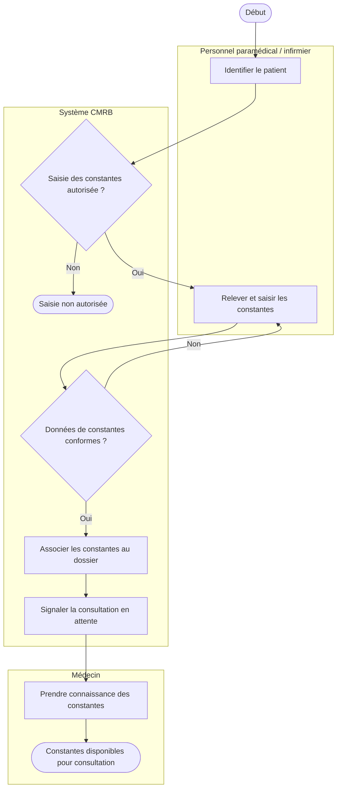

#### Règles critiques et autorisations

- **BR-002 — Encadrer l'écriture clinique :** Les médecins rédigent diagnostic, prescription et conclusion. Les paramédicaux saisissent constantes, observations de soins et administrations prescrites selon Q-002.

**SEC-009** — ACT-003 saisit les constantes selon annotation, en conflit avec EF-SEC-002 et AC-05. Aucun droit sur diagnostic déduit.

**Notifications :** aucun envoi supplémentaire explicitement requis.

#### Exceptions importantes

Le paramédical n'administre qu'un médicament prescrit et trace l'administration; en urgence, le médecin peut commencer l'épisode et les constantes sont complétées dès que possible.

Valeur ou unité invalide : règles arrêté pour la baseline; mauvaise identité : interrompre rattachement; conflit de droits : branche bloquée.

Décision de cadrage technique : toute mutation est atomique, idempotente lorsqu'une clé de requête existe et protégée par contrôle de version. Une opération refusée n'a aucun effet métier; les doublons sont signalés et aucune fusion ou correction automatique n'est autorisée.

**Exigences SRS associées :** ADD-001; ADD-015; EF-DM-004; EF-SEC-002. Sources exactes dans le [catalogue](../requirements/REQUIREMENTS_CATALOG.md).

**Données concernées :** ENT-004 — Patient; ENT-006 — Dossier médical; ENT-008 — Prestation; ENT-015 — Constantes.

#### Décisions de baseline applicables

- [Q-002](#q-002) : Quels champs les paramédicaux peuvent-ils saisir, corriger et consulter ?
- [Q-025](#q-025) : Comment créer, vérifier, attribuer et retirer un accès; prouver le lien compte-patient; gérer les sessions ?
- [Q-026](#q-026) : Quels volumes, p95, disponibilité, RPO/RTO, rétention logs, restauration, navigateurs et SLA ?
- [Q-012](#q-012) : Quelles durées par donnée, quel déclencheur, gel, archivage et destruction autorisée ?
- [Q-011](#q-011) : Quels champs, justificatifs, règles d’unicité et traitement des homonymes sont requis par canal ?
- [Q-033](#q-033) : Quel cadre applicable, lieu d’hébergement, données à reprendre, validation et procédure de bascule ?

[Fiche canonique et scénarios de recette](../workflows/WF-009.md).

<a id="wf-010"></a>

### WF-010 — Réaliser une consultation

**Objectif :** Consultation enregistrée et disponible pour facturation.

**Acteur principal :** ACT-002.

Les autres acteurs concernés et leurs responsabilités figurent dans le tableau ci-dessous ; leur présence ne vaut pas attribution de permission.

| Acteur | Responsabilité dans le parcours |
| --- | --- |
| ACT-002 | Médecin: Consultation et dossier clinique; orientation médicale. |
| ACT-003 | Personnel paramédical / infirmier: Constantes avant médecin; médicaments à clarifier. |
| ACT-012 | Système CMRB: Application web, contrôles et enregistrement. |

**Déclencheur :** Consultation en attente prise par un médecin.

**Préconditions principales :** Le médecin demande le dossier d’un patient identifié. L’accès est contrôlé avant présentation ; le contenu clinique et les orientations restent soumis aux décisions de baseline associées.

**Résultat attendu :** Consultation enregistrée et disponible pour facturation.

#### Diagramme du processus

Les conditions de conformité renvoient aux préconditions et aux décisions de baseline de cette fiche. Elles ne définissent aucune validation de saisie ou permission supplémentaire.

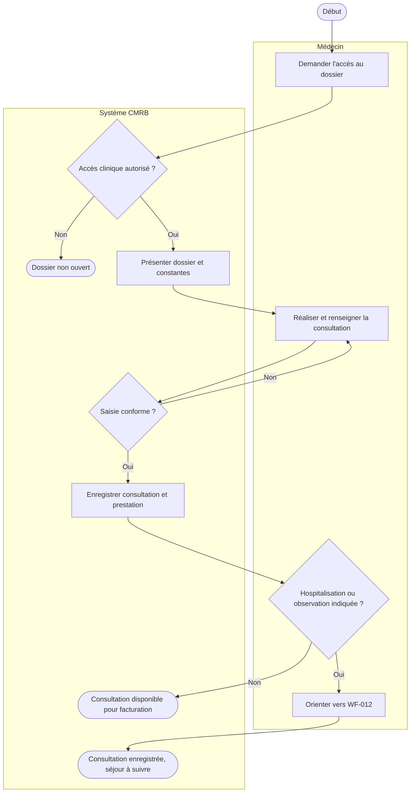

#### Règles critiques et autorisations

- **BR-002 — Encadrer l'écriture clinique :** Les médecins rédigent diagnostic, prescription et conclusion. Les paramédicaux saisissent constantes, observations de soins et administrations prescrites selon Q-002.

**SEC-010** — ACT-002 renseigne le dossier médical. L’ajout des constantes par ACT-003 exige Q-002; ajout de pièces jointes soumis au même périmètre.

**Notifications :** aucun envoi supplémentaire explicitement requis.

#### Exceptions importantes

Consultation avec ou sans rendez-vous est précisé par la décision de baseline associée; orientation séjour n’est pas une admission automatique.

Document invalide ou enregistrement concurrent : reprise défini par la baseline; utilisateur non médecin : interdiction générale, hors conflit paramédical enregistré.

Décision de cadrage technique : toute mutation est atomique, idempotente lorsqu'une clé de requête existe et protégée par contrôle de version. Une opération refusée n'a aucun effet métier; les doublons sont signalés et aucune fusion ou correction automatique n'est autorisée.

**Exigences SRS associées :** EF-SRV-CONS-001; EF-SRV-CONS-002; EF-SRV-CONS-003; EF-DM-002; EF-DM-004; ADD-020; ADD-021. Sources exactes dans le [catalogue](../requirements/REQUIREMENTS_CATALOG.md).

**Données concernées :** ENT-004 — Patient; ENT-006 — Dossier médical; ENT-008 — Prestation; ENT-015 — Constantes; ENT-019 — Ordonnance; ENT-020 — Pièce jointe.

#### Décisions de baseline applicables

- [Q-002](#q-002) : Quels champs les paramédicaux peuvent-ils saisir, corriger et consulter ?
- [Q-025](#q-025) : Comment créer, vérifier, attribuer et retirer un accès; prouver le lien compte-patient; gérer les sessions ?
- [Q-026](#q-026) : Quels volumes, p95, disponibilité, RPO/RTO, rétention logs, restauration, navigateurs et SLA ?
- [Q-012](#q-012) : Quelles durées par donnée, quel déclencheur, gel, archivage et destruction autorisée ?
- [Q-016](#q-016) : Quelles admissions, chambres, durées, transferts, sorties et différences observation/hospitalisation ?
- [Q-028](#q-028) : Quels fichiers, taille, version, validation de contenu et règles de téléchargement ?
- [Q-033](#q-033) : Quel cadre applicable, lieu d’hébergement, données à reprendre, validation et procédure de bascule ?

[Fiche canonique et scénarios de recette](../workflows/WF-010.md).

<a id="wf-011"></a>

### WF-011 — Consulter l’historique médical

**Objectif :** Historique consulté; aucune publication patient induite.

**Acteur principal :** ACT-002.

Les autres acteurs concernés et leurs responsabilités figurent dans le tableau ci-dessous ; leur présence ne vaut pas attribution de permission.

| Acteur | Responsabilité dans le parcours |
| --- | --- |
| ACT-002 | Médecin: Consultation et dossier clinique; orientation médicale. |
| ACT-012 | Système CMRB: Application web, contrôles et enregistrement. |

**Déclencheur :** Besoin clinique d’historique.

**Préconditions principales :** Le patient est identifié. Le médecin possède le droit de lecture médicale applicable ; l’historique est distinct de sa publication au patient.

**Résultat attendu :** Historique consulté; aucune publication patient induite.

#### Diagramme du processus

Les conditions de conformité renvoient aux préconditions et aux décisions de baseline de cette fiche. Elles ne définissent aucune validation de saisie ou permission supplémentaire.

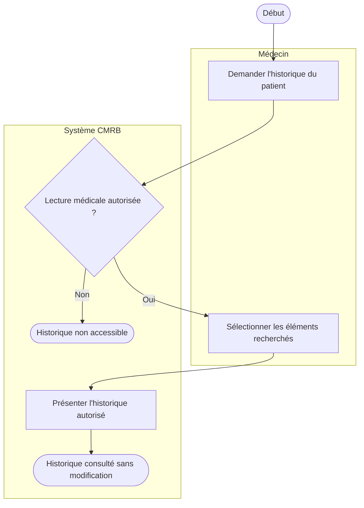

#### Règles critiques et autorisations

- **BR-001 — Séparer données administratives et cliniques :** Les dossiers administratif et médical utilisent des permissions et des données distinctes; aucun droit administratif n'accorde un accès clinique.

**SEC-011** — ACT-002 lit l’historique. Le droit de lecture médicale d’autres profils n’est pas accordé par leur seule participation aux soins.

**Notifications :** aucun envoi supplémentaire explicitement requis.

#### Exceptions importantes

Lecture par d’autres rôles non confirmée; portail patient traité séparément.

Historique vide distinct d’erreur technique; document non autorisé non divulgué; identité ambiguë nécessite sélection sûre.

Décision de cadrage technique : toute mutation est atomique, idempotente lorsqu'une clé de requête existe et protégée par contrôle de version. Une opération refusée n'a aucun effet métier; les doublons sont signalés et aucune fusion ou correction automatique n'est autorisée.

**Exigences SRS associées :** EF-DM-001; EF-DM-003. Sources exactes dans le [catalogue](../requirements/REQUIREMENTS_CATALOG.md).

**Données concernées :** ENT-004 — Patient; ENT-006 — Dossier médical; ENT-008 — Prestation; ENT-018 — Résultat / compte rendu; ENT-019 — Ordonnance; ENT-020 — Pièce jointe.

#### Décisions de baseline applicables

- [Q-025](#q-025) : Comment créer, vérifier, attribuer et retirer un accès; prouver le lien compte-patient; gérer les sessions ?
- [Q-026](#q-026) : Quels volumes, p95, disponibilité, RPO/RTO, rétention logs, restauration, navigateurs et SLA ?
- [Q-012](#q-012) : Quelles durées par donnée, quel déclencheur, gel, archivage et destruction autorisée ?
- [Q-002](#q-002) : Quels champs les paramédicaux peuvent-ils saisir, corriger et consulter ?
- [Q-003](#q-003) : Quelles données et versions sont visibles, pour quels patients et à partir de quel événement ?
- [Q-028](#q-028) : Quels fichiers, taille, version, validation de contenu et règles de téléchargement ?
- [Q-033](#q-033) : Quel cadre applicable, lieu d’hébergement, données à reprendre, validation et procédure de bascule ?

[Fiche canonique et scénarios de recette](../workflows/WF-011.md).

<a id="wf-012"></a>

### WF-012 — Suivre hospitalisation ou observation

**Objectif :** Séjour ouvert, lit affecté si hospitalisation, transferts historisés, prestations rattachées et sortie signée selon Q-016.

**Acteur principal :** ACT-002 pour l’orientation ; répartition des autres actes arrêté pour la baseline.

Les autres acteurs concernés et leurs responsabilités figurent dans le tableau ci-dessous ; leur présence ne vaut pas attribution de permission.

| Acteur | Responsabilité dans le parcours |
| --- | --- |
| ACT-002 | Médecin: Consultation et dossier clinique; orientation médicale. |
| ACT-003 | Personnel paramédical / infirmier: Constantes avant médecin; médicaments à clarifier. |
| ACT-001 | Personnel administratif: Inscription et rendez-vous; facturation/paiement en conflit avec matrice. |
| ACT-012 | Système CMRB: Application web, contrôles et enregistrement. |

**Déclencheur :** Orientation médicale vers un séjour.

**Préconditions principales :** Une hospitalisation ou observation est indiquée par le médecin; admission, chambre/lit, transferts historisés et sortie signée suivent Q-016.

**Résultat attendu :** Séjour ouvert, lit affecté si hospitalisation, transferts historisés, prestations rattachées et sortie signée selon Q-016.

#### Diagramme du processus

Décision de baseline : vue partielle des liens entre orientation, séjour et prestations. Les étapes d’admission, de sortie et leurs responsables ne sont pas inventés. Cette vue ne permet pas encore d’implémenter la gestion complète du séjour (Q-016).

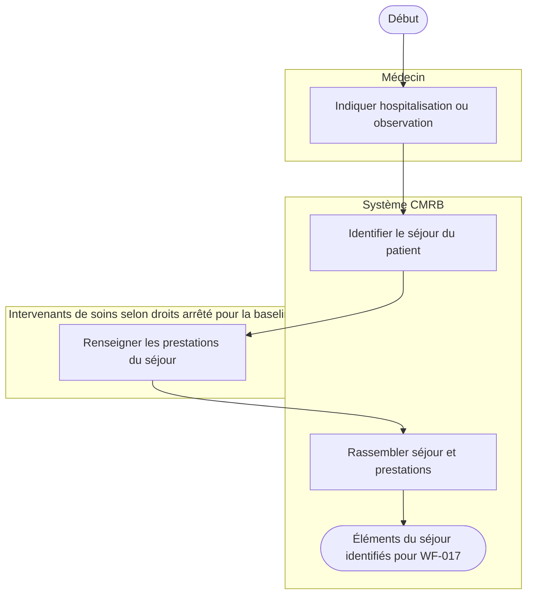

#### Règles critiques et autorisations

Les exigences liées, règles transverses et décisions Q citées sont normatives pour ce workflow.

**SEC-012** — ACT-002 oriente vers le séjour. Autorité d’admission/sortie et saisie de soins par ACT-003 non détaillées.

**Notifications :** aucun envoi supplémentaire explicitement requis.

#### Exceptions importantes

Chambre individuelle ou double citée; transfert, lit, durée d’observation et passage en hospitalisation définis par la baseline.

Chambre indisponible, sortie avec acte manquant ou séjour concomitant : décisions métier absentes; aucun automatisme inventé.

Décision de cadrage technique : toute mutation est atomique, idempotente lorsqu'une clé de requête existe et protégée par contrôle de version. Une opération refusée n'a aucun effet métier; les doublons sont signalés et aucune fusion ou correction automatique n'est autorisée.

**Exigences SRS associées :** EF-SRV-HOSP-001; EF-SRV-HOSP-002; EF-SRV-CONS-003; ADD-008. Sources exactes dans le [catalogue](../requirements/REQUIREMENTS_CATALOG.md).

**Données concernées :** ENT-004 — Patient; ENT-008 — Prestation; ENT-016 — Séjour / observation; ENT-017 — Chambre.

#### Décisions de baseline applicables

- [Q-016](#q-016) : Quelles admissions, chambres, durées, transferts, sorties et différences observation/hospitalisation ?
- [Q-025](#q-025) : Comment créer, vérifier, attribuer et retirer un accès; prouver le lien compte-patient; gérer les sessions ?
- [Q-026](#q-026) : Quels volumes, p95, disponibilité, RPO/RTO, rétention logs, restauration, navigateurs et SLA ?
- [Q-012](#q-012) : Quelles durées par donnée, quel déclencheur, gel, archivage et destruction autorisée ?
- [Q-002](#q-002) : Quels champs les paramédicaux peuvent-ils saisir, corriger et consulter ?
- [Q-033](#q-033) : Quel cadre applicable, lieu d’hébergement, données à reprendre, validation et procédure de bascule ?

[Fiche canonique et scénarios de recette](../workflows/WF-012.md).

<a id="wf-013"></a>

### WF-013 — Enregistrer prestation et résultat de laboratoire

**Objectif :** Prestation enregistrée; résultat non automatiquement publié au portail.

**Acteur principal :** ACT-010 pour la saisie ; réalisation par le service et validation/publication selon Q-017.

Les autres acteurs concernés et leurs responsabilités figurent dans le tableau ci-dessous ; leur présence ne vaut pas attribution de permission.

| Acteur | Responsabilité dans le parcours |
| --- | --- |
| ACT-010 | Assistante: Saisie de résultats de laboratoire. |
| ACT-002 | Médecin: Consultation et dossier clinique; orientation médicale. |
| ACT-012 | Système CMRB: Application web, contrôles et enregistrement. |

**Déclencheur :** Prestation de laboratoire à enregistrer.

**Préconditions principales :** Le patient, la prestation de laboratoire et le résultat à saisir sont identifiés. Les validations de contenu et le circuit de publication restent défini par la baseline (Q-017).

**Résultat attendu :** Prestation enregistrée; résultat non automatiquement publié au portail.

#### Diagramme du processus

Décision de baseline : la saisie par l’assistante n’implique aucun droit de validation ou publication. Le diagramme s’arrête à l’enregistrement ; le circuit de réalisation et de diffusion reste ouvert (Q-017).

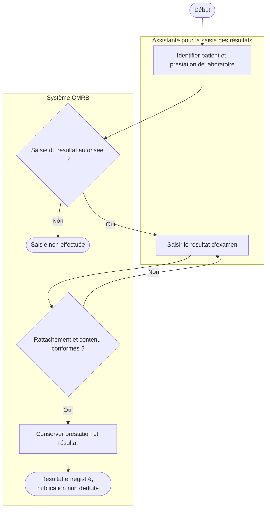

#### Règles critiques et autorisations

Les exigences liées, règles transverses et décisions Q citées sont normatives pour ce workflow.

**SEC-013** — ACT-010 est mentionné pour saisie du résultat; ni validation ni publication ne lui sont implicitement attribuées.

**Notifications :** aucun envoi supplémentaire explicitement requis.

#### Exceptions importantes

Résultat textuel ou document arrêté pour la baseline; intégration automate non confirmée.

Résultat rattaché au mauvais patient, correction après diffusion, pièce jointe invalide : règles défini par la baseline avant publication.

Décision de cadrage technique : toute mutation est atomique, idempotente lorsqu'une clé de requête existe et protégée par contrôle de version. Une opération refusée n'a aucun effet métier; les doublons sont signalés et aucune fusion ou correction automatique n'est autorisée.

**Exigences SRS associées :** EF-SRV-LAB-001; EF-SRV-LAB-002; ADD-013. Sources exactes dans le [catalogue](../requirements/REQUIREMENTS_CATALOG.md).

**Données concernées :** ENT-004 — Patient; ENT-008 — Prestation; ENT-018 — Résultat / compte rendu; ENT-020 — Pièce jointe.

#### Décisions de baseline applicables

- [Q-017](#q-017) : Qui saisit, valide, corrige et publie les résultats et comptes rendus ?
- [Q-025](#q-025) : Comment créer, vérifier, attribuer et retirer un accès; prouver le lien compte-patient; gérer les sessions ?
- [Q-026](#q-026) : Quels volumes, p95, disponibilité, RPO/RTO, rétention logs, restauration, navigateurs et SLA ?
- [Q-012](#q-012) : Quelles durées par donnée, quel déclencheur, gel, archivage et destruction autorisée ?
- [Q-028](#q-028) : Quels fichiers, taille, version, validation de contenu et règles de téléchargement ?
- [Q-027](#q-027) : Aucun logiciel métier tiers, ou aucune dépendance même pour SMS et paiement ?
- [Q-033](#q-033) : Quel cadre applicable, lieu d’hébergement, données à reprendre, validation et procédure de bascule ?

[Fiche canonique et scénarios de recette](../workflows/WF-013.md).

<a id="wf-014"></a>

### WF-014 — Enregistrer imagerie et compte rendu

**Objectif :** Prestation d’imagerie enregistrée; diffusion conditionnée aux décisions.

**Acteur principal :** Intervenant d’imagerie à habiliter ; participation ACT-002 arrêté pour la baseline, sans création d’un rôle autonome.

Les autres acteurs concernés et leurs responsabilités figurent dans le tableau ci-dessous ; leur présence ne vaut pas attribution de permission.

| Acteur | Responsabilité dans le parcours |
| --- | --- |
| ACT-002 | Médecin: Consultation et dossier clinique; orientation médicale. |
| ACT-012 | Système CMRB: Application web, contrôles et enregistrement. |

**Déclencheur :** Échographie ou autre imagerie réalisée.

**Préconditions principales :** Le patient et la prestation d’imagerie sont identifiés. Le rôle de saisie, le contenu et le circuit de diffusion du compte rendu restent arrêté pour la baseline (Q-017).

**Résultat attendu :** Prestation d’imagerie enregistrée; diffusion conditionnée aux décisions.

#### Diagramme du processus

Décision de baseline : rôle de saisie et circuit de validation/publication arrêtés par la baseline. L’enregistrement ne vaut pas validation médicale ni publication au portail (Q-017).

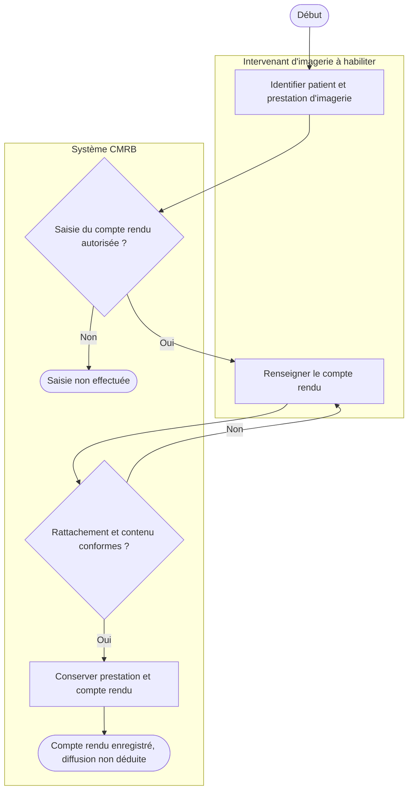

#### Règles critiques et autorisations

Les exigences liées, règles transverses et décisions Q citées sont normatives pour ce workflow.

**SEC-014** — Aucun profil de validation/publication du compte rendu n’est arrêté; présence ACT-002 est une participation arrêté pour la baseline.

**Notifications :** aucun envoi supplémentaire explicitement requis.

#### Exceptions importantes

Échographie est un exemple d’imagerie; stockage d’images DICOM non exigé.

Compte rendu absent, document volumineux ou correction : politique non précisée; aucun résultat réputé validé par simple saisie.

Décision de cadrage technique : toute mutation est atomique, idempotente lorsqu'une clé de requête existe et protégée par contrôle de version. Une opération refusée n'a aucun effet métier; les doublons sont signalés et aucune fusion ou correction automatique n'est autorisée.

**Exigences SRS associées :** EF-SRV-IMG-001; EF-SRV-IMG-002. Sources exactes dans le [catalogue](../requirements/REQUIREMENTS_CATALOG.md).

**Données concernées :** ENT-004 — Patient; ENT-008 — Prestation; ENT-018 — Résultat / compte rendu; ENT-020 — Pièce jointe.

#### Décisions de baseline applicables

- [Q-017](#q-017) : Qui saisit, valide, corrige et publie les résultats et comptes rendus ?
- [Q-025](#q-025) : Comment créer, vérifier, attribuer et retirer un accès; prouver le lien compte-patient; gérer les sessions ?
- [Q-026](#q-026) : Quels volumes, p95, disponibilité, RPO/RTO, rétention logs, restauration, navigateurs et SLA ?
- [Q-012](#q-012) : Quelles durées par donnée, quel déclencheur, gel, archivage et destruction autorisée ?
- [Q-028](#q-028) : Quels fichiers, taille, version, validation de contenu et règles de téléchargement ?
- [Q-033](#q-033) : Quel cadre applicable, lieu d’hébergement, données à reprendre, validation et procédure de bascule ?

[Fiche canonique et scénarios de recette](../workflows/WF-014.md).

<a id="wf-015"></a>

### WF-015 — Relier pharmacie, stock et prestation

**Objectif :** Dispensation confirmée, mouvement de stock et ligne facturable créés atomiquement selon Q-018.

**Acteur principal :** ACT-008, avec lecture de la prescription active et confirmation de dispensation selon Q-018.

Les autres acteurs concernés et leurs responsabilités figurent dans le tableau ci-dessous ; leur présence ne vaut pas attribution de permission.

| Acteur | Responsabilité dans le parcours |
| --- | --- |
| ACT-008 | Gestionnaire de stock / pharmacie: Produits, mouvements, seuils et implication pharmacie. |
| ACT-002 | Médecin: Consultation et dossier clinique; orientation médicale. |
| ACT-012 | Système CMRB: Application web, contrôles et enregistrement. |

**Déclencheur :** Prestation pharmacie, notamment pendant un séjour.

**Préconditions principales :** Le produit, le patient et la prestation de pharmacie sont identifiés. L’autorité de dispensation et son lien exact avec stock et facture sont régis par les décisions associées.

**Résultat attendu :** Dispensation confirmée, mouvement de stock et ligne facturable créés atomiquement selon Q-018.

#### Diagramme du processus

Décision de baseline : le rapprochement avec un mouvement de stock et une ligne de facture reste défini par la baseline (Q-018). Aucun débit automatique du stock n’est déduit de la simple saisie.

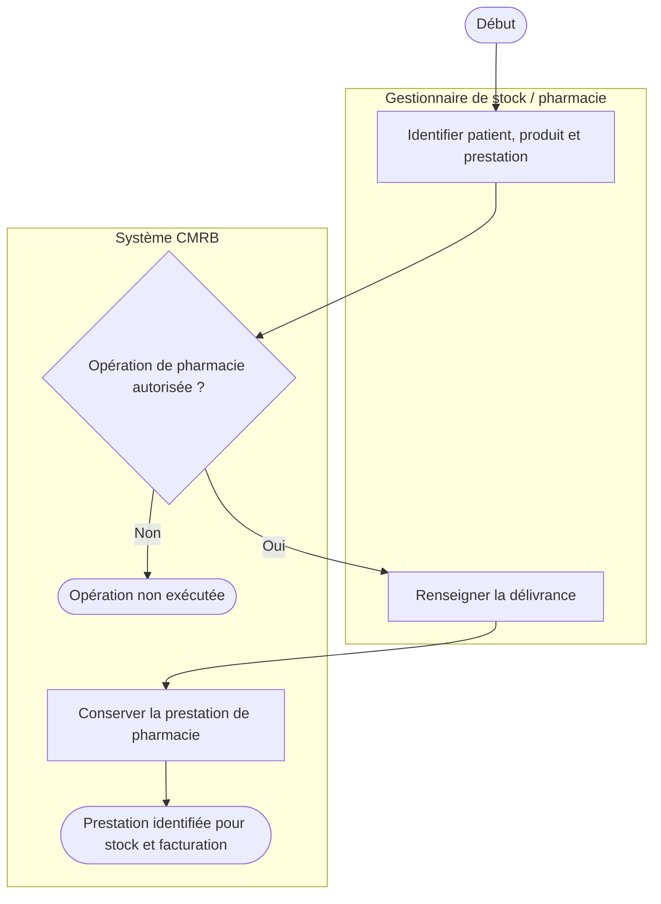

#### Règles critiques et autorisations

Les exigences liées, règles transverses et décisions Q citées sont normatives pour ce workflow.

**SEC-015** — ACT-008 intervient en pharmacie/stock; lecture limitée à l'identité et à la prescription active; aucune émission de facture.

**Notifications :** aucun envoi supplémentaire explicitement requis.

#### Exceptions importantes

Dispensation ambulatoire ou hospitalière : seules implications du séjour explicitées; retour non décrit.

Stock insuffisant, double remise, annulation ou rupture entre stock et facture : traitement arbitré par la baseline.

Décision de cadrage technique : toute mutation est atomique, idempotente lorsqu'une clé de requête existe et protégée par contrôle de version. Une opération refusée n'a aucun effet métier; les doublons sont signalés et aucune fusion ou correction automatique n'est autorisée.

**Exigences SRS associées :** EF-SRV-PHA-001; EF-SRV-PHA-002; EF-SRV-TRA-003. Sources exactes dans le [catalogue](../requirements/REQUIREMENTS_CATALOG.md).

**Données concernées :** ENT-004 — Patient; ENT-008 — Prestation; ENT-012 — Produit de stock; ENT-013 — Mouvement de stock; ENT-022 — Ligne de facture.

#### Décisions de baseline applicables

- [Q-025](#q-025) : Comment créer, vérifier, attribuer et retirer un accès; prouver le lien compte-patient; gérer les sessions ?
- [Q-026](#q-026) : Quels volumes, p95, disponibilité, RPO/RTO, rétention logs, restauration, navigateurs et SLA ?
- [Q-012](#q-012) : Quelles durées par donnée, quel déclencheur, gel, archivage et destruction autorisée ?
- [Q-018](#q-018) : Quand une dispensation décrémente-t-elle le stock et devient-elle facturable; comment gérer retour ou annulation ?
- [Q-023](#q-023) : Quels achats, fournisseurs, unités, inventaires, seuils, lots, péremption et alertes sont requis ?
- [Q-033](#q-033) : Quel cadre applicable, lieu d’hébergement, données à reprendre, validation et procédure de bascule ?

[Fiche canonique et scénarios de recette](../workflows/WF-015.md).


<a id="domaine-9"></a>

## 9. Facturation et paiements

<a id="wf-016"></a>

### WF-016 — Émettre une facture individuelle

**Objectif :** Facture individuelle émise selon Q-009, Q-020, Q-024 et Q-035.

**Acteur principal :** ACT-004 ; rôle ACT-001 en conflit.

Les autres acteurs concernés et leurs responsabilités figurent dans le tableau ci-dessous ; leur présence ne vaut pas attribution de permission.

| Acteur | Responsabilité dans le parcours |
| --- | --- |
| ACT-004 | Service comptable: Facturation, paiements et rapports financiers. |
| ACT-001 | Personnel administratif: Inscription et rendez-vous; facturation/paiement en conflit avec matrice. |
| ACT-012 | Système CMRB: Application web, contrôles et enregistrement. |

**Déclencheur :** Prestations ambulatoires à facturer.

**Préconditions principales :** Le patient, les prestations et le payeur sont identifiés. Tarifs, taxes, numérotation et règles d’émission doivent être définis ; le droit de facturer de l’accueil reste en conflit.

**Résultat attendu :** Facture individuelle émise selon Q-009, Q-020, Q-024 et Q-035.

#### Diagramme du processus

Les conditions de conformité renvoient aux préconditions et aux décisions de baseline de cette fiche. Elles ne définissent aucune validation de saisie ou permission supplémentaire.

```mermaid
flowchart TD
  start(["Début"])
  subgraph U["Service comptable"]
    a["Retrouver patient et prestations"]
    c["Établir les lignes et le payeur"]
  end
  subgraph S["Système CMRB"]
    b{"Émission autorisée ?"}
    r(["Facture non émise"])
    d{"Tarifs et lignes exploitables ?"}
    e["Émettre la facture individuelle"]
    z(["Facture disponible pour suivi du paiement"])
  end
  start --> a
  a --> b
  b -->|Oui| c
  b -->|Non| r
  c --> d
  d -->|Oui| e
  d -->|Non| r
  e --> z
```

#### Règles critiques et autorisations

- **BR-012 — Facturer individuellement l'ambulatoire :** Chaque patient ambulatoire reçoit une facture individuelle; le groupement concerne les bordereaux organisme.
- **BR-013 — Conserver les catégories de prestations :** Consultation, hospitalisation, imagerie, laboratoire et pharmacie utilisent un socle commun de prestation et des détails spécialisés.

**SEC-016** — ACT-004 émet la facture; attribution à ACT-001 en conflit entre UC-07 et matrice.

**Notifications :** aucun envoi supplémentaire explicitement requis.

#### Exceptions importantes

Séjour traité dans sa facture dédiée; émission par accueil mentionnée mais matrice contradictoire.

Prestation déjà facturée, tarif absent, facture annulée : règles Q-009, Q-020, Q-024 et Q-035; aucun montant déduit d’un tarif inexistant.

Décision de cadrage technique : toute mutation est atomique, idempotente lorsqu'une clé de requête existe et protégée par contrôle de version. Une opération refusée n'a aucun effet métier; les doublons sont signalés et aucune fusion ou correction automatique n'est autorisée.

**Exigences SRS associées :** EF-FAC-001; EF-FAC-006; EF-SRV-TRA-001; EF-SRV-TRA-003; ADD-019. Sources exactes dans le [catalogue](../requirements/REQUIREMENTS_CATALOG.md).

**Données concernées :** ENT-004 — Patient; ENT-008 — Prestation; ENT-009 — Facture; ENT-022 — Ligne de facture.

#### Décisions de baseline applicables

- [Q-025](#q-025) : Comment créer, vérifier, attribuer et retirer un accès; prouver le lien compte-patient; gérer les sessions ?
- [Q-026](#q-026) : Quels volumes, p95, disponibilité, RPO/RTO, rétention logs, restauration, navigateurs et SLA ?
- [Q-012](#q-012) : Quelles durées par donnée, quel déclencheur, gel, archivage et destruction autorisée ?
- [Q-024](#q-024) : Quelles actions de facture et paiement sont autorisées à l’accueil ?
- [Q-020](#q-020) : Payée signifie-t-il solde nul toutes parts comprises; que permet l’archivage, puis un remboursement ?
- [Q-009](#q-009) : Sur quelle base calculer les pourcentages, arrondis, plafonds, exceptions et reste patient ?
- [Q-035](#q-035) : Quels tarifs et dates d’effet, devise, arrondis, taxes, numéros, annulations, avoirs et corrections après émission ?
- [Q-033](#q-033) : Quel cadre applicable, lieu d’hébergement, données à reprendre, validation et procédure de bascule ?

[Fiche canonique et scénarios de recette](../workflows/WF-016.md).

<a id="wf-017"></a>

### WF-017 — Établir la facture du séjour

**Objectif :** Facture du séjour calculée en XOF depuis les nuits et prestations réellement enregistrées, avec tarifs versionnés selon Q-016/Q-035.

**Acteur principal :** ACT-004 ; rôle ACT-001 arrêté pour la baseline.

Les autres acteurs concernés et leurs responsabilités figurent dans le tableau ci-dessous ; leur présence ne vaut pas attribution de permission.

| Acteur | Responsabilité dans le parcours |
| --- | --- |
| ACT-004 | Service comptable: Facturation, paiements et rapports financiers. |
| ACT-001 | Personnel administratif: Inscription et rendez-vous; facturation/paiement en conflit avec matrice. |
| ACT-012 | Système CMRB: Application web, contrôles et enregistrement. |

**Déclencheur :** Facturation d’une hospitalisation.

**Préconditions principales :** Le séjour et ses prestations sont identifiés. Rubriques, durées, tarifs et modalités d’émission doivent être définis avant calcul de la facture.

**Résultat attendu :** Facture du séjour calculée en XOF depuis les nuits et prestations réellement enregistrées, avec tarifs versionnés selon Q-016/Q-035.

#### Diagramme du processus

Les conditions de conformité renvoient aux préconditions et aux décisions de baseline de cette fiche. Elles ne définissent aucune validation de saisie ou permission supplémentaire.

```mermaid
flowchart TD
  start(["Début"])
  subgraph U["Service comptable"]
    a["Retrouver le séjour à facturer"]
    c["Réunir chambres, soins, actes et médicaments"]
  end
  subgraph S["Système CMRB"]
    b{"Facturation du séjour autorisée ?"}
    r(["Facture du séjour non émise"])
    d{"Quantités, durées et tarifs exploitables ?"}
    e["Établir la facture détaillée du séjour"]
    z(["Séjour facturé selon rubriques retenues"])
  end
  start --> a
  a --> b
  b -->|Oui| c
  b -->|Non| r
  c --> d
  d -->|Oui| e
  d -->|Non| r
  e --> z
```

#### Règles critiques et autorisations

- **BR-012 — Facturer individuellement l'ambulatoire :** Chaque patient ambulatoire reçoit une facture individuelle; le groupement concerne les bordereaux organisme.

**SEC-017** — Facturation de séjour par ACT-004; saisie accueil et corrections après paiement arbitré par la baseline.

**Notifications :** aucun envoi supplémentaire explicitement requis.

#### Exceptions importantes

Observation et chambre double : calcul non précisé; facturation intermédiaire non confirmée.

Durée incomplète, prestation tardive, médicament déjà facturé ou tarif manquant : résolution métier requise.

Décision de cadrage technique : toute mutation est atomique, idempotente lorsqu'une clé de requête existe et protégée par contrôle de version. Une opération refusée n'a aucun effet métier; les doublons sont signalés et aucune fusion ou correction automatique n'est autorisée.

**Exigences SRS associées :** EF-FAC-001; EF-SRV-HOSP-002; ADD-008. Sources exactes dans le [catalogue](../requirements/REQUIREMENTS_CATALOG.md).

**Données concernées :** ENT-004 — Patient; ENT-009 — Facture; ENT-016 — Séjour / observation; ENT-017 — Chambre; ENT-022 — Ligne de facture.

#### Décisions de baseline applicables

- [Q-025](#q-025) : Comment créer, vérifier, attribuer et retirer un accès; prouver le lien compte-patient; gérer les sessions ?
- [Q-026](#q-026) : Quels volumes, p95, disponibilité, RPO/RTO, rétention logs, restauration, navigateurs et SLA ?
- [Q-012](#q-012) : Quelles durées par donnée, quel déclencheur, gel, archivage et destruction autorisée ?
- [Q-016](#q-016) : Quelles admissions, chambres, durées, transferts, sorties et différences observation/hospitalisation ?
- [Q-009](#q-009) : Sur quelle base calculer les pourcentages, arrondis, plafonds, exceptions et reste patient ?
- [Q-020](#q-020) : Payée signifie-t-il solde nul toutes parts comprises; que permet l’archivage, puis un remboursement ?
- [Q-024](#q-024) : Quelles actions de facture et paiement sont autorisées à l’accueil ?
- [Q-035](#q-035) : Quels tarifs et dates d’effet, devise, arrondis, taxes, numéros, annulations, avoirs et corrections après émission ?
- [Q-033](#q-033) : Quel cadre applicable, lieu d’hébergement, données à reprendre, validation et procédure de bascule ?

[Fiche canonique et scénarios de recette](../workflows/WF-017.md).

<a id="wf-018"></a>

### WF-018 — Facturer assurance ou mutuelle

**Objectif :** Facture organisme et parts à recouvrer identifiées.

**Acteur principal :** ACT-004.

Les autres acteurs concernés et leurs responsabilités figurent dans le tableau ci-dessous ; leur présence ne vaut pas attribution de permission.

| Acteur | Responsabilité dans le parcours |
| --- | --- |
| ACT-004 | Service comptable: Facturation, paiements et rapports financiers. |
| ACT-006 | Assureur / mutuelle: Destinataire financier et débiteur tiers. |
| ACT-012 | Système CMRB: Application web, contrôles et enregistrement. |

**Déclencheur :** Constitution d’une facture organisme payeur.

**Préconditions principales :** L’organisme payeur et les prestations couvertes sont identifiés. Le sens des « 10 patients », la base du pourcentage et la ventilation doivent être arbitrés.

**Résultat attendu :** Facture organisme et parts à recouvrer identifiées.

#### Diagramme du processus

Décision de baseline : la condition de groupement ne fixe ni plafond ni lot exact de 10 patients. La base de couverture, le détail et la transmission à l’organisme sont précisés par les décisions de baseline associées (Q-007, Q-009).

```mermaid
flowchart TD
  start(["Début"])
  subgraph U["Service comptable"]
    a["Identifier organisme et prise en charge"]
    c["Regrouper les prestations couvertes"]
  end
  subgraph S["Système CMRB"]
    b{"Facturation organisme autorisée ?"}
    r(["Facture organisme non émise"])
    d{"Groupement et couverture conformes ?"}
    e["Établir facture et détail par patient"]
    z(["Créance à suivre en paiement différé"])
  end
  subgraph O["Assureur / mutuelle, sans accès CMRB présumé"]
    f["Recevoir la facture organisme"]
  end
  start --> a
  a --> b
  b -->|Oui| c
  b -->|Non| r
  c --> d
  d -->|Oui| e
  d -->|Non| r
  e --> f
  f --> z
```

#### Règles critiques et autorisations

- **BR-007 — Limiter le groupement organisme :** Une facture organisme regroupe au maximum dix patients d'un même organisme et d'une même période, avec détail par patient.
- **BR-008 — Calculer la couverture par ligne :** La quote-part suit la formule, les plafonds, exclusions et arrondis définis dans Q-009.

**SEC-018** — ACT-004 facture l’organisme ACT-006. ACT-006 n’a pas d’accès applicatif direct confirmé.

**Notifications :** aucun envoi supplémentaire explicitement requis.

#### Exceptions importantes

Assurance et mutuelle utilisent la catégorie d'organisme Q-008; un lot de un à dix patients est admis selon Q-007.

Couverture inconnue, pourcentage incohérent ou prestations de plusieurs organismes : pas de regroupement automatique supposé.

Décision de cadrage technique : toute mutation est atomique, idempotente lorsqu'une clé de requête existe et protégée par contrôle de version. Une opération refusée n'a aucun effet métier; les doublons sont signalés et aucune fusion ou correction automatique n'est autorisée.

**Exigences SRS associées :** EF-FAC-002; EF-FAC-003; EF-FAC-006; ADD-004; ADD-010. Sources exactes dans le [catalogue](../requirements/REQUIREMENTS_CATALOG.md).

**Données concernées :** ENT-004 — Patient; ENT-008 — Prestation; ENT-009 — Facture; ENT-011 — Organisme payeur; ENT-022 — Ligne de facture; ENT-023 — Prise en charge.

#### Décisions de baseline applicables

- [Q-025](#q-025) : Comment créer, vérifier, attribuer et retirer un accès; prouver le lien compte-patient; gérer les sessions ?
- [Q-026](#q-026) : Quels volumes, p95, disponibilité, RPO/RTO, rétention logs, restauration, navigateurs et SLA ?
- [Q-012](#q-012) : Quelles durées par donnée, quel déclencheur, gel, archivage et destruction autorisée ?
- [Q-007](#q-007) : Est-ce exactement 10, un maximum de 10, ou un exemple; par organisme et par période ?
- [Q-009](#q-009) : Sur quelle base calculer les pourcentages, arrondis, plafonds, exceptions et reste patient ?
- [Q-008](#q-008) : Un même type d’organisme couvre-t-il assurance et mutuelle, avec ou sans catégorie distincte ?
- [Q-029](#q-029) : Quel niveau d’affectation d’un règlement et d’identification de chaque ligne ?
- [Q-035](#q-035) : Quels tarifs et dates d’effet, devise, arrondis, taxes, numéros, annulations, avoirs et corrections après émission ?
- [Q-033](#q-033) : Quel cadre applicable, lieu d’hébergement, données à reprendre, validation et procédure de bascule ?

[Fiche canonique et scénarios de recette](../workflows/WF-018.md).

<a id="wf-019"></a>

### WF-019 — Enregistrer et consulter un paiement

**Objectif :** Paiement enregistré; règlement effectif distingué de simple initiation.

**Acteur principal :** ACT-004 ; rôle ACT-001 en conflit.

Les autres acteurs concernés et leurs responsabilités figurent dans le tableau ci-dessous ; leur présence ne vaut pas attribution de permission.

| Acteur | Responsabilité dans le parcours |
| --- | --- |
| ACT-004 | Service comptable: Facturation, paiements et rapports financiers. |
| ACT-001 | Personnel administratif: Inscription et rendez-vous; facturation/paiement en conflit avec matrice. |
| ACT-006 | Assureur / mutuelle: Destinataire financier et débiteur tiers. |
| ACT-005 | Patient: Inscription, réservation, consultation personnelle et demande de copie. |
| ACT-012 | Système CMRB: Application web, contrôles et enregistrement. |
| ACT-015 | Service de paiement: Transaction en ligne si intégration retenue. |

**Déclencheur :** Règlement patient ou organisme reçu.

**Préconditions principales :** La dette et le règlement à enregistrer sont identifiés. La preuve admissible, l’affectation et le traitement du paiement partiel doivent être arrêtés.

**Résultat attendu :** Paiement enregistré; règlement effectif distingué de simple initiation.

#### Diagramme du processus

Les conditions de conformité renvoient aux préconditions et aux décisions de baseline de cette fiche. Elles ne définissent aucune validation de saisie ou permission supplémentaire.

```mermaid
flowchart TD
  start(["Début"])
  subgraph U["Service comptable"]
    a["Identifier règlement et dette concernée"]
    c["Vérifier la preuve de règlement"]
    f["Consulter l'historique des paiements"]
  end
  subgraph S["Système CMRB"]
    b{"Enregistrement du paiement autorisé ?"}
    r(["Paiement non enregistré"])
    d{"Règlement vérifié et affectable ?"}
    e["Enregistrer paiement et affectation"]
    z(["Paiement enregistré et consultable"])
  end
  start --> a
  a --> b
  b -->|Oui| c
  b -->|Non| r
  c --> d
  d -->|Oui| e
  d -->|Non| r
  e --> f
  f --> z
```

#### Règles critiques et autorisations

- **BR-014 — Conserver l'historique des paiements :** Toute opération de paiement, rejet, imputation, remboursement et contrepassation reste consultable et non destructive.

**SEC-019** — ACT-004 enregistre les paiements; ACT-001 apparaît dans UC-08 mais pas dans la matrice. Payer ne signifie pas pouvoir modifier l’historique.

**Notifications :** aucun envoi supplémentaire explicitement requis.

#### Exceptions importantes

Espèces, chèque, virement, carte, Mobile Money et en ligne cités; remboursement et partiel relèvent des décisions ouvertes.

Une clé d'idempotence bloque le doublon; preuve et référence sont exigées, le trop-perçu devient crédit/remboursement tracé, et aucun retour navigateur ne confirme seul un paiement.

Décision de cadrage technique : toute mutation est atomique, idempotente lorsqu'une clé de requête existe et protégée par contrôle de version. Une opération refusée n'a aucun effet métier; les doublons sont signalés et aucune fusion ou correction automatique n'est autorisée.

**Exigences SRS associées :** EF-PAI-001; EF-PAI-002; EF-PAI-003; EF-PAI-004; EF-SRV-TRA-002; ADD-016; ADD-019. Sources exactes dans le [catalogue](../requirements/REQUIREMENTS_CATALOG.md).

**Données concernées :** ENT-009 — Facture; ENT-010 — Paiement; ENT-011 — Organisme payeur; ENT-028 — Affectation de paiement.

#### Décisions de baseline applicables

- [Q-025](#q-025) : Comment créer, vérifier, attribuer et retirer un accès; prouver le lien compte-patient; gérer les sessions ?
- [Q-026](#q-026) : Quels volumes, p95, disponibilité, RPO/RTO, rétention logs, restauration, navigateurs et SLA ?
- [Q-012](#q-012) : Quelles durées par donnée, quel déclencheur, gel, archivage et destruction autorisée ?
- [Q-019](#q-019) : Quels moyens au lancement; saisie manuelle ou intégration; quelle preuve et quel traitement des rejets ?
- [Q-024](#q-024) : Quelles actions de facture et paiement sont autorisées à l’accueil ?
- [Q-029](#q-029) : Quel niveau d’affectation d’un règlement et d’identification de chaque ligne ?
- [Q-033](#q-033) : Quel cadre applicable, lieu d’hébergement, données à reprendre, validation et procédure de bascule ?

[Fiche canonique et scénarios de recette](../workflows/WF-019.md).

<a id="wf-020"></a>

### WF-020 — Suivre paiement différé, écarts et rejets

**Objectif :** Encours et écart identifiés; résolution régie par Q-009, Q-019 et Q-029.

**Acteur principal :** ACT-004.

Les autres acteurs concernés et leurs responsabilités figurent dans le tableau ci-dessous ; leur présence ne vaut pas attribution de permission.

| Acteur | Responsabilité dans le parcours |
| --- | --- |
| ACT-004 | Service comptable: Facturation, paiements et rapports financiers. |
| ACT-006 | Assureur / mutuelle: Destinataire financier et débiteur tiers. |
| ACT-012 | Système CMRB: Application web, contrôles et enregistrement. |

**Déclencheur :** Échéance ou règlement d’un organisme à rapprocher.

**Préconditions principales :** Des factures et des paiements de l’organisme sont disponibles pour comparaison. Les règles de ventilation et de traitement des écarts restent défini par la baseline.

**Résultat attendu :** Encours et écart identifiés; résolution régie par Q-009, Q-019 et Q-029.

#### Diagramme du processus

Décision de baseline : le parcours identifie les écarts ; il ne les résout pas automatiquement et n’efface aucun solde. La suite nécessite les règles de ventilation, rejet et recouvrement (Q-019, Q-029).

```mermaid
flowchart TD
  start(["Début"])
  subgraph U["Service comptable"]
    a["Demander les encours de l'organisme"]
    d["Comparer montants reçus et attendus"]
    e{"Écart ou rejet constaté ?"}
    z(["Écart identifié, traitement arbitré par la baseline"])
    x(["Aucun écart constaté"])
  end
  subgraph S["Système CMRB"]
    b{"Consultation financière autorisée ?"}
    r(["Encours non accessibles"])
    c["Présenter factures et paiements"]
  end
  start --> a
  a --> b
  b -->|Oui| c
  b -->|Non| r
  c --> d
  d --> e
  e -->|Oui| z
  e -->|Non| x
```

#### Règles critiques et autorisations

- **BR-008 — Calculer la couverture par ligne :** La quote-part suit la formule, les plafonds, exclusions et arrondis définis dans Q-009.

**SEC-020** — ACT-004 suit les écarts avec ACT-006; aucune remise de dette ni annulation de créance autorisée implicitement.

**Notifications :** aucun envoi supplémentaire explicitement requis.

#### Exceptions importantes

Le paiement différé est suivi manuellement; la V1 exclut relance automatique, remise de dette et échéancier automatisé.

Organisme conteste une ligne ou verse un total non ventilé : décision de ventilation nécessaire; aucun solde effacé silencieusement.

Décision de cadrage technique : toute mutation est atomique, idempotente lorsqu'une clé de requête existe et protégée par contrôle de version. Une opération refusée n'a aucun effet métier; les doublons sont signalés et aucune fusion ou correction automatique n'est autorisée.

**Exigences SRS associées :** EF-PAI-005; ADD-010. Sources exactes dans le [catalogue](../requirements/REQUIREMENTS_CATALOG.md).

**Données concernées :** ENT-009 — Facture; ENT-010 — Paiement; ENT-011 — Organisme payeur; ENT-023 — Prise en charge; ENT-028 — Affectation de paiement.

#### Décisions de baseline applicables

- [Q-025](#q-025) : Comment créer, vérifier, attribuer et retirer un accès; prouver le lien compte-patient; gérer les sessions ?
- [Q-026](#q-026) : Quels volumes, p95, disponibilité, RPO/RTO, rétention logs, restauration, navigateurs et SLA ?
- [Q-012](#q-012) : Quelles durées par donnée, quel déclencheur, gel, archivage et destruction autorisée ?
- [Q-019](#q-019) : Quels moyens au lancement; saisie manuelle ou intégration; quelle preuve et quel traitement des rejets ?
- [Q-029](#q-029) : Quel niveau d’affectation d’un règlement et d’identification de chaque ligne ?
- [Q-009](#q-009) : Sur quelle base calculer les pourcentages, arrondis, plafonds, exceptions et reste patient ?
- [Q-033](#q-033) : Quel cadre applicable, lieu d’hébergement, données à reprendre, validation et procédure de bascule ?

[Fiche canonique et scénarios de recette](../workflows/WF-020.md).

<a id="wf-021"></a>

### WF-021 — Archiver une facture payée

**Objectif :** Facture archivée si condition de paiement satisfaite.

**Acteur principal :** ACT-004 ou ACT-012 selon déclenchement automatique après paiement complet.

Les autres acteurs concernés et leurs responsabilités figurent dans le tableau ci-dessous ; leur présence ne vaut pas attribution de permission.

| Acteur | Responsabilité dans le parcours |
| --- | --- |
| ACT-004 | Service comptable: Facturation, paiements et rapports financiers. |
| ACT-012 | Système CMRB: Application web, contrôles et enregistrement. |

**Déclencheur :** Facture considérée comme payée.

**Préconditions principales :** Une facture existe avec ses paiements; elle devient payée puis archivée automatiquement lorsque toutes les parts sont couvertes selon Q-020.

**Résultat attendu :** Facture archivée si condition de paiement satisfaite.

#### Diagramme du processus

Les conditions de conformité renvoient aux préconditions et aux décisions de baseline de cette fiche. Elles ne définissent aucune validation de saisie ou permission supplémentaire.

```mermaid
flowchart TD
  start(["Début"])
  subgraph U["Service comptable ou système selon déclencheur arrêté pour la baseline"]
    a["Identifier la facture à archiver"]
  end
  subgraph S["Système CMRB"]
    b{"Archivage autorisé ?"}
    r(["Facture non archivée"])
    c{"Condition de paiement satisfaite ?"}
    d["Archiver la facture sans la supprimer"]
    z(["Facture archivée"])
  end
  start --> a
  a --> b
  b -->|Oui| c
  b -->|Non| r
  c -->|Oui| d
  c -->|Non| r
  d --> z
```

#### Règles critiques et autorisations

- **BR-009 — Archiver une facture soldée :** Une facture soldée est verrouillée et archivée; les corrections passent par avoir, remboursement ou nouvelle facture.

**SEC-021** — Déclencheur comptable ou système arrêté par la baseline. Archivage ne donne aucun droit de destruction ni réouverture.

**Notifications :** aucun envoi supplémentaire explicitement requis.

#### Exceptions importantes

L'archivage exige la couverture de toutes les parts dues; un paiement partiel ou d'un seul payeur laisse la facture ouverte.

Remboursement ou rejet après archivage : transition définie par la baseline; aucune suppression de facture déduite de l’archivage.

Décision de cadrage technique : toute mutation est atomique, idempotente lorsqu'une clé de requête existe et protégée par contrôle de version. Une opération refusée n'a aucun effet métier; les doublons sont signalés et aucune fusion ou correction automatique n'est autorisée.

#### Cycle de vie partiel

Vue partielle : seuls les états nécessaires à la formulation source sont nommés. Aucun état initial technique, rejet, réouverture ou suppression n’est ajouté.

| Origine | Cible | Sens / condition | Acteur | Action | Notification | Audit | Interdictions |
| --- | --- | --- | --- | --- | --- | --- | --- |
| Payee | Archivee | Archivage après paiement; Q-020 | ACT-004 ou ACT-012, déclenchement automatique après paiement complet | Appliquer la transition après validation | Immédiate après succès transactionnel | Q-026 | Toutes les autres transitions sont interdites; aucune autorisation déduite |

```mermaid
stateDiagram-v2
  state "Payée" as Payee
  state "Archivée" as Archivee
  Payee --> Archivee: Archivage après paiement
```

Source : ADD-009. Labels conceptuels, codes techniques arrêtés par la baseline.

**Exigences SRS associées :** EF-FAC-005; ADD-009. Sources exactes dans le [catalogue](../requirements/REQUIREMENTS_CATALOG.md).

**Données concernées :** ENT-009 — Facture; ENT-010 — Paiement; ENT-028 — Affectation de paiement.

#### Décisions de baseline applicables

- [Q-020](#q-020) : Payée signifie-t-il solde nul toutes parts comprises; que permet l’archivage, puis un remboursement ?
- [Q-025](#q-025) : Comment créer, vérifier, attribuer et retirer un accès; prouver le lien compte-patient; gérer les sessions ?
- [Q-026](#q-026) : Quels volumes, p95, disponibilité, RPO/RTO, rétention logs, restauration, navigateurs et SLA ?
- [Q-012](#q-012) : Quelles durées par donnée, quel déclencheur, gel, archivage et destruction autorisée ?
- [Q-029](#q-029) : Quel niveau d’affectation d’un règlement et d’identification de chaque ligne ?
- [Q-035](#q-035) : Quels tarifs et dates d’effet, devise, arrondis, taxes, numéros, annulations, avoirs et corrections après émission ?
- [Q-033](#q-033) : Quel cadre applicable, lieu d’hébergement, données à reprendre, validation et procédure de bascule ?

[Fiche canonique et scénarios de recette](../workflows/WF-021.md).

<a id="wf-022"></a>

### WF-022 — Accéder à la plateforme FNE

**Objectif :** Plateforme externe ouverte, sans preuve automatique d’émission fiscale.

**Acteur principal :** ACT-004.

Les autres acteurs concernés et leurs responsabilités figurent dans le tableau ci-dessous ; leur présence ne vaut pas attribution de permission.

| Acteur | Responsabilité dans le parcours |
| --- | --- |
| ACT-004 | Service comptable: Facturation, paiements et rapports financiers. |
| ACT-013 | Plateforme FNE: Destination du bouton FNE. |
| ACT-012 | Système CMRB: Application web, contrôles et enregistrement. |

**Déclencheur :** Utilisateur active le bouton FNE.

**Préconditions principales :** Le lien de la plateforme FNE doit être fourni. L’accès CMRB au bouton ne présume ni session externe ni droit fiscal sur la plateforme.

**Résultat attendu :** Plateforme externe ouverte, sans preuve automatique d’émission fiscale.

#### Diagramme du processus

La branche d’accessibilité représente le résultat observé par l’utilisateur dans sa navigation externe, pas un contrôle ou retour automatique de la plateforme vers CMRB. Aucune émission fiscale n’est attestée.

```mermaid
flowchart TD
  start(["Début"])
  subgraph U["Service comptable"]
    a["Demander l'accès au bouton FNE"]
    d["Suivre le lien externe"]
  end
  subgraph S["Système CMRB"]
    b{"Accès à la fonction autorisé ?"}
    r(["Lien non retenu pour la baseline"])
    c["Présenter le lien vers la plateforme FNE"]
  end
  subgraph X["Navigation externe, hors contrôle CMRB"]
    e{"Plateforme accessible ?"}
    z(["Page externe ouverte, émission non attestée"])
    x(["Plateforme externe inaccessible"])
  end
  start --> a
  a --> b
  b -->|Oui| c
  b -->|Non| r
  c --> d
  d --> e
  e -->|Oui| z
  e -->|Non| x
```

#### Règles critiques et autorisations

Les exigences liées, règles transverses et décisions Q citées sont normatives pour ce workflow.

**SEC-022** — ACT-004 accède au bouton; une identité CMRB ne fournit pas de session ni droit sur ACT-013.

**Notifications :** aucun envoi supplémentaire explicitement requis.

#### Exceptions importantes

Une API ou un préremplissage serait un choix supplémentaire arrêté pour la baseline, non déduit du bouton.

Lien indisponible ou session externe expirée : reprise externe; ne pas marquer la facture fiscale créée sur simple clic.

Décision de cadrage technique : toute mutation est atomique, idempotente lorsqu'une clé de requête existe et protégée par contrôle de version. Une opération refusée n'a aucun effet métier; les doublons sont signalés et aucune fusion ou correction automatique n'est autorisée.

**Exigences SRS associées :** EF-FAC-004; ADD-014. Sources exactes dans le [catalogue](../requirements/REQUIREMENTS_CATALOG.md).

**Données concernées :** ENT-009 — Facture.

#### Décisions de baseline applicables

- [Q-025](#q-025) : Comment créer, vérifier, attribuer et retirer un accès; prouver le lien compte-patient; gérer les sessions ?
- [Q-026](#q-026) : Quels volumes, p95, disponibilité, RPO/RTO, rétention logs, restauration, navigateurs et SLA ?
- [Q-012](#q-012) : Quelles durées par donnée, quel déclencheur, gel, archivage et destruction autorisée ?
- [Q-010](#q-010) : Le bouton ouvre-t-il seulement la plateforme ou transmet-il aussi des informations ?
- [Q-027](#q-027) : Aucun logiciel métier tiers, ou aucune dépendance même pour SMS et paiement ?
- [Q-033](#q-033) : Quel cadre applicable, lieu d’hébergement, données à reprendre, validation et procédure de bascule ?

[Fiche canonique et scénarios de recette](../workflows/WF-022.md).


<a id="domaine-10"></a>

## 10. Portail patient et copies

<a id="wf-023"></a>

### WF-023 — Consulter son dossier dans le portail

**Objectif :** Contenu consulté dans les limites décidées.

**Acteur principal :** ACT-005.

Les autres acteurs concernés et leurs responsabilités figurent dans le tableau ci-dessous ; leur présence ne vaut pas attribution de permission.

| Acteur | Responsabilité dans le parcours |
| --- | --- |
| ACT-005 | Patient: Inscription, réservation, consultation personnelle et demande de copie. |
| ACT-012 | Système CMRB: Application web, contrôles et enregistrement. |

**Déclencheur :** Patient ouvre son espace personnel.

**Préconditions principales :** Le compte doit être relié au patient concerné. Le périmètre visible dans le portail reste en conflit avec certaines exclusions du SRS (Q-003).

**Résultat attendu :** Contenu consulté dans les limites décidées.

#### Diagramme du processus

Décision de baseline : le diagramme ne choisit pas les catégories de données visibles tant que Q-003 reste ouvert. Une lecture autorisée n’est pas une autorisation de téléchargement.

```mermaid
flowchart TD
  start(["Début"])
  subgraph U["Patient"]
    a["Demander son dossier"]
    z(["Dossier consulté, sans remise de copie implicite"])
  end
  subgraph S["Système CMRB"]
    b{"Identité liée au patient concerné ?"}
    r(["Accès au dossier refusé"])
    c["Sélectionner les données du périmètre autorisé"]
    d["Présenter les données accessibles"]
  end
  start --> a
  a --> b
  b -->|Oui| c
  b -->|Non| r
  c --> d
  d --> z
```

#### Règles critiques et autorisations

- **BR-006 — Remettre une copie après décision habilitée :** La copie est délivrée après contrôle d'identité et décision selon Q-005, par lien temporaire ou remise scellée.

**SEC-023** — ACT-005 : propre dossier seulement après liaison d’identité et arbitrage du périmètre; lecture ne permet pas de modifier le médical.

**Notifications :** aucun envoi supplémentaire explicitement requis.

#### Exceptions importantes

Mineur, représentant ou compte partagé définis par la baseline; aucun accès à un autre dossier supposé.

Lien identité absent, tentative d’accès à un autre patient, URL de pièce jointe directe : contrôles serveur retenu pour la baselines; conflit de périmètre bloque la spécification finale.

Décision de cadrage technique : toute mutation est atomique, idempotente lorsqu'une clé de requête existe et protégée par contrôle de version. Une opération refusée n'a aucun effet métier; les doublons sont signalés et aucune fusion ou correction automatique n'est autorisée.

**Exigences SRS associées :** EF-PORT-003; EF-PORT-004; EF-DM-005; ADD-003. Sources exactes dans le [catalogue](../requirements/REQUIREMENTS_CATALOG.md).

**Données concernées :** ENT-004 — Patient; ENT-005 — Dossier administratif; ENT-006 — Dossier médical; ENT-018 — Résultat / compte rendu; ENT-019 — Ordonnance; ENT-020 — Pièce jointe.

#### Décisions de baseline applicables

- [Q-003](#q-003) : Quelles données et versions sont visibles, pour quels patients et à partir de quel événement ?
- [Q-025](#q-025) : Comment créer, vérifier, attribuer et retirer un accès; prouver le lien compte-patient; gérer les sessions ?
- [Q-026](#q-026) : Quels volumes, p95, disponibilité, RPO/RTO, rétention logs, restauration, navigateurs et SLA ?
- [Q-012](#q-012) : Quelles durées par donnée, quel déclencheur, gel, archivage et destruction autorisée ?
- [Q-005](#q-005) : Qui accepte/refuse, pour quels motifs, quel format et quel canal de remise ?
- [Q-006](#q-006) : L’objectif porte-t-il sur la fonction de téléchargement ou sur toute reproduction ?
- [Q-033](#q-033) : Quel cadre applicable, lieu d’hébergement, données à reprendre, validation et procédure de bascule ?

[Fiche canonique et scénarios de recette](../workflows/WF-023.md).

<a id="wf-024"></a>

### WF-024 — Limiter l’accès patient à une ordonnance

**Objectif :** Accès accordé ou expiré; ordonnance clinique non supprimée par cette règle.

**Acteur principal :** ACT-005.

Les autres acteurs concernés et leurs responsabilités figurent dans le tableau ci-dessous ; leur présence ne vaut pas attribution de permission.

| Acteur | Responsabilité dans le parcours |
| --- | --- |
| ACT-005 | Patient: Inscription, réservation, consultation personnelle et demande de copie. |
| ACT-012 | Système CMRB: Application web, contrôles et enregistrement. |

**Déclencheur :** Patient demande une ordonnance.

**Préconditions principales :** L’ordonnance est rattachée au patient. L’origine, le fuseau et l’inclusion de la borne des 15 jours doivent être décidés avant application de la fenêtre (Q-004).

**Résultat attendu :** Accès accordé ou expiré; ordonnance clinique non supprimée par cette règle.

#### Diagramme du processus

Décision de baseline : origine, borne et exceptions de la fenêtre restent ouvertes (Q-004). La branche expirée retire la visibilité patient, pas la conservation de l’ordonnance clinique.

```mermaid
flowchart TD
  start(["Début"])
  subgraph U["Patient"]
    a["Demander son ordonnance"]
  end
  subgraph S["Système CMRB"]
    b{"Identité et appartenance autorisées ?"}
    r(["Accès refusé, aucun contenu présenté"])
    c["Comparer la demande à la fenêtre de 15 jours"]
    d{"Demande dans la fenêtre ?"}
    e["Présenter l'ordonnance"]
    z(["Ordonnance consultable"])
    x(["Accès expiré, ordonnance conservée"])
  end
  start --> a
  a --> b
  b -->|Oui| c
  b -->|Non| r
  c --> d
  d -->|Oui| e
  d -->|Non| x
  e --> z
```

#### Règles critiques et autorisations

- **BR-005 — Limiter la visibilité d'une ordonnance :** Une ordonnance publiée est visible pendant 15 jours calendaires selon Q-004 sans suppression de la preuve clinique.

**SEC-024** — ACT-005 : propre ordonnance et condition temporelle; accès médecin non limité par cette mention patient.

**Notifications :** aucun envoi supplémentaire explicitement requis.

#### Exceptions importantes

Renouvellement, document corrigé et accès du médecin non couverts par cette fenêtre patient.

Une origine non autorisée est refusée; le calcul utilise Africa/Abidjan; une URL expirée ou réutilisée est refusée côté serveur et tracée.

Décision de cadrage technique : toute mutation est atomique, idempotente lorsqu'une clé de requête existe et protégée par contrôle de version. Une opération refusée n'a aucun effet métier; les doublons sont signalés et aucune fusion ou correction automatique n'est autorisée.

**Exigences SRS associées :** ADD-002; EF-PORT-003. Sources exactes dans le [catalogue](../requirements/REQUIREMENTS_CATALOG.md).

**Données concernées :** ENT-004 — Patient; ENT-019 — Ordonnance.

#### Décisions de baseline applicables

- [Q-004](#q-004) : Les 15 jours commencent-ils à la prescription, validation ou publication; que se passe-t-il à la limite exacte ?
- [Q-025](#q-025) : Comment créer, vérifier, attribuer et retirer un accès; prouver le lien compte-patient; gérer les sessions ?
- [Q-026](#q-026) : Quels volumes, p95, disponibilité, RPO/RTO, rétention logs, restauration, navigateurs et SLA ?
- [Q-012](#q-012) : Quelles durées par donnée, quel déclencheur, gel, archivage et destruction autorisée ?
- [Q-003](#q-003) : Quelles données et versions sont visibles, pour quels patients et à partir de quel événement ?
- [Q-033](#q-033) : Quel cadre applicable, lieu d’hébergement, données à reprendre, validation et procédure de bascule ?

[Fiche canonique et scénarios de recette](../workflows/WF-024.md).

<a id="wf-025"></a>

### WF-025 — Demander une copie du dossier et traiter la décision

**Objectif :** Décision enregistrée par l'approbateur Q-005; copie remise uniquement au patient vérifié après acceptation.

**Acteur principal :** ACT-005 ; approbateur défini par Q-005.

Les autres acteurs concernés et leurs responsabilités figurent dans le tableau ci-dessous ; leur présence ne vaut pas attribution de permission.

| Acteur | Responsabilité dans le parcours |
| --- | --- |
| ACT-005 | Patient: Inscription, réservation, consultation personnelle et demande de copie. |
| ACT-012 | Système CMRB: Application web, contrôles et enregistrement. |

**Déclencheur :** Patient demande à obtenir son dossier.

**Préconditions principales :** Le patient demande une copie de son dossier. Le décideur, son habilitation, le contenu et le canal de remise doivent être définis (Q-005).

**Résultat attendu :** Décision enregistrée par l'approbateur Q-005; copie remise uniquement au patient vérifié après acceptation.

#### Diagramme du processus

Décision de baseline : l'approbateur est déterminé par la nature de la copie conformément à Q-005. La branche « Non » signifie absence d’acceptation permettant la remise ; elle ne crée pas un statut persistant « Rejeté » ni un délai de décision.

```mermaid
flowchart TD
  start(["Début"])
  subgraph U["Patient"]
    a["Demander une copie du dossier"]
    z(["Copie remise selon canal arrêté pour la baseline"])
  end
  subgraph S["Système CMRB"]
    b["Identifier dossier et périmètre demandé"]
    e["Permettre la remise de la copie acceptée"]
    x(["Aucune copie remise"])
  end
  subgraph D["Approbateur habilité selon Q-005"]
    c["Examiner la demande de copie"]
    d{"Demande acceptée ?"}
  end
  start --> a
  a --> b
  b --> c
  c --> d
  d -->|Oui| e
  d -->|Non| x
  e --> z
```

#### Règles critiques et autorisations

- **BR-006 — Remettre une copie après décision habilitée :** La copie est délivrée après contrôle d'identité et décision selon Q-005, par lien temporaire ou remise scellée.

**SEC-025** — ACT-005 demande; approbateur défini par Q-005 : médecin auteur ou directeur médical délégué pour le clinique, responsable administratif pour l'administratif ou financier.

**Notifications :** aucun envoi supplémentaire explicitement requis.

#### Exceptions importantes

Refus, demande de complément, délai et recours non décrits; ne pas inventer de rôle approbateur.

Demande d’un tiers, double demande, copie après expiration d’ordonnance : arbitrages nécessaires.

Décision de cadrage technique : toute mutation est atomique, idempotente lorsqu'une clé de requête existe et protégée par contrôle de version. Une opération refusée n'a aucun effet métier; les doublons sont signalés et aucune fusion ou correction automatique n'est autorisée.

#### Cycle de vie partiel

Vue partielle : seuls les états nécessaires à la formulation source sont nommés. Aucun état initial technique, rejet, réouverture ou suppression n’est ajouté.

| Origine | Cible | Sens / condition | Acteur | Action | Notification | Audit | Interdictions |
| --- | --- | --- | --- | --- | --- | --- | --- |
| DemandeRecue | Acceptee | Demande acceptée; Q-005 | Médecin auteur/directeur médical délégué ou responsable administratif selon la nature | Appliquer la transition après validation | Immédiate après succès transactionnel | Q-026 | Toutes les autres transitions sont interdites; aucune autorisation déduite |

```mermaid
stateDiagram-v2
  state "Demande reçue" as DemandeRecue
  state "Acceptée" as Acceptee
  DemandeRecue --> Acceptee: Demande acceptée
```

Source : ADD-003. Labels conceptuels, codes techniques arrêtés par la baseline.

**Exigences SRS associées :** ADD-003; EF-PORT-003. Sources exactes dans le [catalogue](../requirements/REQUIREMENTS_CATALOG.md).

**Données concernées :** ENT-004 — Patient; ENT-020 — Pièce jointe; ENT-021 — Demande de copie; ENT-024 — Décision de copie.

#### Décisions de baseline applicables

- [Q-005](#q-005) : Qui accepte/refuse, pour quels motifs, quel format et quel canal de remise ?
- [Q-025](#q-025) : Comment créer, vérifier, attribuer et retirer un accès; prouver le lien compte-patient; gérer les sessions ?
- [Q-026](#q-026) : Quels volumes, p95, disponibilité, RPO/RTO, rétention logs, restauration, navigateurs et SLA ?
- [Q-012](#q-012) : Quelles durées par donnée, quel déclencheur, gel, archivage et destruction autorisée ?
- [Q-006](#q-006) : L’objectif porte-t-il sur la fonction de téléchargement ou sur toute reproduction ?
- [Q-028](#q-028) : Quels fichiers, taille, version, validation de contenu et règles de téléchargement ?
- [Q-033](#q-033) : Quel cadre applicable, lieu d’hébergement, données à reprendre, validation et procédure de bascule ?

[Fiche canonique et scénarios de recette](../workflows/WF-025.md).


<a id="domaine-11"></a>

## 11. Produits et stocks

<a id="wf-029"></a>

### WF-029 — Gérer les produits de stock

**Objectif :** Produit référencé.

**Acteur principal :** ACT-008.

Les autres acteurs concernés et leurs responsabilités figurent dans le tableau ci-dessous ; leur présence ne vaut pas attribution de permission.

| Acteur | Responsabilité dans le parcours |
| --- | --- |
| ACT-008 | Gestionnaire de stock / pharmacie: Produits, mouvements, seuils et implication pharmacie. |
| ACT-012 | Système CMRB: Application web, contrôles et enregistrement. |

**Déclencheur :** Produit pharmacie ou bureautique à référencer.

**Préconditions principales :** Le produit est identifié comme article de pharmacie ou de bureautique. Caractéristiques, unités et règles de doublon sont précisés par les décisions de baseline associées (Q-023).

**Résultat attendu :** Produit référencé.

#### Diagramme du processus

Les conditions de conformité renvoient aux préconditions et aux décisions de baseline de cette fiche. Elles ne définissent aucune validation de saisie ou permission supplémentaire.

```mermaid
flowchart TD
  start(["Début"])
  subgraph U["Gestionnaire de stock / pharmacie"]
    a["Identifier le produit"]
    c["Renseigner catégorie et caractéristiques"]
  end
  subgraph S["Système CMRB"]
    b{"Gestion du produit autorisée ?"}
    r(["Produit non enregistré"])
    d{"Données produit conformes ?"}
    e["Conserver la référence produit"]
    z(["Produit référencé"])
  end
  start --> a
  a --> b
  b -->|Oui| c
  b -->|Non| r
  c --> d
  d -->|Non| c
  d -->|Oui| e
  e --> z
```

#### Règles critiques et autorisations

Les exigences liées, règles transverses et décisions Q citées sont normatives pour ce workflow.

**SEC-029** — ACT-008 gère les produits. Les droits d’achat avancé restent indéfinis.

**Notifications :** aucun envoi supplémentaire explicitement requis.

#### Exceptions importantes

Médicament et article de bureau partagent un besoin de stock sans imposer mêmes caractéristiques.

Doublon de désignation ou changement d’unité après mouvements : intégrité défini par la baseline.

Décision de cadrage technique : toute mutation est atomique, idempotente lorsqu'une clé de requête existe et protégée par contrôle de version. Une opération refusée n'a aucun effet métier; les doublons sont signalés et aucune fusion ou correction automatique n'est autorisée.

**Exigences SRS associées :** EF-STK-001; EF-STK-002. Sources exactes dans le [catalogue](../requirements/REQUIREMENTS_CATALOG.md).

**Données concernées :** ENT-012 — Produit de stock.

#### Décisions de baseline applicables

- [Q-023](#q-023) : Quels achats, fournisseurs, unités, inventaires, seuils, lots, péremption et alertes sont requis ?
- [Q-025](#q-025) : Comment créer, vérifier, attribuer et retirer un accès; prouver le lien compte-patient; gérer les sessions ?
- [Q-026](#q-026) : Quels volumes, p95, disponibilité, RPO/RTO, rétention logs, restauration, navigateurs et SLA ?
- [Q-012](#q-012) : Quelles durées par donnée, quel déclencheur, gel, archivage et destruction autorisée ?
- [Q-033](#q-033) : Quel cadre applicable, lieu d’hébergement, données à reprendre, validation et procédure de bascule ?

[Fiche canonique et scénarios de recette](../workflows/WF-029.md).

<a id="wf-030"></a>

### WF-030 — Enregistrer entrée, sortie et consulter stock

**Objectif :** Mouvement enregistré et stock cohérent selon règle future.

**Acteur principal :** ACT-008.

Les autres acteurs concernés et leurs responsabilités figurent dans le tableau ci-dessous ; leur présence ne vaut pas attribution de permission.

| Acteur | Responsabilité dans le parcours |
| --- | --- |
| ACT-008 | Gestionnaire de stock / pharmacie: Produits, mouvements, seuils et implication pharmacie. |
| ACT-012 | Système CMRB: Application web, contrôles et enregistrement. |

**Déclencheur :** Approvisionnement, sortie ou consultation de disponibilité.

**Préconditions principales :** Le produit existe. L’unité, les validations de quantité et la politique de stock négatif ou concurrent sont arbitrés par la baseline (Q-023).

**Résultat attendu :** Mouvement enregistré et stock cohérent selon règle future.

#### Diagramme du processus

Les conditions de conformité renvoient aux préconditions et aux décisions de baseline de cette fiche. Elles ne définissent aucune validation de saisie ou permission supplémentaire.

```mermaid
flowchart TD
  start(["Début"])
  subgraph U["Gestionnaire de stock / pharmacie"]
    a["Sélectionner le produit"]
    c["Renseigner sens et quantité"]
    f["Consulter le stock du produit"]
  end
  subgraph S["Système CMRB"]
    b{"Mouvement de stock autorisé ?"}
    r(["Mouvement non appliqué"])
    d{"Mouvement conforme aux règles de stock ?"}
    e["Enregistrer le mouvement et actualiser le stock"]
    z(["Mouvement enregistré, stock consultable"])
  end
  start --> a
  a --> b
  b -->|Oui| c
  b -->|Non| r
  c --> d
  d -->|Oui| e
  d -->|Non| r
  e --> f
  f --> z
```

#### Règles critiques et autorisations

Les exigences liées, règles transverses et décisions Q citées sont normatives pour ce workflow.

**SEC-030** — ACT-008 saisit mouvements et consulte stock; correction d’inventaire et retour non autorisés implicitement.

**Notifications :** aucun envoi supplémentaire explicitement requis.

#### Exceptions importantes

Achats avancés évoqués sans circuit approuvé; inventaire et correction non détaillés.

Quantité invalide, mouvement doublé, sorties concurrentes ou solde négatif : politique de rejet atomique, idempotence et verrouillage optimiste avant implementation.

Décision de cadrage technique : toute mutation est atomique, idempotente lorsqu'une clé de requête existe et protégée par contrôle de version. Une opération refusée n'a aucun effet métier; les doublons sont signalés et aucune fusion ou correction automatique n'est autorisée.

**Exigences SRS associées :** EF-STK-003; EF-STK-004; ADD-022. Sources exactes dans le [catalogue](../requirements/REQUIREMENTS_CATALOG.md).

**Données concernées :** ENT-012 — Produit de stock; ENT-013 — Mouvement de stock.

#### Décisions de baseline applicables

- [Q-023](#q-023) : Quels achats, fournisseurs, unités, inventaires, seuils, lots, péremption et alertes sont requis ?
- [Q-025](#q-025) : Comment créer, vérifier, attribuer et retirer un accès; prouver le lien compte-patient; gérer les sessions ?
- [Q-026](#q-026) : Quels volumes, p95, disponibilité, RPO/RTO, rétention logs, restauration, navigateurs et SLA ?
- [Q-012](#q-012) : Quelles durées par donnée, quel déclencheur, gel, archivage et destruction autorisée ?
- [Q-018](#q-018) : Quand une dispensation décrémente-t-elle le stock et devient-elle facturable; comment gérer retour ou annulation ?
- [Q-033](#q-033) : Quel cadre applicable, lieu d’hébergement, données à reprendre, validation et procédure de bascule ?

[Fiche canonique et scénarios de recette](../workflows/WF-030.md).

<a id="wf-031"></a>

### WF-031 — Renseigner les seuils de sécurité

**Objectif :** Seuil enregistré; mécanisme d’alerte reste ouvert.

**Acteur principal :** ACT-008.

Les autres acteurs concernés et leurs responsabilités figurent dans le tableau ci-dessous ; leur présence ne vaut pas attribution de permission.

| Acteur | Responsabilité dans le parcours |
| --- | --- |
| ACT-008 | Gestionnaire de stock / pharmacie: Produits, mouvements, seuils et implication pharmacie. |
| ACT-012 | Système CMRB: Application web, contrôles et enregistrement. |

**Déclencheur :** Définition ou modification d’un seuil produit.

**Préconditions principales :** Le produit existe. L’unité, la portée et la validation du seuil sont régis par les décisions associées ; aucun envoi automatique d’alerte n’est présumé.

**Résultat attendu :** Seuil enregistré; mécanisme d’alerte reste ouvert.

#### Diagramme du processus

Le parcours s’arrête à l’enregistrement du seuil. Alerte, destinataire et automatisation ne sont pas approuvés par ce diagramme (Q-023).

```mermaid
flowchart TD
  start(["Début"])
  subgraph U["Gestionnaire de stock / pharmacie"]
    a["Sélectionner le produit"]
    c["Renseigner le seuil de sécurité"]
  end
  subgraph S["Système CMRB"]
    b{"Modification du seuil autorisée ?"}
    r(["Seuil non modifié"])
    d{"Seuil conforme à l'unité et à la portée ?"}
    e["Enregistrer le seuil"]
    z(["Seuil enregistré, sans alerte automatique présumée"])
  end
  start --> a
  a --> b
  b -->|Oui| c
  b -->|Non| r
  c --> d
  d -->|Non| c
  d -->|Oui| e
  e --> z
```

#### Règles critiques et autorisations

- **BR-017 — Alerter sur les seuils de stock :** Chaque produit et emplacement possède un seuil; l'alerte ne modifie jamais automatiquement le stock.

**SEC-031** — ACT-008 renseigne seuil; destinataire d’alerte et droit de changer une règle globale non fixés.

**Notifications :** aucun envoi supplémentaire explicitement requis.

#### Exceptions importantes

Le seuil est défini par produit et emplacement; une alerte est émise lorsque le disponible est inférieur ou égal au seuil, sans commande automatique.

Seuil négatif, unité incohérente ou destinataire absent : règle attendue.

Décision de cadrage technique : toute mutation est atomique, idempotente lorsqu'une clé de requête existe et protégée par contrôle de version. Une opération refusée n'a aucun effet métier; les doublons sont signalés et aucune fusion ou correction automatique n'est autorisée.

**Exigences SRS associées :** EF-STK-005; ADD-017. Sources exactes dans le [catalogue](../requirements/REQUIREMENTS_CATALOG.md).

**Données concernées :** ENT-012 — Produit de stock; ENT-013 — Mouvement de stock.

#### Décisions de baseline applicables

- [Q-025](#q-025) : Comment créer, vérifier, attribuer et retirer un accès; prouver le lien compte-patient; gérer les sessions ?
- [Q-026](#q-026) : Quels volumes, p95, disponibilité, RPO/RTO, rétention logs, restauration, navigateurs et SLA ?
- [Q-012](#q-012) : Quelles durées par donnée, quel déclencheur, gel, archivage et destruction autorisée ?
- [Q-023](#q-023) : Quels achats, fournisseurs, unités, inventaires, seuils, lots, péremption et alertes sont requis ?
- [Q-033](#q-033) : Quel cadre applicable, lieu d’hébergement, données à reprendre, validation et procédure de bascule ?

[Fiche canonique et scénarios de recette](../workflows/WF-031.md).


<a id="domaine-12"></a>

## 12. Personnel et paie

<a id="wf-027"></a>

### WF-027 — Gérer les informations du personnel

**Objectif :** Fiche personnel exploitable selon champs validés.

**Acteur principal :** ACT-007.

Les autres acteurs concernés et leurs responsabilités figurent dans le tableau ci-dessous ; leur présence ne vaut pas attribution de permission.

| Acteur | Responsabilité dans le parcours |
| --- | --- |
| ACT-007 | Responsable RH / paie: Personnel, préparation de la paie et bulletins selon Q-022; aucun calcul social ou fiscal automatique sans paramétrage approuvé. |
| ACT-012 | Système CMRB: Application web, contrôles et enregistrement. |

**Déclencheur :** Création ou mise à jour d’une fiche employé.

**Préconditions principales :** L’employé est identifié. Les champs RH, les obligations de saisie et le périmètre du responsable RH sont précisés par les décisions de baseline associées (Q-022).

**Résultat attendu :** Fiche personnel exploitable selon champs validés.

#### Diagramme du processus

Les conditions de conformité renvoient aux préconditions et aux décisions de baseline de cette fiche. Elles ne définissent aucune validation de saisie ou permission supplémentaire.

```mermaid
flowchart TD
  start(["Début"])
  subgraph U["Responsable RH / paie"]
    a["Identifier l'employé"]
    c["Renseigner les informations du personnel"]
  end
  subgraph S["Système CMRB"]
    b{"Modification RH autorisée ?"}
    r(["Fiche personnel non modifiée"])
    d{"Informations conformes ?"}
    e["Conserver la fiche de l'employé"]
    z(["Fiche personnel disponible pour la paie"])
  end
  start --> a
  a --> b
  b -->|Oui| c
  b -->|Non| r
  c --> d
  d -->|Non| c
  d -->|Oui| e
  e --> z
```

#### Règles critiques et autorisations

Les exigences liées, règles transverses et décisions Q citées sont normatives pour ce workflow.

**SEC-027** — ACT-007 gère le personnel; droit aux salaires ne s’étend pas aux autres données patient.

**Notifications :** aucun envoi supplémentaire explicitement requis.

#### Exceptions importantes

Gestion de contrats, présence et absences citée comme détail défini par la baseline; aucune gestion complète de recrutement ajoutée.

Doublon employé, données contractuelles absentes ou accès salarial non habilité : traitement défini par la baseline.

Décision de cadrage technique : toute mutation est atomique, idempotente lorsqu'une clé de requête existe et protégée par contrôle de version. Une opération refusée n'a aucun effet métier; les doublons sont signalés et aucune fusion ou correction automatique n'est autorisée.

**Exigences SRS associées :** EF-RH-001; EF-RH-004. Sources exactes dans le [catalogue](../requirements/REQUIREMENTS_CATALOG.md).

**Données concernées :** ENT-003 — Employé.

#### Décisions de baseline applicables

- [Q-022](#q-022) : Quel lot pour RH/paie, formule, période, validations, confidentialité et date déclenchant la notification ?
- [Q-025](#q-025) : Comment créer, vérifier, attribuer et retirer un accès; prouver le lien compte-patient; gérer les sessions ?
- [Q-026](#q-026) : Quels volumes, p95, disponibilité, RPO/RTO, rétention logs, restauration, navigateurs et SLA ?
- [Q-012](#q-012) : Quelles durées par donnée, quel déclencheur, gel, archivage et destruction autorisée ?
- [Q-034](#q-034) : Quels lots, échéances, responsables de validation et conditions de passage en développement ?
- [Q-033](#q-033) : Quel cadre applicable, lieu d’hébergement, données à reprendre, validation et procédure de bascule ?

[Fiche canonique et scénarios de recette](../workflows/WF-027.md).

<a id="wf-028"></a>

### WF-028 — Produire la paie et notifier l’employé

**Objectif :** Bulletin produit et notification de paie selon calendrier retenu.

**Acteur principal :** ACT-007.

Les autres acteurs concernés et leurs responsabilités figurent dans le tableau ci-dessous ; leur présence ne vaut pas attribution de permission.

| Acteur | Responsabilité dans le parcours |
| --- | --- |
| ACT-007 | Responsable RH / paie: Personnel, préparation de la paie et bulletins selon Q-022; aucun calcul social ou fiscal automatique sans paramétrage approuvé. |
| ACT-011 | Employé: Destinataire notification le jour de paie. |
| ACT-012 | Système CMRB: Application web, contrôles et enregistrement. |
| ACT-014 | Service de notification: Transport des notifications si externalisé. |

**Déclencheur :** Période de paie à traiter.

**Préconditions principales :** Les éléments de paie de l’employé sont identifiés. Les formules, le calendrier de paie et le canal de notification doivent être validés ; le bulletin ne prouve pas le versement.

**Résultat attendu :** Bulletin produit et notification de paie selon calendrier retenu.

#### Diagramme du processus

Le destinataire est l’employé concerné (ACT-011) ; le transport peut être externalisé (ACT-014), sans fournisseur imposé. Une transmission acceptée n’atteste ni lecture du message ni versement du salaire. Q-014 et Q-022 restent ouverts.

```mermaid
flowchart TD
  start(["Début"])
  subgraph U["Responsable RH / paie"]
    a["Rassembler les éléments de paie"]
  end
  subgraph S["Système CMRB"]
    b{"Production de paie autorisée ?"}
    r(["Bulletin non produit"])
    c{"Éléments de paie exploitables ?"}
    d["Calculer la paie selon formules retenues"]
    e["Générer le bulletin de paie"]
    f["Transmettre la notification le jour de paie"]
    g{"Transmission acceptée ?"}
    z(["Bulletin produit, notification transmise"])
    x(["Bulletin produit, notification non confirmée"])
  end
  start --> a
  a --> b
  b -->|Oui| c
  b -->|Non| r
  c -->|Oui| d
  c -->|Non| r
  d --> e
  e --> f
  f --> g
  g -->|Oui| z
  g -->|Non| x
```

#### Règles critiques et autorisations

- **BR-011 — Notifier la paie approuvée :** L'employé est notifié à la date de paiement d'un bulletin approuvé et verrouillé.

**SEC-028** — ACT-007 produit le bulletin, ACT-011 reçoit notification; aucun compte libre-service ni droit de validation de paie déduit.

**Notifications :** Notification employé le jour de paie; contenu et canal Q-022.

#### Exceptions importantes

Validation avant paie et bulletin rectificatif définis par la baseline; génération bulletin ne prouve pas virement effectif.

Calcul absent, employé sans coordonnée, bulletin incorrect ou notification dupliquée : procédures arrêté pour la baseline.

Décision de cadrage technique : toute mutation est atomique, idempotente lorsqu'une clé de requête existe et protégée par contrôle de version. Une opération refusée n'a aucun effet métier; les doublons sont signalés et aucune fusion ou correction automatique n'est autorisée.

**Exigences SRS associées :** EF-RH-002; EF-RH-003; EF-RH-004; ADD-007. Sources exactes dans le [catalogue](../requirements/REQUIREMENTS_CATALOG.md).

**Données concernées :** ENT-003 — Employé; ENT-014 — Bulletin de paie; ENT-026 — Notification.

#### Décisions de baseline applicables

- [Q-025](#q-025) : Comment créer, vérifier, attribuer et retirer un accès; prouver le lien compte-patient; gérer les sessions ?
- [Q-022](#q-022) : Quel lot pour RH/paie, formule, période, validations, confidentialité et date déclenchant la notification ?
- [Q-026](#q-026) : Quels volumes, p95, disponibilité, RPO/RTO, rétention logs, restauration, navigateurs et SLA ?
- [Q-012](#q-012) : Quelles durées par donnée, quel déclencheur, gel, archivage et destruction autorisée ?
- [Q-014](#q-014) : Combien de rappels, à quel moment, avec quel contenu et quel repli en cas d’échec ?
- [Q-034](#q-034) : Quels lots, échéances, responsables de validation et conditions de passage en développement ?
- [Q-033](#q-033) : Quel cadre applicable, lieu d’hébergement, données à reprendre, validation et procédure de bascule ?

[Fiche canonique et scénarios de recette](../workflows/WF-028.md).


<a id="domaine-13"></a>

## 13. Rapports financiers

<a id="wf-026"></a>

### WF-026 — Produire les rapports financiers

**Objectif :** Rapport disponible avec périmètre et base de calcul explicites.

**Acteur principal :** ACT-004 ou ACT-009 selon accès au rapport.

Les autres acteurs concernés et leurs responsabilités figurent dans le tableau ci-dessous ; leur présence ne vaut pas attribution de permission.

| Acteur | Responsabilité dans le parcours |
| --- | --- |
| ACT-004 | Service comptable: Facturation, paiements et rapports financiers. |
| ACT-009 | Direction: Consultation de rapports et arbitrage projet. |
| ACT-012 | Système CMRB: Application web, contrôles et enregistrement. |

**Déclencheur :** Rapport demandé pour une période.

**Préconditions principales :** La période, les filtres et les sources financières sont identifiés. Les formules des indicateurs et les droits d’accès doivent être validés (Q-021).

**Résultat attendu :** Rapport disponible avec périmètre et base de calcul explicites.

#### Diagramme du processus

Décision de baseline : les formules constituent un préalable de conception (Q-021), pas une question posée au logiciel après calcul. Source indisponible et absence de données ne doivent pas être confondues.

```mermaid
flowchart TD
  start(["Début"])
  subgraph U["Service comptable ou direction selon droits arrêté pour la baseline"]
    a["Choisir période et filtre"]
    z(["Rapport financier consultable"])
  end
  subgraph S["Système CMRB"]
    b{"Rapport et périmètre autorisés ?"}
    r(["Rapport non produit"])
    c{"Période et données exploitables ?"}
    d["Calculer les indicateurs du rapport"]
    e["Présenter le rapport et ses filtres"]
  end
  start --> a
  a --> b
  b -->|Oui| c
  b -->|Non| r
  c -->|Oui| d
  c -->|Non| r
  d --> e
  e --> z
```

#### Règles critiques et autorisations

- **BR-018 — Distinguer engagement et trésorerie :** Les rapports appliquent les dates, filtres et formats définis par Q-021.

**SEC-026** — ACT-004 et ACT-009 sont cités pour rapports; export, détail patient et périmètres précis restent à attribuer.

**Notifications :** aucun envoi supplémentaire explicitement requis.

#### Exceptions importantes

Périodes jour, semaine, mois, année ou personnalisée; planification automatique non déduite de la périodicité.

Aucune donnée distincte de source indisponible; filtre contradictoire ou dates invalides : validation défini par la baseline; données médicales non nécessaires à exclure par recommandation.

Décision de cadrage technique : toute mutation est atomique, idempotente lorsqu'une clé de requête existe et protégée par contrôle de version. Une opération refusée n'a aucun effet métier; les doublons sont signalés et aucune fusion ou correction automatique n'est autorisée.

**Exigences SRS associées :** EF-REP-001; EF-REP-002; EF-REP-003; EF-REP-004; EF-REP-005; ADD-011. Sources exactes dans le [catalogue](../requirements/REQUIREMENTS_CATALOG.md).

**Données concernées :** ENT-008 — Prestation; ENT-009 — Facture; ENT-010 — Paiement; ENT-011 — Organisme payeur; ENT-029 — Dépense.

#### Décisions de baseline applicables

- [Q-021](#q-021) : Quelle base CA, consommation et dépenses; date de service, facture ou paiement; formats attendus ?
- [Q-025](#q-025) : Comment créer, vérifier, attribuer et retirer un accès; prouver le lien compte-patient; gérer les sessions ?
- [Q-026](#q-026) : Quels volumes, p95, disponibilité, RPO/RTO, rétention logs, restauration, navigateurs et SLA ?
- [Q-012](#q-012) : Quelles durées par donnée, quel déclencheur, gel, archivage et destruction autorisée ?
- [Q-008](#q-008) : Un même type d’organisme couvre-t-il assurance et mutuelle, avec ou sans catégorie distincte ?
- [Q-033](#q-033) : Quel cadre applicable, lieu d’hébergement, données à reprendre, validation et procédure de bascule ?

[Fiche canonique et scénarios de recette](../workflows/WF-026.md).

## 14. Cas particuliers et exceptions transverses

Les refus d’accès ne doivent pas être présentés comme des réussites. Les reprises après panne, doublons, corrections et opérations concurrentes appliquent les décisions Q associées et sont couverts par la recette. Les fiches techniques conservent les scénarios de test et les preuves d’audit attendues.

L’expiration de visibilité d’une ordonnance ne supprime pas le dossier clinique. L’archivage d’une facture ne vaut pas destruction. Un clic FNE n’atteste aucune émission fiscale tant que son numéro officiel n’est pas rapproché. La transmission d’une notification ne prouve pas sa lecture.

## 15. Décisions clôturées de la baseline

Les 35 questions historiques sont reprises comme décisions clôturées. Toute évolution postérieure suit la procédure de changement et ne modifie pas silencieusement la baseline.

<a id="q-001"></a>

### Q-001 — Quelle priorité accorder aux commentaires, révisions et texte contradictoire ?

- **Question d'origine :** Quelle priorité accorder aux commentaires, révisions et texte contradictoire ?
- **Décision retenue :** Le texte courant du SRS reste la preuve source. Chaque commentaire ou révision est traité individuellement : il ne remplace le texte que lorsqu'une décision de cadrage l'adopte explicitement et en conserve la trace.
- **Type de décision :** SOURCE_EXPLICITE
- **Justification :** Choix V1 sûr, testable, paramétrable lorsque pertinent et limitant le risque de reprise.
- **Conséquences fonctionnelles et techniques :** Gouvernance documentaire et traitement des changements.
- **Risque résiduel :** Faible; revue client globale et recette couvrent les écarts.
- **Statut :** Clôturé pour la baseline
- **Décision / date / preuve :** 17 septembre 2026; baseline experte CMRB; dossier global et présent registre

<a id="q-002"></a>

### Q-002 — Quels champs les paramédicaux peuvent-ils saisir, corriger et consulter ?

- **Question d'origine :** Quels champs les paramédicaux peuvent-ils saisir, corriger et consulter ?
- **Décision retenue :** Le paramédical lit les données nécessaires à l'épisode actif et saisit les constantes, allergies signalées, observations de soins et administrations de médicaments prescrits. Il ne saisit ni diagnostic, ni prescription, ni compte rendu final. Avant validation médicale il corrige sa saisie; après validation, toute correction est un addendum tracé.
- **Type de décision :** Décision de cadrage de la baseline
- **Justification :** Sépare les actes de soins paramédicaux de la responsabilité diagnostique et prescriptive.
- **Conséquences fonctionnelles et techniques :** RBAC, dossier clinique, consultation, audit et tests de modification.
- **Risque résiduel :** Faible; revue client globale et recette couvrent les écarts.
- **Statut :** Clôturé pour la baseline
- **Décision / date / preuve :** 17 septembre 2026; baseline experte CMRB; dossier global et présent registre

<a id="q-003"></a>

### Q-003 — Quelles données et versions sont visibles, pour quels patients et à partir de quel événement ?

- **Question d'origine :** Quelles données et versions sont visibles, pour quels patients et à partir de quel événement ?
- **Décision retenue :** Le portail expose au patient authentifié ses données d'identité, rendez-vous, factures, reçus, ordonnances signées encore visibles, résultats publiés et comptes rendus de sortie signés. Les brouillons, notes internes, données de tiers et journaux restent exclus. La visibilité commence à la publication et exige un lien compte-patient vérifié.
- **Type de décision :** Décision de cadrage de la baseline
- **Justification :** Applique minimisation, confidentialité et maîtrise de la publication.
- **Conséquences fonctionnelles et techniques :** Portail, publication, identité, documents et sécurité objet.
- **Risque résiduel :** Faible; revue client globale et recette couvrent les écarts.
- **Statut :** Clôturé pour la baseline
- **Décision / date / preuve :** 17 septembre 2026; baseline experte CMRB; dossier global et présent registre

<a id="q-004"></a>

### Q-004 — Les 15 jours commencent-ils à la prescription, validation ou publication; que se passe-t-il à la limite exacte ?

- **Question d'origine :** Les 15 jours commencent-ils à la prescription, validation ou publication; que se passe-t-il à la limite exacte ?
- **Décision retenue :** La fenêtre d'une ordonnance court de sa publication signée jusqu'à l'instant exclu publication + 15 jours calendaires, selon le fuseau Africa/Abidjan. L'expiration masque le document dans le portail sans supprimer le dossier clinique ni empêcher une demande formelle de copie.
- **Type de décision :** Décision de cadrage de la baseline
- **Justification :** Choix V1 sûr, testable, paramétrable lorsque pertinent et limitant le risque de reprise.
- **Conséquences fonctionnelles et techniques :** Ordonnance, planification temporelle et portail.
- **Risque résiduel :** Faible; revue client globale et recette couvrent les écarts.
- **Statut :** Clôturé pour la baseline
- **Décision / date / preuve :** 17 septembre 2026; baseline experte CMRB; dossier global et présent registre

<a id="q-005"></a>

### Q-005 — Qui accepte/refuse, pour quels motifs, quel format et quel canal de remise ?

- **Question d'origine :** Qui accepte/refuse, pour quels motifs, quel format et quel canal de remise ?
- **Décision retenue :** Le médecin auteur ou le directeur médical délégué décide des copies cliniques; le responsable administratif décide des pièces administratives ou financières. La demande indique identité, périmètre et motif. La remise se fait en PDF protégé à lien unique valable 72 heures ou sous enveloppe scellée, avec preuve de remise.
- **Type de décision :** Décision de cadrage de la baseline
- **Justification :** Choix V1 sûr, testable, paramétrable lorsque pertinent et limitant le risque de reprise.
- **Conséquences fonctionnelles et techniques :** Demande de copie, approbation, remise et preuve.
- **Risque résiduel :** Faible; revue client globale et recette couvrent les écarts.
- **Statut :** Clôturé pour la baseline
- **Décision / date / preuve :** 17 septembre 2026; baseline experte CMRB; dossier global et présent registre

<a id="q-006"></a>

### Q-006 — L’objectif porte-t-il sur la fonction de téléchargement ou sur toute reproduction ?

- **Question d'origine :** L’objectif porte-t-il sur la fonction de téléchargement ou sur toute reproduction ?
- **Décision retenue :** Le système contrôle la délivrance côté serveur, les URL temporaires, l'authentification, le filigrane et le journal de téléchargement. Il n'affirme pas empêcher une photographie ou une capture d'écran; cette limite est affichée et couverte par les règles d'usage.
- **Type de décision :** Décision de cadrage de la baseline
- **Justification :** Choix V1 sûr, testable, paramétrable lorsque pertinent et limitant le risque de reprise.
- **Conséquences fonctionnelles et techniques :** Téléchargement, stockage, journalisation et information utilisateur.
- **Risque résiduel :** Faible; revue client globale et recette couvrent les écarts.
- **Statut :** Clôturé pour la baseline
- **Décision / date / preuve :** 17 septembre 2026; baseline experte CMRB; dossier global et présent registre

<a id="q-007"></a>

### Q-007 — Est-ce exactement 10, un maximum de 10, ou un exemple; par organisme et par période ?

- **Question d'origine :** Est-ce exactement 10, un maximum de 10, ou un exemple; par organisme et par période ?
- **Décision retenue :** Une facture destinée à un organisme regroupe au maximum dix patients pour un même organisme et une même période de facturation. Un lot incomplet est autorisé. Chaque patient, prestation et montant reste identifiable par une ligne distincte.
- **Type de décision :** Décision de cadrage de la baseline
- **Justification :** Choix V1 sûr, testable, paramétrable lorsque pertinent et limitant le risque de reprise.
- **Conséquences fonctionnelles et techniques :** Agrégation de factures organisme et traçabilité patient.
- **Risque résiduel :** Faible; revue client globale et recette couvrent les écarts.
- **Statut :** Clôturé pour la baseline
- **Décision / date / preuve :** 17 septembre 2026; baseline experte CMRB; dossier global et présent registre

<a id="q-008"></a>

### Q-008 — Un même type d’organisme couvre-t-il assurance et mutuelle, avec ou sans catégorie distincte ?

- **Question d'origine :** Un même type d’organisme couvre-t-il assurance et mutuelle, avec ou sans catégorie distincte ?
- **Décision retenue :** Assurance et mutuelle partagent l'entité Organisme payeur, avec une catégorie obligatoire ASSURANCE, MUTUELLE ou AUTRE. L'identité, les conventions et les comptes sont communs; les rapports et règles de couverture restent séparables par catégorie.
- **Type de décision :** Décision de cadrage de la baseline
- **Justification :** Choix V1 sûr, testable, paramétrable lorsque pertinent et limitant le risque de reprise.
- **Conséquences fonctionnelles et techniques :** Modèle de payeur, conventions et reporting.
- **Risque résiduel :** Faible; revue client globale et recette couvrent les écarts.
- **Statut :** Clôturé pour la baseline
- **Décision / date / preuve :** 17 septembre 2026; baseline experte CMRB; dossier global et présent registre

<a id="q-009"></a>

### Q-009 — Sur quelle base calculer les pourcentages, arrondis, plafonds, exceptions et reste patient ?

- **Question d'origine :** Sur quelle base calculer les pourcentages, arrondis, plafonds, exceptions et reste patient ?
- **Décision retenue :** La couverture est calculée par ligne éligible : montant couvert = minimum(base éligible après remises × taux, plafond restant), puis exclusions. Les montants sont arrondis au franc CFA le plus proche, méthode demi-supérieure. Le patient supporte le reste. Une seule couverture principale est gérée en V1; les cumuls relèvent d'un changement ultérieur.
- **Type de décision :** Décision de cadrage de la baseline
- **Justification :** Choix V1 sûr, testable, paramétrable lorsque pertinent et limitant le risque de reprise.
- **Conséquences fonctionnelles et techniques :** Lignes de facture, couverture et reste patient.
- **Risque résiduel :** Modéré; revue juridique, fiscale ou métier ciblée avant mise en production, sans bloquer la conception ni le développement.
- **Statut :** Clôturé pour la baseline
- **Décision / date / preuve :** 17 septembre 2026; baseline experte CMRB; dossier global et présent registre

<a id="q-010"></a>

### Q-010 — Le bouton ouvre-t-il seulement la plateforme ou transmet-il aussi des informations ?

- **Question d'origine :** Le bouton ouvre-t-il seulement la plateforme ou transmet-il aussi des informations ?
- **Décision retenue :** La V1 ouvre la plateforme FNE de la DGI dans un nouvel onglet et conserve dans CMRB le numéro FNE, le QR ou justificatif et l'état de rapprochement saisis par un utilisateur habilité. Aucune donnée n'est transmise automatiquement. L'API FNE est un lot ultérieur soumis au guide DGI et à l'agrément applicable.
- **Type de décision :** SOURCE_EXPLICITE
- **Justification :** Respecte le besoin source d'un lien tout en évitant de simuler une certification fiscale.
- **Conséquences fonctionnelles et techniques :** Workflow FNE, preuve fiscale et intégrations.
- **Risque résiduel :** Modéré; revue juridique, fiscale ou métier ciblée avant mise en production, sans bloquer la conception ni le développement.
- **Statut :** Clôturé pour la baseline
- **Décision / date / preuve :** 17 septembre 2026; baseline experte CMRB; dossier global et présent registre

<a id="q-011"></a>

### Q-011 — Quels champs, justificatifs, règles d’unicité et traitement des homonymes sont requis par canal ?

- **Question d'origine :** Quels champs, justificatifs, règles d’unicité et traitement des homonymes sont requis par canal ?
- **Décision retenue :** La création exige nom, prénoms, date de naissance, sexe administratif, au moins un téléphone ou e-mail et le canal de contact. Adresse, pièce d'identité et contact d'urgence sont facultatifs sauf exigence opérationnelle. Le système attribue un identifiant interne immuable, signale les doublons sur identité normalisée, naissance et contact, et interdit toute fusion automatique.
- **Type de décision :** Décision de cadrage de la baseline
- **Justification :** Choix V1 sûr, testable, paramétrable lorsque pertinent et limitant le risque de reprise.
- **Conséquences fonctionnelles et techniques :** Formulaires patient, doublons et dictionnaire.
- **Risque résiduel :** Faible; revue client globale et recette couvrent les écarts.
- **Statut :** Clôturé pour la baseline
- **Décision / date / preuve :** 17 septembre 2026; baseline experte CMRB; dossier global et présent registre

<a id="q-012"></a>

### Q-012 — Quelles durées par donnée, quel déclencheur, gel, archivage et destruction autorisée ?

- **Question d'origine :** Quelles durées par donnée, quel déclencheur, gel, archivage et destruction autorisée ?
- **Décision retenue :** Aucune suppression physique automatique n'est autorisée. Les dossiers cliniques sont conservés 25 ans après le dernier épisode; les dossiers de mineurs au moins jusqu'au 28e anniversaire et jamais moins de 25 ans après le dernier épisode. Les pièces financières sont conservées 10 ans, les données RH 10 ans après départ, les journaux de sécurité 12 mois et les traces d'accès clinique 10 ans. Un gel juridique suspend toute échéance. À terme, anonymisation irréversible après autorisation du responsable désigné.
- **Type de décision :** Décision de cadrage de la baseline
- **Justification :** Privilégie la conservation clinique et interdit une destruction automatisée juridiquement risquée.
- **Conséquences fonctionnelles et techniques :** Archivage, anonymisation, gel et politiques de rétention.
- **Risque résiduel :** Modéré; revue juridique, fiscale ou métier ciblée avant mise en production, sans bloquer la conception ni le développement.
- **Statut :** Clôturé pour la baseline
- **Décision / date / preuve :** 17 septembre 2026; baseline experte CMRB; dossier global et présent registre

<a id="q-013"></a>

### Q-013 — Confirmez-vous l’unité heure, la limite inclusive, les acteurs, exceptions et effet d’un report ?

- **Question d'origine :** Confirmez-vous l’unité heure, la limite inclusive, les acteurs, exceptions et effet d’un report ?
- **Décision retenue :** L'annulation autonome du patient est permise jusqu'à 24 heures incluses avant le début prévu. À moins de 24 heures, l'accueil traite la demande et consigne le motif. Le report annule l'ancien créneau et crée un nouveau rendez-vous lié. La réservation est transactionnelle et interdit le double-booking, sauf dérogation nominative tracée par un responsable.
- **Type de décision :** Décision de cadrage de la baseline
- **Justification :** Choix V1 sûr, testable, paramétrable lorsque pertinent et limitant le risque de reprise.
- **Conséquences fonctionnelles et techniques :** Agenda, annulation, report et concurrence.
- **Risque résiduel :** Faible; revue client globale et recette couvrent les écarts.
- **Statut :** Clôturé pour la baseline
- **Décision / date / preuve :** 17 septembre 2026; baseline experte CMRB; dossier global et présent registre

<a id="q-014"></a>

### Q-014 — Combien de rappels, à quel moment, avec quel contenu et quel repli en cas d’échec ?

- **Question d'origine :** Combien de rappels, à quel moment, avec quel contenu et quel repli en cas d’échec ?
- **Décision retenue :** Deux rappels sont planifiés à 48 heures puis 24 heures avant le rendez-vous, par canal vérifié choisi entre SMS, e-mail et WhatsApp. En cas d'échec, deux nouvelles tentatives sont effectuées puis un repli SMS, ou e-mail si aucun mobile n'est vérifié. Aucun contenu clinique n'est envoyé et les rappels cessent après annulation ou arrivée.
- **Type de décision :** Décision de cadrage de la baseline
- **Justification :** Choix V1 sûr, testable, paramétrable lorsque pertinent et limitant le risque de reprise.
- **Conséquences fonctionnelles et techniques :** Notifications, consentement de canal et reprise.
- **Risque résiduel :** Faible; revue client globale et recette couvrent les écarts.
- **Statut :** Clôturé pour la baseline
- **Décision / date / preuve :** 17 septembre 2026; baseline experte CMRB; dossier global et présent registre

<a id="q-015"></a>

### Q-015 — Quels agendas, ressources, durées, doublons, absences et statuts sont nécessaires ?

- **Question d'origine :** Quels agendas, ressources, durées, doublons, absences et statuts sont nécessaires ?
- **Décision retenue :** L'agenda est géré par praticien et ressource obligatoire éventuelle. La durée provient du type de rendez-vous et reste paramétrable. Les états sont DEMANDE, À_CONFIRMER, CONFIRMÉ, ARRIVÉ, EN_COURS, TERMINÉ, ANNULÉ_PATIENT, ANNULÉ_CMRB, ABSENT et REPORTÉ. Les absences, congés, conflits et surbooking exceptionnel sont tracés.
- **Type de décision :** Décision de cadrage de la baseline
- **Justification :** Choix V1 sûr, testable, paramétrable lorsque pertinent et limitant le risque de reprise.
- **Conséquences fonctionnelles et techniques :** Agenda, ressources, états et disponibilité.
- **Risque résiduel :** Faible; revue client globale et recette couvrent les écarts.
- **Statut :** Clôturé pour la baseline
- **Décision / date / preuve :** 17 septembre 2026; baseline experte CMRB; dossier global et présent registre

<a id="q-016"></a>

### Q-016 — Quelles admissions, chambres, durées, transferts, sorties et différences observation/hospitalisation ?

- **Question d'origine :** Quelles admissions, chambres, durées, transferts, sorties et différences observation/hospitalisation ?
- **Décision retenue :** Le médecin décide observation ou hospitalisation. Le séjour comprend admission, affectation chambre/lit, transferts historisés, épisodes de soins, sortie signée et clôture administrative. L'observation peut rester sans lit permanent. La facture détaille chambre par nuit, visites, soins infirmiers, pharmacie, laboratoire, imagerie et autres prestations réellement enregistrées.
- **Type de décision :** Décision de cadrage de la baseline
- **Justification :** Choix V1 sûr, testable, paramétrable lorsque pertinent et limitant le risque de reprise.
- **Conséquences fonctionnelles et techniques :** Séjour, chambre, soins, sortie et facturation.
- **Risque résiduel :** Faible; revue client globale et recette couvrent les écarts.
- **Statut :** Clôturé pour la baseline
- **Décision / date / preuve :** 17 septembre 2026; baseline experte CMRB; dossier global et présent registre

<a id="q-017"></a>

### Q-017 — Qui saisit, valide, corrige et publie les résultats et comptes rendus ?

- **Question d'origine :** Qui saisit, valide, corrige et publie les résultats et comptes rendus ?
- **Décision retenue :** Le technicien ou l'assistante habilitée saisit un brouillon de résultat; le responsable du service ou médecin habilité le valide; le médecin prescripteur ou le valideur autorisé le publie. Après validation, aucune modification destructive : une correction crée une nouvelle version et un addendum motivé. Seule la version publiée est visible au patient.
- **Type de décision :** Décision de cadrage de la baseline
- **Justification :** Choix V1 sûr, testable, paramétrable lorsque pertinent et limitant le risque de reprise.
- **Conséquences fonctionnelles et techniques :** Laboratoire, imagerie, versions et publication.
- **Risque résiduel :** Faible; revue client globale et recette couvrent les écarts.
- **Statut :** Clôturé pour la baseline
- **Décision / date / preuve :** 17 septembre 2026; baseline experte CMRB; dossier global et présent registre

<a id="q-018"></a>

### Q-018 — Quand une dispensation décrémente-t-elle le stock et devient-elle facturable; comment gérer retour ou annulation ?

- **Question d'origine :** Quand une dispensation décrémente-t-elle le stock et devient-elle facturable; comment gérer retour ou annulation ?
- **Décision retenue :** Le stock est décrémenté et la ligne devient facturable lors de la confirmation de dispensation. Une réservation ne décrémente pas le stock. Un retour admissible crée un mouvement inverse et un avoir; un médicament délivré non réintégrable reste sorti. Toute annulation après dispensation passe par une opération de contrepassation, jamais par suppression.
- **Type de décision :** Décision de cadrage de la baseline
- **Justification :** Choix V1 sûr, testable, paramétrable lorsque pertinent et limitant le risque de reprise.
- **Conséquences fonctionnelles et techniques :** Dispensation, mouvements, facturation et avoirs.
- **Risque résiduel :** Faible; revue client globale et recette couvrent les écarts.
- **Statut :** Clôturé pour la baseline
- **Décision / date / preuve :** 17 septembre 2026; baseline experte CMRB; dossier global et présent registre

<a id="q-019"></a>

### Q-019 — Quels moyens au lancement; saisie manuelle ou intégration; quelle preuve et quel traitement des rejets ?

- **Question d'origine :** Quels moyens au lancement; saisie manuelle ou intégration; quelle preuve et quel traitement des rejets ?
- **Décision retenue :** La V1 accepte espèces, virement bancaire et mobile money enregistrés manuellement. Chaque paiement porte montant, date, payeur, mode, référence et justificatif éventuel. Les statuts sont EN_ATTENTE, CONFIRMÉ, REJETÉ, ANNULÉ et REMBOURSÉ. Cartes, PayPal, Stripe et confirmation automatique sont hors V1.
- **Type de décision :** Décision de cadrage de la baseline
- **Justification :** Choix V1 sûr, testable, paramétrable lorsque pertinent et limitant le risque de reprise.
- **Conséquences fonctionnelles et techniques :** Caisse, justificatifs, états et rapprochement.
- **Risque résiduel :** Faible; revue client globale et recette couvrent les écarts.
- **Statut :** Clôturé pour la baseline
- **Décision / date / preuve :** 17 septembre 2026; baseline experte CMRB; dossier global et présent registre

<a id="q-020"></a>

### Q-020 — Payée signifie-t-il solde nul toutes parts comprises; que permet l’archivage, puis un remboursement ?

- **Question d'origine :** Payée signifie-t-il solde nul toutes parts comprises; que permet l’archivage, puis un remboursement ?
- **Décision retenue :** Une facture est PAYÉE lorsque les paiements confirmés et avoirs imputés couvrent toutes les parts dues. Un trop-perçu crée un crédit ou un remboursement tracé. L'archivage rend la facture non modifiable mais consultable. Un remboursement ou avoir postérieur conserve l'original, crée une écriture inverse et recalcule le solde.
- **Type de décision :** Décision de cadrage de la baseline
- **Justification :** Choix V1 sûr, testable, paramétrable lorsque pertinent et limitant le risque de reprise.
- **Conséquences fonctionnelles et techniques :** Cycle facture, archive, crédits et remboursements.
- **Risque résiduel :** Faible; revue client globale et recette couvrent les écarts.
- **Statut :** Clôturé pour la baseline
- **Décision / date / preuve :** 17 septembre 2026; baseline experte CMRB; dossier global et présent registre

<a id="q-021"></a>

### Q-021 — Quelle base CA, consommation et dépenses; date de service, facture ou paiement; formats attendus ?

- **Question d'origine :** Quelle base CA, consommation et dépenses; date de service, facture ou paiement; formats attendus ?
- **Décision retenue :** Les rapports distinguent comptabilité d'engagement par date de prestation/facture et trésorerie par date de paiement. La période mensuelle est proposée par défaut, avec plage libre. Les filtres couvrent payeur, catégorie, service, prestation, praticien et statut. Les exports autorisés sont PDF et CSV; les dépenses suivent leur date de comptabilisation.
- **Type de décision :** Décision de cadrage de la baseline
- **Justification :** Choix V1 sûr, testable, paramétrable lorsque pertinent et limitant le risque de reprise.
- **Conséquences fonctionnelles et techniques :** Indicateurs, périodes, filtres et exports.
- **Risque résiduel :** Faible; revue client globale et recette couvrent les écarts.
- **Statut :** Clôturé pour la baseline
- **Décision / date / preuve :** 17 septembre 2026; baseline experte CMRB; dossier global et présent registre

<a id="q-022"></a>

### Q-022 — Quel lot pour RH/paie, formule, période, validations, confidentialité et date déclenchant la notification ?

- **Question d'origine :** Quel lot pour RH/paie, formule, période, validations, confidentialité et date déclenchant la notification ?
- **Décision retenue :** La V1 RH couvre registre du personnel, contrat, période, montants de base, primes, retenues, brut, net et bulletin. Elle ne calcule pas automatiquement des règles sociales ou fiscales non fournies. Le RH prépare, la comptabilité contrôle, la direction approuve; le bulletin est verrouillé puis l'employé est notifié à la date de paiement enregistrée.
- **Type de décision :** Décision de cadrage de la baseline
- **Justification :** Évite d'inventer les calculs sociaux et fiscaux tout en livrant le processus documentaire demandé.
- **Conséquences fonctionnelles et techniques :** RH, paie, approbation, confidentialité et notification.
- **Risque résiduel :** Modéré; revue juridique, fiscale ou métier ciblée avant mise en production, sans bloquer la conception ni le développement.
- **Statut :** Clôturé pour la baseline
- **Décision / date / preuve :** 17 septembre 2026; baseline experte CMRB; dossier global et présent registre

<a id="q-023"></a>

### Q-023 — Quels achats, fournisseurs, unités, inventaires, seuils, lots, péremption et alertes sont requis ?

- **Question d'origine :** Quels achats, fournisseurs, unités, inventaires, seuils, lots, péremption et alertes sont requis ?
- **Décision retenue :** Le stock gère produits, catégories, unités, fournisseurs, réceptions, sorties, retours, ajustements et inventaires. Lot et péremption sont obligatoires pour les médicaments et facultatifs pour la bureautique. La sortie applique FEFO, les seuils sont définis par produit et emplacement, et la valorisation V1 utilise le coût moyen pondéré.
- **Type de décision :** Décision de cadrage de la baseline
- **Justification :** Choix V1 sûr, testable, paramétrable lorsque pertinent et limitant le risque de reprise.
- **Conséquences fonctionnelles et techniques :** Lots, péremption, inventaire, seuils et valorisation.
- **Risque résiduel :** Faible; revue client globale et recette couvrent les écarts.
- **Statut :** Clôturé pour la baseline
- **Décision / date / preuve :** 17 septembre 2026; baseline experte CMRB; dossier global et présent registre

<a id="q-024"></a>

### Q-024 — Quelles actions de facture et paiement sont autorisées à l’accueil ?

- **Question d'origine :** Quelles actions de facture et paiement sont autorisées à l’accueil ?
- **Décision retenue :** L'accueil peut créer une facture brouillon à partir des prestations enregistrées, encaisser une part patient par mode autorisé et imprimer un reçu. Il ne modifie ni tarifs ni couverture, ne valide pas les bordereaux organisme, ne rembourse pas et n'annule pas une facture émise. La comptabilité émet, rapproche, crée les avoirs et traite remboursements et rejets.
- **Type de décision :** Décision de cadrage de la baseline
- **Justification :** Choix V1 sûr, testable, paramétrable lorsque pertinent et limitant le risque de reprise.
- **Conséquences fonctionnelles et techniques :** Séparation des tâches accueil/comptabilité.
- **Risque résiduel :** Faible; revue client globale et recette couvrent les écarts.
- **Statut :** Clôturé pour la baseline
- **Décision / date / preuve :** 17 septembre 2026; baseline experte CMRB; dossier global et présent registre

<a id="q-025"></a>

### Q-025 — Comment créer, vérifier, attribuer et retirer un accès; prouver le lien compte-patient; gérer les sessions ?

- **Question d'origine :** Comment créer, vérifier, attribuer et retirer un accès; prouver le lien compte-patient; gérer les sessions ?
- **Décision retenue :** Chaque personne possède un compte nominatif et des rôles cumulables approuvés par un administrateur désigné par la direction. Le premier lien patient exige date de naissance, code à usage unique sur contact vérifié et validation manuelle en cas d'écart. MFA est obligatoire pour comptes internes sensibles; inactivité 15 minutes, durée maximale 12 heures, révocation immédiate. Un accès d'urgence médical exige motif et alerte au directeur médical.
- **Type de décision :** Décision de cadrage de la baseline
- **Justification :** Choix V1 sûr, testable, paramétrable lorsque pertinent et limitant le risque de reprise.
- **Conséquences fonctionnelles et techniques :** Comptes, sessions, MFA, liaison patient et accès d'urgence.
- **Risque résiduel :** Faible; revue client globale et recette couvrent les écarts.
- **Statut :** Clôturé pour la baseline
- **Décision / date / preuve :** 17 septembre 2026; baseline experte CMRB; dossier global et présent registre

<a id="q-026"></a>

### Q-026 — Quels volumes, p95, disponibilité, RPO/RTO, rétention logs, restauration, navigateurs et SLA ?

- **Question d'origine :** Quels volumes, p95, disponibilité, RPO/RTO, rétention logs, restauration, navigateurs et SLA ?
- **Décision retenue :** Cibles V1 : p95 ≤ 2 s pour les actions courantes et ≤ 10 s pour les rapports; disponibilité mensuelle 99,5 % hors maintenance annoncée limitée à 4 h/mois; RPO 15 min et RTO 4 h; sauvegardes chiffrées quotidiennes 35 jours et mensuelles 12 mois; 200 utilisateurs simultanés, 100 000 patients et 20 % de croissance annuelle; navigateurs majeurs sur leurs deux dernières versions; SLA P1 prise en charge 30 min et contournement 4 h.
- **Type de décision :** Décision de cadrage de la baseline
- **Justification :** Fournit des seuils V1 mesurables, proportionnés à un centre médical unique.
- **Conséquences fonctionnelles et techniques :** Architecture, exploitation, tests de charge, reprise et support.
- **Risque résiduel :** Faible; revue client globale et recette couvrent les écarts.
- **Statut :** Clôturé pour la baseline
- **Décision / date / preuve :** 17 septembre 2026; baseline experte CMRB; dossier global et présent registre

<a id="q-027"></a>

### Q-027 — Aucun logiciel métier tiers, ou aucune dépendance même pour SMS et paiement ?

- **Question d'origine :** Aucun logiciel métier tiers, ou aucune dépendance même pour SMS et paiement ?
- **Décision retenue :** Les modules métier cœur sont réunis dans CMRB. Les services externes nécessaires restent autorisés derrière des adaptateurs : FNE, SMS/e-mail/WhatsApp, mobile money, hébergement, antivirus et identité. Leur indisponibilité ne doit pas corrompre une transaction; les échanges sont mis en attente, réessayés et rapprochés.
- **Type de décision :** Décision de cadrage de la baseline
- **Justification :** Choix V1 sûr, testable, paramétrable lorsque pertinent et limitant le risque de reprise.
- **Conséquences fonctionnelles et techniques :** Architecture d'intégration et résilience.
- **Risque résiduel :** Faible; revue client globale et recette couvrent les écarts.
- **Statut :** Clôturé pour la baseline
- **Décision / date / preuve :** 17 septembre 2026; baseline experte CMRB; dossier global et présent registre

<a id="q-028"></a>

### Q-028 — Quels fichiers, taille, version, validation de contenu et règles de téléchargement ?

- **Question d'origine :** Quels fichiers, taille, version, validation de contenu et règles de téléchargement ?
- **Décision retenue :** Les pièces jointes V1 acceptent PDF, JPEG et PNG, 10 Mo maximum par fichier. Le système vérifie extension, type MIME, signature, taille et antivirus, calcule SHA-256, chiffre le stockage et interdit l'exécution. Les versions sont immuables; validation, publication, remplacement par nouvelle version et téléchargement sont autorisés selon rôle et ressource.
- **Type de décision :** Décision de cadrage de la baseline
- **Justification :** Choix V1 sûr, testable, paramétrable lorsque pertinent et limitant le risque de reprise.
- **Conséquences fonctionnelles et techniques :** Documents, sécurité, versions et droits.
- **Risque résiduel :** Faible; revue client globale et recette couvrent les écarts.
- **Statut :** Clôturé pour la baseline
- **Décision / date / preuve :** 17 septembre 2026; baseline experte CMRB; dossier global et présent registre

<a id="q-029"></a>

### Q-029 — Quel niveau d’affectation d’un règlement et d’identification de chaque ligne ?

- **Question d'origine :** Quel niveau d’affectation d’un règlement et d’identification de chaque ligne ?
- **Décision retenue :** Chaque règlement est imputé explicitement à une ou plusieurs factures et, si nécessaire, à leurs lignes. Une zone d'attente comptable temporaire est permise mais doit être apurée. L'enregistrement exige payeur, montant, devise XOF, date, mode, référence unique et clé d'idempotence. La ventilation ne détruit jamais l'écriture d'origine.
- **Type de décision :** Décision de cadrage de la baseline
- **Justification :** Choix V1 sûr, testable, paramétrable lorsque pertinent et limitant le risque de reprise.
- **Conséquences fonctionnelles et techniques :** Paiements, imputations, unicité et rapprochement.
- **Risque résiduel :** Faible; revue client globale et recette couvrent les écarts.
- **Statut :** Clôturé pour la baseline
- **Décision / date / preuve :** 17 septembre 2026; baseline experte CMRB; dossier global et présent registre

<a id="q-030"></a>

### Q-030 — Valider le glossaire harmonisé sans modifier les citations sources.

- **Question d'origine :** Valider le glossaire harmonisé sans modifier les citations sources.
- **Décision retenue :** Le glossaire harmonisé est adopté : Patient, Dossier administratif, Dossier médical, Épisode, Prestation, Facture, Ligne de facture, Paiement, Imputation, Organisme payeur et Document sont des concepts distincts. Les citations sources restent inchangées.
- **Type de décision :** SOURCE_EXPLICITE
- **Justification :** Choix V1 sûr, testable, paramétrable lorsque pertinent et limitant le risque de reprise.
- **Conséquences fonctionnelles et techniques :** Terminologie, données et API.
- **Risque résiduel :** Faible; revue client globale et recette couvrent les écarts.
- **Statut :** Clôturé pour la baseline
- **Décision / date / preuve :** 17 septembre 2026; baseline experte CMRB; dossier global et présent registre

<a id="q-031"></a>

### Q-031 — Confirmer la décomposition technique des capacités pour appliquer les droits existants.

- **Question d'origine :** Confirmer la décomposition technique des capacités pour appliquer les droits existants.
- **Décision retenue :** Les permissions sont décomposées par action créer, lire, modifier, valider, publier, annuler, rembourser, exporter et administrer, puis contrôlées côté serveur sur l'action et la ressource. Le droit au module n'accorde aucun droit implicite sur toutes ses données.
- **Type de décision :** Décision de cadrage de la baseline
- **Justification :** Choix V1 sûr, testable, paramétrable lorsque pertinent et limitant le risque de reprise.
- **Conséquences fonctionnelles et techniques :** RBAC fin et contrôles serveur.
- **Risque résiduel :** Faible; revue client globale et recette couvrent les écarts.
- **Statut :** Clôturé pour la baseline
- **Décision / date / preuve :** 17 septembre 2026; baseline experte CMRB; dossier global et présent registre

<a id="q-032"></a>

### Q-032 — Souhaitez-vous ouvrir des demandes de changement distinctes pour ces capacités ?

- **Question d'origine :** Souhaitez-vous ouvrir des demandes de changement distinctes pour ces capacités ?
- **Décision retenue :** Les fonctions non retenues en V1 deviennent des demandes de changement distinctes : API FNE, paiement en ligne automatisé, interopérabilité HL7/FHIR/DICOM, télémédecine, application mobile native, moteur complet de paie, multi-site et rapports médicaux avancés.
- **Type de décision :** Décision de cadrage de la baseline
- **Justification :** Choix V1 sûr, testable, paramétrable lorsque pertinent et limitant le risque de reprise.
- **Conséquences fonctionnelles et techniques :** Périmètre V1 et backlog contractuel.
- **Risque résiduel :** Faible; revue client globale et recette couvrent les écarts.
- **Statut :** Clôturé pour la baseline
- **Décision / date / preuve :** 17 septembre 2026; baseline experte CMRB; dossier global et présent registre

<a id="q-033"></a>

### Q-033 — Quel cadre applicable, lieu d’hébergement, données à reprendre, validation et procédure de bascule ?

- **Question d'origine :** Quel cadre applicable, lieu d’hébergement, données à reprendre, validation et procédure de bascule ?
- **Décision retenue :** La production et les sauvegardes sont hébergées dans une zone approuvée contractuellement, avec préférence Côte d'Ivoire; tout transfert hors territoire exige l'analyse et les formalités applicables. La reprise V1 utilise des modèles CSV contrôlés, rapprochement des totaux et procès-verbal. La bascule suit répétition, gel, sauvegarde, migration, contrôle, décision go/no-go et retour arrière.
- **Type de décision :** Décision de cadrage de la baseline
- **Justification :** Rend la migration et le transfert de données contrôlables sans présumer d'un hébergeur.
- **Conséquences fonctionnelles et techniques :** Hébergement, migration, bascule et retour arrière.
- **Risque résiduel :** Modéré; revue juridique, fiscale ou métier ciblée avant mise en production, sans bloquer la conception ni le développement.
- **Statut :** Clôturé pour la baseline
- **Décision / date / preuve :** 17 septembre 2026; baseline experte CMRB; dossier global et présent registre

<a id="q-034"></a>

### Q-034 — Quels lots, échéances, responsables de validation et conditions de passage en développement ?

- **Question d'origine :** Quels lots, échéances, responsables de validation et conditions de passage en développement ?
- **Décision retenue :** Le plan de référence dure 24 semaines : cadrage 2, conception 4, construction 10, intégration/QA 4, recette-déploiement 2 et hypercare 2. Chaque jalon possède critères d'entrée/sortie; le client répond sous 5 jours ouvrés. Un retard de dépendance client décale le jalon sans modifier silencieusement le périmètre.
- **Type de décision :** Décision de cadrage de la baseline
- **Justification :** Choix V1 sûr, testable, paramétrable lorsque pertinent et limitant le risque de reprise.
- **Conséquences fonctionnelles et techniques :** Lots, jalons, dépendances et recette.
- **Risque résiduel :** Faible; revue client globale et recette couvrent les écarts.
- **Statut :** Clôturé pour la baseline
- **Décision / date / preuve :** 17 septembre 2026; baseline experte CMRB; dossier global et présent registre

<a id="q-035"></a>

### Q-035 — Quels tarifs et dates d’effet, devise, arrondis, taxes, numéros, annulations, avoirs et corrections après émission ?

- **Question d'origine :** Quels tarifs et dates d’effet, devise, arrondis, taxes, numéros, annulations, avoirs et corrections après émission ?
- **Décision retenue :** Les tarifs sont versionnés avec date d'effet et devise XOF sans décimales. Les taxes et exonérations sont des codes configurables. Une facture émise est immuable; correction par avoir puis nouvelle facture. La séquence interne et le numéro officiel FNE sont distincts, uniques et conservés. Remises, annulations et remboursements exigent motif, habilitation et piste d'audit.
- **Type de décision :** Décision de cadrage de la baseline
- **Justification :** Choix V1 sûr, testable, paramétrable lorsque pertinent et limitant le risque de reprise.
- **Conséquences fonctionnelles et techniques :** Tarification, taxes, numérotation et corrections.
- **Risque résiduel :** Modéré; revue juridique, fiscale ou métier ciblée avant mise en production, sans bloquer la conception ni le développement.
- **Statut :** Clôturé pour la baseline
- **Décision / date / preuve :** 17 septembre 2026; baseline experte CMRB; dossier global et présent registre

